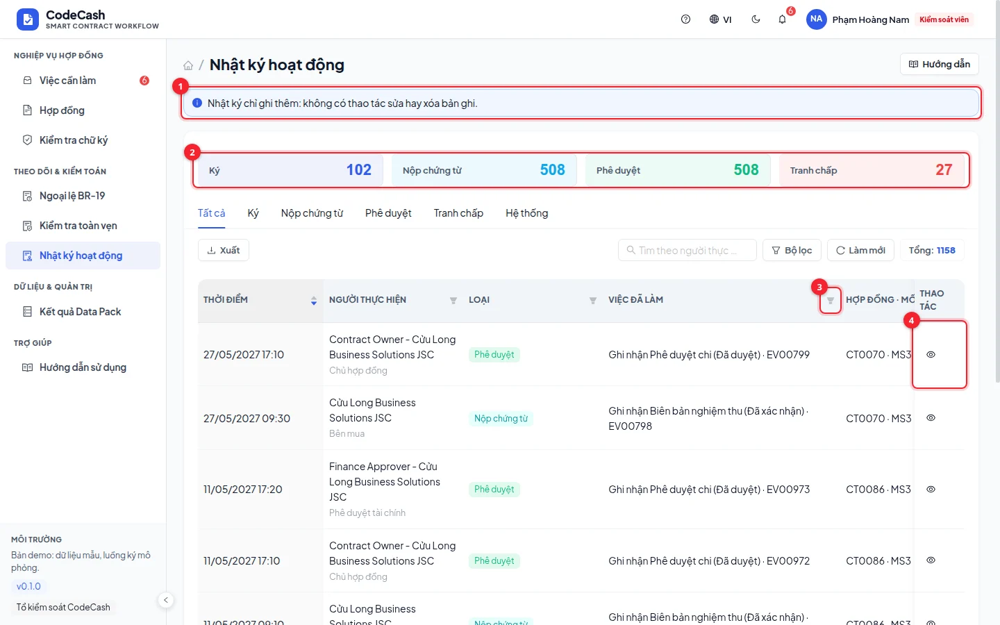

# Activity and history

Activity connects user actions, business events and status changes. Records are append-only through the application. Business users see their scope; controllers and auditors can review across organizations.

## Follow a contract

1. Open a contract and select its activity button. The log is filtered to that contract, such as CT0103.
2. Read time, actor, category, contract/milestone, description and origin.
3. Narrow results using tabs, search, filters or column filters.
4. Open row details and export CSV/JSON when needed for reconciliation.

## Distinguish record types

| Information      | Question answered                                       |
| ---------------- | ------------------------------------------------------- |
| User action      | Who submitted, approved, signed or reviewed?            |
| Business event   | Which evidence or approval was recorded by which party? |
| State transition | What changed, and under which evaluation run?           |
| Origin           | Official data, demo seed or app-created record?         |

One action can create several rows. Approval may add an APPROVAL event, run the engine and create a status transition. The number of log rows is not the number of payments.

## Reconcile CT0103 milestone 2

After finance approval, filter CT0103. Find the finance actor and new approval, then the transition from awaiting approval to payment after deduction. Compare the evaluation run and decision trace: on fresh sample data it is PENALTY, 2.22 million penalty and 737.78 million payable.

Simply reading a page does not create a payment event. If a record is missing, check contract, source and activity-type filters, then refresh.

## Export and preserve

Export respects the current query and access scope. Select relevant columns while retaining contract and milestone IDs. “All” exports all matching rows, not inaccessible organizations.

> Viewing a log entry does not prove the database was untouched. Use [Integrity](/guide/integrity) to compare hashes, with an independent anchor when whole-history replacement must be detectable.

Do not overwrite history through administration or direct imports. Business corrections require authorized new actions, preserving the original record and its resolution.
