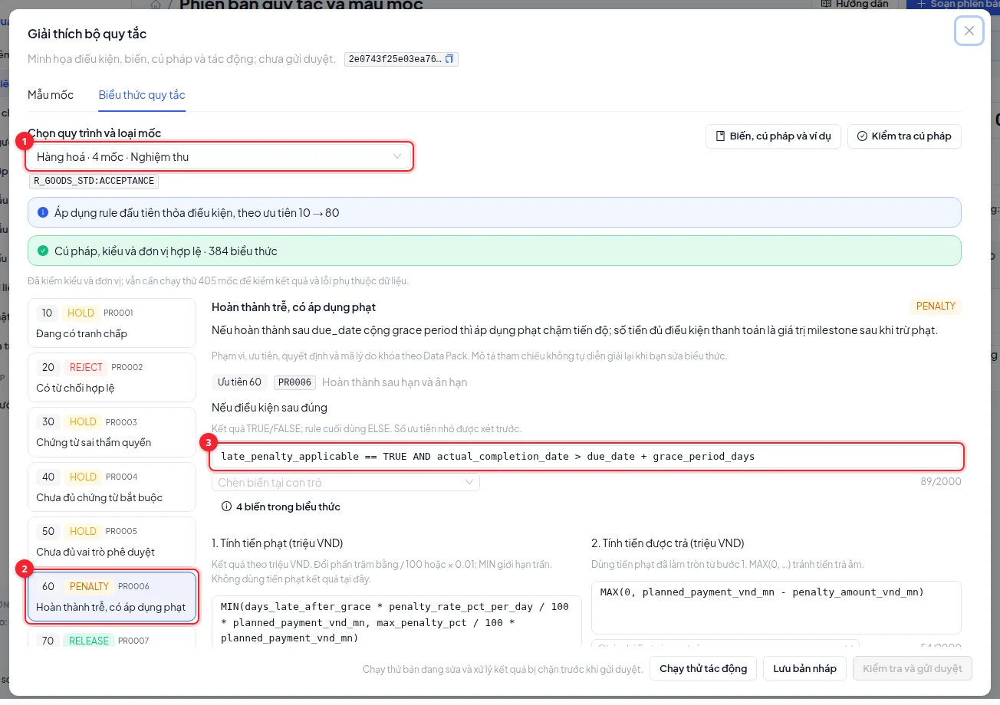
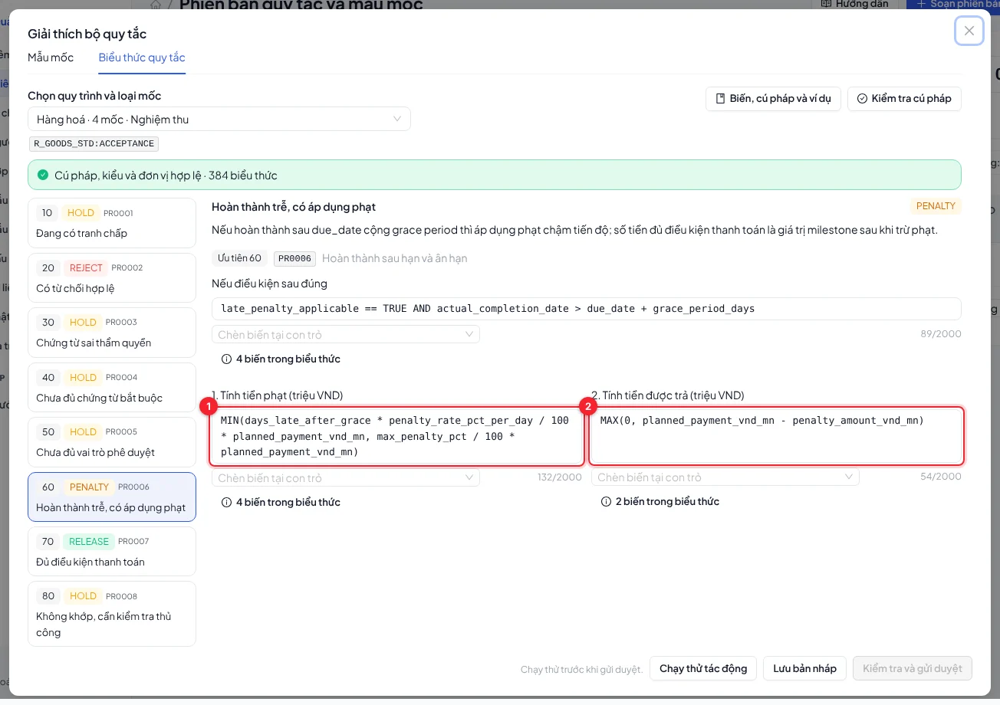
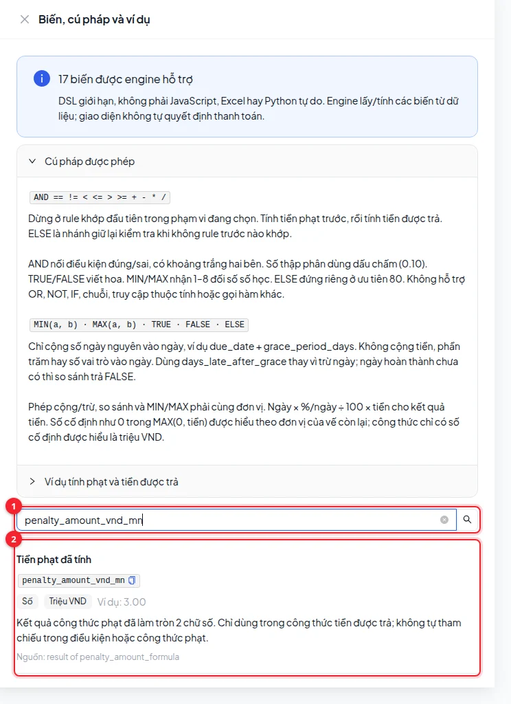
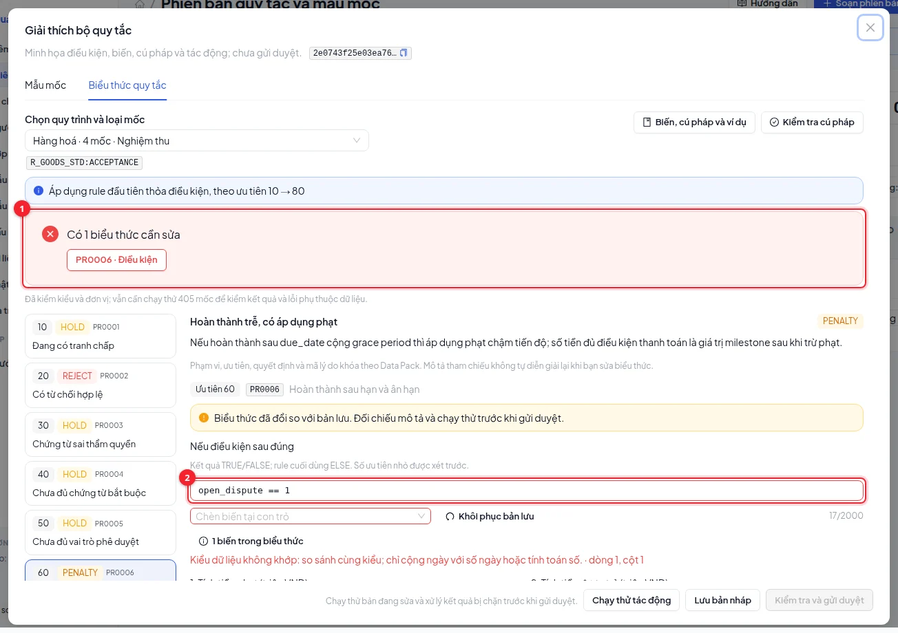
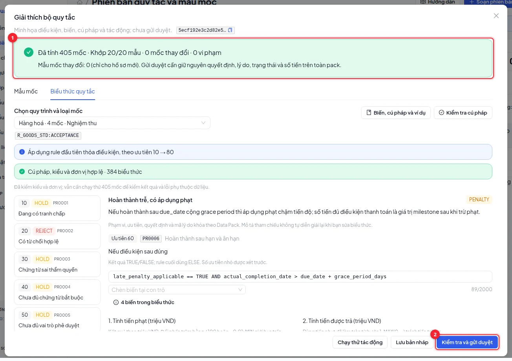

# Administration and permissions

Use `sysadmin@codecash.vn` for administration; auditors read and export. Administration is separated from exception review and payment approval.

## Choose and edit a resource

Tabs cover organizations, users, contract drafts, milestone templates, parameters, documents and administration logs. Switching tabs clears that resource's search/filter state.

Check the origin tag: official Data Pack and workflow-managed records are protected from generic edits. Change business contracts through their dedicated draft, signing, evidence or approval screens.

To add an allowed record, choose **Create**, fill required fields and references, review organization kind and role, then save and verify the new row. Use the edit icon only when enabled; protected records show a view action.

## Import resources

Download the selected resource's template, populate it and preview validation. Correct type and reference errors before importing valid rows. Check the success/failure result afterwards. Resource import differs from Data Pack evaluation upload; each has its own schema and purpose.

## Manage users

Open **Users**, use edit for permitted fields and the additional-action menu for details or password reset. Review the target before locking an account. Assign the correct organization and minimum necessary role; OPS accounts do not act as buyer payment approvers.

## Read the permission matrix

Search modules and compare which roles can view, create, import, export or invoke workflow actions. This matrix displays existing permissions; it does not offer live permission toggles.

> Decision rules and permissions are not editable through this screen. Draft-level penalty parameters flow into milestones. Arbitrary parameter rows do not automatically change the engine. Rule versions have a separate draft, preview and review flow on the rule configuration page. New integration providers require implementation and review.

`MANAGED_RECORD` means the protected record must be handled through its owning workflow. Missing write controls may mean you signed in as auditor. See [Roles](/guide/roles), [Table tools](/guide/tables) and [Exceptions](/guide/exceptions).

## Edit rule conditions and formulas

Open **Rule versions and milestone templates**, create a version with a name and reason, then use **Rule expressions**. Authors edit their own drafts; readers may inspect and preview. The engine owns payment decisions.

Choose a scope (1) and rule (2). Priorities run from 10 to 80; the first match wins. An open dispute triggers HOLD before payment or penalties. Scope, priority, decision and reason code are locked to the Data Pack. The reference description does not rewrite itself when expressions change.

Conditions return **TRUE/FALSE**, or **ELSE** in the final rule. The engine calculates and rounds penalty (1) to two decimals before making `penalty_amount_vnd_mn` available to the payable formula (2). Both amounts use **million VND**. Scroll inside the configuration dialog for the remaining controls.

Open **Variables, syntax and examples**, search (1), and inspect meaning, type, units and source (2). Insert variables at the cursor, or use the variable-count button beneath an expression to look them up. Do not invent variable names. Completion ratio `1.0` means 100%; penalty rate `0.10` means 0.10% per day, divided by 100 in formulas. Completion uses required valid business events, not the last workflow event.

**Check syntax** validates all 384 expressions. Click an issue (1) to select its rule. For example, `open_dispute == 1` compares incompatible types; use `open_dispute == TRUE` to check an open dispute. Errors show a line and column (2). **Restore saved value** restores that field only. Valid syntax and primitive types do not prove correct units or business logic.

**Preview impact** validates syntax, runs all 405 milestones, checks 20 public examples and compares decisions, reasons, statuses and amounts with the baseline. Inspect up to 30 changed milestones; any changed pack result blocks submission. Template edits affect new contracts only, without rewriting organiser milestones. Editing configuration invalidates the previous preview; preview again before submitting (2). Another administrator must publish. Matching the public examples and preserving baseline do not verify hidden ground truth.
