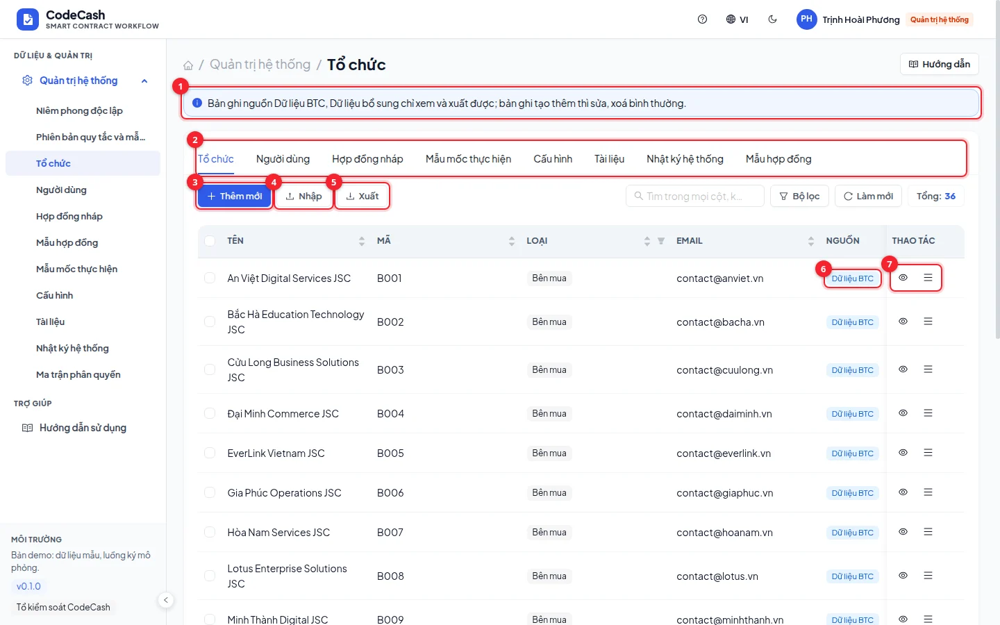
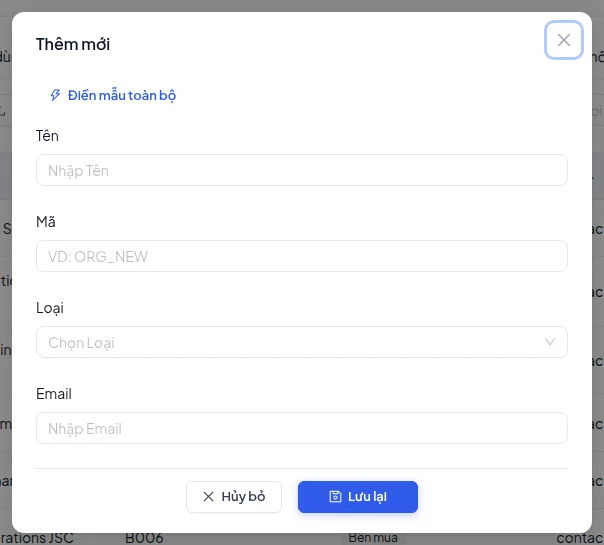
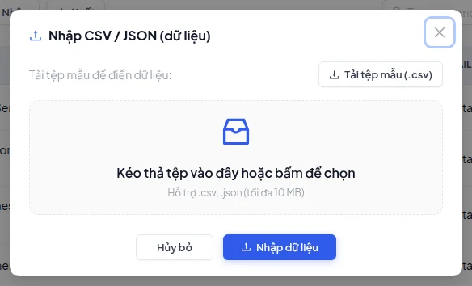
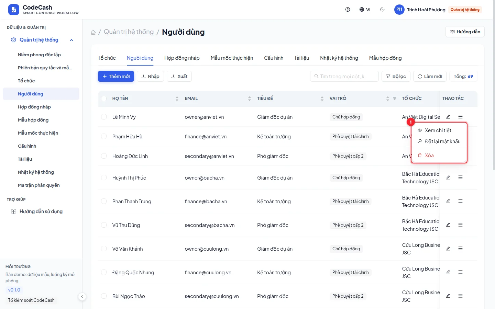
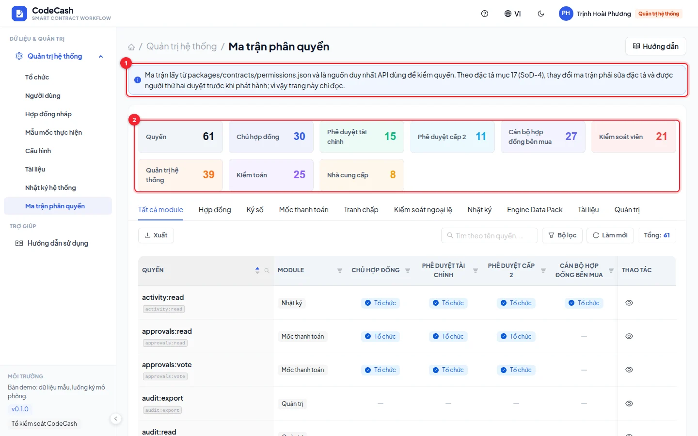
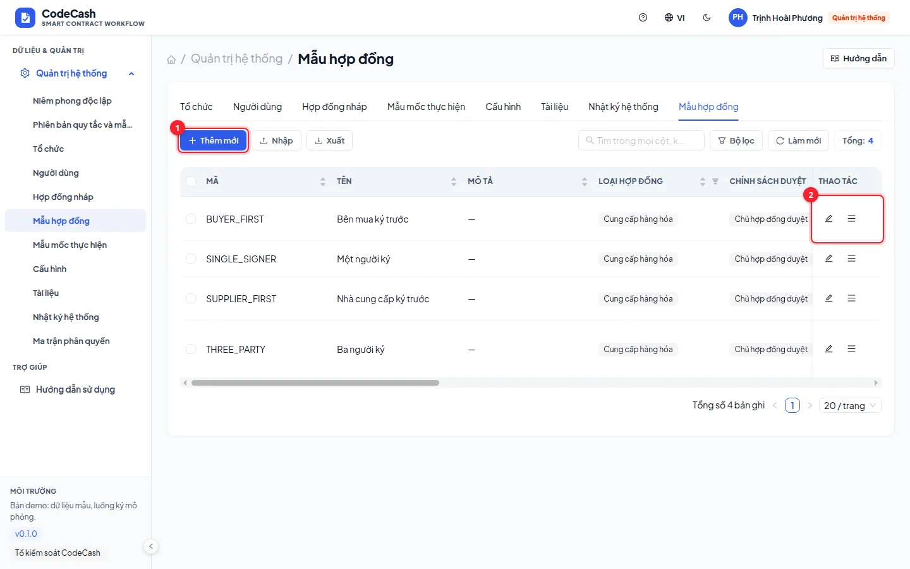
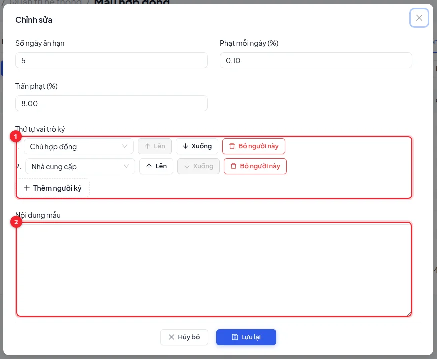

# Administration and permissions

Use `sysadmin@codecash.vn` for administration; auditors read and export. Administration is separated from exception review and payment approval.

## Choose and edit a resource

Tabs cover organizations, users, contract drafts, milestone templates, parameters, documents and administration logs. Switching tabs clears that resource's search/filter state.

Check the origin tag: official Data Pack and workflow-managed records are protected from generic edits. Change business contracts through their dedicated draft, signing, evidence or approval screens.

To add an allowed record, choose **Create**, fill required fields and references, review organization kind and role, then save and verify the new row. Use the edit icon only when enabled; protected records show a view action.

## Import resources

Download the selected resource's template, populate it and preview validation. Correct type and reference errors before importing valid rows. Check the success/failure result afterwards. Resource import differs from Data Pack evaluation upload; each has its own schema and purpose.

## Manage users

Open **Users**, use edit for permitted fields and the additional-action menu for details or password reset. Review the target before locking an account. Assign the correct organization and minimum necessary role; OPS accounts do not act as buyer payment approvers.

## Read the permission matrix

Search modules and compare which roles can view, create, import, export or invoke workflow actions. This matrix displays existing permissions; it does not offer live permission toggles.

> Decision rules and permissions are not editable through this screen. Draft-level penalty parameters flow into milestones. Arbitrary parameter rows do not automatically change the engine. Rule versions use their own draft, impact-preview and second-person publication flow. A new provider needs its own integration and verification.

`MANAGED_RECORD` means the protected record must be handled through its owning workflow. Missing write controls may mean you signed in as auditor. See [Roles](/guide/roles), [Table tools](/guide/tables) and [Exceptions](/guide/exceptions).

## Contract templates

As system administrator, open **Contract templates**. Create, edit, delete or deactivate a template; import/export use the table tools. Configure type, suggested value, approval policy, penalty, ordered signer roles and additional text. Multiple signers must cover both parties. The contract editor chooses the actual people.

Text supports fields such as `{{title}}`, `{{buyer}}`, `{{supplier}}`, `{{valueMillion}}`. Each saved draft keeps its own template version and adjustments; editing or deleting the catalog entry does not alter that draft. Deactivate a template to prevent new use.

## Sample input

Create forms start empty. The single **Fill sample data** button at the top proposes values for every empty field; review and save explicitly. It does not create accounts, change permissions, reset passwords or publish rules. References use your allowed directory. Rule publication requires zero changed outcomes across the 405-milestone baseline as well as public-label and invariant checks; this is not hidden-ground-truth validation.
