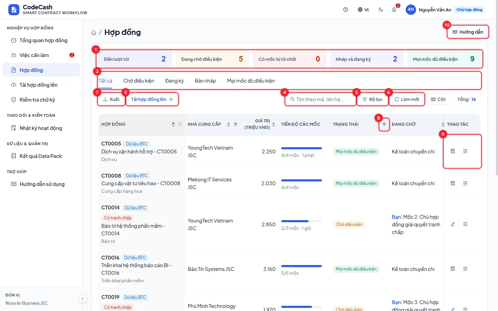
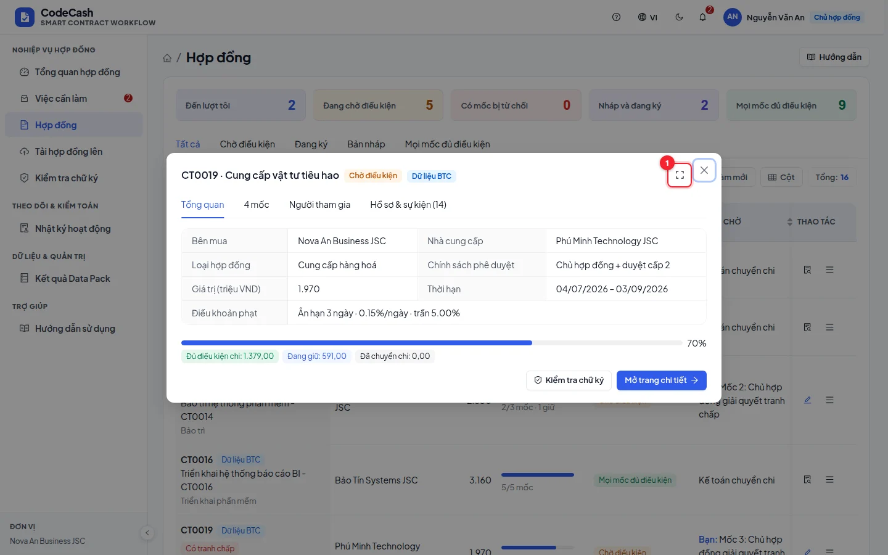
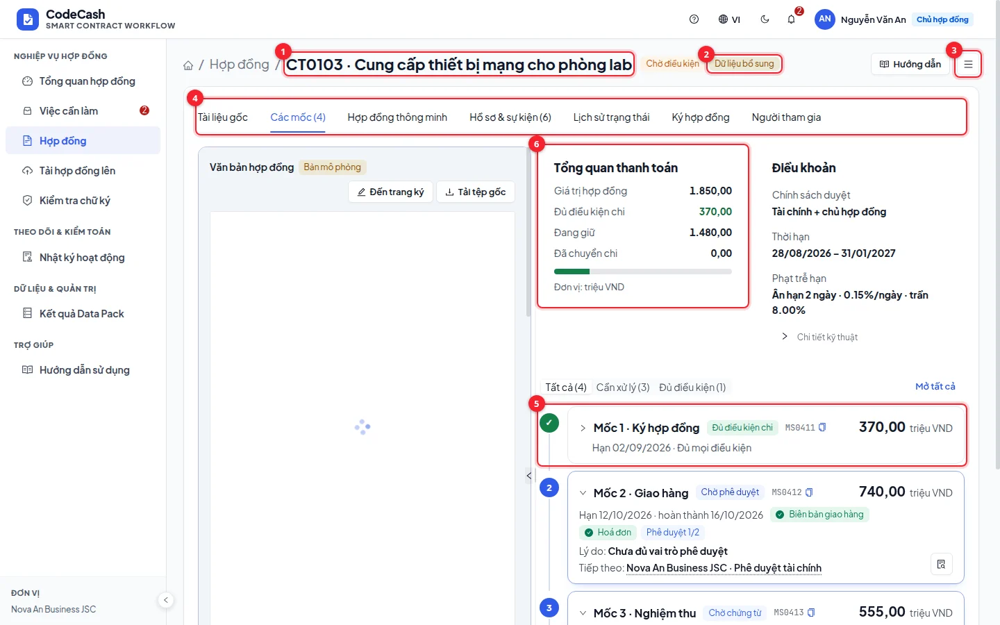
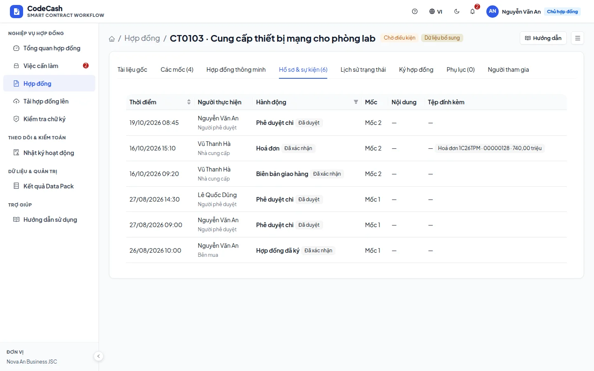
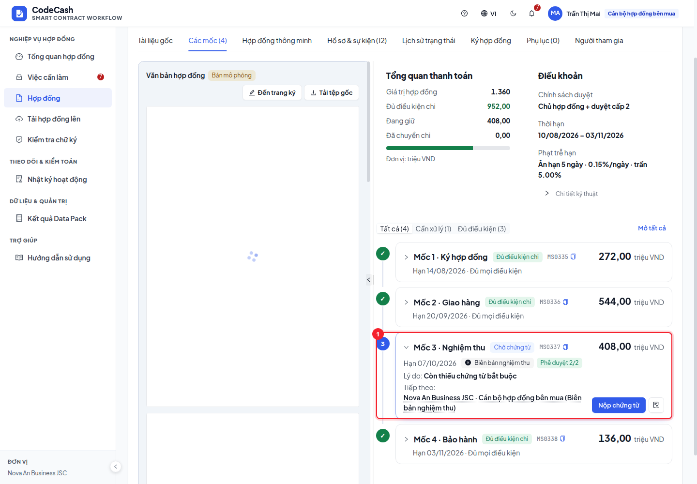
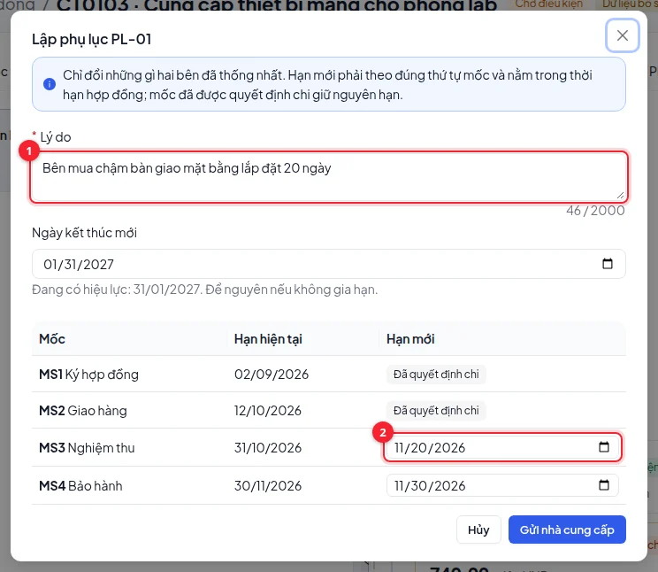
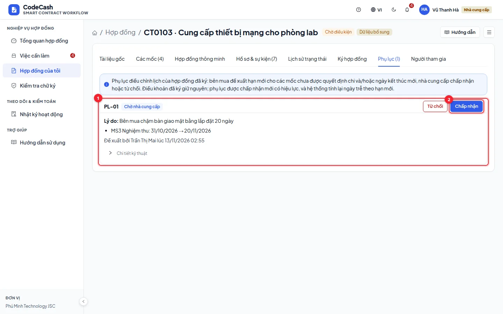
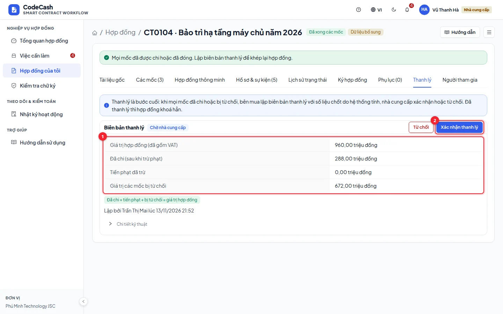

# Contract list and details

Open **Contracts** or **My contracts**. Access follows your organization. Owners and buyer contract officers can see drafts; suppliers and approvers cannot see buyer drafts. System administrators do not access contract business records.

## Find and open a record

Search a contract ID or words in its name, then narrow by statistics, tabs or column filters. Click the name for a quick view and use the full-screen control to expand it. Open the contract's detail page for milestones and workflow actions.

## Read the overview

The breadcrumb contains the ID and title. Status and origin tags distinguish official Data Pack, demo seed and app-created records. Demo records are not official answer labels.

Each milestone shows due date, required evidence, achieved/required approvals, current decision and the next action. The payment overview separates planned, eligible, penalized and transferred amounts, in million VND. Use the milestone's decision trace to understand a HOLD rather than assuming an attached file is enough.

## Explore tabs

The events tab shows event type, actor, time and origin. History connects status changes with evaluation runs. Signing shows the assigned order; participants identifies the buyer, supplier and approvers. The **☰** button beside **Guide** holds the contract activity (a log filtered to this contract) and signature verification.

## Continue according to status

Drafts need preparation, signing positions and reviewed terms. Signing contracts wait for the assigned signer. Active milestones need evidence or approvals. HOLD requires addressing its specific reason. RELEASE and PENALTY allow finance to transfer to accounting. Rejected and transferred milestones are locked.

> A visible event is not automatically valid evidence. The engine also checks authority, status, duplication, disputes and policy. Access checks remain enforced when opening a URL directly.

See [Decision trace](/guide/decision), [New contracts and signing](/guide/signing) and [Table tools](/guide/tables).

## Signed contracts can still have blocked payments

**CT0084** has a contract-signed event, but **MS0337 — Acceptance** lacks `ACCEPTANCE`. Two approvals do not replace the acceptance evidence, so that milestone is **HOLD**. The warning names the milestone and missing action. Do not mark every payment complete just because the signing view says 3/3.

**Contract owner** is a role; **Project director** is a job title. A signer may also approve payments where the policy allows it, subject to the separate conditions and quorum of each milestone. **Role/organisation: Organiser data** alongside **Demo identity** distinguishes Data Pack functions from demo personal names/emails.

## Contract amendments

After signing, the schedule changes only through an amendment. The buyer's contract officer or owner presses **Propose amendment**, gives the reason, new due dates for milestones whose payment is not decided and/or a new end date. New dates keep the milestone order and stay within the contract period.

The supplier gets a **Review amendment** task and answers on the **Amendments** tab: accepting puts the new dates in force and the milestones are evaluated again; rejecting needs a reason. The buyer may withdraw an open amendment. The signed terms are never edited, so the signatures still verify; each amendment has its own digest and every step is in the audit log. The organiser's contracts stay as given and cannot be amended.

The top of the contract page also says what needs attention: milestones without a due date, signing after the start date, an end date passed with open milestones, or every milestone settled.

## Contract liquidation

When every milestone is paid or rejected, the contract status is **All milestones settled** and the contract officer gets a **Make liquidation record** task. On the **Liquidation** tab the system computes the settled figures: value, paid net of penalties, penalties, value of rejected milestones, checked against the contract value. The supplier gets a **Confirm liquidation** task: confirming makes the contract **Liquidated** and closes it for good; rejecting needs a reason, and the buyer makes a new record once it is clarified.

