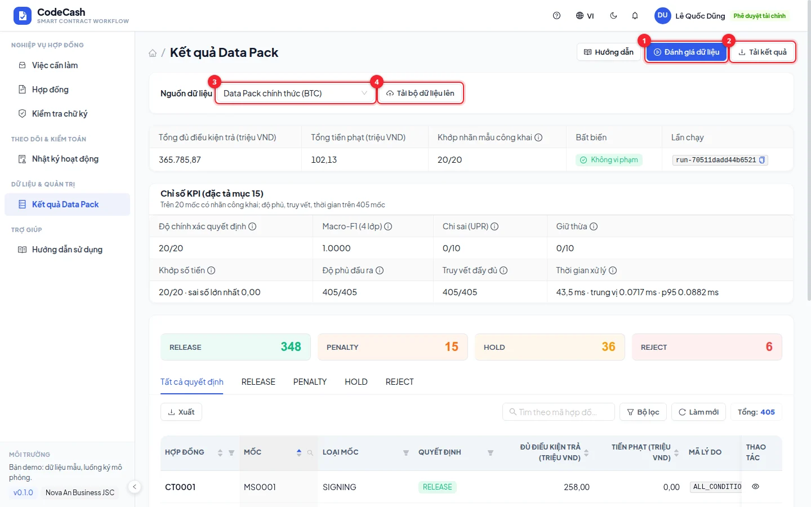
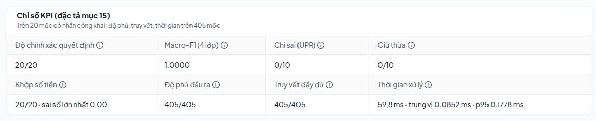
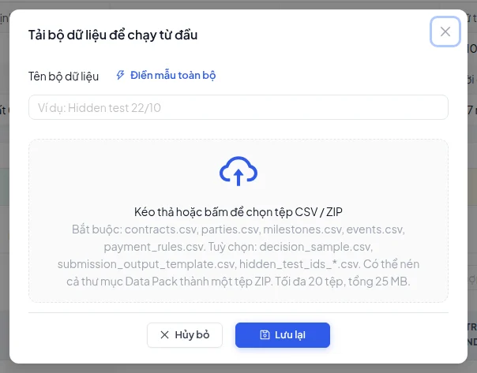
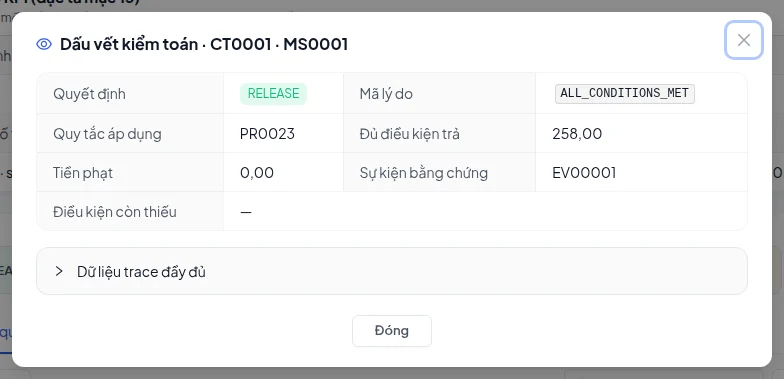

# Evaluate the Data Pack and read metrics

**Data Pack results** evaluates official data or a separately uploaded CSV/ZIP dataset. It differs from the live contract workflow containing demo and app-created events.

## Evaluate official data

Select the official dataset, evaluate if permitted, then inspect counts and results. The original pack contains 100 contracts, 405 milestones and 1,134 events. Demo seed records do not change those counts. Search a milestone and open its trace before downloading outputs.

The engine matches all 20 public labeled decisions and amounts. Wrong-release and excess-hold measures use their respective ten-case labeled groups. This does not establish accuracy on all 405 milestones or hidden tests. Without labels, missing accuracy metrics do not mean 100% accuracy.

## Upload another dataset

1. Upload supported CSV files or a ZIP.
2. Include `contracts.csv`, `parties.csv`, `milestones.csv`, `events.csv` and `payment_rules.csv`.
3. Optionally include `decision_sample.csv`, `submission_output_template.csv` and `hidden_test_ids_*.csv`.
4. Resolve missing-file, column and validation errors at the source.
5. Select the uploaded dataset, evaluate, inspect traces and download outputs.

Evaluation uploads do not overwrite the live contracts used by inbox tasks. Hidden-test ID files restrict output milestones while the engine still reads the supporting full dataset.

## Choose the output

`submission_output.csv` follows the template's 22-column order. `audit.json` contains per-milestone facts and trace. `metrics.json` contains aggregate statistics and measured metrics.

The table's export button exports its current filtered rows; the result-download menu exports evaluation artifacts. Choose the correct one before submitting.

Owners, finance and controllers can run evaluation under their permissions. Other buyer roles and auditors mainly read permitted results; suppliers have no access to this page. See [Roles](/guide/roles) and [Table tools](/guide/tables).
