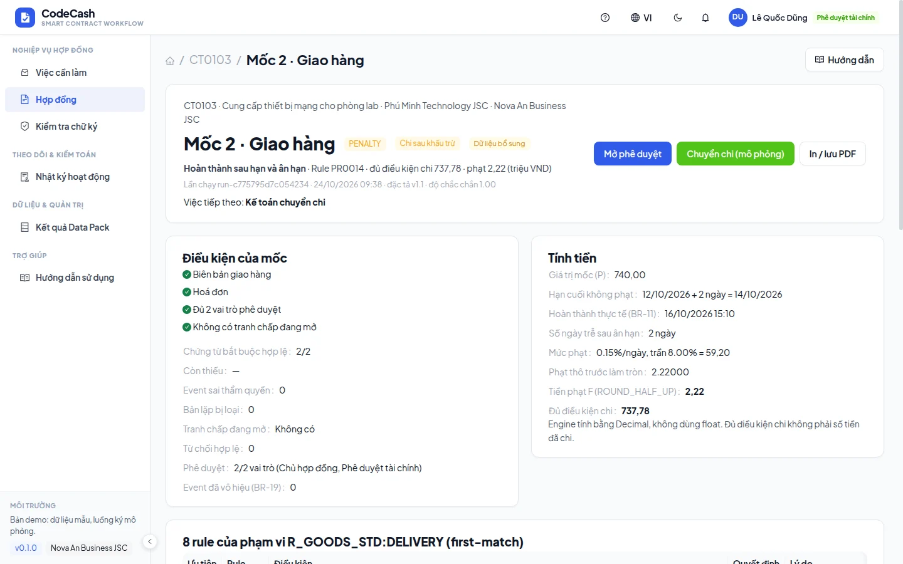
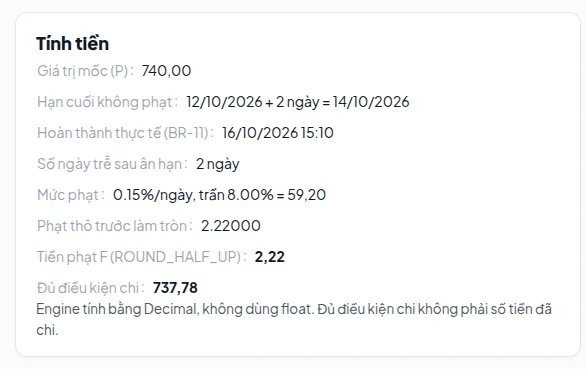
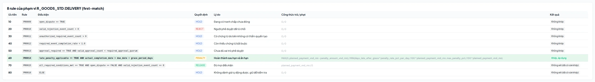
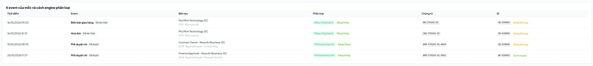
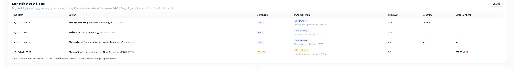
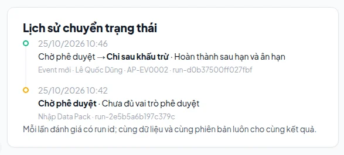
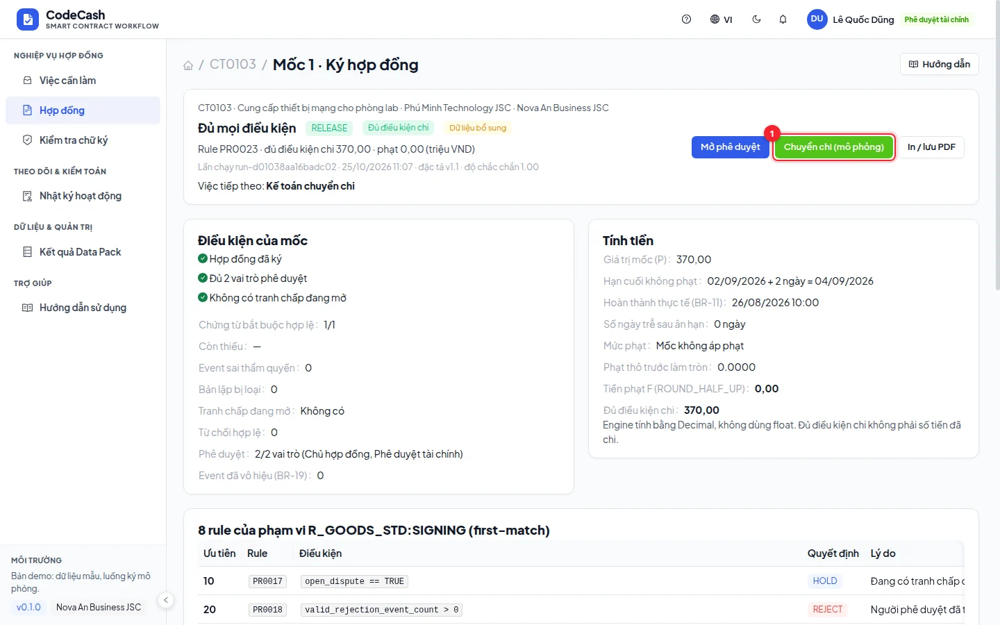

# Understand decisions and amounts

Open **Decision trace** from a milestone. This page explains the engine's stored outcome; it does not let users edit the decision or payable amount.

## Read the outcome

| Decision | Meaning                                  | Next step                          |
| -------- | ---------------------------------------- | ---------------------------------- |
| RELEASE  | All conditions met                       | Finance may transfer to accounting |
| PENALTY  | Eligible after late-completion deduction | Review calculation, then transfer  |
| HOLD     | Missing condition or blocker             | Address the displayed reason       |
| REJECT   | Valid rejection, locked outcome          | Read rejection and history         |

Check contract, milestone, reason code and matched rule. HOLD for missing evidence needs a different action from HOLD for an open dispute.

## Reconcile the amount

Read planned amount, due date, grace, completion date, late days, daily rate and cap. For CT0103 milestone 2: 740.00 million planned, due 12 October 2026, two grace days and completion on 16 October. Two late days give `740 × 0.15% × 2 = 2.22`; payable is 737.78 million. Rounding is HALF_UP to 0.01 million.

Completion comes from valid required evidence, not simply the latest event or the approval date.

## Rules, evidence and replay

Priorities 10–80 check open disputes, rejection, unauthorized events, missing events, approval quorum, lateness, full eligibility and fallback. The engine stops at the first match. “Not evaluated” means later in that order, not necessarily false.

Evidence is classified as valid, unauthorized, voided or otherwise excluded. Open the timeline replay to see the outcome after each historical event. Replay explains earlier conditions without restoring old data.

## Accounting transfer

Finance can transfer RELEASE or PENALTY milestones once. The action creates a transfer record and locks the milestone; it does not execute a bank payment.

For unauthorized events use [BR-19](/guide/exceptions); for disputes use [Dispute handling](/guide/dispute). Neither bypasses other missing conditions.
