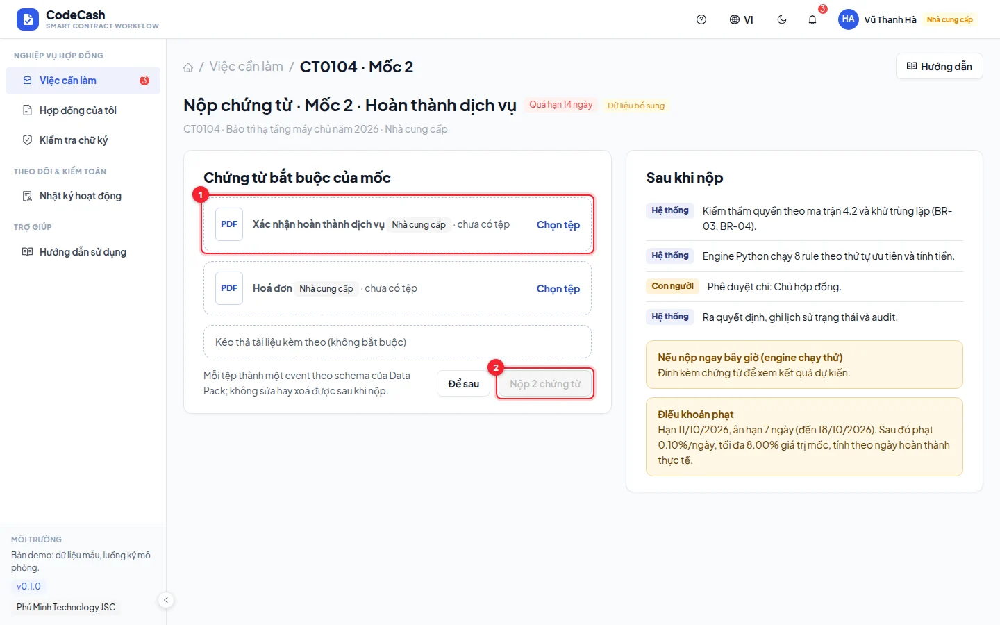
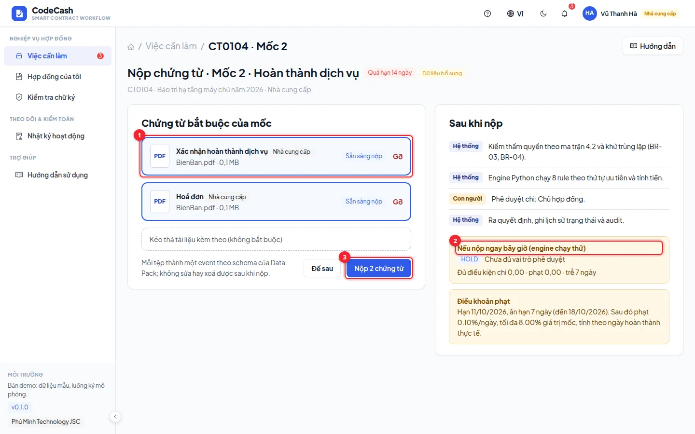

# Submit evidence

Buyer contract officers and suppliers submit evidence from their assigned tasks. Every slot corresponds to a required event type for their side of the contract.

## Prepare and submit

1. Verify contract, milestone, due date and required types.
2. Upload the correct file into each pending slot. Wait for upload completion and check the displayed filename.
3. Read existing evidence to avoid duplicates.
4. Review **If submitted now**. The preview can still show HOLD if approvals or another condition remain missing.
5. When enabled, submit and wait for success and re-evaluation.

The buyer's officer submits acceptance, UAT and other buyer records. Suppliers submit delivery, invoices, go-live, activation, service completion and warranty completion. Identity and authority come from the authenticated account; a supplier cannot record buyer acceptance.

## Try CT0104 milestone 2

Use `supplier@phuminh.vn`. Upload service-completion evidence and an invoice, then submit. The owner receives the approval task. On fresh data with submission on 23 October 2026, the milestone is five days past its grace deadline; after owner approval, the penalty is 2.40 million and payable is 477.60 million. Later submission dates change these figures.

## Resolve submission problems

A disabled button may mean files are missing or still uploading. An absent type may belong to the other side. A rejected or transferred milestone is locked. A permission error may mean the account belongs to another organization.

> Uploading a file does not grant approval, close a dispute or void an unauthorized event. A successful submission can legitimately leave the milestone on HOLD.

App submissions receive an app-origin tag and an activity record. Return to the inbox to check the handoff. Read [Decision trace](/guide/decision) when the new outcome is unclear and [Roles](/guide/roles) when the evidence type is unavailable.
