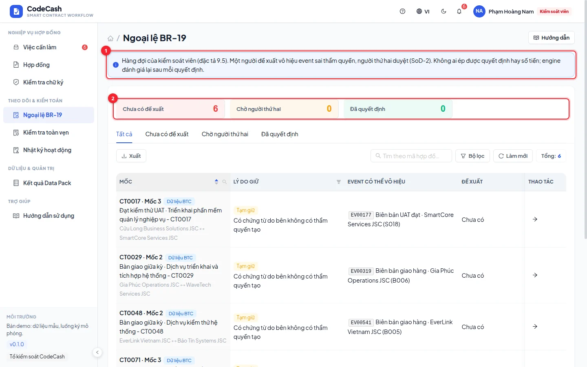
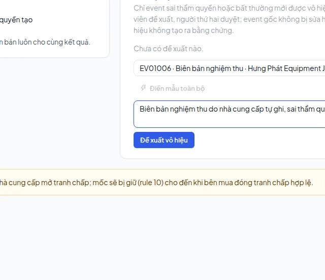
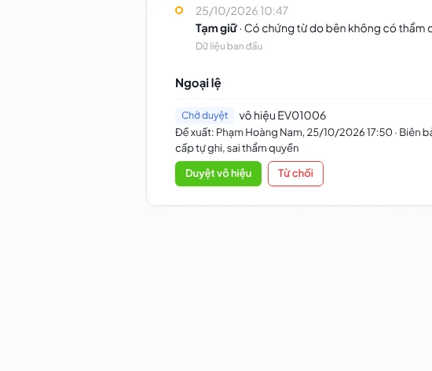

# BR-19 unauthorized-event exceptions

Controllers process exceptions; auditors read them. System administrators cannot review business exceptions. Two different controllers are required.

## Inspect before proposing

Find the contract and milestone in **BR-19 exceptions**, then open its decision. Inspect the original event and the engine's classification. CT0090 milestone 3 contains acceptance event EV01006 issued by the supplier, although acceptance belongs to the buyer; its outcome is HOLD with `UNAUTHORIZED_EVENT`.

## First controller proposes

1. Use `admin@codecash.vn` and open CT0090 milestone 3.
2. Select EV01006 in the BR-19 section.
3. Explain the event type, actual issuing side and authorized side.
4. Submit and check the pending exception ID.

A valid event cannot be voided merely because its outcome is inconvenient. Self-approval is blocked with `SECOND_CONTROLLER_REQUIRED`.

## Second controller decides

Sign out and use `controller@codecash.vn`. Open the same milestone or assigned review task, inspect the proposer, original event and reason, then approve voiding or reject the proposal. Approval triggers re-evaluation.

The original event remains in history and is marked voided. The example changes from HOLD for unauthorized evidence to HOLD for missing valid acceptance. It does not automatically release payment or fabricate buyer evidence.

The buyer's real officer must continue: `legal@cuulong.vn` for this contract, not the Nova An officer. Once valid acceptance is submitted, remaining rules and lateness apply.

> Controllers cannot edit decisions or payable amounts. BR-19 changes the treatment of an abnormal event, while the engine still calculates the outcome.

If no action is available, check role and proposal status. An auditor should have read-only access. See [Roles](/guide/roles), [Decisions](/guide/decision) and [Activity](/guide/activity).
