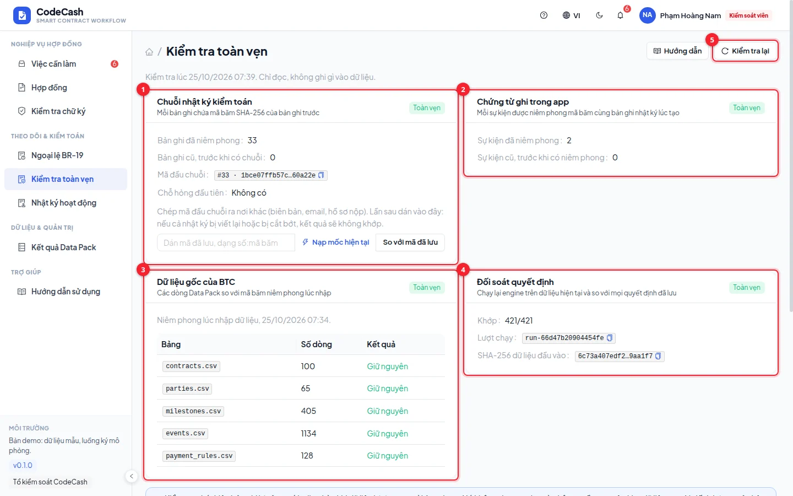

# Check data integrity

Controllers and auditors use **Integrity** to compare stored records with sealed hashes. Interpret each verdict within the data it checks.

## Run the four checks

1. Select **Check again**, wait and note the check time.
2. **Audit chain** checks sequence, previous-hash links and entry content.
3. **App evidence** compares business-event records with hashes sealed when they were created. It does not establish legal signature validity or independently verify every PDF's contents.
4. **Official Data Pack** compares source rows with the import seal.
5. **Decision reconciliation** runs the engine and compares stored outcomes, accounting for locked milestones.

## Compare an independently saved anchor

Save a sequence number and its head hash somewhere independent of the application database. Enter that pair during a later check.

| Result    | Meaning                                                      |
| --------- | ------------------------------------------------------------ |
| MATCH     | The entry at that sequence matches the saved hash            |
| MISMATCH  | The entry exists but its hash differs                        |
| NOT_FOUND | The saved sequence is absent, or this is another environment |

New actions change the current head. Compare the saved hash at its original sequence, rather than comparing it directly to a later head.

## Investigate a mismatch

Record environment, time, failed section, sequence and event IDs. Export related activity and compare with independent anchors or backups. Preserve the evidence before recovery; do not edit records just to make the page green.

> A party able to replace the entire database and recompute the chain can make it internally consistent. Without an independently saved anchor, the check cannot prove history was never rewritten. The demo does not publish hashes to a blockchain or timestamp authority.

Integrity also does not prove a business document describes a real-world event. Authority and business evidence still need review. See [Activity](/guide/activity), [Exceptions](/guide/exceptions) and [Signature limitations](/guide/signing).
