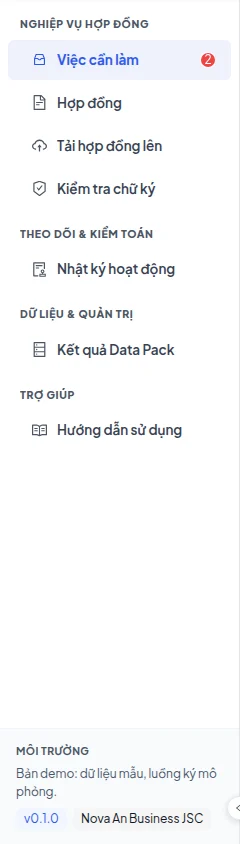
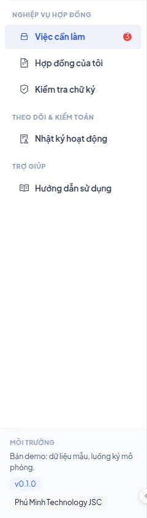
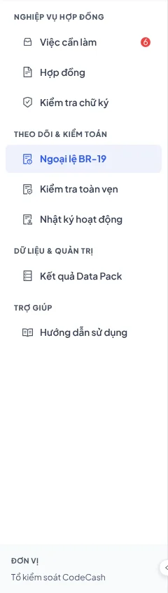
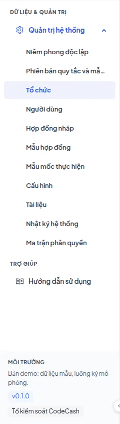
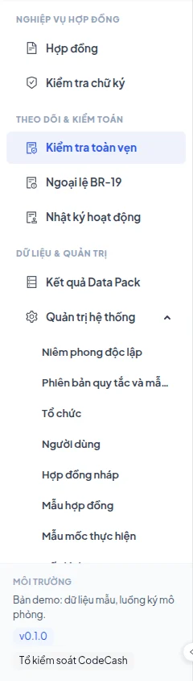

# Roles, access and demo scenarios

Access depends on the authenticated person, organization and role. Switching accounts demonstrates handoffs between people. There are eight roles; the two controllers are separate people with the same role.

| Demo email               | Role                     | First scenario                                                 |
| ------------------------ | ------------------------ | -------------------------------------------------------------- |
| `owner@novaan.vn`        | Contract owner           | Resolve CT0019 milestone 3; approve according to policy        |
| `finance@novaan.vn`      | Finance approver         | Approve CT0103 milestone 2; transfer milestone 1 to accounting |
| `secondary@novaan.vn`    | Secondary approver       | Sign CT0102 after the supplier; provide required approvals     |
| `legal@novaan.vn`        | Buyer's contract officer | Complete CT0101; submit CT0084 milestone 3 acceptance          |
| `supplier@phuminh.vn`    | Supplier                 | Submit CT0104 milestone 2 evidence; sign CT0102                |
| `admin@codecash.vn`      | Controller               | Propose voiding an unauthorized CT0090 event                   |
| `controller@codecash.vn` | Second controller        | Review the other controller's proposal                         |
| `sysadmin@codecash.vn`   | System administrator     | Manage users, organizations and permitted configuration        |
| `auditor@codecash.vn`    | Auditor                  | Read records, export and check integrity                       |

## Business access

Buyer's users see their organization's contracts. Only the owner and contract officer see drafts. Suppliers see contracts they participate in, excluding buyer drafts. Opening another organization's contract ID does not grant access.

The contract officer submits buyer evidence such as acceptance and UAT. The supplier submits delivery, invoices and service completion. Approvers provide the roles required by the contract policy. Signing assignments are separate from payment approval roles.

## Internal roles

Controllers review exceptions across organizations but cannot approve payments or manage accounts. System administrators manage configuration and accounts but cannot process exceptions or contract business actions. Auditors read and export; they cannot write business records or run a new stored evaluation.

## Four different actions

Signing activates the contract after the final assigned signer. Evidence submission adds a required business event. Approval adds an authorized approval role. Accounting transfer records a handoff for an eligible milestone and locks it. None substitutes for the others.

> An exception needs two different controllers. The proposer cannot approve their own proposal. If an action is unavailable, check role, organization and signing turn before changing configuration.

For a handoff, submit CT0104 evidence as supplier, approve as owner, then inspect the decision as finance. Actual submission dates affect lateness and penalties.
