# Prepare, review and sign a contract

The flow is **Upload → Signature positions → Terms review → Signing → Effective**. Owners and buyer contract officers prepare it; assigned signers act in order.

## Prepare the draft

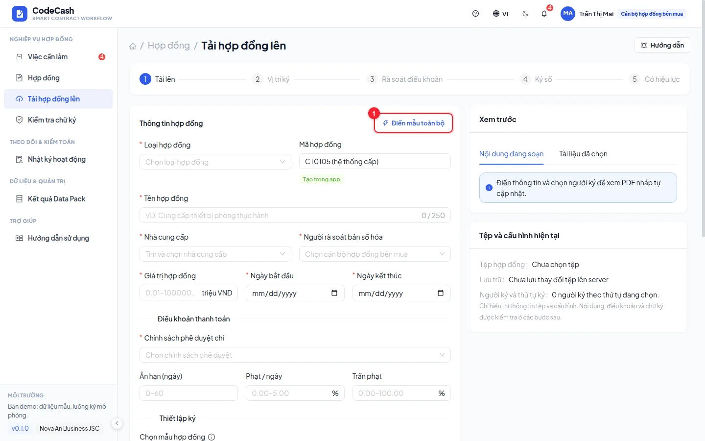

Enter title, parties, contract type, value in million VND and dates. Select approval policy, grace days, daily penalty rate and cap. These values flow into generated milestones with penalties enabled. Upload the document and wait for completion.

Choose one to four signers. A single signer completes the configured signing flow; two or more signers must include both parties. Presets help arrange order but still require review. Signing roles and payment-approval roles are separate.

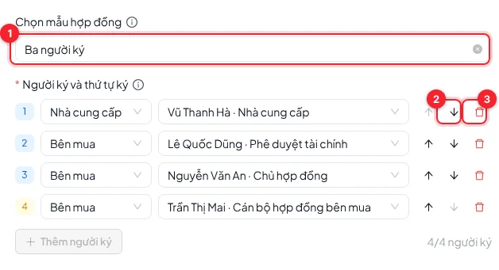

## Position signatures and review terms

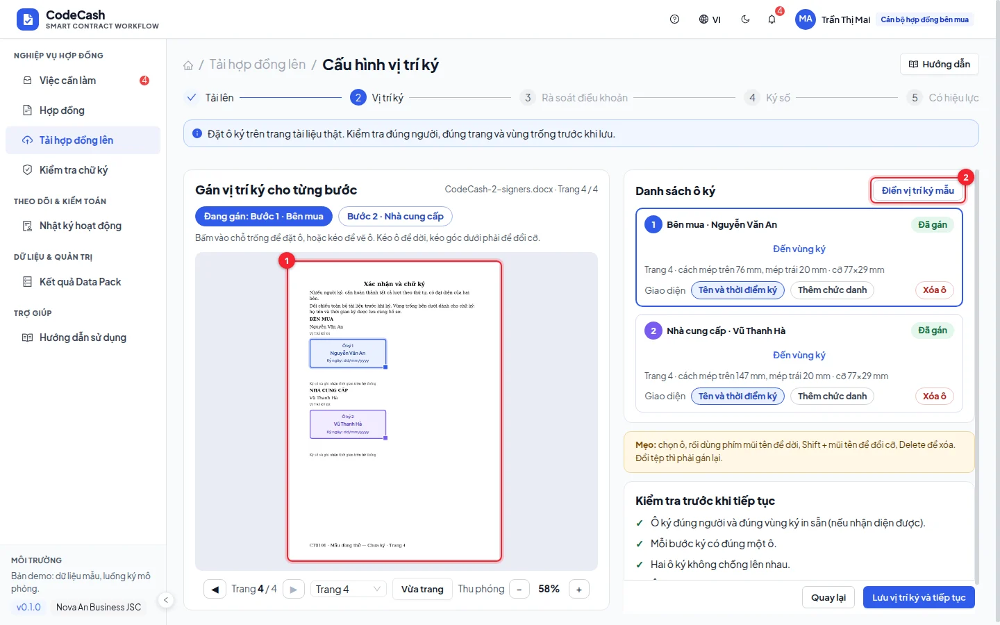

The background displays the actual uploaded PDF pages. Suggest signature areas, then review every signer, page and rectangle. Move or resize boxes; the server rejects page overflow, detected-text coverage and overlapping signatures. Save, then review milestone amounts, percentages, evidence types, approvals, penalties and dates. A relative warranty term needs an explicit confirmed deadline.

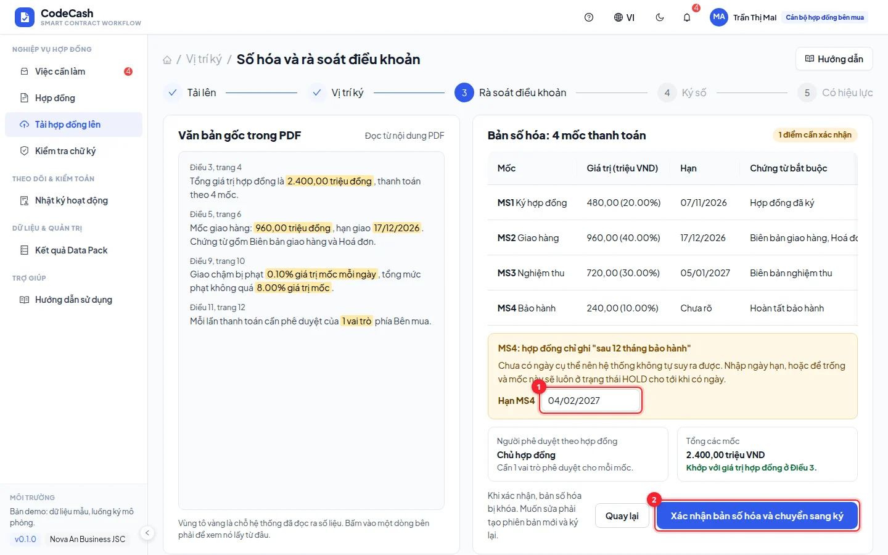

> When Gemini is enabled, the API sends the rendered PDF to Google and suggests six terms with page quotations. Quotes are checked against text on the claimed page; values still require human review. Scan quotations require manual checking. Local mode extracts text without AI. Milestone templates still come from the Data Pack. Placement uses actual PDF page coordinates; simulated signatures remain detached proofs rather than embedded PAdES signatures.

Confirmation creates milestones, locks terms and starts signing. The final milestone absorbs rounding remainder so amounts add to the contract value. An unresolved structural gap can leave a milestone on HOLD.

## Sign in order

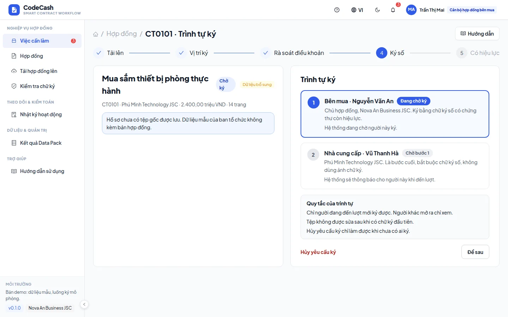

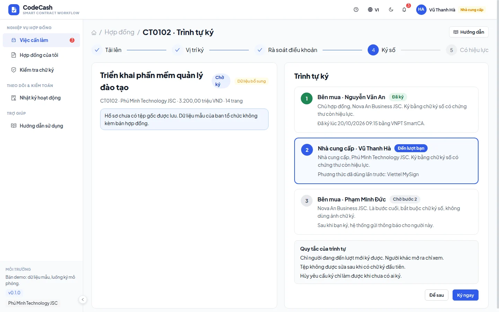

Sign in as the current signer, read the document, choose a method and complete the simulated confirmation. The final step requires a digital-signature method rather than only an image. Completion advances the next turn; final completion activates the contract and records `CONTRACT_SIGNED` for the buyer.

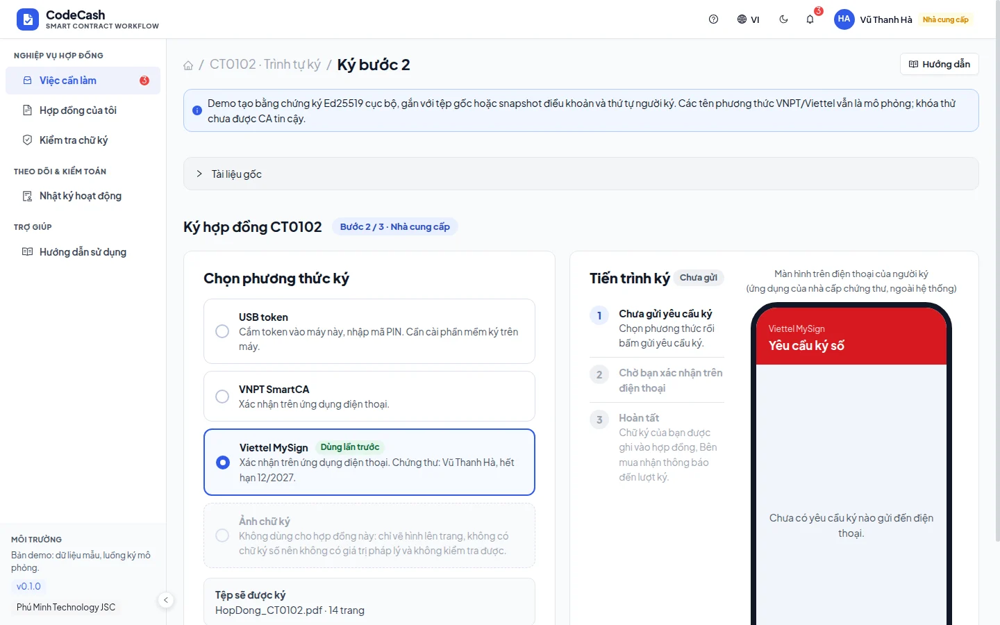

Try CT0102 as supplier, then secondary approver. Attempts before your turn are blocked. Workflow cancellation belongs to the draft manager and requires reviewing its confirmation.

## Verify recorded signatures

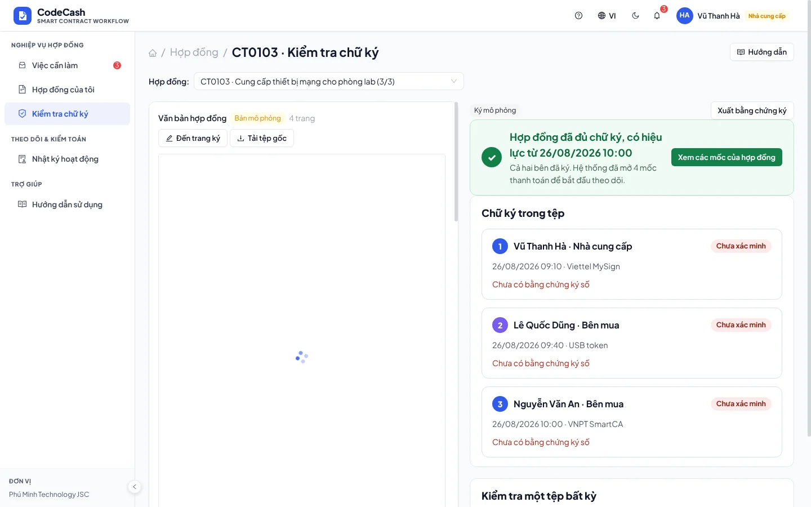

Compare signer, method, time and effective date. External PDF structural detection is reported as unverified.

> Provider signing and internal signature results are simulated. The app has no live CA, OCSP/CRL or cryptographic PDF verification. A demo “valid” result is not evidence of a real verified digital signature.

## Preview the actual document

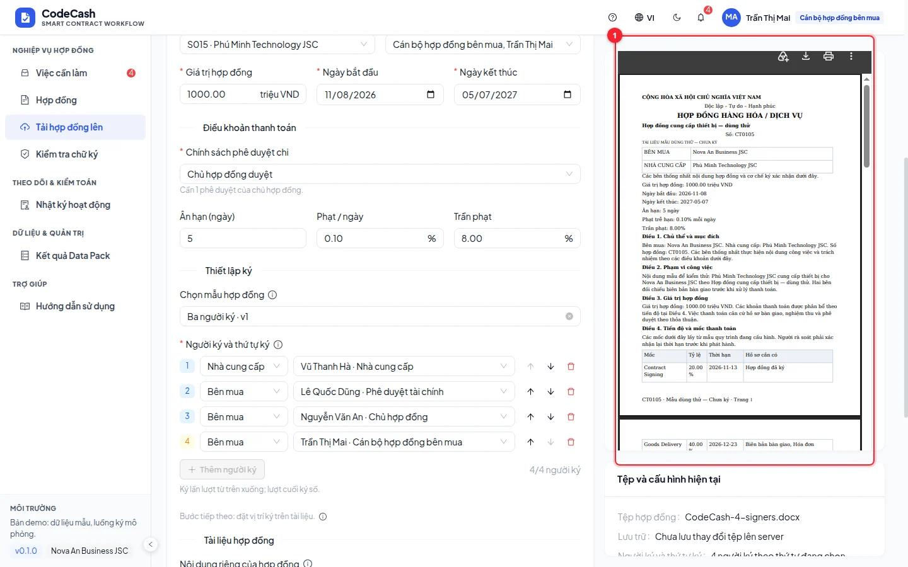

1. Select a PDF/DOCX or generate a sample. The preview displays an actual PDF; DOCX files are converted to PDF rather than illustrated.
2. Scroll or change pages inside the viewer; download the preview PDF to compare it. Rendering does not change the original bytes or hash.
3. After saving, open contract details → **Original documents** to view the stored file. Organiser records without attachments show a missing-file message.

## Use a managed template

Select a template in the upload form, then adjust terms, signer count/order and additional text for this contract. **Generate sample contract** produces a real DOCX. If you edit those fields afterwards, regenerate or upload a replacement before continuing. Saved drafts preserve the applied template version even if an administrator edits or deletes it.

Original files can be opened during review, signing and contract details. The current file appears before previous uploads; download the original separately from the rendered preview PDF. Extraction requires explicit review, including manual checks for scans. Review the actual signature placement before consent. Embedded PAdES signing is not connected. Local signing creates actual Ed25519 proofs with test keys; VNPT/Viettel method flows remain simulated.

## Quick input stays under your control

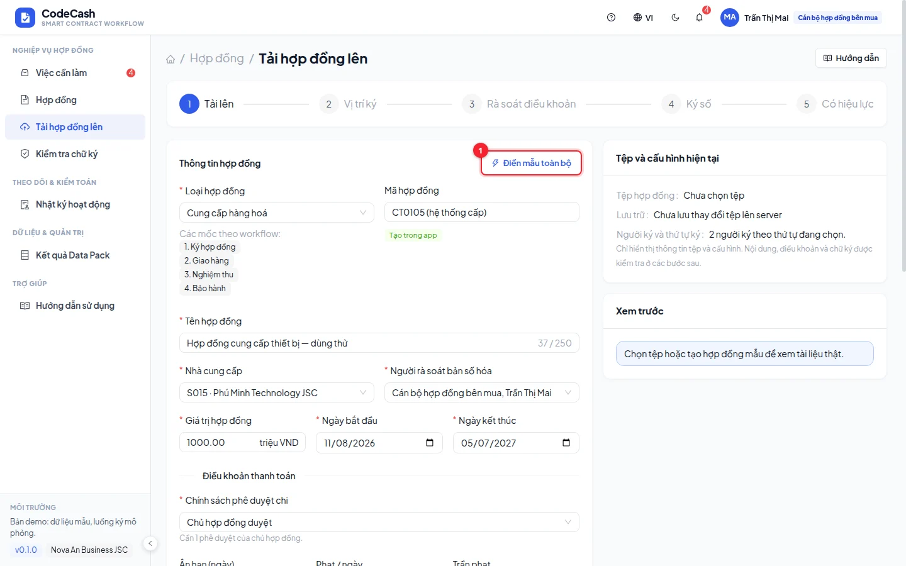

New upload forms start empty; generated IDs and system fields remain read-only. Use the single **Fill sample data** button at the top to fill every empty field, including unselected signers. Existing text, zero and false values stay unchanged; the action does not save or submit. Use the up/down arrows directly on each signer row to reorder it, or the red trash link button to remove it. Hover or focus a button to read its tooltip. Signing order runs from top to bottom. Completing an existing draft preserves its stored data.

**Load suggestions** uses values actually extracted from the file for review. Unconfirmed dates and new signature positions also start empty and have explicit suggestion/sample actions.

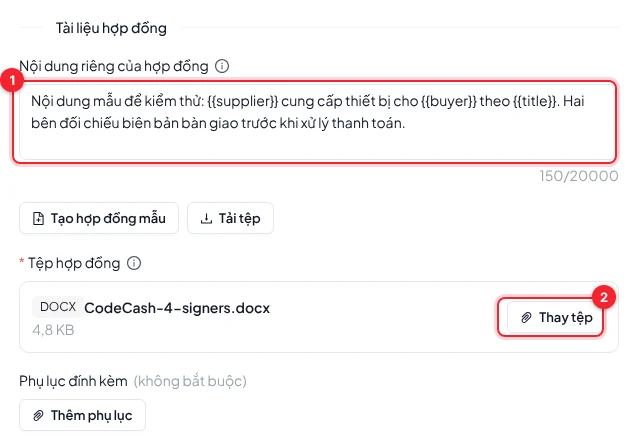

## Download demo files and preview current input

Expand **Instructions and signer accounts** below the download buttons to check the supplier, names and emails before configuring the signers.

Open **Guide** on the page or the header help button. Download one of the 1–4 signer PDFs or the PDF/DOCX ZIP. These files are **unsigned** and intended for upload/signing demos. Select supplier **S015 — Phú Minh** and use the first N names: Nguyễn Văn An, Vũ Thanh Hà, Lê Quốc Dũng, Trần Thị Mai. Find the accounts by name/email in **Demo accounts**.

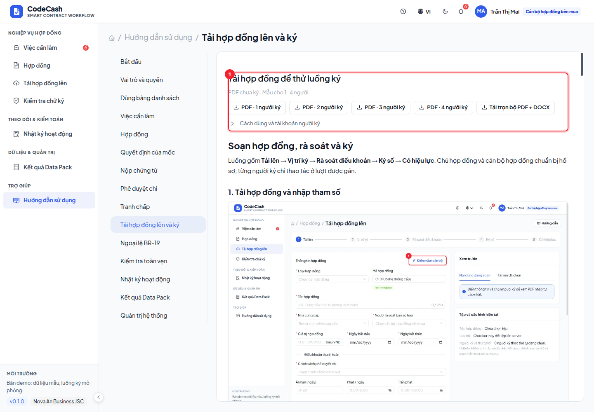

The right panel has two tabs: **Working draft** is an actual PDF updated from valid form input; **Selected document** is the file that will be uploaded and signed. Form changes do not modify that file. Generate and use the sample or upload a revised document to change the signing file.

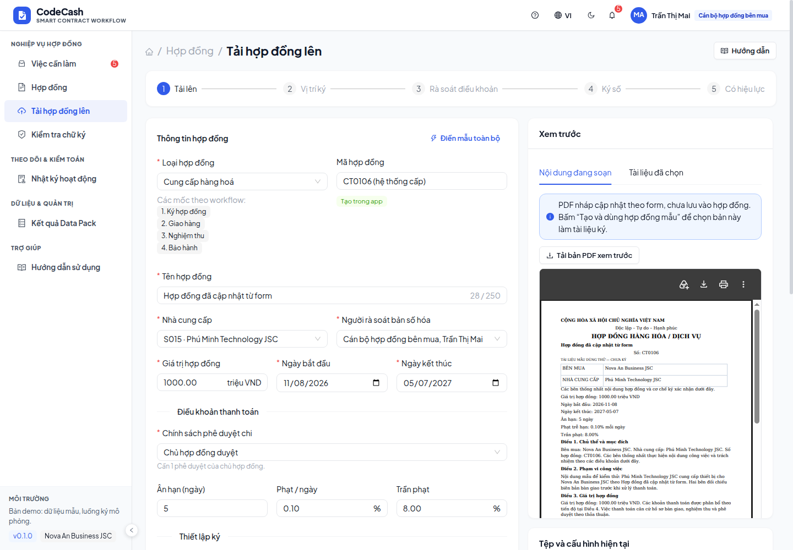

## Match the printed signer and area

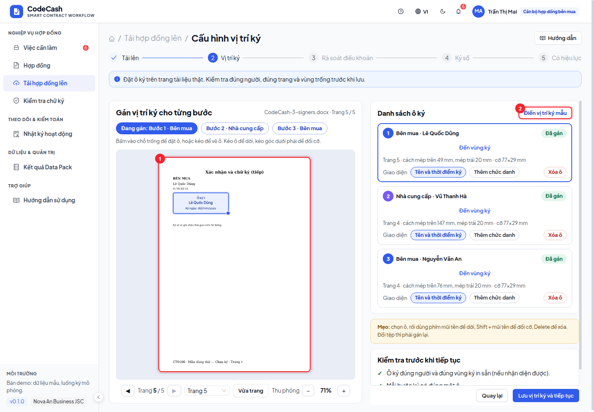

Suggestions match detectable printed names and parties rather than blindly using the box number. Select a signer or **Go to signing area** to open the right page. **Fit page** shows the full page; zoom in for detailed placement. The document and signer list scroll independently.

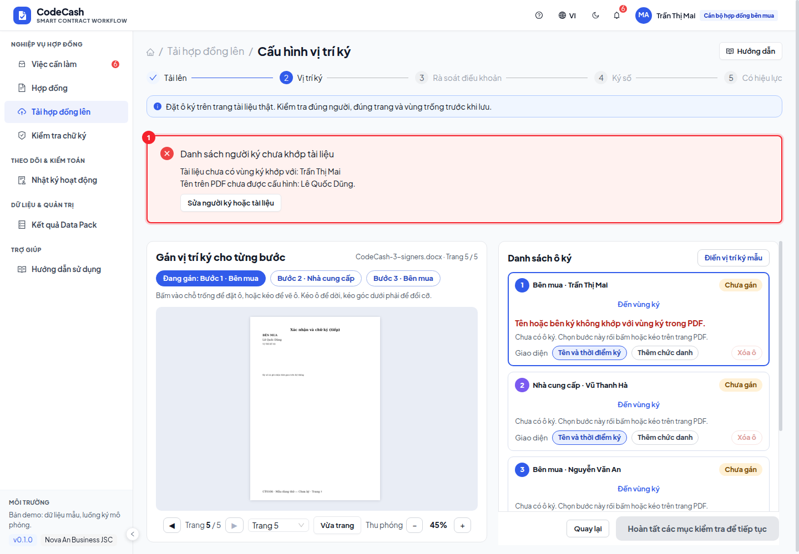

Correct the signer list or regenerate the file if a configured signer is absent or a printed signer is missing from the configuration. Do not place one person below another person's printed name. Documents without identifiable names/parties require manual checking; coordinate checks alone do not verify identity. Review the document's signing-order clause too; regenerate a generated sample after changing its order.
