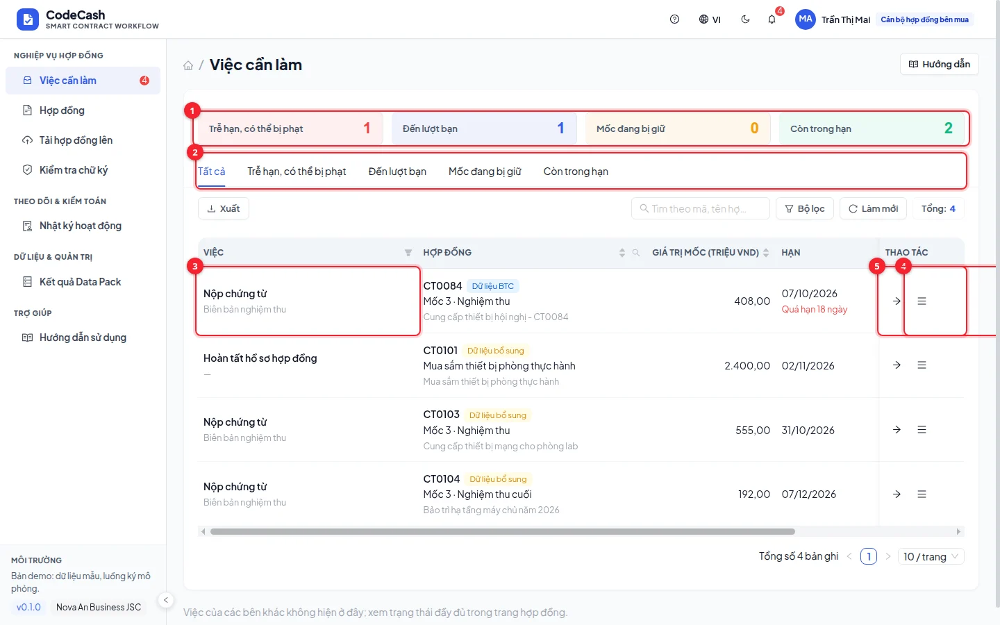
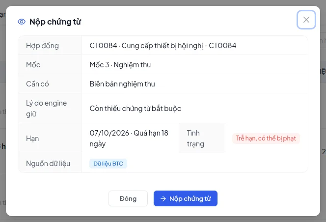
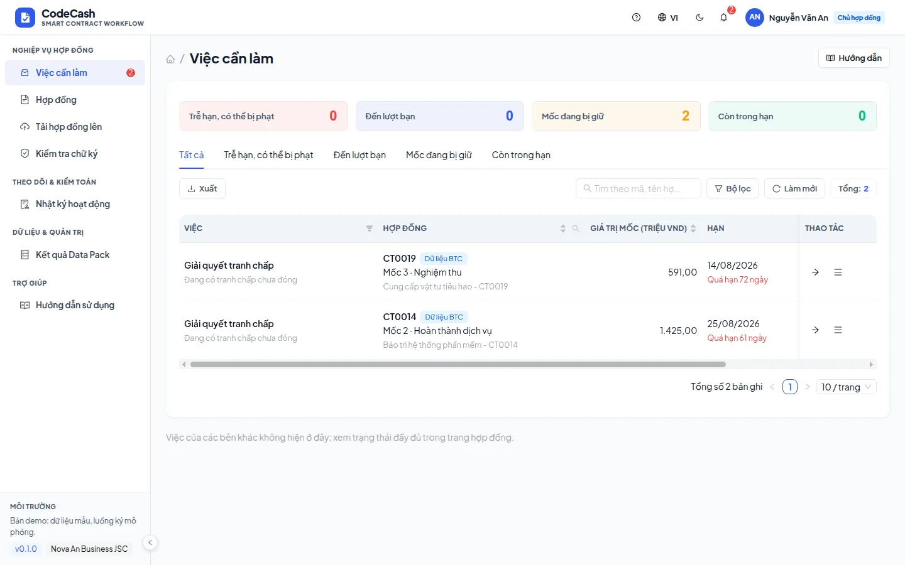
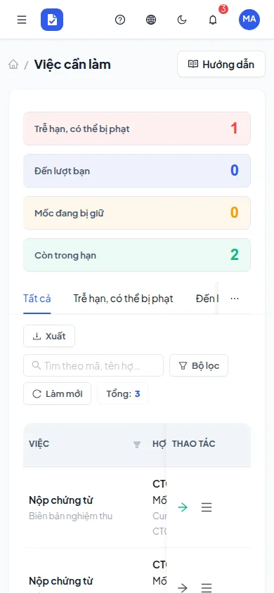

# Task inbox

The inbox shows actions assigned to your current role and organization. Tasks come from contract status, missing conditions and signing order; they are not every task in the organization.

## Open the right action

1. Read the task type, contract ID and milestone number.
2. Check its due date, urgency and explanation. “Overdue, penalty possible” is a warning; the engine calculates the eventual decision.
3. Click the record for a quick view or use its row action to open the workflow.
4. Complete the action, return to the inbox and refresh. A completed task disappears; a different person may receive the next task.

| Task             | Check first                          | What happens next                      |
| ---------------- | ------------------------------------ | -------------------------------------- |
| Submit evidence  | Correct type, issuing side and files | Re-evaluation may assign approval      |
| Approve payment  | Evidence, required role and preview  | Adds your role's approval              |
| Sign contract    | Assigned signer and current turn     | Advances signing order                 |
| Resolve dispute  | Open case and resolution notes       | Removes that dispute blocker           |
| Complete draft   | File, signing positions and terms    | Creates milestones and starts signing  |
| Review exception | Event authority and proposer         | Requires another controller's decision |

## Try each role

Finance has CT0103 milestone 2 approval. The buyer's officer has CT0101 preparation and CT0084 acceptance. The supplier has CT0104 evidence and CT0102 signing. The owner has the CT0019 dispute.

If a task is missing, clear filters, refresh and verify the account. It may be complete, belong to another organization or require another person's turn. Secondary approvers receive tasks only when required by policy; auditors do not receive business write tasks.

The notification bell opens tasks within your scope. Continue with [Evidence](/guide/evidence), [Approval](/guide/approval), [Signing](/guide/signing) or [Disputes](/guide/dispute).
