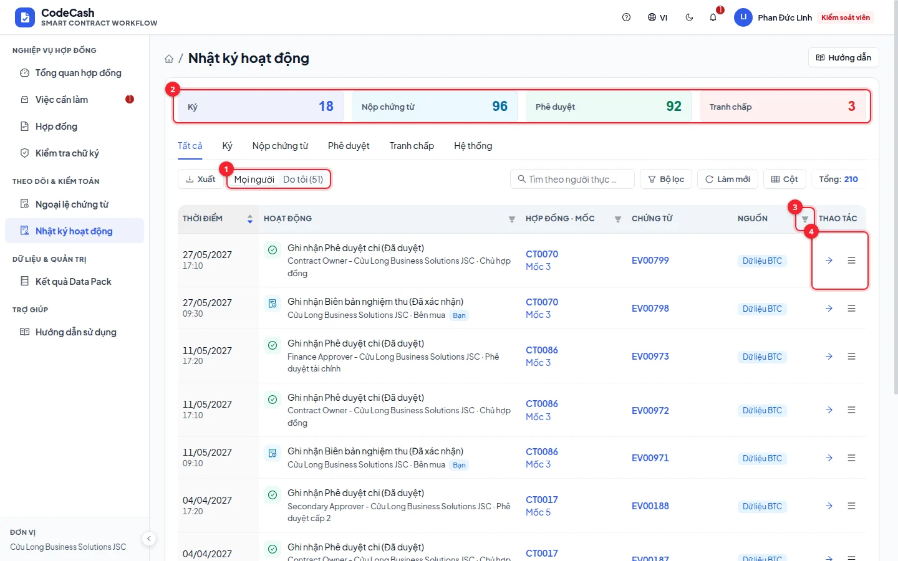

# Nhật ký hoạt động

Nhật ký nối các thao tác người dùng, sự kiện và lần đổi trạng thái để giải thích một kết quả. Dữ liệu chỉ được ghi thêm, không sửa hoặc xoá qua ứng dụng. Bạn chỉ xem được phạm vi được cấp; kiểm soát viên và kiểm toán có phạm vi toàn hệ thống.

## Theo dõi một hợp đồng

1. Mở hợp đồng, bấm nút **☰** cạnh **Hướng dẫn** rồi chọn **Nhật ký hợp đồng**. Trang tự lọc theo mã, ví dụ CT0103.
2. Mỗi dòng gồm thời điểm, hoạt động (biểu tượng loại, nội dung, người thực hiện và vai trò; nhãn **Bạn** khi chính bạn làm), hợp đồng · mốc, mã chứng từ và nguồn.
3. Dùng tab, **Mọi người / Do tôi**, tìm kiếm, bộ lọc hoặc lọc cột để thu hẹp nhóm cần xem. Bộ lọc nằm trên địa chỉ trang, nên có thể gửi link cho người khác.
4. Đối soát: bấm mã hợp đồng, mốc hoặc mã chứng từ để mở đúng chỗ (mã chứng từ mở quyết định của mốc và làm nổi dòng chứng từ đó); nút tải bên cạnh mã chứng từ tải đúng tệp đã ký. Chỉ hiện những liên kết bạn có quyền mở. Xuất CSV/JSON khi cần đối chiếu ngoài ứng dụng.

## Phân biệt các nhóm thông tin

| Nhóm                | Trả lời câu hỏi                                                          |
| ------------------- | ------------------------------------------------------------------------ |
| Thao tác người dùng | Ai đăng nhập, nộp, duyệt, ký, giải quyết tranh chấp hoặc xử lý ngoại lệ? |
| Sự kiện nghiệp vụ   | Bằng chứng nào được ghi, loại và bên có thẩm quyền là gì?                |
| Chuyển trạng thái   | Mốc chuyển từ trạng thái nào sang trạng thái nào, do lượt chạy nào?      |
| Nguồn               | Dòng thuộc Data Pack, seed demo hay do app tạo?                          |

Một thao tác có thể sinh nhiều dòng: ví dụ phê duyệt vừa ghi sự kiện APPROVAL, vừa chạy engine, vừa tạo lịch sử trạng thái. Không cộng số dòng nhật ký thành số giao dịch thanh toán.

## Ví dụ đối chiếu CT0103 mốc 2

Sau khi tài chính phê duyệt, lọc CT0103. Tìm người tài chính và sự kiện mới, sau đó xem lịch sử từ chờ phê duyệt sang chi sau khấu trừ. Mở quyết định để đối chiếu mã lượt chạy, PENALTY, phạt 2,22 và được trả 737,78 triệu trên dữ liệu mẫu.

Nếu bạn chỉ mở trang và đọc, không nên mong xuất hiện sự kiện thanh toán. Nếu tìm không thấy, kiểm tra bộ lọc nguồn, hợp đồng, loại hoạt động và bấm **Làm mới**.

## Lọc và xuất

Tìm kiếm, phân trang và xuất cùng dùng trạng thái lọc hiện tại. **Tất cả** khi xuất nghĩa là mọi dòng khớp trong phạm vi được phép, không phải bỏ qua quyền. Khi gửi hồ sơ cho người khác, chọn cột cần thiết và giữ mã hợp đồng/mốc để đối chiếu.

> **Nhật ký và tính toàn vẹn:** nhìn thấy dòng hoạt động chưa chứng minh cơ sở dữ liệu không bị can thiệp. Dùng [Kiểm tra toàn vẹn](/guide/integrity) để so dấu băm, và lưu mốc niêm phong ở nơi độc lập nếu cần phát hiện viết lại toàn bộ lịch sử.

Không sửa hoặc nhập đè nhật ký bằng công cụ quản trị. Các nghiệp vụ cần điều chỉnh phải tạo hành động mới đúng thẩm quyền, để cả hồ sơ ban đầu và hành động xử lý được giữ lại.
