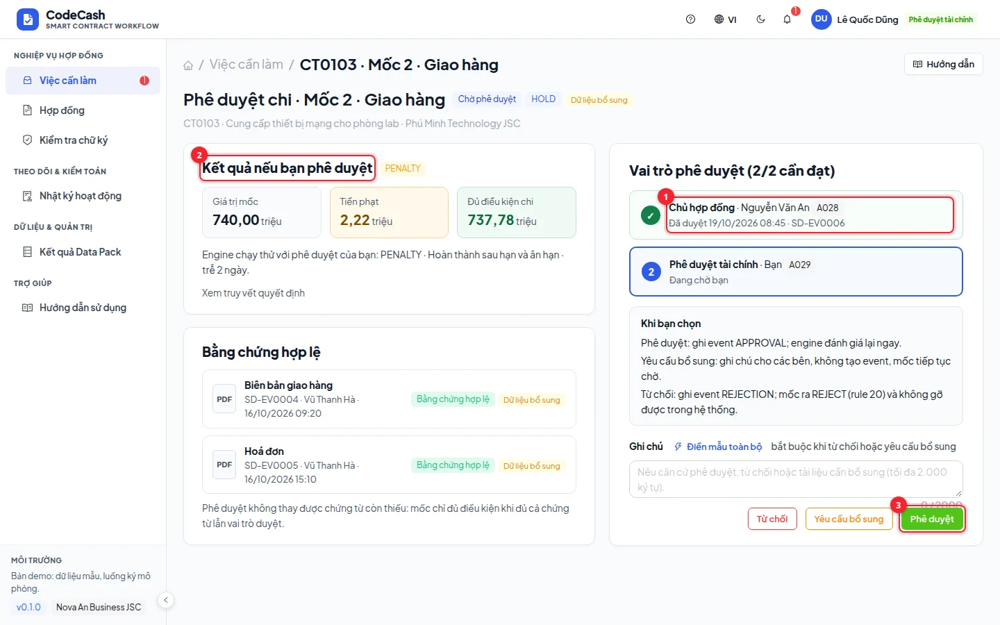
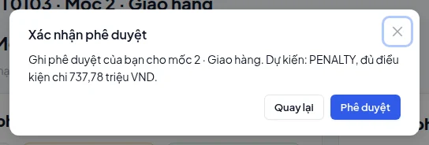

# Phê duyệt chi

Chủ hợp đồng, phê duyệt tài chính hoặc phê duyệt cấp 2 mở việc **Phê duyệt chi**. Chính sách của hợp đồng xác định vai trò cần có; người cùng tổ chức nhưng khác vai trò không được duyệt thay.

## Kiểm tra trước khi quyết định

1. Đọc mã hợp đồng, mốc, giá trị kế hoạch và trạng thái hiện tại.
2. Xem **Bằng chứng hợp lệ**: loại, tài liệu, bên ghi và thời điểm. Bằng chứng thiếu vẫn có thể làm mốc HOLD sau khi bạn duyệt.
3. Xem **Vai trò phê duyệt** để biết ai đã duyệt và ai đang chờ. Ví dụ CT0103 cần tài chính và chủ hợp đồng, không phải bất kỳ hai người nào.
4. Đọc **Kết quả nếu bạn phê duyệt**, bao gồm quyết định, tiền phạt, tiền được trả và lý do.
5. Mở **Truy vết quyết định** nếu cần xem chi tiết rule hoặc cách tính ngày trễ.

## Ba lựa chọn

| Lựa chọn        | Kết quả được ghi                                       | Khi sử dụng                            |
| --------------- | ------------------------------------------------------ | -------------------------------------- |
| Phê duyệt       | Sự kiện APPROVAL của đúng vai trò; engine đánh giá lại | Đồng ý trên cơ sở chứng từ đã kiểm tra |
| Yêu cầu bổ sung | Ghi chú cho các bên, không tạo phê duyệt               | Cần làm rõ tài liệu trước khi đồng ý   |
| Từ chối         | Sự kiện REJECTION; kết quả REJECT bị khoá              | Có căn cứ từ chối theo hồ sơ           |

Ghi chú bắt buộc khi yêu cầu bổ sung hoặc từ chối. Đọc hộp xác nhận trước khi gửi. Từ chối không có nút gỡ trong luồng hiện tại.

## Kịch bản CT0103 mốc 2

1. Chọn `finance@novaan.vn` từ menu demo.
2. Mở việc CT0103 mốc 2. Chủ hợp đồng đã duyệt; tài chính còn thiếu.
3. Xem trước: PENALTY, kế hoạch 740,00; phạt 2,22; được trả 737,78 triệu.
4. Bấm **Phê duyệt** rồi xác nhận. Trang quyết định hiển thị `LATE_COMPLETION` và kết quả mới.
5. Nếu muốn chuyển khoản đủ điều kiện sang kế toán, làm tại trang quyết định. Phê duyệt và chuyển kế toán là hai thao tác riêng.

## Hiểu chính sách phê duyệt

Chính sách có thể yêu cầu chỉ chủ hợp đồng; chủ hợp đồng + cấp 2; hoặc tài chính + chủ hợp đồng. Một người duyệt chỉ bổ sung phần của vai trò mình. Đạt 1/2 vẫn HOLD. Đạt 2/2 vẫn có thể HOLD do tranh chấp hoặc chứng từ thiếu.

> **Kết quả xem trước:** engine chạy thử trên trạng thái hiện tại. Khi gửi thật, API kiểm lại quyền và dữ liệu; nếu người khác vừa thao tác, hãy làm mới và đọc kết quả mới trước khi thử lại.

Nếu nút không xuất hiện, kiểm tra bạn có đúng vai trò, đúng tổ chức và chưa duyệt mốc đó. Không dùng tài khoản kiểm soát viên hoặc quản trị hệ thống để duyệt chi.
