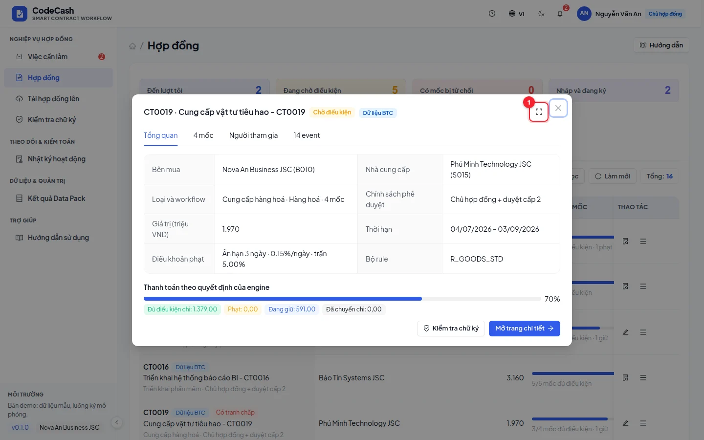
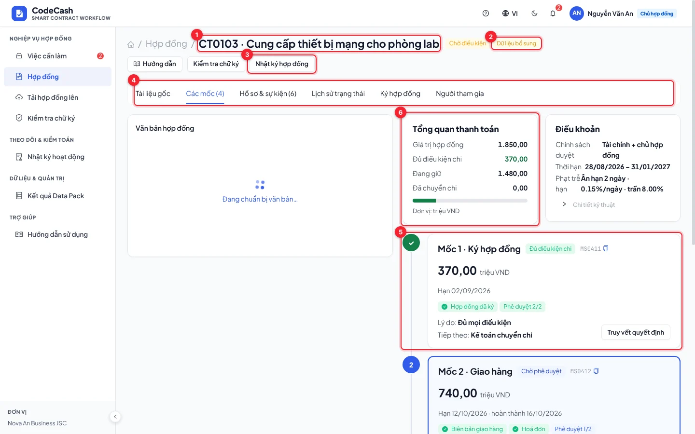
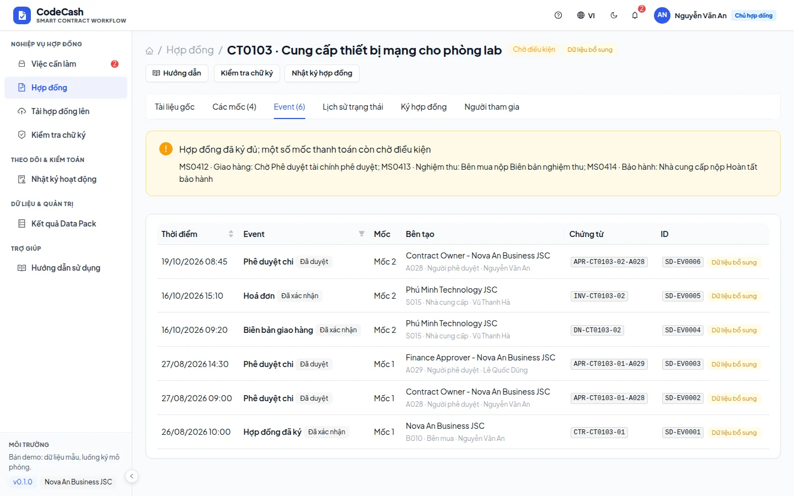

# Danh sách và chi tiết hợp đồng

Mở **Hợp đồng** hoặc **Hợp đồng của tôi**. Chủ hợp đồng và cán bộ hợp đồng có thể thấy bản nháp; tài khoản khác chỉ thấy những hợp đồng được phép truy cập. Quản trị hệ thống không có quyền xem nghiệp vụ hợp đồng.

## Tìm và mở hợp đồng

1. Gõ mã hoặc tên trong ô tìm; ví dụ `CT0103` hoặc `thiet bi`.
2. Chọn thẻ như **Đến lượt tôi**, **Chờ điều kiện**, **Cần xem xét**, **Đang ký**, **Đủ điều kiện** nếu muốn thu hẹp tập dữ liệu.
3. Bấm tên hợp đồng để xem nhanh. Dùng nút phóng toàn màn (số 1) khi cần đọc nhiều trường.
4. Mở trang chi tiết để xem từng mốc và thực hiện bước nghiệp vụ.

## Đọc trang chi tiết

- Tiêu đề dùng breadcrumb, gồm mã, tên và nhãn trạng thái; không có tiêu đề phụ lặp lại.
- Nhãn **Dữ liệu BTC**, **Bổ sung demo**, **Tạo trong app** phân biệt nguồn bản ghi. Dữ liệu demo không phải mẫu đáp án của BTC.
- **Tổng quan thanh toán** cho biết tiền kế hoạch, tiền đủ điều kiện, tiền phạt và phần đã chuyển chi. Đọc đơn vị triệu đồng.
- Mỗi mốc hiển thị hạn, điều kiện chứng từ, số phê duyệt đạt/cần và quyết định hiện tại. Bấm mốc hoặc thao tác tương ứng để nộp, duyệt hay xem giải thích.
- **Nhật ký hợp đồng** mở nhật ký đã lọc đúng mã; **Kiểm tra chữ ký** mở thông tin luồng ký.

## Dùng các tab

Tab **Sự kiện** cho biết ai ghi, loại sự kiện, thời điểm, trạng thái và nguồn. Tab **Lịch sử** giải thích các lần đổi trạng thái; tab **Ký** là trình tự người ký; tab **Các bên** xác định bên mua, NCC và người phê duyệt.

Đừng hiểu “có một sự kiện” là “đã đủ điều kiện”: engine còn kiểm đúng thẩm quyền, trạng thái, trùng lặp, tranh chấp và chính sách phê duyệt. Mở [Quyết định](/guide/decision) để xem cách phân loại.

## Thao tác theo trạng thái

| Trạng thái                          | Bước tiếp theo                                                                   |
| ----------------------------------- | -------------------------------------------------------------------------------- |
| Bản nháp                            | Chủ hợp đồng/cán bộ hợp đồng hoàn tất hồ sơ, đặt vị trí ký và rà soát điều khoản |
| Đang ký                             | Người đang đến lượt ký; chưa đến lượt thì chờ                                    |
| Đang thực hiện                      | Nộp chứng từ hoặc phê duyệt theo việc được giao                                  |
| Tạm giữ                             | Mở trang quyết định; xử lý đúng lý do còn thiếu                                  |
| Đủ điều kiện chi / Chi sau khấu trừ | Tài chính kiểm tra và chuyển kế toán                                             |
| Đã chuyển chi / Bị từ chối          | Kết quả bị khoá; không có thao tác sửa quyết định thủ công                       |

> **Nếu không mở được mã:** kiểm tra tài khoản có thuộc bên mua hoặc NCC của hợp đồng không. Hệ thống kiểm phạm vi ở API; thay địa chỉ trên trình duyệt không mở rộng quyền.

Hồ sơ mới được tạo qua **Tải hợp đồng lên**, xem [Soạn, số hoá và ký](/guide/signing). Các công cụ danh sách được giải thích tại [Tìm, lọc và xuất](/guide/tables).
