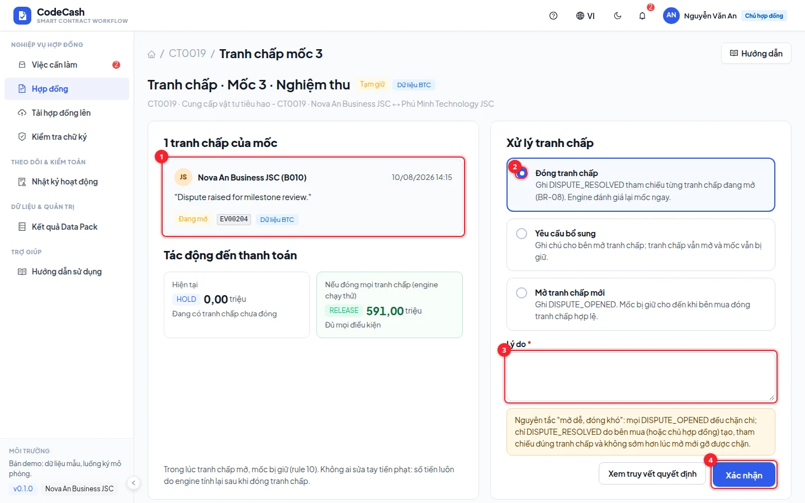
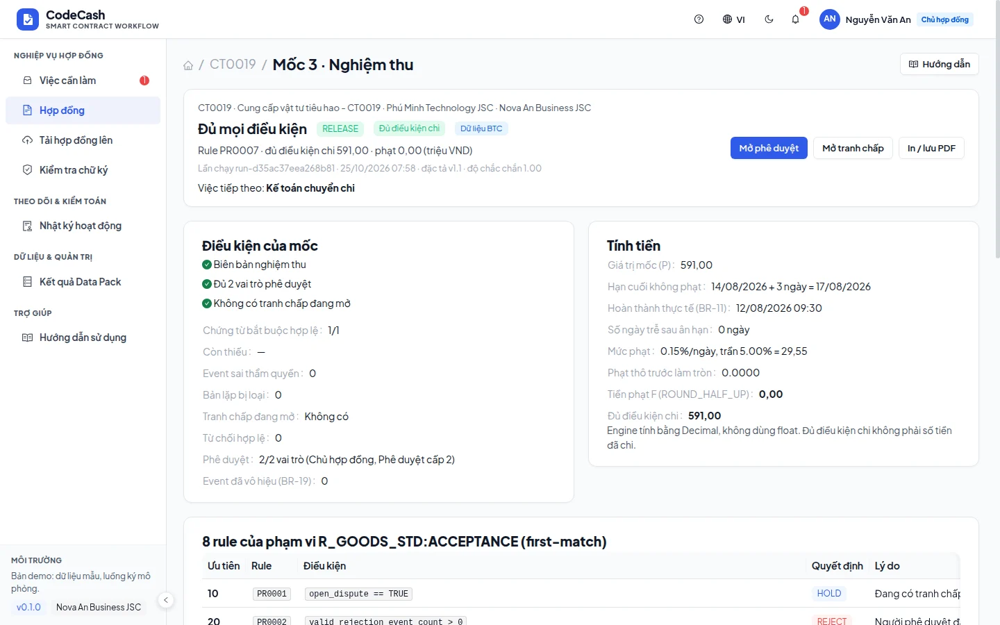

# Mở và xử lý tranh chấp

Tranh chấp đang mở là điều kiện chặn ưu tiên cao nhất: engine trả HOLD trước khi xét các điều kiện khác. Bên mua và NCC có thể mở tranh chấp; chỉ phía bên mua được đóng theo quyền hiện tại.

## Đọc hồ sơ đang mở

Mở từ việc **Giải quyết tranh chấp** hoặc trang quyết định của mốc. Kiểm tra mã tranh chấp, người/bên mở, thời điểm, nội dung và tài liệu liên quan. Phải xử lý đúng tranh chấp đang mở của mốc; ghi chú ở mốc khác không đóng hồ sơ này.

## Mở tranh chấp mới

Khi có quyền mở, nhập lý do cụ thể, gắn với chứng từ hoặc điều khoản cần làm rõ rồi xác nhận. Sự kiện tranh chấp được ghi và mốc chuyển HOLD sau khi engine đánh giá lại. Mở tranh chấp không có nghĩa hệ thống đã đồng ý với khiếu nại hoặc sửa số tiền phạt.

## Đóng hoặc yêu cầu bổ sung

1. Đăng nhập chủ hợp đồng hoặc cán bộ hợp đồng bên mua.
2. Đọc phương án và kết quả dự báo sau khi đóng.
3. Nếu đã có kết luận, chọn phương án giải quyết, nhập ghi chú phản ánh thoả thuận hoặc biên bản.
4. Bấm xác nhận và chờ đánh giá lại. Sự kiện đóng tham chiếu đúng sự kiện tranh chấp gốc.
5. Nếu chưa đủ căn cứ, dùng yêu cầu bổ sung và giữ hồ sơ chờ; không đóng chỉ để đẩy mốc sang thanh toán.

## Thử CT0019 mốc 3

Đăng nhập `owner@novaan.vn`, mở việc **Giải quyết tranh chấp · CT0019 · mốc 3**. Trên dữ liệu mới, đóng tranh chấp EV00204 và ghi chú thống nhất nghiệm thu. Engine trả **RELEASE 591,00 triệu**, lý do đủ mọi điều kiện. Kiểm tra sự kiện đóng và lịch sử trạng thái.

Một ví dụ khác là CT0014 mốc 2, tranh chấp do NCC mở; chủ hợp đồng bên mua vẫn là người đóng. Đăng nhập NCC để thấy mình có thể xem/mở nhưng không đóng được.

## Khi đóng xong vẫn HOLD

Mở [Quyết định](/guide/decision). Các nguyên nhân còn lại có thể là thiếu chứng từ, thiếu phê duyệt hoặc có sự kiện sai thẩm quyền. Đóng tranh chấp chỉ gỡ điều kiện tranh chấp, không bỏ qua các rule khác. Mốc đã bị từ chối hoặc chuyển kế toán có kiểm soát khoá riêng; đừng dùng tranh chấp để cố sửa kết quả đã khoá.

> **Không sửa xoá lịch sử:** mở và đóng là các sự kiện mới. Nhật ký vẫn giữ hồ sơ gốc, bên mở và lý do xử lý. Xem [Nhật ký](/guide/activity) để đối chiếu.
