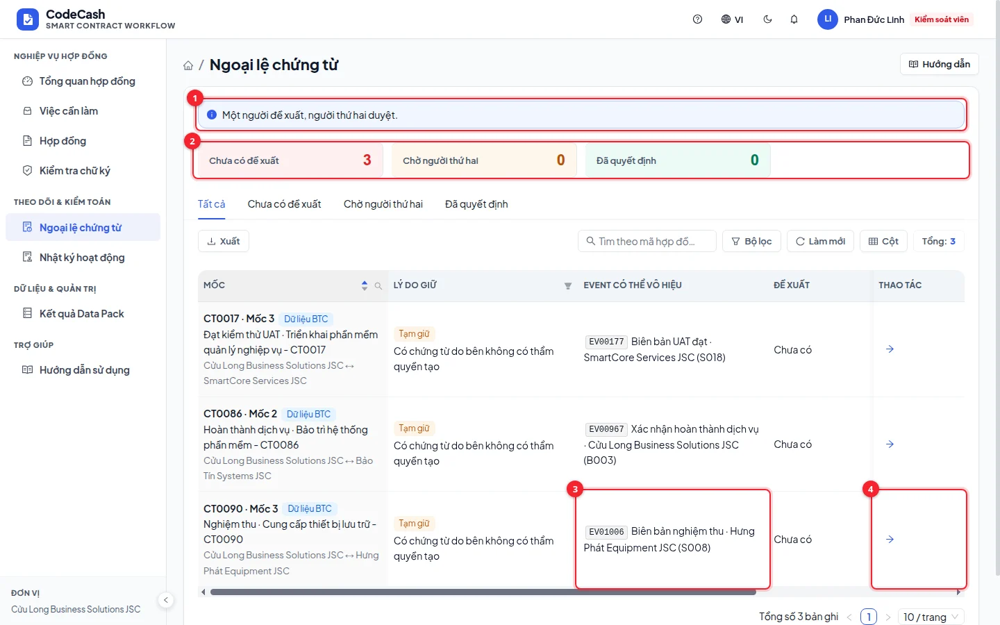
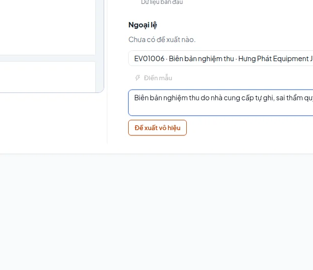
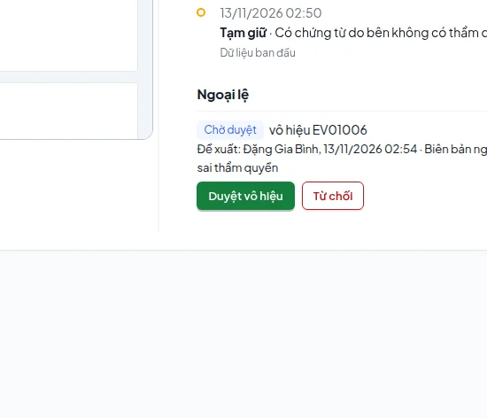

# Ngoại lệ chứng từ (BR-19): xử lý sự kiện sai thẩm quyền

Ngoại lệ cần **hai người khác nhau của bên mua**: chủ hợp đồng đề xuất, kiểm soát viên nội bộ của bên mua duyệt. Kiểm toán không mở hợp đồng; quản trị hệ thống không có quyền duyệt ngoại lệ.

## Tìm hồ sơ cần xử lý

Mở **Ngoại lệ chứng từ**, tìm hợp đồng hoặc lọc lý do. Trên dữ liệu mới có các mốc bị HOLD vì chứng từ do sai bên ghi. Mở trang quyết định của mốc, đọc sự kiện gốc và cách engine phân loại trước khi đề xuất.

Ví dụ **CT0090 mốc 3**: sự kiện nghiệm thu EV01006 do NCC ghi, trong khi nghiệm thu thuộc bên mua. Mốc đang HOLD `UNAUTHORIZED_EVENT` dù có tài liệu.

## Chủ hợp đồng đề xuất

1. Đăng nhập `owner@cuulong.vn` (chủ hợp đồng của Cửu Long, bên mua CT0090).
2. Mở CT0090 mốc 3; ở khối **Ngoại lệ chứng từ**, chọn đúng sự kiện EV01006.
3. Nhập lý do cụ thể: loại sự kiện, bên đã ghi và bên có thẩm quyền.
4. Bấm đề xuất và kiểm tra mã hồ sơ chờ duyệt.

Sự kiện hợp lệ không được đưa vào vô hiệu chỉ vì kết quả thanh toán không mong muốn. Người đề xuất không thể tự duyệt; hệ thống trả `SECOND_CONTROLLER_REQUIRED` nếu cố thực hiện.

## Kiểm soát viên bên mua quyết định

1. Đăng xuất, chọn `controller@cuulong.vn`.
2. Mở cùng mốc hoặc công việc duyệt ngoại lệ được giao.
3. Đọc người đề xuất, sự kiện và lý do; chọn duyệt vô hiệu hoặc bác đề xuất.
4. Khi duyệt, engine chạy lại. Đọc quyết định mới và nhật ký để xác nhận.

## Kết quả sau khi duyệt

EV01006 vẫn còn trong lịch sử, được đánh dấu vô hiệu; không sửa hay xoá sự kiện gốc. CT0090 mốc 3 chuyển từ HOLD vì sai thẩm quyền sang **HOLD vì thiếu nghiệm thu hợp lệ**. Không tự động RELEASE và không tạo chứng từ thay bên mua.

Bước tiếp theo thuộc cán bộ hợp đồng của bên mua thực tế: ở ví dụ này là `legal@cuulong.vn`. Khi bên đó nộp nghiệm thu, engine mới xét tiếp các điều kiện và phạt trễ; không dùng `legal@novaan.vn` vì khác tổ chức.

> **BR-19 không sửa tiền:** kiểm soát viên chỉ xử lý tính hợp lệ của sự kiện bất thường. Quyết định và số tiền vẫn do engine tính theo dữ liệu và rule.

Nếu không có nút xử lý, kiểm tra vai trò và trạng thái hồ sơ; nếu là kiểm toán thì chỉ đọc là đúng. Xem [Vai trò](/guide/roles), [Quyết định](/guide/decision) và [Nhật ký](/guide/activity).
