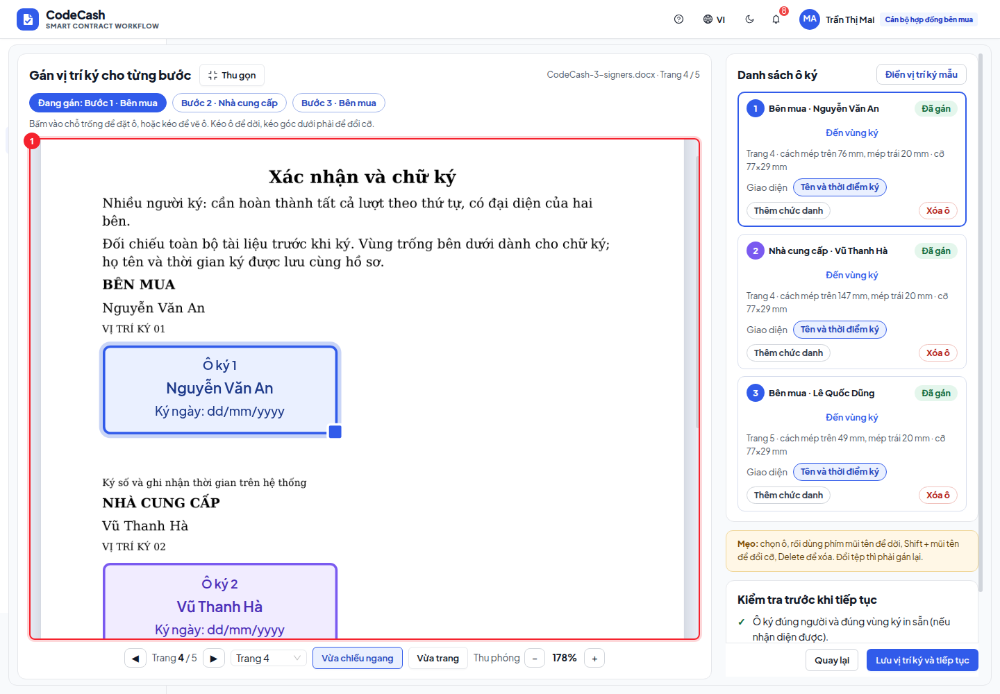
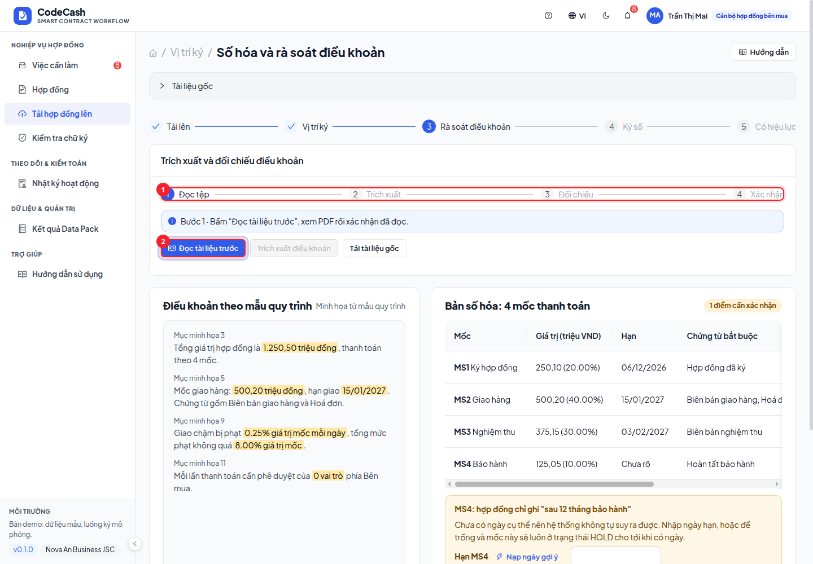
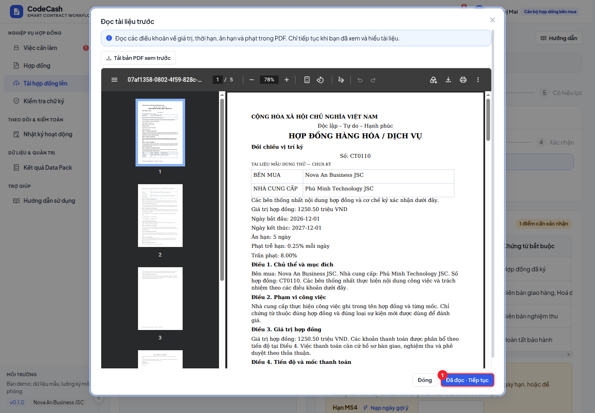
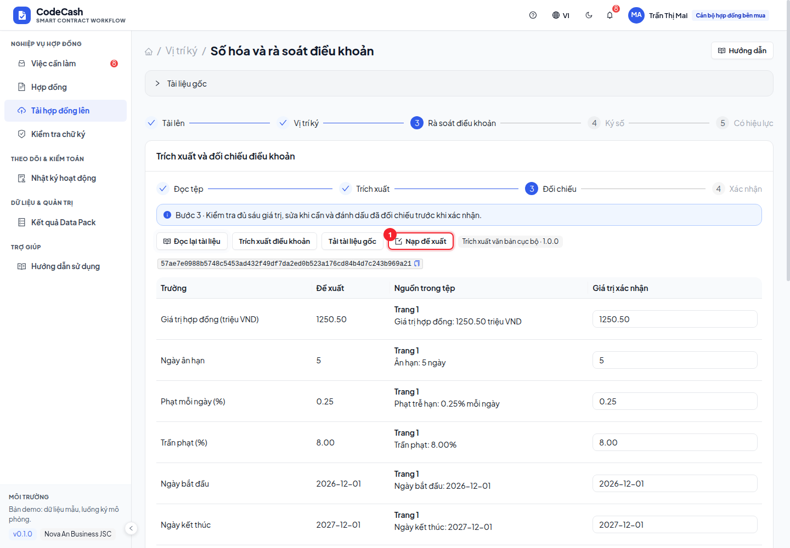

# Soạn hợp đồng, rà soát và ký

Luồng gồm **Tải lên → Vị trí ký → Rà soát điều khoản → Ký số → Có hiệu lực**. Chủ hợp đồng và cán bộ hợp đồng chuẩn bị hồ sơ; từng người ký chỉ thao tác ở lượt được gán.

## 1. Tải hợp đồng và nhập tham số

1. Mở **Tải hợp đồng lên** hoặc việc hoàn tất CT0101.
2. Kiểm tra tên, bên mua, NCC, loại hợp đồng, giá trị và thời gian. Tiền nhập theo triệu VND.
3. Chọn chính sách phê duyệt, số ngày ân hạn, tỷ lệ phạt mỗi ngày và trần phạt. Những tham số này được đưa xuống các mốc có áp dụng phạt.
4. Tải tệp hợp đồng; xem tên tệp và chờ tải xong trước khi lưu.
5. Chọn từ 1–4 người ký. Một người ký hoàn tất toàn bộ lượt ký; từ 2 người phải có đại diện cả hai bên. Chọn mẫu hợp đồng từ danh sách do quản trị cấu hình; có thể thêm/bớt người ký và chỉnh nội dung riêng. Bấm **Tạo hợp đồng mẫu** để sinh DOCX, xem trước và tải về. Sửa dữ liệu sau khi sinh tệp thì phải tạo lại hoặc tải tệp thay thế.

Người ký và vai trò phê duyệt thanh toán là hai cấu hình khác nhau. Ký hợp đồng không tự tạo phê duyệt chi cho mốc.

## 2. Đặt vị trí ký

Khung PDF mặc định **Vừa chiều ngang** để chữ và ô ký đủ lớn; cuộn trong khung để xem phần còn lại. Chọn **Mở rộng** để dùng gần toàn màn hình (bấm **Thu gọn** hoặc Escape để trở lại). **Vừa trang** dùng khi muốn xem tổng thể; có thể phóng to tới 300%. Chọn người ký hoặc **Đến vùng ký** để chuyển đến đúng trang/vùng đang thao tác.

Ảnh nền là từng trang PDF thật của tài liệu đã tải lên. Bấm **Điền vị trí ký mẫu** để gợi ý vùng ký in sẵn, rồi chọn từng người ký và đối chiếu lại. Có thể chuyển trang, phóng to, kéo hoặc đổi kích thước ô ký. Hệ thống chặn ô nằm ngoài trang, đè lên chữ nhận diện được hoặc chồng với ô khác. Lưu vị trí rồi sang bước rà soát. Nếu hồ sơ chưa đủ dữ liệu hoặc vị trí chưa hợp lệ, sửa tại bước tương ứng trước khi tiếp tục.

## 3. Rà soát điều khoản và khoá

Với tệp thật, thực hiện lần lượt bốn bước ở thẻ **Trích xuất và đối chiếu điều khoản**. Bước hiện tại và thao tác cần bấm có viền nhấn, kèm hướng dẫn ngay trên các nút.

1. Bấm **Đọc tài liệu trước**. Xem PDF và bấm **Đã đọc · Tiếp tục**; nút chỉ bật khi trình xem đã tải tệp.
2. Bấm **Trích xuất điều khoản**, chờ kết quả rồi **Nạp đề xuất** vào các ô trống.
3. Đối chiếu sáu giá trị với trang/đoạn trích; sửa hoặc bổ sung rồi đánh dấu **Tôi đã đối chiếu…** bên dưới bảng.
4. Bấm **Xác nhận và áp dụng vào hồ sơ**. Tiếp tục rà bảng mốc/ngày cần xác nhận, rồi **Xác nhận bản số hóa và chuyển sang ký**.

Mở lại hồ sơ chưa xác nhận vẫn thấy hướng dẫn và cần xác nhận đã đọc; không tự gọi AI lại. Hồ sơ đã xác nhận hiển thị bước hoàn tất. Mẫu dữ liệu cũ không có bytes tệp được ghi rõ là cần rà soát thủ công; hệ thống không giả vờ đã đọc một PDF không tồn tại.

Đối chiếu tổng giá trị, tỷ lệ và số tiền từng mốc, loại chứng từ, chính sách phê duyệt, phạt và ngày đến hạn. Mốc có thuật ngữ tương đối như “12 tháng” cần nhập ngày cụ thể. Nếu để trống hạn được phép thiếu, mốc có thể bị HOLD vì thiếu cấu trúc; không tự suy ra ngày để hoàn tất demo.

> **Trích xuất:** nếu được quản trị bật Gemini, hệ thống gửi bản PDF đến Google để đề xuất sáu điều khoản kèm trang và đoạn trích. Với PDF có text, đoạn trích được kiểm lại trên đúng trang; điều này không thay việc xác nhận ý nghĩa và giá trị. Bản scan cần người dùng đối chiếu thủ công. Chế độ local đọc text, không gọi AI. Mốc nghiệp vụ vẫn lấy từ mẫu quy trình Data Pack. Vị trí ký gắn với trang PDF thật; chữ ký demo vẫn là bằng chứng tách rời, chưa nhúng chữ ký PAdES vào PDF.

Bấm **Xác nhận** tạo các mốc thật và khoá điều khoản, chuyển hợp đồng sang **Đang ký**. Số tiền các mốc cộng đúng giá trị hợp đồng; mốc cuối nhận phần dư làm tròn.

## 4. Ký đúng lượt

1. Đăng nhập người đang có nhãn đến lượt; người khác chỉ xem tiến trình.
2. Mở bước ký của mình, đọc tài liệu, bấm **Xem vị trí ký** để đối chiếu ô ký trên trang PDF rồi chọn phương thức phù hợp. Bước cuối yêu cầu chữ ký số, không chỉ ảnh chữ ký.
3. Gửi yêu cầu, thực hiện xác nhận mô phỏng theo màn hình; kiểm tra trạng thái hoàn tất trước khi đổi tài khoản.
4. Người tiếp theo nhận lượt. Chữ ký cuối kích hoạt hợp đồng và tạo sự kiện `CONTRACT_SIGNED` đúng bên mua.

Thử CT0102 bằng `supplier@phuminh.vn` ở bước 2, rồi `secondary@novaan.vn` ở bước cuối. Ký chưa đến lượt bị chặn. Huỷ luồng ký là quyền của người quản lý hồ sơ; cần đọc xác nhận và lý do trước khi thực hiện.

## 5. Kiểm tra chữ ký

Mở **Kiểm tra chữ ký**, đối chiếu người, thứ tự, phương thức, thời điểm và thời điểm hiệu lực. Kiểm PDF bên ngoài chỉ nhận ra cấu trúc thì hiển thị **chưa xác minh**.

> **Chữ ký demo:** Tên phương thức VNPT SmartCA/Viettel MySign hiện là mô phỏng. Bằng chứng Ed25519 gắn tệp gốc được tạo và kiểm tra thật bằng khóa thử cục bộ. Chưa có xác thực chứng thư, OCSP/CRL hay ký PDF với nhà cung cấp thật; không dùng kết quả “hợp lệ” của demo làm kết luận về chữ ký số thực tế.

Sau khi hợp đồng có hiệu lực, quay lại [Việc cần làm](/guide/tasks) để nộp chứng từ và phê duyệt mốc đầu.

## Xem tài liệu thật

1. Chọn PDF/DOCX hoặc bấm **Tạo hợp đồng mẫu**. Khung **Xem trước** hiển thị PDF thật; DOCX được chuyển thành PDF, không dùng hình minh họa.
2. Cuộn hoặc đổi trang trong trình xem để kiểm tra nội dung; bấm **Tải bản PDF xem trước** nếu cần đối chiếu. Bản PDF này là bản kết xuất, không thay đổi bytes/hash của tệp gốc.
3. Sau khi lưu tệp, mở chi tiết hợp đồng → **Tài liệu gốc** để xem lại tài liệu đã tải lên. Hợp đồng trong Data Pack không có tệp đính kèm sẽ báo chưa có tệp.

## Điền nhanh nhưng vẫn chủ động kiểm tra

Màn **Tải hợp đồng lên** mới bắt đầu trống; mã hồ sơ và dữ liệu hệ thống là trường chỉ đọc. Bấm nút **Điền mẫu toàn bộ** duy nhất ở đầu form để điền tất cả ô còn trống, kể cả người ký chưa chọn. Nội dung đã nhập được giữ nguyên; thao tác không lưu/gửi. Trong danh sách người ký, bấm trực tiếp mũi tên lên/xuống để đổi thứ tự; icon thùng rác đỏ dạng link để bỏ người ký. Rê chuột hoặc dùng Tab để xem tên thao tác. Thứ tự được đánh số từ trên xuống. Hồ sơ mở từ việc cần làm hoặc **Hoàn tất bản nháp** giữ dữ liệu đã lưu.

Sau khi tải tài liệu, **Nạp đề xuất** dùng giá trị trích xuất thực để bạn rà soát; đây không phải dữ liệu demo. Ngày chưa xác nhận có nút nạp ngày gợi ý. Vị trí ký mới để trống, dùng **Điền vị trí ký mẫu** hoặc đặt thủ công trước khi lưu.

## Tải mẫu và xem PDF theo dữ liệu đang nhập

Phần **Cách dùng và tài khoản người ký** được thu gọn bên dưới các nút tải; mở ra để đối chiếu nhà cung cấp, tên và email trước khi cấu hình người ký.

Mở **Hướng dẫn** ở đầu trang hoặc nút trợ giúp trên thanh trên cùng. Chọn PDF 1–4 người ký hoặc **Tải trọn bộ PDF + DOCX**; đây là tệp **chưa ký**, dùng để tải lên và đi qua quy trình ký. Với bộ này chọn nhà cung cấp **S015 — Phú Minh**; danh sách theo số người lần lượt là Nguyễn Văn An, Vũ Thanh Hà, Lê Quốc Dũng, Trần Thị Mai. Tìm tài khoản bằng tên/email trong menu **Tài khoản demo**.

Khung bên phải có hai thẻ: **Nội dung đang soạn** là PDF nháp tự cập nhật khi thông tin hợp lệ; **Tài liệu đã chọn** là đúng tệp sẽ tải lên và ký. Sửa form không sửa tệp đã chọn. Dùng **Tạo và dùng hợp đồng mẫu** để chọn bản nháp mới làm tệp ký, hoặc tải lên tài liệu đã sửa.

## Đúng người trên đúng vùng ký

Bấm **Điền vị trí mẫu** rồi đối chiếu từng tên. Gợi ý bám tên và bên ký nhận diện được, không gán máy móc theo số ô. Chọn người hoặc **Đến vùng ký** để chuyển tới đúng trang; dùng **Vừa trang** để xem trọn trang, phóng to khi cần chỉnh chi tiết. Danh sách ô ký và trang PDF có cuộn riêng.

Nếu PDF có tên in sẵn khác danh sách hoặc còn người chưa cấu hình, bấm **Sửa người ký hoặc tài liệu** để điều chỉnh hoặc tạo lại tệp. Không đặt chữ ký của người này dưới tên người khác. Với tệp không nhận diện được tên/bên ký, hệ thống báo cần kiểm tra thủ công; kiểm tọa độ không chứng minh đã đúng người. Đối chiếu cả điều khoản thứ tự ký trong tài liệu trước khi khóa; thay thứ tự trong mẫu đã sinh thì phải tạo lại tệp.
