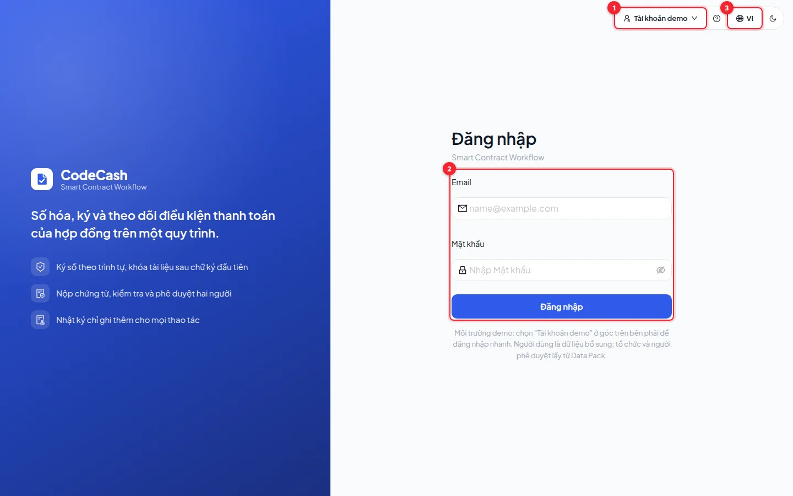
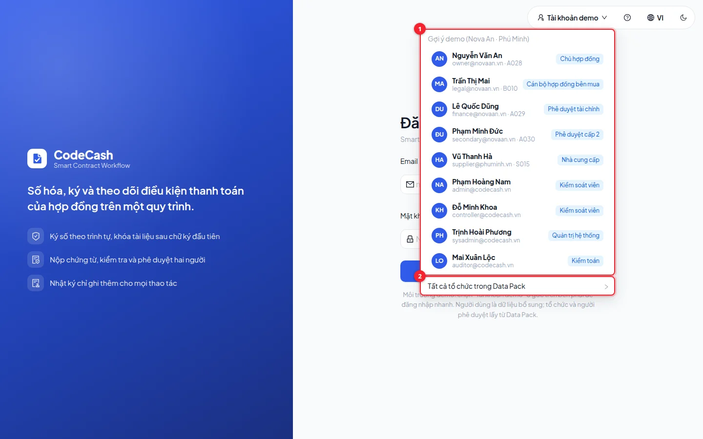
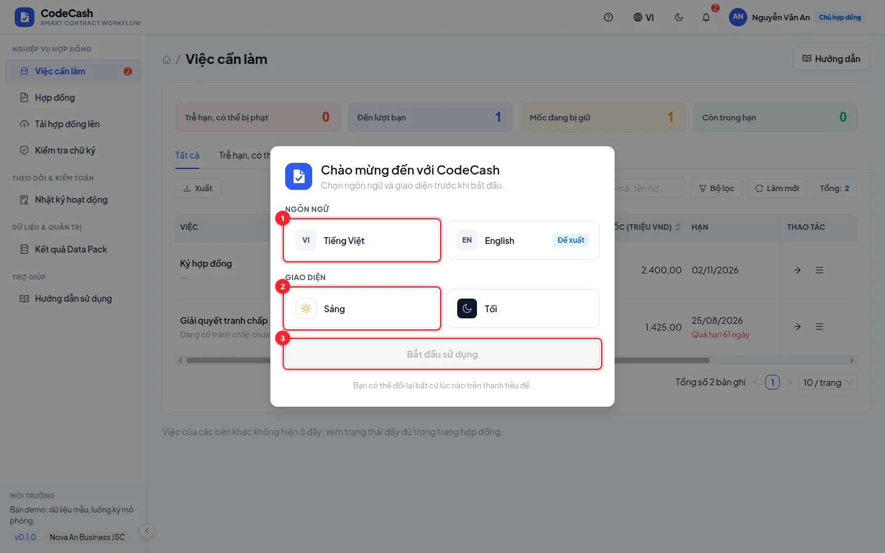
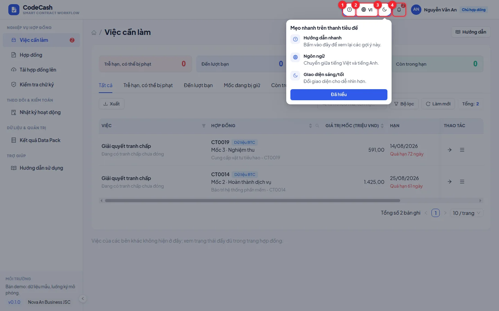
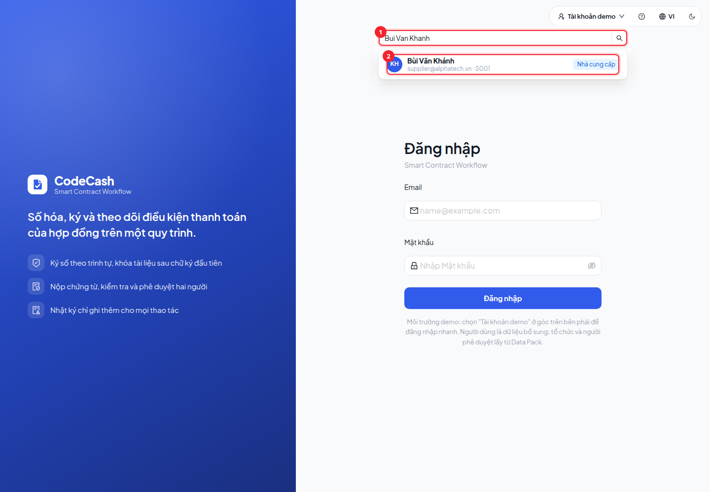

# Bắt đầu và đăng nhập

CodeCash theo dõi hợp đồng, chứng từ và thanh toán theo từng mốc. Hãy bắt đầu bằng tài khoản đúng vai trò; sau mỗi thao tác, hệ thống đánh giá lại điều kiện và giao việc tiếp theo cho người có trách nhiệm.

## Chọn tài khoản demo

1. Mở trang **Đăng nhập**. Bấm **Tài khoản demo** ở góc phải (số 1).
2. Chọn một tài khoản trong nhóm kịch bản mẫu. Menu hiển thị người, chức danh, tổ chức và vai trò để bạn biết mình đang đại diện cho ai.
3. Muốn thử hợp đồng của tổ chức khác, mở **Tất cả tổ chức trong Data Pack** (số 2 trong ảnh dưới) rồi chọn tài khoản của tổ chức đó.
4. Tài khoản được chọn đăng nhập ngay. Menu này vẫn nằm ngoài màn hình đăng nhập để thuận tiện đổi vai trò khi demo.

Nếu nhập email thủ công, dùng mật khẩu do người quản trị môi trường cấp. Mật khẩu seed local mặc định là `Passw0rd!`; môi trường triển khai có thể thay bằng cấu hình `SEED_PASSWORD`. Nếu menu không tải được, kiểm tra API đã chạy; đừng xoá dữ liệu để sửa lỗi đăng nhập.

## Lần đầu vào ứng dụng

Chọn ngôn ngữ và giao diện rồi bấm **Bắt đầu**. Các lựa chọn được lưu trong trình duyệt. Ở những lần sau, dùng các nút trên thanh đầu trang để đổi lại.

- **Hướng dẫn** mở tài liệu này. Nút cạnh tiêu đề từng trang mở đúng nội dung cần dùng trong ngăn bên; chọn **Mở trang hướng dẫn** để đọc toàn màn.
- **Thông báo** đưa bạn tới việc cần làm trong phạm vi tài khoản hiện tại.
- Bấm vào ảnh trong hướng dẫn để phóng lớn, xem chi tiết rồi đóng ảnh để tiếp tục đọc.

## Thử nhanh một vòng nghiệp vụ

1. Chọn `finance@novaan.vn`, mở việc **Phê duyệt chi · CT0103 · mốc 2**.
2. Đọc chứng từ và kết quả xem trước; trên dữ liệu mới, phê duyệt dẫn tới **PENALTY**, được trả **737,78 triệu**, phạt **2,22 triệu**.
3. Mở trang quyết định để xem cách tính, rule và sự kiện. Hệ thống tự tính tiền; người duyệt không nhập số tiền được trả.
4. Đăng xuất qua menu tài khoản rồi chọn `owner@novaan.vn`; thử đóng tranh chấp CT0019 mốc 3.
5. Chọn `supplier@phuminh.vn`; thử chứng từ CT0104 mốc 2 và luồng ký CT0102.

> **Lưu ý:** thao tác demo ghi dữ liệu thật của môi trường đang chạy. Phê duyệt, ký và chuyển kế toán thay đổi trạng thái. Muốn lặp kịch bản từ đầu, nhờ người vận hành khởi tạo môi trường thử riêng; không xoá dữ liệu đang dùng.

## Khi màn hình khác ảnh

Ảnh dùng dữ liệu thử mới khởi tạo ngày 23/10/2026, ngôn ngữ tiếng Việt và giao diện sáng. Số việc, ngày trễ và trạng thái có thể khác sau khi đã thao tác. Tài khoản khác tổ chức chỉ thấy dữ liệu của tổ chức mình. Xem [Vai trò và kịch bản](/guide/roles) để chọn đúng tài khoản và [Công cụ bảng](/guide/tables) để bỏ các bộ lọc còn giữ.

## Tìm đúng tài khoản người ký

Trong **Tài khoản demo**, tìm không dấu như `Bui Van Khanh` hoặc email. Bùi Văn Khánh dùng `supplier@alphatech.vn`, thuộc S001 — AlphaTech. Vũ Thanh Hà dùng `supplier@phuminh.vn`, thuộc S015 — Phú Minh. Chọn đúng công ty ghi trên hợp đồng; tài khoản nhà cung cấp khác không được ký thay. Danh sách lượt ký hiển thị email để đối chiếu.
