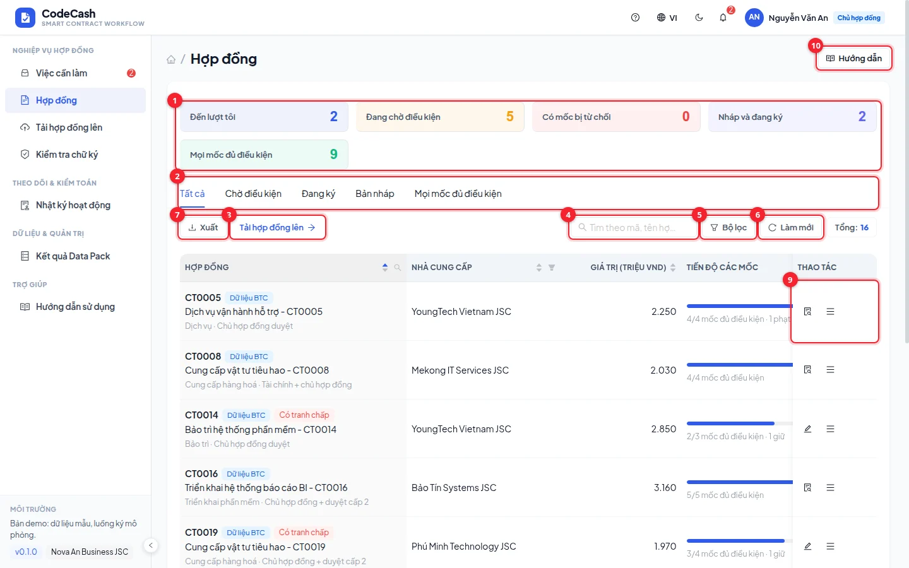
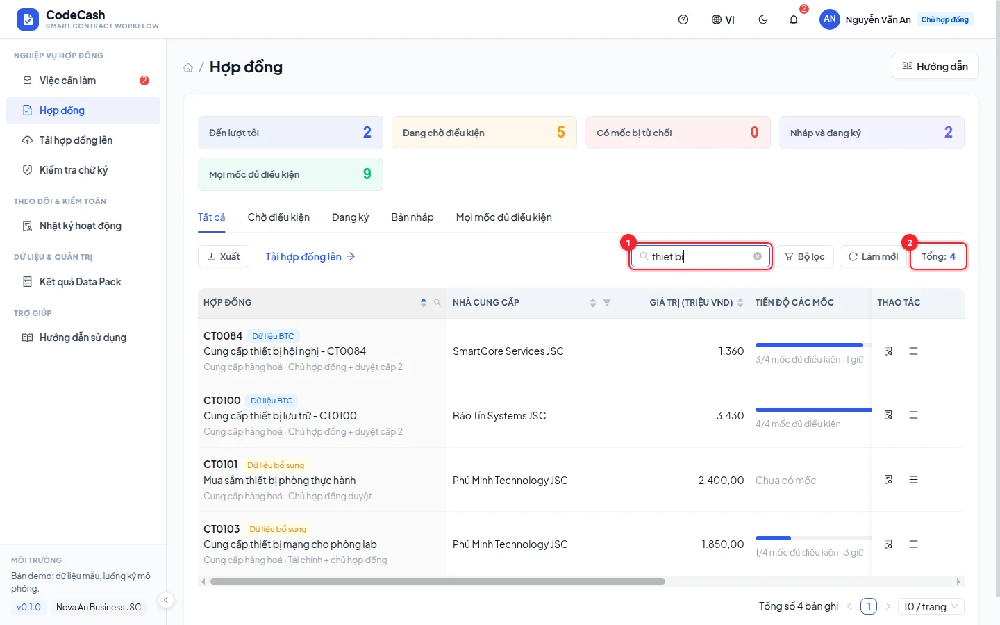
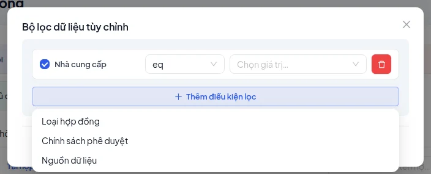
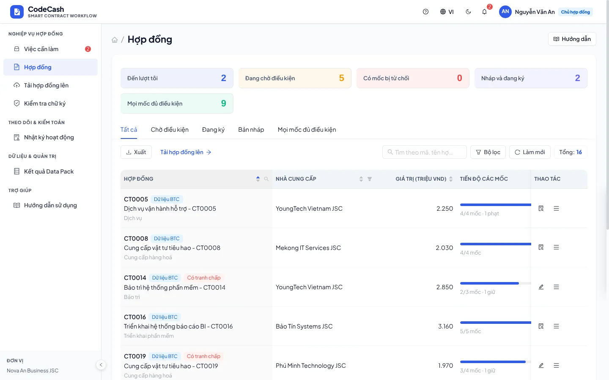

# Tìm kiếm, lọc, phân trang và xuất

Các bảng Hợp đồng, Việc cần làm, Ngoại lệ, Nhật ký, Kết quả Data Pack và Quản trị dùng chung cách thao tác. Phạm vi dữ liệu luôn bị giới hạn bởi tài khoản trước khi tìm và lọc.

| Số  | Công cụ         | Cách dùng                                                        |
| --- | --------------- | ---------------------------------------------------------------- |
| 1   | Thẻ thống kê    | Bấm một nhóm để lọc; số đếm phản ánh nhóm trong phạm vi hiện tại |
| 2   | Tab             | Chuyển tập dữ liệu hoặc trạng thái                               |
| 3   | Tải hợp đồng    | Mở hồ sơ mới nếu tài khoản có quyền                              |
| 4   | Tìm kiếm        | Nhập từ khoá theo mô tả trong ô                                  |
| 5   | Bộ lọc          | Ghép các điều kiện cần áp dụng                                   |
| 6   | Làm mới         | Đọc lại dữ liệu, giữ trang và bộ lọc                             |
| 7   | Xuất            | Chọn định dạng, phạm vi và các cột                               |
| 8   | Lọc theo cột    | Chọn giá trị ngay ở tiêu đề cột                                  |
| 9   | Thao tác dòng   | Xem nhanh hoặc mở trang nghiệp vụ                                |
| 10  | Hướng dẫn trang | Đọc cách dùng trong ngăn bên                                     |

## Tìm kiếm

Gõ `thiet bi` vẫn tìm được “thiết bị”; không phân biệt dấu và hoa thường. Nhiều từ được kết hợp: dòng phải khớp mọi từ. Ứng dụng chờ khoảng 300 ms sau khi ngừng gõ rồi cập nhật; đổi tìm kiếm đưa bạn về trang 1.

Nếu không thấy kết quả, xoá ô tìm, bỏ các lọc đang chọn và kiểm tra tab. Ô **Tổng** là số dòng khớp trên tất cả trang; số dòng đang hiện có thể ít hơn vì phân trang.

## Bộ lọc và lọc cột

1. Bấm **Bộ lọc** → **Thêm điều kiện lọc**.
2. Chọn trường, toán tử được trang hỗ trợ và giá trị.
3. Áp dụng rồi đối chiếu thẻ thống kê, tab và cột đang lọc.
4. Để bỏ một điều kiện, xoá điều kiện đó hoặc dùng thao tác xoá bộ lọc.

Các điều kiện, tìm kiếm và tab kết hợp với nhau; lọc mới không tự bỏ các lọc khác. Sắp xếp bằng tiêu đề cột hỗ trợ sắp xếp. Đổi bộ lọc, sắp xếp hoặc cỡ trang sẽ về trang 1; khi dữ liệu giảm, trang được điều chỉnh về trang cuối hợp lệ.

> **Giới hạn giao diện nền hiện tại:** công tắc bật/tắt từng điều kiện trong hộp lọc chưa loại điều kiện đó khỏi truy vấn; hãy xoá điều kiện để bỏ lọc. Phần nền UniFlow được giữ nguyên theo quy ước dự án.

## Xuất đúng dữ liệu đang xem

1. Chốt từ khoá, bộ lọc và thứ tự sắp xếp trước khi mở **Xuất**.
2. Chọn CSV hoặc JSON.
3. Chọn **Trang hiện tại**, **Tất cả** hoặc **N dòng đầu**. “Tất cả” là tất cả dòng khớp bộ lọc, không phải mọi dòng ngoài phạm vi tài khoản.
4. Chọn các cột cần xuất rồi xác nhận. Đối chiếu mã dòng với bảng.

Nhãn “Trang hiện tại (10 bản ghi)” trong hộp xuất của phần nền có thể vẫn ghi 10; tệp thực tế dùng cỡ trang và số dòng hiện tại. Không dùng nhãn này để suy số lượng bản ghi.

## Nhập và xem nhanh

Nhập chỉ có ở tài nguyên quản trị được cấp quyền. Tải mẫu, điền dữ liệu, xem lỗi từng dòng rồi nhập dòng hợp lệ; xem [Quản trị](/guide/admin). Bấm tên bản ghi để xem nhanh; ở hộp chi tiết có nút phóng toàn màn. Muốn ghi nghiệp vụ như phê duyệt hoặc nộp chứng từ, mở trang nghiệp vụ tương ứng.
