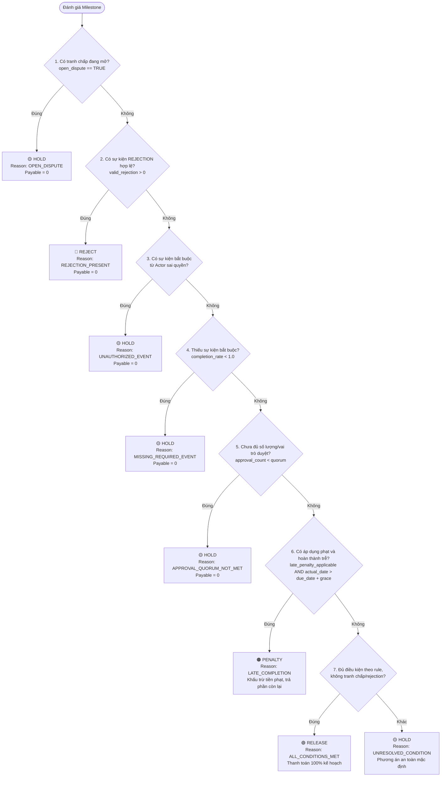

# 📖 PHẦN 1: GIẢI MÃ ĐỀ BÀI, TỪ ĐIỂN THUẬT NGỮ & VÍ DỤ MINH HỌA
**Bảng D – Case 4: Smart Contract Workflow (Vòng sơ khảo)**  

---

## 1. BẢN CHẤT ĐỀ BÀI LÀ GÌ? (GIẢI THÍCH CHO NGƯỜI CHƯA BIẾT GÌ)

### Câu chuyện đời thực: Nỗi đau "Thanh toán hợp đồng"
Hãy tưởng tượng bạn thuê một nhà thầu xây dựng một toà nhà ký túc xá cho trường học trị giá **10 tỷ đồng**. 
Bạn sẽ không bao giờ chuyển toàn bộ 10 tỷ ngay từ ngày đầu tiên. Thay vào đó, bạn chia thành các đợt:
1. **Đợt 1 (20% - 2 tỷ):** Ký hợp đồng xong ứng trước 2 tỷ.
2. **Đợt 2 (30% - 3 tỷ):** Đổ xong móng, nghiệm thu kết cấu đạt chuẩn mới trả tiếp 3 tỷ.
3. **Đợt 3 (30% - 3 tỷ):** Xây xong phần thô, lắp kính nghiệm thu xong trả 3 tỷ.
4. **Đợt 4 (20% - 2 tỷ):** Hoàn thiện nội thất, hết 12 tháng bảo hành không hỏng hóc mới trả nốt 2 tỷ.

**Vấn đề nhức nhối ngoài thực tế:**
* Kế toán và ban quản lý dự án kiểm tra hồ sơ giấy thủ công nên rất dễ mắc lỗi nghiêm trọng:
  * **Thanh toán hớ / Giải ngân non:** Nhà thầu chưa hoàn thành móng mà kế toán đã lỡ chuyển tiền đợt 2.
  * **Ký duyệt sai thẩm quyền:** Biên bản nghiệm thu đáng lẽ phải do Trưởng Ban Quản lý Dự án ký, nhưng lại do một nhân viên kỹ thuật ký bừa mà kế toán vẫn giải ngân.
  * **Bỏ quên phạt vi phạm hợp đồng:** Công trình bị trễ hạn 20 ngày, nhưng kế toán vẫn chuyển đủ 100% tiền đợt 2 mà quên không trừ tiền phạt trễ hạn.
  * **Thanh toán khi đang cãi nhau:** Hai bên đang khiếu nại chất lượng gạch ốp lát bị nứt, sự việc chưa giải quyết xong nhưng tiền vẫn tự động trôi đi.

### Đề bài yêu cầu bạn làm gì?
Ban tổ chức muốn bạn xây dựng một **"Cỗ máy trọng tài kỹ thuật số" (Smart Contract Workflow Engine)** đóng vai trò như một người kiểm soát viên tự động:
1. Đọc dữ liệu hợp đồng và điều kiện của từng mốc.
2. Lắng nghe các sự kiện phát sinh ngoài đời (hàng đến kho, biên bản nghiệm thu, hoá đơn đỏ, chữ ký phê duyệt, khiếu nại...).
3. Tự động kiểm tra từng quy tắc nghiêm ngặt theo thứ tự ưu tiên (*First-match rule check*).
4. Đưa ra **1 trong 4 quyết định tự động**:
   * 🟢 **RELEASE (Giải ngân):** Đủ 100% bằng chứng hợp lệ, đúng người duyệt, không có blocker và không thuộc rule phạt $\rightarrow$ Trả đủ tiền.
   * 🟡 **HOLD (Tạm giữ tiền):** Thiếu giấy tờ, người ký sai quyền, hoặc đang tranh chấp $\rightarrow$ Giữ tiền lại để bảo vệ ngân sách.
   * 🔴 **REJECT (Từ chối):** Biên bản nghiệm thu bị đánh trượt, sản phẩm lỗi bị từ chối chính thức $\rightarrow$ Bác bỏ yêu cầu giải ngân mốc này.
   * 🟠 **PENALTY (Phạt trễ hạn):** Hồ sơ nghiệm thu đủ, nhưng bị nộp trễ quá số ngày cho phép $\rightarrow$ Tính tiền phạt theo công thức, trừ tiền phạt rồi mới giải ngân phần còn lại.
5. **Ghi lại nhật ký kiểm toán (Audit Trail):** Giải trình rõ ràng vì sao lại ra quyết định đó, căn cứ vào bằng chứng nào, quy tắc nào phán quyết.

> [!NOTE]
> **Smart Contract ở đây nghĩa là gì?**  
> Trong phạm vi bài thi, "Smart Contract" được hiểu là các điều kiện hợp đồng số hóa và workflow tự động kiểm tra khi có sự kiện. Đề thi này **KHÔNG BẮT BUỘC** bạn phải dùng Blockchain, Ethereum hay Solidity! Trọng tâm là **tính logic, an toàn dòng tiền và khả năng truy vết**.

---

## 2. TỪ ĐIỂN THUẬT NGỮ CHUYÊN MÔN QUAN TRỌNG

| Thuật ngữ | Thuật ngữ gốc | Giải thích dễ hiểu |
| :--- | :--- | :--- |
| **Hợp đồng** | `Contract` | Bản hợp đồng tổng thể giữa Bên mua (`BUYER`) và Bên bán (`SUPPLIER`). |
| **Mốc thực hiện / Đợt thanh toán** | `Milestone` | Một giai đoạn cụ thể trong hợp đồng (ví dụ: Ký HĐ, Giao hàng, Nghiệm thu, Bảo hành). |
| **Sự kiện thực tế** | `Event` | Một hành động phát sinh ngoài đời được gửi vào hệ thống (gửi hàng, gửi hoá đơn, ký biên bản...). |
| **Chủ thể & Thẩm quyền** | `Actor & Authority` | Ai là người thực hiện sự kiện đó? Người đó có đúng thẩm quyền hay không? *(Ví dụ: Bên bán giao hàng thì hợp lệ, nhưng bên mua tự ấn 'Đã giao hàng' là sai thẩm quyền).* |
| **Sự kiện gửi lặp** | `Duplicate Event` | Do mạng lag hoặc nhân viên gửi nhầm 2 lần cùng một hoá đơn/biên bản. Hệ thống phải biết lọc trùng, không được tính 2 lần bằng chứng. |
| **Túc số phê duyệt** | `Approval Quorum` | Số lượng chữ ký tối thiểu và đúng chức danh quy định để được duyệt *(Ví dụ: Phải đủ 2 người gồm Giám đốc hợp đồng và Kế toán trưởng ký).* |
| **Tranh chấp / Khiếu nại** | `Dispute` | Khi một bên khiếu nại chất lượng sản phẩm/dịch vụ (`DISPUTE_OPENED`). Khi tranh chấp còn mở, hệ thống **bắt buộc phải HOLD**. Chỉ khi có lệnh giải quyết (`DISPUTE_RESOLVED`) mới tiếp tục xét duyệt. |
| **Thời gian ân hạn** | `Grace Period` | Số ngày du di cho phép trễ hạn mà chưa bị phạt *(Ví dụ: Hạn 10/05, ân hạn 2 ngày $\rightarrow$ Nộp ngày 12/05 vẫn không bị phạt).* |
| **Phạt chậm tiến độ** | `Late Penalty` | Tiền phạt tính theo số ngày trễ (vượt qua thời gian ân hạn) theo tỷ lệ % mỗi ngày quy định trong hợp đồng. |
| **Thứ tự ưu tiên quy tắc** | `First-match Rule Priority` | Thứ tự kiểm tra từ trên xuống dưới; gặp quy tắc nào khớp trước thì áp dụng ngay và dừng lại, không xét các quy tắc sau. |
| **Dấu vết kiểm toán** | `Audit Trail` | Nhật ký truy vết ghi lại lịch sử: Quyết định ra lúc mấy giờ, do rule nào phán quyết, căn cứ vào mã sự kiện (`Event ID`) nào. |

---

## 3. CƠ CHẾ QUYẾT ĐỊNH (FIRST-MATCH RULE PRIORITY)

Quy trình thẩm định một mốc thanh toán tuân thủ nghiêm ngặt theo lưu đồ sau:

---

## 4. 5 VÍ DỤ MINH HỌA TRỰC QUAN TỪ BỘ DỮ LIỆU ĐỀ THI

Các giá trị dưới đây đối chiếu từ `decision_sample.csv`, `milestones.csv` và `events.csv`; là kết quả tham chiếu của BTC, chưa phải kết quả engine của đội. Xem [nguồn sample](../BangD-Case4/DataPack-CASE4_SmartContractWorkflow/03_labels_sample/decision_sample.csv).

### Ví dụ 1: Trường hợp chuẩn mẫu (`CLEAN_RELEASE` $\rightarrow$ 🟢 RELEASE)
* **Mã tình huống trong đề:** `SC001` (Hợp đồng `CT0001`, Mốc `MS0003`).
* **Hợp đồng:** Cung cấp thiết bị lưu trữ, mốc thanh toán 387 triệu VND.
* **Diễn biến sự kiện:**
  * Nhà cung cấp giao hàng đúng hạn.
  * Bên mua ký biên bản nghiệm thu (`ACCEPTANCE`) qua sự kiện `EV00004`.
  * Không có tranh chấp, không có từ chối, không cần cấp duyệt bổ sung.
* **Kết quả xử lý:**
  * Quyết định: **RELEASE**
  * Lý do (`reason_code`): `ALL_CONDITIONS_MET`
  * Số tiền thanh toán: **387.00 triệu VND**
  * Tiền phạt: **0.00 triệu VND**
  * Bằng chứng truy vết (`evidence_event_ids`): `EV00004`

---

### Ví dụ 2: Bị phạt do giao hàng trễ tiến độ (`LATE_PENALTY` $\rightarrow$ 🟠 PENALTY)
* **Mã tình huống trong đề:** `SC005` (Hợp đồng `CT0005`, Mốc `MS0020`).
* **Thông số mốc:**
  * Giá trị kế hoạch: **900.00 triệu VND**.
  * Hạn chót hoàn thành (`due_date`): **2026-11-02**.
  * Thời gian ân hạn (`grace_period_days`): **5 ngày** (tức đến hết ngày 2026-11-07 là không phạt).
  * Tỷ lệ phạt: **0.15%/ngày**; Phạt tối đa: **8%**.
* **Diễn biến thực tế:**
  * Nghiệm thu ngày **2026-11-12** (`EV00037`); hóa đơn và phê duyệt cuối ngày **2026-11-13** (`EV00038`, `EV00039`). Ngày hoàn thành đủ điều kiện là **2026-11-13**.
* **Tính toán chi tiết:**
  $$\text{Hạn chót sau ân hạn} = 02/11/2026 + 5\text{ ngày} = 07/11/2026$$
  $$\text{Số ngày tính phạt} = 13/11/2026 - 07/11/2026 = 6\text{ ngày}$$
  $$\text{Tiền phạt} = \min(6 \times 0.15\% \times 900, 8\% \times 900) = 6 \times 0.0015 \times 900 = 8.10\text{ triệu VND}$$
  $$\text{Số tiền thực trả} = 900.00 - 8.10 = 891.90\text{ triệu VND}$$
* **Kết quả xử lý:**
  * Quyết định: **PENALTY**
  * Lý do: `LATE_COMPLETION`
  * Tiền thanh toán: **891.90 triệu VND** | Tiền phạt: **8.10 triệu VND**

---

### Ví dụ 3: Đang có tranh chấp khiếu nại (`OPEN_DISPUTE_HOLD` $\rightarrow$ 🟡 HOLD)
* **Mã tình huống trong đề:** `SC007` (Hợp đồng `CT0003`, Mốc `MS0011`).
* **Giá trị kế hoạch:** 477.00 triệu VND.
* **Diễn biến thực tế:**
  * Bên mua phát hiện lỗi thiết bị và phát lệnh khiếu nại (`DISPUTE_OPENED` - `EV00018`).
  * Tại thời điểm kiểm tra, chưa có sự kiện giải quyết tranh chấp (`DISPUTE_RESOLVED`).
* **Quy tắc xử lý:**
  * Tranh chấp đang mở là quy tắc ưu tiên số 1 (Priority 10). Bất kể hàng đã giao hay hóa đơn đã nộp, hệ thống lập tức ra lệnh **HOLD**.
* **Kết quả xử lý:**
  * Quyết định: **HOLD**
  * Lý do: `OPEN_DISPUTE`
  * Tiền thanh toán: **0.00 triệu VND** | Tiền phạt: **0.00 triệu VND**

---

### Ví dụ 4: Vượt quyền phê duyệt / Sai thẩm quyền (`UNAUTHORIZED_EVENT` $\rightarrow$ 🟡 HOLD)
* **Mã tình huống trong đề:** `SC017` (Hợp đồng `CT0017`, Mốc `MS0067`).
* **Diễn biến thực tế:**
  * Sự kiện `UAT_PASSED` (`EV00177`) được tạo bởi nhà cung cấp `S018`, không có thẩm quyền xác nhận UAT. Vì vậy chỉ 1/2 required event hợp lệ, dù đã đủ 2 approval.
* **Quy tắc xử lý:**
  * Không chấp nhận bằng chứng từ người không có thẩm quyền (Priority 30).
* **Kết quả xử lý:**
  * Quyết định: **HOLD**
  * Lý do: `UNAUTHORIZED_EVENT`
  * Tiền thanh toán: **0.00 triệu VND** (chặn thanh toán trong tình huống sai quyền này).

---

### Ví dụ 5: Lỗi gửi lặp sự kiện (`DUPLICATE_EVENT_RELEASE` $\rightarrow$ 🟢 RELEASE)
* **Mã tình huống trong đề:** `SC019` (Hợp đồng `CT0043`, Mốc `MS0172`).
* **Diễn biến thực tế:**
  * Bên bán gửi hai sự kiện `DELIVERY` (`EV00482`, `EV00484`) cùng document `DN-CT0043-02`. Sau dedup chỉ tính một bằng chứng giao hàng; hóa đơn và hai approval vẫn hợp lệ.
* **Quy tắc xử lý:**
  * Hệ thống thông minh nhận diện và lọc bỏ bản trùng lặp, chỉ giữ lại 1 bản hợp lệ duy nhất. Sau khi lọc trùng, mốc vẫn đủ điều kiện giải ngân.
* **Kết quả xử lý:**
  * Quyết định: **RELEASE**
  * Lý do: `ALL_CONDITIONS_MET`
  * Tiền thanh toán: **752.50 triệu VND** (Đầy đủ, không bị trừ oan và không bị thanh toán đúp).
