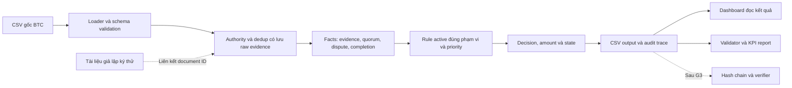

# Chiến lược kỹ thuật: lõi đúng, kiểm chứng được, mở rộng có giới hạn

**Case 4 — Smart Contract Workflow**

Đây là thiết kế để triển khai, chưa phải mô tả một hệ thống đã hoàn thành. Nguồn: [đề thi](../BangD-Case4/DeThi2026_BangD_SmartContractWorkflow.pdf), [Data Pack README](../BangD-Case4/DataPack-CASE4_SmartContractWorkflow/README.md) và [dictionary](../BangD-Case4/DataPack-CASE4_SmartContractWorkflow/02_metadata/data_dictionary.csv). Phân công và thời hạn nằm ở [kế hoạch 7 ngày](03_LO_TRINH_VA_CHECKLIST_NOP_BAI.md).

## 1. Bronze/Silver/Gold và phạm vi thực hiện

| Mức theo đề | Nội dung | Quyết định của đội trong 7 ngày |
| --- | --- | --- |
| Bronze bắt buộc | Nhiều hợp đồng, ≥3 loại milestone; rule/state tự động; bốn decision; payable/penalty/lịch sử; dashboard; không RELEASE khi thiếu điều kiện | Làm toàn bộ lõi tối giản, 405 mốc; chưa có ground truth toàn bộ nên báo đúng phạm vi kiểm chứng |
| Silver cộng điểm | Escrow/penalty/time-lock; quyền/multi-party approval; dispute; duplicate/unauthorized; KPI/scenario test | Ưu tiên quyền, quorum, dispute, dedup và test vì cũng cần để xử lý đúng Data Pack; không để thành phần này sang cuối như tùy chọn |
| Gold cộng điểm cao | Blockchain nếu phù hợp, multisig/oracle mô phỏng, audit/rule nâng cao, dashboard đa hợp đồng, AI hỗ trợ điều khoản/human-in-the-loop | Chọn tối đa 1–2 nâng cấp nhỏ sau G3: hash chain có verifier hoặc ký/verify giả lập; không tự nhận đạt Gold vì chỉ có sơ đồ |

Không cần blockchain để giải bài. Audit cơ bản và dashboard tối thiểu vẫn phải có; hash chain và AI không phải điều kiện thay thế cho nghiệp vụ đúng. Ký nhiều approval event khác với cơ chế multisignature mật mã.

## 2. Kiến trúc tối giản và ranh giới module



Hoàng sở hữu loader/spec; Tuấn sở hữu lõi/export/audit; Mai Anh sở hữu ma trận quyền và test an toàn; Lâm tích hợp/QA; Hà Phương làm UI; Thúy viết hồ sơ từ bằng chứng. Engine không phụ thuộc UI, API AI hoặc test label. UI không tự tính lại tiền/rule.

D1 chốt CSV/trace mock để làm song song. CSV lấy nguyên header **22 cột** từ [template thực tế](../BangD-Case4/DataPack-CASE4_SmartContractWorkflow/04_output_templates/submission_output_template.csv), không chép schema từ trí nhớ. Giữ sáu trường điền sẵn và đủ 405 khóa; trace lưu chi tiết hơn CSV theo audit_trace_id. Hướng stack: Python + pytest, dashboard đọc CSV/JSONL bằng công cụ đội quen.

## 3. Hợp đồng nghiệp vụ và rule engine

### Facts phải có trước khi đánh giá rule

- Required events hợp lệ sau kiểm trạng thái và actor; liệt kê thiếu, sai quyền, duplicate và lý do loại.
- Quyền actor đối chiếu party chuẩn: type/role, active, tổ chức/parent. Required event kiểm theo **ma trận thẩm quyền** của [đặc tả mục 4.2](04_DAC_TA_NGHIEP_VU.md#42-ma-trận-thẩm-quyền-tạo-required-event), không theo nguyên cột allowed_event_types (dùng nguyên cột làm sai 108/405 mốc và 5/20 sample); allowed_event_types chỉ dùng cho APPROVAL/REJECTION/DISPUTE (alias DISPUTE gồm cả mở/giải quyết).
- Approval actor duy nhất, đúng role bắt buộc, đúng bên mua; đếm số vai trò được phủ, không chỉ đếm số event. Hạn mức `approval_limit_vnd_mn` là kiểm tra tùy chọn Silver, hiện không bị vượt ở mốc nào ([đặc tả BR-10](04_DAC_TA_NGHIEP_VU.md#82-quy-tắc-chi-tiết)).
- Dispute còn mở sau khi resolve đúng reference, quyền và thứ tự thời gian; rejection hợp lệ.
- Completion là thời điểm muộn nhất trong các required event hợp lệ (bản sớm nhất mỗi loại), **không** tính approval ([đặc tả BR-11](04_DAC_TA_NGHIEP_VU.md#82-quy-tắc-chi-tiết)); không lấy ngày chạy chương trình. Batch so mẫu đọc toàn bộ lịch sử, vì Data Pack có sự kiện sau ngày thi; demo as-of dùng cutoff cấu hình riêng.

Dedup giữ raw log, không gộp khác actor, không để sự kiện sai quyền biến mất khi chọn bản đại diện. Khóa gợi ý có contract/milestone/type/document/actor; phải chốt document rỗng và reference/timestamp. Replay không được tạo thanh toán hai lần.

### Ma trận first-match

Đọc các rule active đúng rule_set_id/release_rule_code/workflow/milestone; sort priority tăng dần. Bảng dưới là tóm tắt Data Pack, không phải hard-code theo scenario ID. Tên fact thực tế trong CSV có `valid_rejection_event_count`.

| Priority | Điều kiện tóm tắt | Decision / reason | Payable |
| --- | --- | --- | --- |
| 10 | open_dispute | HOLD / OPEN_DISPUTE | 0 |
| 20 | valid_rejection_event_count > 0 | REJECT / REJECTION_PRESENT | 0 |
| 30 | unauthorized_required_event_count > 0 | HOLD / UNAUTHORIZED_EVENT | 0 |
| 40 | required_event_completion_rate < 1 | HOLD / MISSING_REQUIRED_EVENT | 0 |
| 50 | cần approval nhưng chưa đủ quorum | HOLD / APPROVAL_QUORUM_NOT_MET | 0 |
| 60 | late_penalty_applicable và completion quá due + grace, sau khi các điều kiện trước đã qua | PENALTY / LATE_COMPLETION | planned − penalty, không âm |
| 70 | all_required_conditions_met, không dispute/rejection | RELEASE / ALL_CONDITIONS_MET | planned |
| 80 | ELSE | HOLD / UNRESOLVED_CONDITION | 0 |

Predicate `all_required_conditions_met` phải bao hàm role và quyền đã chốt, không chỉ số đếm. Thiếu rule/config hoặc điều kiện không hiểu thì ghi diagnostic và HOLD; không dùng eval trực tiếp trên condition_expression CSV. Nếu vừa dispute vừa rejection, priority 10 thắng. Nếu late_penalty_applicable=FALSE, trễ không tự động sinh PENALTY.

### Tiền và rounding

```text
days_late = max(0, completion_date - (due_date + grace_days))
penalty = min(days_late × rate_pct / 100 × planned,
              cap_pct / 100 × planned)
payable = max(0, planned - penalty)
```

Dùng Decimal; `_vnd_mn` là **triệu VND**; 0.10 là **0,10%**, không phải 10%. Làm tròn penalty tới 0,01 theo ROUND_HALF_UP rồi mới trừ ([đặc tả BR-13](04_DAC_TA_NGHIEP_VU.md#82-quy-tắc-chi-tiết); `Decimal` mặc định HALF_EVEN sẽ lệch ở MS0396), không dùng float rồi format để che sai số. HOLD/REJECT không thanh toán; penalty chỉ tính theo điều kiện rule đã qua.

Ví dụ chuẩn **SC005 / CT0005 / MS0020**: due 02/11/2026, grace 5 ngày, completion 13/11/2026 → trễ 6 ngày; planned 900.00, rate 0,15%/ngày, cap 8% → penalty 8.10, payable 891.90 triệu VND. Xem [decision sample](../BangD-Case4/DataPack-CASE4_SmartContractWorkflow/03_labels_sample/decision_sample.csv).

### State khác decision

State model đã chốt ở [đặc tả mục 9](04_DAC_TA_NGHIEP_VU.md#9-quyết-định-trạng-thái-và-xử-lý-ngoại-lệ): ánh xạ decision → trạng thái theo tên README (PENALTY → `PAID_WITH_PENALTY`, nghĩa là đủ điều kiện chi sau khấu trừ), bảng chuyển trạng thái và điều kiện đánh giá lại (9.4), xử lý ngoại lệ không có override (9.5), trạng thái hợp đồng tổng hợp (9.3). COMPLETED chỉ dùng khi có bước chi mô phỏng; không tự coi là đã chuyển tiền thật.

## 4. Audit trail và hash chain

Audit cơ bản P0 ghi input/facts, event dùng/loại, actor, rule/priority, reason, amounts/rounding, trạng thái trước/sau, timestamp, run/config/engine version. Khi thiếu evidence, danh sách rỗng hợp lệ nếu lý do thiếu rõ; không tạo bằng chứng giả.

P1 đề xuất:

```text
hash_i = SHA256(canonical_JSON(record_i_without_hash) || previous_hash)
```

Chốt canonical serialization, thứ tự bản ghi và genesis; verifier tính lại chuỗi, so hash neo được lưu tách biệt. Demo bản gốc qua, sửa decision/amount/event thì fail. Đưa cả input fingerprint, rule/config version vào thông tin run để truy vết việc thay dữ liệu/luật.

**Giới hạn:** hash chain phát hiện thay đổi khi có mốc hash tin cậy để đối chiếu. Người sửa toàn bộ log và mốc hash cùng lúc có thể tạo lại chuỗi hợp lệ. Đây không phải blockchain phân tán hay bảo đảm bất biến tuyệt đối; chưa có kiểm soát truy cập/neo độc lập thì phải nói rõ.

## 5. Hợp đồng số và demo ký số

Trong Data Pack, CONTRACT_SIGNED là một event nghiệp vụ, chưa chứa đầy đủ chữ ký/chứng thư để xác minh mật mã. Không tự tuyên bố đã xác thực chữ ký chỉ vì có event.

Luồng P1 giới hạn:

1. Tạo tài liệu hợp đồng giả lập, document ID/hash; dùng khóa thử nghiệm ngoài repo.
2. Ký nội dung bằng thư viện mật mã tiêu chuẩn, không tự thiết kế thuật toán.
3. Verify chữ ký bằng public key tin cậy của signer thử nghiệm, so nội dung/hash.
4. Đối chiếu signer với vai trò/quyền nghiệp vụ; chữ ký đúng nhưng người sai quyền vẫn không thỏa điều kiện.
5. Ghi verification result liên kết document–event–actor, chạy engine theo luật bình thường. Sửa một byte tài liệu thì verify fail.

Mai Anh viết spec và checklist, Tuấn review kỹ thuật, Hà Phương hiển thị kết quả nếu đã tích hợp. Không ghi vào Data Pack gốc. Nếu chưa có crypto demo, UI chỉ ghi **event ký mô phỏng**, không ghi “đã xác minh chữ ký”. Demo không kết nối CA thật, không chứng minh đầy đủ hiệu lực pháp lý hay xác thực danh tính thực.

**Đầu việc nghiên cứu pháp lý, không phải kết luận tư vấn:** Mai Anh/Thúy lập bảng vấn đề–nguồn chính thức–ngày hiệu lực–điều kiện áp dụng–phần cần xác minh, bao gồm hợp đồng điện tử/chữ ký điện tử, định danh/thẩm quyền, chứng thư/thu hồi/thời gian, dữ liệu cá nhân và lưu trữ. Kiểm văn bản đang hiệu lực tại ngày nộp qua nguồn chính thức; chỉ đưa kết luận vào hồ sơ sau khi có nguồn và người review. P0 chỉ cần nêu đúng phạm vi mô phỏng của đề, không phụ thuộc một nghiên cứu pháp lý production hoàn chỉnh.

## 6. AI có giới hạn và use case trường học

Giải thích P0 theo template reason/điều kiện thiếu/evidence, dễ kiểm và chạy offline. LLM nếu thêm chỉ diễn đạt lại facts, không sửa luật/tiền, không tự bịa “đã gửi email”. Clause extraction/OCR đưa vào roadmap: JSON phải kiểm schema, gắn nguồn điều khoản, con người duyệt trước khi kích hoạt rule. Chỉ công bố chất lượng trích xuất khi có tập đánh giá. Anomaly model chưa có baseline/dữ liệu đánh giá thì chưa nên triển khai trong 7 ngày.

Use case mô phỏng: mua thiết bị phòng thực hành; trường là BUYER, công ty là SUPPLIER, đại diện kỹ thuật/ngân sách ánh xạ vào role approval đúng policy. Hoàng xác định mapping, không mặc định chức danh ngoài đời luôn tương ứng quyền trong CSV. Đo giá trị tương lai bằng cùng bộ hồ sơ: thời gian xử lý, số lần trả lại do thiếu chứng từ, tỷ lệ sai kiểm quyền và khả năng truy vết. Không tự nhận đã pilot hay tiết kiệm 80% khi chưa đo.

## 7. Bằng chứng để quyết định có nâng cấp không

G3 cần 20 mẫu decision/amount đúng, test chặn chi sai qua, UI tối thiểu hoạt động. G4 có CSV validator, audit review và báo cáo KPI. Đo accuracy trên tập có nhãn; trên toàn 405 mốc báo coverage/invariant/trace. Không suy thành tích toàn bộ từ mẫu công khai, không hứa hidden test hay “đạt Gold” chỉ vì dùng AI/hash.

## Cập nhật theo trả lời BTC ngày 24/10/2026

Ưu tiên Đồng → Bạc → Vàng được áp dụng bằng cổng kiểm cụ thể trong [14 — Rà soát](14_RA_SOAT_BTC_DONG_BAC_VANG.md). BTC xác nhận 20 PUBLIC / 250 HIDDEN / 135 HOLDOUT đều trong 405 mốc; xuất toàn template, không tự lọc scope. Rule động phải giữ nguyên toàn bộ baseline 405, không chỉ 20 mẫu. Ngày hoàn thành chỉ dựa required event; phân quyền resolver là extension Silver; confidence [0,1] do đội giải thích, không mở khóa decision. Những điểm còn chưa xác nhận ở [15 — Xác nhận BTC](15_XAC_NHAN_BTC_VA_GIA_DINH.md).
