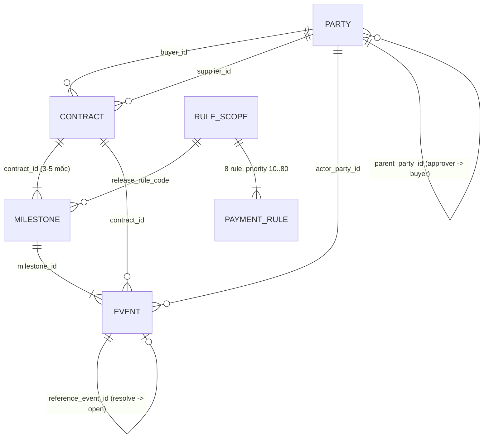
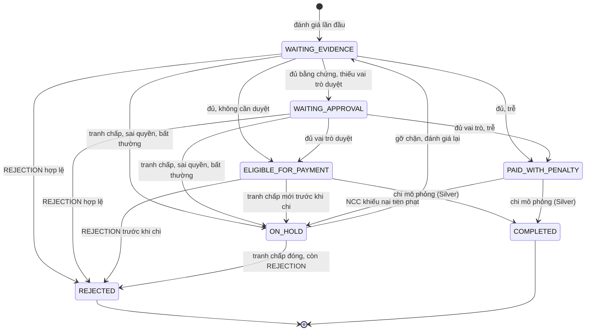

# 04 — Đặc tả nghiệp vụ: Smart Contract Workflow

**Case 4 — Bảng D — Festival Chuyển đổi số 2026 — Vòng sơ khảo**

| Mục | Nội dung |
| --- | --- |
| Phiên bản | **1.1** |
| Trạng thái | Bản chuẩn đã kiểm chứng trên Data Pack. Chờ đội duyệt và BTC trả lời các giả định Mở (mục 13). |
| Ngày | 25/10/2026 |
| Quy ước phiên bản | `MAJOR.MINOR`. Tăng MINOR khi bổ sung hoặc làm rõ mà không đổi kết quả của 405 mốc. Tăng MAJOR khi bất kỳ quyết định hay số tiền nào trên Data Pack thay đổi. Quy trình ở mục 19.2. |
| Lịch sử | Các bản 0.1, 0.2, 0.4, 0.5 nằm ở [`archive/nghiep-vu/`](archive/nghiep-vu/); nội dung thay đổi ở Phụ lục E |
| Nguồn | [Đề thi PDF](../BangD-Case4/DeThi2026_BangD_SmartContractWorkflow.pdf). Data Pack v1.0-final, snapshot 18/10/2026: [README](../BangD-Case4/DataPack-CASE4_SmartContractWorkflow/README.md), [data dictionary](../BangD-Case4/DataPack-CASE4_SmartContractWorkflow/02_metadata/data_dictionary.csv), [manifest](../BangD-Case4/DataPack-CASE4_SmartContractWorkflow/02_metadata/dataset_manifest_final.csv), 5 tệp `01_data`, 2 tệp `03_labels_sample`, [template nộp](../BangD-Case4/DataPack-CASE4_SmartContractWorkflow/04_output_templates/submission_output_template.csv) |
| Kiểm chứng | Script [`tools/kiem_chung_nghiep_vu.py`](../tools/kiem_chung_nghiep_vu.py) (`SPEC_VERSION = "1.1"`) và bộ test [`tests/test_dac_ta_nghiep_vu.py`](../tests/test_dac_ta_nghiep_vu.py) gồm 41 test. Cách chạy ở Phụ lục D. |
| Đối tượng đọc | Toàn đội: nghiệp vụ, kỹ thuật, thuyết trình |
| Mục đích | Một nguồn duy nhất về cách hiểu bài toán, thuật ngữ, quy tắc quyết định, vòng đời trạng thái, xử lý ngoại lệ, phân quyền và quy ước đầu ra |

Bản 1.1 bổ sung [trả lời BTC do đội cung cấp](15_XAC_NHAN_BTC_VA_GIA_DINH.md) về ngày hoàn thành, dispute, confidence và chia 20 PUBLIC / 250 HIDDEN / 135 HOLDOUT. Kết quả decision/reason/payable/penalty trên 405 mốc giữ nguyên. Phân quyền đóng dispute phía bên mua là thiết kế Silver; Bronze chỉ xử lý trạng thái và liên kết event chuẩn. Cổng rule động và profile xuất bài được giải thích ở [báo cáo rà soát](14_RA_SOAT_BTC_DONG_BAC_VANG.md).

## Quy ước nhãn độ tin cậy

| Nhãn | Ý nghĩa | Mức tin |
| --- | --- | --- |
| **[ĐỀ]** | Nêu trực tiếp trong đề PDF, README, data dictionary hoặc `payment_rules.csv` của BTC | Cao nhất |
| **[BTC]** | BTC trả lời trực tiếp đội thi, được đội chuyển lại trong phiên làm việc 24/10/2026; xem tài liệu 15 | Làm rõ phạm vi đề |
| **[SAMPLE]** | Được 20 mẫu công khai của BTC xác nhận (script khớp 20/20) | Cao, nhưng chỉ cho loại tình huống có mẫu |
| **[DỮ LIỆU]** | Đếm hoặc kiểm trên CSV bằng script. Là sự thật về dữ liệu, **không phải** ground truth | Tái lập được |
| **[GIẢ ĐỊNH]** | Đội tự chọn khi nguồn không nói rõ. Luôn kèm tác động đo được và mã ở mục 13 | Phải nêu trong hồ sơ |
| **[THIẾT KẾ]** | Quy trình vận hành do đội đề xuất, ngoài phạm vi Data Pack. Không đổi kết quả của 405 mốc | Đề xuất của đội |

Khi các nguồn mâu thuẫn, ưu tiên theo thứ tự **[ĐỀ] kết hợp [BTC] làm rõ → [SAMPLE] → [DỮ LIỆU] → [GIẢ ĐỊNH]**. Ví dụ ở mục 4.4: cột `allowed_event_types` bị gạt vì 20 sample (đáp án của BTC) cho kết quả khác.

## Quy ước ngôn ngữ và ký hiệu

- Thuật ngữ dùng tiếng Việt, kèm tên trường dữ liệu ở lần xuất hiện đầu: *mốc thanh toán (milestone)*.
- Bốn quyết định giữ nguyên tiếng Anh, viết hoa: **RELEASE, HOLD, REJECT, PENALTY**.
- Tiền tính bằng **triệu VND** (hậu tố `_vnd_mn`). Phần trăm lưu ở dạng số phần trăm: `0.10` nghĩa là 0,10%, không phải 10%.
- Mã định danh: `CTdddd` hợp đồng, `MSdddd` milestone, `EVddddd` event, `PRdddd` rule, `Bddd` bên mua, `Sddd` nhà cung cấp (NCC), `Addd` người phê duyệt.
- Ký hiệu: P = `planned_payment_vnd_mn`; F = tiền phạt.

---

## 1. Tóm tắt điều hành

**Bài toán.** Hợp đồng được thanh toán theo từng mốc: ký, giao hàng, nghiệm thu, bảo hành... Kiểm tra thủ công dễ dẫn tới trả tiền khi chưa đủ điều kiện, xử lý chậm và thiếu dấu vết. Hệ thống cần tự kiểm tra điều kiện của từng mốc, ra quyết định và giải thích được quyết định đó. **[ĐỀ]**

**Cốt lõi.** Với mỗi milestone, hệ thống:

1. gom sự kiện và khử trùng lặp;
2. phân loại sự kiện thành hợp lệ, sai thẩm quyền hoặc bị loại, nhưng vẫn giữ toàn bộ dấu vết;
3. tính các fact;
4. áp 8 rule của `payment_rules.csv` theo first-match để ra một quyết định, kèm số tiền, lý do, rule áp dụng và bằng chứng.

Con người chỉ can thiệp bằng cách tạo event mới hoặc quyết định ngoại lệ có hai người duyệt. Không ai sửa tay được quyết định.

**Năm điều cần nhớ.**

1. Đơn vị ra quyết định là **milestone** (405 mốc), không phải hợp đồng. **[ĐỀ]**
2. 8 rule chạy **first-match**, priority từ 10 đến 80, đọc từ `payment_rules.csv`. Logic giống hệt nhau ở cả 16 phạm vi rule. **[ĐỀ] [DỮ LIỆU]**
3. **Chặn trước, tính tiền sau.** Dữ liệu hoặc điều kiện chưa rõ thì HOLD, không bao giờ tự RELEASE. **[ĐỀ]**
4. Đề ưu tiên **Rule Execution Accuracy** và **tỷ lệ tình huống xử lý đúng**; **Unauthorized Payment Rate càng gần 0 càng tốt**. Nếu buộc phải sai, sai theo hướng giữ tiền an toàn hơn trả nhầm. **[ĐỀ]**
5. Không hard-code theo sample. BTC xác nhận 405 mốc gồm **20 PUBLIC, 250 HIDDEN, 135 HOLDOUT**; không biết danh sách chia tập và ground truth ẩn. Xuất đủ template 405 dòng. **[BTC]**

**Tình trạng kiểm chứng.**

- Script cài đúng đặc tả này và khớp **20/20 sample trên cả 17 cột so sánh**: quyết định, reason_code, payable, penalty, planned_payment, evidence_event_ids, missing_required_events và 10 cột fact.
- **41/41 test của bản 1.0** đã đạt, gồm 30 test cho các ca biên mà Data Pack chưa có.
- **0 vi phạm** bất biến đầu ra trên 405 mốc.
- Trên toàn pack: RELEASE 348, PENALTY 15, HOLD 36, REJECT 6.

**[SAMPLE] [DỮ LIỆU]** Đây là kết quả theo đặc tả, không phải ground truth của BTC.

**Năm lựa chọn ảnh hưởng kết quả nhiều nhất** (đo bằng script, chi tiết ở mục 13):

| Lựa chọn | Đặc tả chọn | Nếu chọn khác |
| --- | --- | --- |
| Nguồn kiểm thẩm quyền | Ma trận mục 4.2 | Dùng nguyên `allowed_event_types`: **108/405 mốc** đổi kết quả, sample chỉ còn khớp **15/20** |
| Quyền tạo 4 loại event chưa có sample | Theo ma trận (bên mua / NCC như dữ liệu) | **80 mốc** phụ thuộc vào lựa chọn này. Rủi ro thấp (mục 4.2) |
| Phạm vi tranh chấp | Theo milestone | Tính theo cả hợp đồng: **31 mốc** chuyển sang HOLD |
| `invoice_required` | Không thay cho `required_event_types` | Bắt buộc hoá đơn: **15 mốc** ACTIVATION chuyển sang HOLD |
| Làm tròn tiền phạt | ROUND_HALF_UP | HALF_EVEN: **1 mốc** (MS0396) lệch 0,01 |

---

## 2. Bối cảnh, phạm vi và hồ sơ nộp

### 2.1. Mục tiêu **[ĐỀ]**

- Mô hình hoá chuỗi **Contract → Milestone → Event → Rule Check → Decision → Audit Log**.
- Kiểm tra required event, quyền của actor, approval quorum, dispute/rejection và điều kiện thời hạn.
- Ra RELEASE / HOLD / REJECT / PENALTY theo thứ tự ưu tiên của rule.
- Tính số tiền đủ điều kiện thanh toán và tiền phạt.
- Truy vết quyết định về event, rule và actor. Có giao diện theo dõi trạng thái **hợp đồng và từng milestone**.

### 2.2. Ngoài phạm vi **[ĐỀ]**

- Không bắt buộc blockchain, Solidity, tiền mã hoá hay ví điện tử.
- Kết quả không phải quyết định pháp lý, thanh toán hay giải ngân thực tế. Toàn bộ dữ liệu là giả lập.

### 2.3. Nguyên tắc thiết kế

| Nguyên tắc | Hệ quả |
| --- | --- |
| An toàn trước, nhanh sau | Có nghi ngờ thì HOLD. Bất thường dữ liệu chỉ được **chặn** thanh toán, không bao giờ được **mở** thanh toán (BR-15) |
| Mở dễ, đóng khó | Mọi `DISPUTE_OPENED` đều chặn. Chỉ `DISPUTE_RESOLVED` hợp lệ mới gỡ chặn (BR-08) |
| Không ai vượt rule | Không có thao tác "duyệt chi thủ công". Con người tác động bằng event mới hoặc quyết định ngoại lệ có giới hạn (BR-19, mục 9.5) |
| Giải thích được | Mỗi quyết định gắn với rule_id, event làm bằng chứng, actor và công thức tiền |
| Không hard-code | Rule đọc từ `payment_rules.csv`. Không viết điều kiện theo mã milestone, hợp đồng hay sample |
| Đơn giản nhưng đúng | Đề đánh giá workflow đúng logic cao hơn công nghệ phức tạp |

### 2.4. Hồ sơ vòng sơ khảo **[ĐỀ]**

| Hạng mục | Yêu cầu |
| --- | --- |
| Bắt buộc | Bản đề xuất 5–10 trang (PDF); slide tối đa 15 trang (PDF); tên tệp `HSSK_<TenDoi>_D.pdf` |
| Tuỳ chọn | Phụ lục: wireframe, sơ đồ trạng thái, bảng rule, audit trace mẫu, kết quả thử nghiệm |
| Thang điểm | Phù hợp vấn đề 25 · Thiết kế kỹ thuật và đo lường 30 · Đầu ra và tuân thủ (riêng tư/đạo đức) 20 · Kế hoạch MVP 15 · Trình bày 10 |

Mục 8 của đề không liệt kê tệp CSV 405 dòng, trong khi README gọi template là "bắt buộc". Đội vẫn chuẩn bị CSV và đưa vào phụ lục làm minh chứng (A15). Khi viết hồ sơ, trích các mục 1, 4.2, 8.1, 9, 15, 16 và 18 của tài liệu này.

---

## 3. Thuật ngữ

| Thuật ngữ (tên trường) | Định nghĩa | Không nhầm với |
| --- | --- | --- |
| Hợp đồng (`contract`) | Thoả thuận giữa một bên mua và một NCC, có giá trị tổng, mẫu workflow, bộ rule và tham số phê duyệt/phạt. Có 100 hợp đồng. | Milestone |
| Mốc thanh toán (`milestone`) | Một giai đoạn của hợp đồng, gắn với việc cần đạt, hạn (`due_date`) và một phần giá trị. **Đơn vị ra quyết định.** Có 405 mốc. | Event |
| Sự kiện (`event`) | Việc đã xảy ra và được ghi nhận: giao hàng, hoá đơn, nghiệm thu, phê duyệt, từ chối, mở/đóng tranh chấp... Có 1.134 event. | Bằng chứng |
| Bằng chứng (`evidence`) | Event **hợp lệ** dùng để chứng minh một điều kiện hoặc một yếu tố chặn. Event bị loại không phải bằng chứng nhưng vẫn nằm trong audit. | Event thô |
| Required event (`required_event_types`) | Các loại event mà milestone bắt buộc phải có. Mỗi loại cần ít nhất một event hợp lệ. | Event hỗ trợ: APPROVAL, REJECTION, DISPUTE_* |
| Bên tham gia / actor (`party`) | Tổ chức hoặc người tạo event: BUYER, SUPPLIER, APPROVER. | Người dùng hệ thống (mục 17) |
| Phê duyệt (`APPROVAL`) | Người phê duyệt có quyền cho phép chi tiền cho một milestone. | Nghiệm thu (`ACCEPTANCE`): bên mua xác nhận chất lượng |
| Ngưỡng phê duyệt (`required_approval_quorum`) | Số vai trò phê duyệt bắt buộc phải đạt (0, 1 hoặc 2). Mỗi người chỉ được tính một lần. | Số event APPROVAL thô |
| Tranh chấp (`dispute`) | Một bên phản đối milestone bằng `DISPUTE_OPENED`. Còn mở khi chưa có `DISPUTE_RESOLVED` hợp lệ tham chiếu đúng tới nó. | Từ chối |
| Từ chối (`REJECTION`) | Người phê duyệt của bên mua bác milestone, dẫn tới REJECT. Data Pack không có cơ chế rút lại. | Tranh chấp: có thể được giải quyết để quy trình tiếp tục |
| Ân hạn (`grace_period_days`) | Số ngày sau `due_date` mà chưa bị tính phạt. | |
| Phạt chậm (`penalty`) | Khoản trừ khi hoàn thành sau `due_date + grace_period_days`. Chỉ áp dụng khi `late_penalty_applicable = TRUE`. | |
| Giá trị kế hoạch (P) | Số tiền dự kiến trả cho milestone nếu đủ điều kiện. | Số tiền được thanh toán |
| Số tiền được thanh toán (`payable_amount_vnd_mn`) | RELEASE: P; PENALTY: P − F; HOLD và REJECT: 0. Đây là số **đủ điều kiện chi**, không phải số đã chi. | |
| Ngày hoàn thành thực tế | Thời điểm toàn bộ required event lần đầu có bằng chứng hợp lệ (BR-11). | Ngày phê duyệt, ngày của event cuối cùng |
| Khử trùng lặp (`deduplication`) | Gộp các bản ghi của cùng một sự việc thành một bằng chứng. Bản lặp vẫn được giữ trong audit. | Xoá dữ liệu |
| Sự kiện sai thẩm quyền | Required event do bên không được phép tạo loại đó (sai loại bên, không thuộc hợp đồng, hoặc không ACTIVE). | Event bị thiếu |
| Event không liên quan | Event nghiệp vụ gắn vào mốc nhưng không thuộc `required_event_types` của mốc đó (BR-20). | Event sai thẩm quyền |
| Phạm vi rule (`release_rule_code`) | Bộ 8 rule áp cho một cặp `rule_set_id:milestone_type`. Có 16 phạm vi, dùng chung giữa nhiều mốc. | Rule |
| First-match | Duyệt rule theo priority tăng dần; rule đầu tiên có điều kiện đúng được áp dụng và dừng. | |
| Fact | Biến đã tính từ dữ liệu, dùng trong biểu thức rule (mục 7.3). | Cột dữ liệu thô |
| Cổng chất lượng dữ liệu | Bước chặn khi dữ liệu không đủ tin cậy để đánh giá tự động; ra HOLD theo rule 80 (BR-15). | |
| Quyết định ngoại lệ | Quyết định có hai người duyệt, vô hiệu một event sai thẩm quyền hoặc bất thường để gỡ chặn (BR-19). | Sửa hoặc xoá event |
| Đánh giá lại | Chạy lại 9 bước ở mục 7.2 khi có thay đổi (mục 9.4). Mỗi lần chạy có `run_id` riêng. | Sửa kết quả cũ |
| Snapshot | Ngày chốt dữ liệu ghi trong metadata: 18/10/2026. **Không** dùng để cắt event (BR-16). | Thời điểm của event |
| Audit trail | Bản ghi đủ để tái hiện quyết định: đầu vào, fact, event được dùng hoặc bị loại, rule thắng, công thức tiền, thời điểm, phiên bản. | |

---

## 4. Các bên và thẩm quyền

### 4.1. Ba loại bên **[DỮ LIỆU]**

| Loại | Số lượng | Việc làm trong dữ liệu |
| --- | --- | --- |
| Bên mua (`BUYER`) | 10 | Ký hợp đồng, xác nhận khởi động, duyệt yêu cầu, xác nhận UAT, nghiệm thu; mở và giải quyết tranh chấp |
| Nhà cung cấp (`SUPPLIER`) | 25 | Giao hàng, gửi hoá đơn, go-live, kích hoạt và hoàn tất dịch vụ, hoàn tất bảo hành; mở tranh chấp |
| Người phê duyệt (`APPROVER`) | 30 | Phê duyệt hoặc từ chối thanh toán |

Mỗi bên mua có đúng **3 người phê duyệt**, mỗi người giữ một vai trò: `CONTRACT_OWNER`, `FINANCE_APPROVER`, `SECONDARY_APPROVER` (liên kết qua `parent_party_id`). Cả 30 người đều có `can_approve_payment = TRUE`. Chỉ `CONTRACT_OWNER` có thêm quyền `DISPUTE`. Cả 65 party đều ở trạng thái `ACTIVE`.

### 4.2. Ma trận thẩm quyền tạo required event

Đây là **nguồn kiểm quyền chính** cho required event (BR-04). Người tạo hợp lệ phải đúng **loại bên** ghi trong bảng, **đúng bên của hợp đồng** (`buyer_id` / `supplier_id`), và đang `ACTIVE`.

| Loại event | Bên được tạo | Có trong `allowed_event_types`? | Căn cứ |
| --- | --- | --- | --- |
| `CONTRACT_SIGNED` | BUYER | Có | [ĐỀ] cột quyền; dữ liệu 100/100 do bên mua tạo |
| `ACCEPTANCE` | BUYER | Có | [ĐỀ] README mục 6; [SAMPLE] SC001 |
| `UAT_PASSED` | BUYER | **Không** | [SAMPLE] SC004 (bên mua tạo → RELEASE); SC017 (NCC tạo → UNAUTHORIZED) |
| `KICKOFF_CONFIRMED` | BUYER | **Không** | [GIẢ ĐỊNH] A01; dữ liệu 25/25 do bên mua tạo |
| `REQUIREMENTS_APPROVED` | BUYER | **Không** | [GIẢ ĐỊNH] A01; dữ liệu 20/20 do bên mua tạo |
| `DELIVERY` | SUPPLIER | Có | [ĐỀ] README mục 6; [SAMPLE] SC019 hợp lệ; SC018 (bên mua tạo) → UNAUTHORIZED |
| `INVOICE` | SUPPLIER | Có | [SAMPLE] SC002 và các sample có hoá đơn |
| `WARRANTY_COMPLETED` | SUPPLIER | Có | [ĐỀ] cột quyền; dữ liệu 85/85 do NCC tạo |
| `SERVICE_COMPLETED` | SUPPLIER | **Không** | [SAMPLE] SC003, SC012–SC014 coi là hợp lệ |
| `GO_LIVE` | SUPPLIER | **Không** | [GIẢ ĐỊNH] A01; dữ liệu 20/20 do NCC tạo |
| `SERVICE_ACTIVATED` | SUPPLIER | **Không** | [GIẢ ĐỊNH] A01; dữ liệu 15/15 do NCC tạo |

Bốn loại đánh dấu [GIẢ ĐỊNH] chưa có sample nào. Chúng liên quan tới **80 mốc** (KICKOFF, REQUIREMENTS_APPROVAL, GO_LIVE_ACCEPTANCE, ACTIVATION). Rủi ro vẫn thấp vì hai lý do:

- mỗi loại chỉ do đúng một loại bên tạo, qua các kênh thông thường;
- 6 event sai bên thật trong dữ liệu đều mang dấu vết riêng của bộ sinh dữ liệu (`MANUAL_ENTRY`, ghi chú "Business evidence submitted."). Dấu vết này chỉ là căn cứ gián tiếp, **không** dùng làm quy tắc (BR-18). **[DỮ LIỆU]**

Quyền với các event hỗ trợ:

| Loại event | Hợp lệ khi | Căn cứ |
| --- | --- | --- |
| `APPROVAL` | Người tạo là APPROVER đang ACTIVE, thuộc bên mua của hợp đồng, có `can_approve_payment = TRUE`, và vai trò (tra trong `parties`) nằm trong `required_approval_roles` | [ĐỀ] README mục 9; [SAMPLE] |
| `REJECTION` | Người tạo là APPROVER đang ACTIVE, thuộc bên mua của hợp đồng, có `REJECTION` trong `allowed_event_types`. **Không** giới hạn theo `required_approval_roles` | [SAMPLE] SC015: mốc không cần phê duyệt vẫn ra REJECT |
| `DISPUTE_OPENED` | Mọi bản ghi đều được tính là tranh chấp ("mở dễ"). Trong dữ liệu: bên mua 12, NCC 6, tất cả đều có `can_raise_dispute = TRUE` | [GIẢ ĐỊNH] an toàn |
| `DISPUTE_RESOLVED` | Bronze: event RESOLVED tham chiếu đúng dispute/mốc/hợp đồng, không trước lúc mở. Silver: ứng dụng giới hạn bên mua/approver bên mua và lưu audit | [BTC]; phân quyền Silver [THIẾT KẾ], dữ liệu 8/8 do bên mua |

Hệ thống luôn tra loại bên và vai trò trong `parties.csv`; **không** tin cột `actor_party_type` / `actor_role` ghi trong event. Hiện hai nguồn khớp 1.134/1.134, test T43 kiểm phòng vệ nếu có dữ liệu lệch. BTC đã xác nhận hidden dùng các mốc trong cùng Data Pack; đây không phải nhận định rằng BTC sẽ tạo dữ liệu actor mới. **[DỮ LIỆU]**

### 4.3. Chính sách phê duyệt **[DỮ LIỆU]**

| `approval_policy` | Hợp đồng | Milestone | `approval_required` | Quorum | Vai trò bắt buộc | `auto_release_allowed` |
| --- | --- | --- | --- | --- | --- | --- |
| `AUTO_IF_ALL_CONDITIONS` | 16 | 66 | FALSE | 0 | (trống) | TRUE |
| `SINGLE_BUYER_APPROVAL` | 40 | 163 | TRUE | 1 | `CONTRACT_OWNER` | FALSE |
| `DUAL_APPROVAL` | 27 | 108 | TRUE | 2 | `CONTRACT_OWNER;SECONDARY_APPROVER` | FALSE |
| `FINANCE_PLUS_OWNER` | 17 | 68 | TRUE | 2 | `CONTRACT_OWNER;FINANCE_APPROVER` | FALSE |

- Chính sách đặt ở cấp hợp đồng và được chép xuống từng milestone. Engine đọc **tham số tại milestone** theo `parameter_source` của rule.
- Ở 405/405 mốc, quorum bằng đúng số vai trò bắt buộc, và `auto_release_allowed` khớp với `approval_required` (A10, A11 đã đóng).
- Hạn mức `approval_limit_vnd_mn` (CONTRACT_OWNER 20.000, FINANCE 30.000, SECONDARY 8.000) không bao giờ bị vượt, vì mốc lớn nhất chỉ 5.460. Kiểm hạn mức là tuỳ chọn Silver và không đổi kết quả (A17).

### 4.4. Vì sao không dùng nguyên cột `allowed_event_types` **[DỮ LIỆU] [SAMPLE]**

| Loại bên | `allowed_event_types` |
| --- | --- |
| BUYER | `CONTRACT_SIGNED;ACCEPTANCE;DISPUTE;CONTRACT_CLOSE_REQUEST` |
| SUPPLIER | `DELIVERY;INVOICE;WARRANTY_COMPLETED;DISPUTE` |
| APPROVER | `APPROVAL;REJECTION` (riêng CONTRACT_OWNER có thêm `DISPUTE`) |

So khớp nguyên văn `event_type` với cột này cho **145/1.134 event lệch**:

- **26** là `DISPUTE_OPENED` / `DISPUTE_RESOLVED`. Cột dùng nhãn gộp `DISPUTE`, nên đây không phải vi phạm.
- Trong **119** event còn lại:
  - **6** là vi phạm thật theo ma trận 4.2 (danh sách ở mục 11.4);
  - **113** bị bắt nhầm. Đó là các loại KICKOFF_CONFIRMED, REQUIREMENTS_APPROVED, UAT_PASSED, GO_LIVE, SERVICE_ACTIVATED, SERVICE_COMPLETED, vốn không có trong cột quyền của bất kỳ bên nào.

Nếu kiểm quyền bằng nguyên cột, **108/405 milestone** đổi kết quả (99 mốc RELEASE thành HOLD) và **5 sample của BTC bị sai** (SC003, SC004, SC012, SC013, SC014).

Vì vậy đặc tả dùng cột này như sau:

1. Required event được kiểm quyền bằng **ma trận 4.2**.
2. `allowed_event_types` vẫn là nguồn quyền cho `APPROVAL`, `REJECTION` và `DISPUTE`; nhãn `DISPUTE` bao gồm cả `DISPUTE_OPENED` lẫn `DISPUTE_RESOLVED`.
3. `CONTRACT_CLOSE_REQUEST` không xuất hiện trong event nào và không được dùng.
4. Bốn loại event chưa có sample được nêu là giả định trong hồ sơ và gửi BTC xác nhận (A01).

---

## 5. Mô hình dữ liệu

### 5.1. Sơ đồ quan hệ



### 5.2. Khoá liên kết

| Từ | Đến | Quan hệ | Dùng để |
| --- | --- | --- | --- |
| `milestones.contract_id` | `contracts.contract_id` | N:1 | Lấy bên mua/NCC, chính sách, giá trị |
| `events.milestone_id` | `milestones.milestone_id` | N:1 | **Gom bằng chứng theo mốc** |
| `events.contract_id` | `contracts.contract_id` | N:1 | Kiểm event thuộc đúng hợp đồng của mốc |
| `contracts.buyer_id`, `supplier_id` | `parties.party_id` | N:1 | Xác định hai bên của hợp đồng |
| `events.actor_party_id` | `parties.party_id` | N:1 | Kiểm quyền người tạo |
| `parties.parent_party_id` | `parties.party_id` | N:1 | Approver thuộc bên mua nào |
| `events.reference_event_id` | `events.event_id` | N:1 | `DISPUTE_RESOLVED` trỏ về `DISPUTE_OPENED`. Chỉ loại event này dùng trường |
| `milestones.release_rule_code` | `payment_rules.release_rule_code` | N mốc : 1 phạm vi : 8 rule | Lấy bộ rule của mốc |

Ở 405/405 mốc, `release_rule_code = rule_set_id + ":" + milestone_type`. Có 16 phạm vi, mỗi phạm vi đủ 8 rule (priority 10..80); bảng rule_id ở Phụ lục C. **[DỮ LIỆU]**

### 5.3. Kiểm tra toàn vẹn **[DỮ LIỆU]**

| Kiểm tra | Kết quả |
| --- | --- |
| SHA-256 của 9 tệp CSV công khai so với manifest | Khớp 9/9 |
| Khoá chính trùng (contracts, milestones, events, rules) | 0 |
| Khoá ngoại mồ côi của events (hợp đồng, milestone, actor, reference) | 0 |
| `events.contract_id` khác hợp đồng của milestone | 0 |
| Tổng `payment_percent` = 100% / tổng P = giá trị hợp đồng | 100/100 / 100/100 |
| Milestone không có event | 0 |
| `document_id` trống | 0 |
| `event_status` đúng theo loại event (BR-05) | 1.134/1.134 |
| `actor_party_type` / `actor_role` của event khớp `parties` | 1.134/1.134 |
| Event do bên mua/NCC không thuộc hợp đồng | 0 |
| Event nghiệp vụ không thuộc `required_event_types` của mốc (BR-20) | 0 |
| Thứ tự `contract_event_sequence` khớp thứ tự thời gian | 100/100 hợp đồng |
| `amount_vnd_mn` của INVOICE / APPROVAL / REJECTION bằng P | 140/140, 497/497, 6/6 |
| Mốc có phạt (220): grace, rate, cap bằng hợp đồng | 220/220 |
| Mốc không phạt (185): rate = cap = 0,00 | 185/185. Đây chính là "185 mốc khác tham số hợp đồng" nêu ở bản 0.2; không phải khác biệt nghiệp vụ |
| `grace_period_days` của mốc bằng hợp đồng | 405/405 |
| `required_condition` nhất quán với `required_event_types` và quorum | 405/405 |
| `invoice_required = TRUE` nhưng INVOICE không nằm trong `required_event_types` | **15 mốc** (tất cả ACTIVATION của hợp đồng bảo trì); không có event INVOICE nào. Xem BR-06, A08 |
| Template: 405 dòng, 22 cột, 405 ID duy nhất, khớp tập `milestones.csv` | Đạt |

Đường dẫn thực tế khác với README: `02_metadata/dataset_manifest_final.csv` (README ghi `dataset_manifest.csv`) và `04_output_templates/` (README ghi `04_output_template/`). Dùng đường dẫn thực tế. **[DỮ LIỆU]**

### 5.4. Quy ước dữ liệu **[ĐỀ]**

- Ngày `YYYY-MM-DD`; thời điểm `YYYY-MM-DDTHH:MM:SS`, không có múi giờ.
- Tiền tính bằng triệu VND: `1250.00` là 1,25 tỷ VND.
- Phần trăm phải chia cho 100 khi tính.
- Danh sách trong một ô phân cách bằng `;`.

---

## 6. Workflow theo loại hợp đồng **[DỮ LIỆU]**

Mỗi loại hợp đồng có một mẫu workflow, một `rule_set_id` và số mốc cố định. Việc cần phê duyệt phụ thuộc chính sách của hợp đồng (mục 4.3), không phụ thuộc loại mốc. Việc áp phạt phụ thuộc loại mốc và đồng nhất trong từng loại.

| Workflow (số HĐ) | STT | `milestone_type` | `required_event_types` | Áp phạt |
| --- | --- | --- | --- | --- |
| `WF_GOODS_4STAGE` (40) | 1 | SIGNING | CONTRACT_SIGNED | Không |
| | 2 | DELIVERY | DELIVERY; INVOICE | Có |
| | 3 | ACCEPTANCE | ACCEPTANCE | Có |
| | 4 | WARRANTY | WARRANTY_COMPLETED | Không |
| `WF_SERVICE_4STAGE` (25) | 1 | KICKOFF | CONTRACT_SIGNED; KICKOFF_CONFIRMED | Không |
| | 2 | INTERIM_DELIVERY | DELIVERY; INVOICE | Có |
| | 3 | FINAL_ACCEPTANCE | ACCEPTANCE; INVOICE | Có |
| | 4 | WARRANTY_CLOSE | WARRANTY_COMPLETED | Không |
| `WF_SOFTWARE_5STAGE` (20) | 1 | SIGNING | CONTRACT_SIGNED | Không |
| | 2 | REQUIREMENTS_APPROVAL | REQUIREMENTS_APPROVED | Có |
| | 3 | UAT_PASS | UAT_PASSED; INVOICE | Có |
| | 4 | GO_LIVE_ACCEPTANCE | GO_LIVE; ACCEPTANCE; INVOICE | Có |
| | 5 | WARRANTY_CLOSE | WARRANTY_COMPLETED | Không |
| `WF_MAINTENANCE_3STAGE` (15) | 1 | ACTIVATION | CONTRACT_SIGNED; SERVICE_ACTIVATED | Không |
| | 2 | SERVICE_COMPLETION | SERVICE_COMPLETED; INVOICE | Có |
| | 3 | FINAL_ACCEPTANCE | ACCEPTANCE | Có |

Tổng cộng có 220 mốc áp phạt và 185 mốc không áp phạt. Tên `FINAL_ACCEPTANCE` dùng ở cả hợp đồng dịch vụ (ACCEPTANCE; INVOICE) lẫn bảo trì (chỉ ACCEPTANCE), nên phải tra rule theo `release_rule_code`, không chỉ theo `milestone_type`.

---

## 7. Quy trình nghiệp vụ

### 7.1. Vòng đời hợp đồng

```text
Ký hợp đồng → chia thành 3–5 milestone (theo workflow)
   └─ Với mỗi milestone:
        các bên tạo EVENT (giao hàng, hoá đơn, nghiệm thu, phê duyệt, tranh chấp...)
        → HỆ THỐNG đánh giá (7.2) → QUYẾT ĐỊNH + SỐ TIỀN + TRẠNG THÁI + AUDIT
        → HOLD: xử lý theo 9.5, rồi đánh giá lại (9.4)
   └─ Trạng thái hợp đồng = tổng hợp trạng thái các mốc (9.3)
```

Mỗi milestone được đánh giá **độc lập**. `payment_rules.csv` không có rule nào chặn mốc sau dựa trên mốc trước, nên đặc tả không tự thêm điều kiện kiểu "mốc trước phải RELEASE" (A09). Dashboard có thể hiện cảnh báo "mốc trước đang bị giữ" nhưng không đổi quyết định.

### 7.2. Quy trình xử lý một milestone (9 bước)

| Bước | Hành động | Đầu vào | Kết quả | Quy tắc |
| --- | --- | --- | --- | --- |
| 1 | Nạp milestone, hợp đồng, phạm vi rule; kiểm lỗi cấu trúc | `milestones`, `contracts`, `payment_rules` | Tham số mốc; 8 rule đã sắp; danh sách lỗi | BR-02, BR-15 |
| 2 | Gom mọi event theo `milestone_id`, sắp theo `(event_timestamp, event_id)`; lọc theo `evaluation_time` nếu chạy chế độ as-of | `events` | Danh sách event thô (giữ nguyên) | BR-16 |
| 3 | Khử trùng lặp | Khoá BR-03 | Event duy nhất + ánh xạ `duplicate_of` | BR-03 |
| 4 | Áp quyết định ngoại lệ đã duyệt; phân loại từng event (required / approval / rejection / dispute / không liên quan); kiểm trạng thái và thẩm quyền | `parties`, ma trận 4.2, sổ ngoại lệ | Hợp lệ / sai thẩm quyền / sai trạng thái / bất thường / không liên quan / đã vô hiệu | BR-04, BR-05, BR-09, BR-19, BR-20 |
| 5 | Tính fact tranh chấp và từ chối | DISPUTE_*, REJECTION | `open_dispute`, `valid_rejection_event_count` | BR-08, BR-09 |
| 6 | Tính fact bằng chứng và phê duyệt | Kết quả bước 4 | Tỷ lệ hoàn thành, loại còn thiếu, số event sai quyền, `valid_approval_count` | BR-06, BR-07, BR-10 |
| 7 | Tính fact thời hạn | Bằng chứng hợp lệ, `due_date`, ân hạn | Ngày hoàn thành, số ngày trễ | BR-11 |
| 8 | Áp 8 rule theo first-match; tính tiền bằng công thức của rule thắng | Fact (7.3) | Quyết định, reason_code, rule_id, payable, penalty, trạng thái | BR-02, BR-12, BR-13 |
| 9 | Ghi output, audit và lịch sử trạng thái | Kết quả các bước trên | Một dòng output + một bản audit | BR-17, mục 9.4, 14 |

### 7.3. Từ điển fact

Tên fact trùng với tên biến trong `condition_expression` của rule và tên cột trong `decision_sample.csv`, để có thể so khớp trực tiếp. **[ĐỀ] [SAMPLE]**

| Fact | Định nghĩa | Rule dùng | Cột sample |
| --- | --- | --- | --- |
| `open_dispute` | Có ít nhất một `DISPUTE_OPENED` của mốc chưa được đóng hợp lệ (BR-08) | 10, 70 | `open_dispute` |
| `valid_rejection_event_count` | Số REJECTION hợp lệ (BR-09) | 20, 70 | `valid_rejection_count` |
| `unauthorized_required_event_count` | Số event (sau khử lặp, chưa bị vô hiệu) thuộc loại required nhưng sai thẩm quyền (BR-04) | 30 | `unauthorized_required_event_count` |
| `required_event_count` | Số **loại** trong `required_event_types` | — | `required_event_count` |
| `valid_required_event_count` | Số loại required có ít nhất một event hợp lệ | — | `valid_required_event_count` |
| `required_event_completion_rate` | `valid_required_event_count / required_event_count` | 40 | — |
| `missing_required_events` | Các loại required chưa có event hợp lệ, theo thứ tự trong `required_event_types`; **gồm cả loại chỉ có event sai quyền** | — | `missing_required_events` |
| `duplicate_event_count` | Số bản lặp bị loại ở bước 3 | — | `duplicate_event_count` |
| `approval_required`, `required_approval_quorum` | Lấy từ milestone | 50 | Cùng tên |
| `valid_approval_count` | Số **vai trò** trong `required_approval_roles` đã có approval hợp lệ; mỗi approver chỉ tính một lần (BR-10) | 50 | `valid_approval_count` |
| `actual_completion_date` | Phần ngày của thời điểm hoàn thành (BR-11); để trống nếu còn thiếu required event | 60 | — |
| `days_late_after_grace` | `max(0, actual_completion_date − (due_date + grace_period_days))` theo ngày lịch; bằng 0 nếu chưa hoàn thành | 60 | `days_late_after_grace` |
| `all_required_conditions_met` | `completion_rate = 1` **và** không có required event sai quyền **và** (không cần phê duyệt **hoặc** `valid_approval_count ≥ quorum`) | 70 | — |
| `late_penalty_applicable`, `due_date`, `grace_period_days`, `penalty_rate_pct_per_day`, `max_penalty_pct`, P | Lấy từ **milestones.csv** theo `parameter_source` | 60 | — |

**Hệ quả.** Với các định nghĩa trên, nếu rule 10–60 đều không khớp thì rule 70 chắc chắn khớp. Rule 80 (`UNRESOLVED_CONDITION`) vì thế chỉ có thể xảy ra qua **cổng chất lượng dữ liệu** (BR-15). Trên dữ liệu hiện tại có 0 mốc như vậy. **[DỮ LIỆU]**

### 7.4. Ví dụ phân vai: mốc giao hàng của hợp đồng hàng hoá

| Thứ tự | Bên | Việc | Event |
| --- | --- | --- | --- |
| 1 | NCC của hợp đồng | Giao hàng | `DELIVERY` |
| 2 | NCC của hợp đồng | Gửi hoá đơn | `INVOICE` |
| 3 | Approver của bên mua theo chính sách (0, 1 hoặc 2 vai trò) | Cho phép chi | `APPROVAL` |
| 4 | Hệ thống | Đối chiếu, ra quyết định | Output + audit |

Ví dụ trong dữ liệu: `CT0001` / `MS0002` có `EV00002` (DELIVERY) và `EV00003` (INVOICE), đều do `S021` tạo, đúng NCC của hợp đồng. Hợp đồng này dùng `AUTO_IF_ALL_CONDITIONS` nên không cần APPROVAL. **[DỮ LIỆU]**

---

## 8. Quy tắc nghiệp vụ

### 8.1. Tám rule theo thứ tự ưu tiên **[ĐỀ]**

Logic giống hệt nhau ở cả 16 phạm vi: mỗi priority chỉ có một biến thể về biểu thức, quyết định, công thức và `parameter_source`. Mọi rule đều `active = TRUE` và `stop_processing = TRUE`. **[DỮ LIỆU]**

| Priority | `condition_expression` (nguyên văn) | Quyết định | `reason_code` | Payable | Penalty | Ý nghĩa |
| --- | --- | --- | --- | --- | --- | --- |
| 10 | `open_dispute == TRUE` | HOLD | `OPEN_DISPUTE` | 0 | 0 | Đang tranh chấp thì không chi |
| 20 | `valid_rejection_event_count > 0` | REJECT | `REJECTION_PRESENT` | 0 | 0 | Người có thẩm quyền đã bác |
| 30 | `unauthorized_required_event_count > 0` | HOLD | `UNAUTHORIZED_EVENT` | 0 | 0 | Có bằng chứng không đáng tin, cần kiểm tra |
| 40 | `required_event_completion_rate < 1.0` | HOLD | `MISSING_REQUIRED_EVENT` | 0 | 0 | Chưa đủ chứng từ |
| 50 | `approval_required == TRUE AND valid_approval_count < required_approval_quorum` | HOLD | `APPROVAL_QUORUM_NOT_MET` | 0 | 0 | Chưa đủ số lượng/vai trò phê duyệt |
| 60 | `late_penalty_applicable == TRUE AND actual_completion_date > due_date + grace_period_days` | PENALTY | `LATE_COMPLETION` | `MAX(0, P − F)` | `MIN(days_late × rate / 100 × P, max_pct / 100 × P)` | Đủ điều kiện nhưng trễ: trả sau khấu trừ |
| 70 | `all_required_conditions_met == TRUE AND open_dispute == FALSE AND valid_rejection_event_count == 0` | RELEASE | `ALL_CONDITIONS_MET` | P | 0 | Chi đủ |
| 80 | `ELSE` | HOLD | `UNRESOLVED_CONDITION` | 0 | 0 | Không đánh giá tự động được thì giữ lại |

**Chặn trước, tính tiền sau.** Các yếu tố chặn (10–50) luôn được xét trước phạt (60). Hai kiểu chồng điều kiện có thật trong dữ liệu và đã được sample xác nhận **[SAMPLE] [DỮ LIỆU]**:

- Rejection cộng thiếu quorum → **REJECT** (4 mốc: MS0148, MS0168, MS0185, MS0295; sample SC016).
- Sai thẩm quyền cộng thiếu required event → **UNAUTHORIZED_EVENT** (6 mốc; sample SC017, SC018).

Trường hợp tranh chấp đang mở cộng rejection ra HOLD theo priority 10 **[ĐỀ]**. Dữ liệu hiện không có ca này; test T17 kiểm nó.

### 8.2. Quy tắc chi tiết

**BR-01. Một quyết định hiện hành cho mỗi milestone trong mỗi lượt đánh giá.** Mỗi lượt có `run_id` riêng; lịch sử các lượt trước được giữ lại (mục 9.4). **[ĐỀ]**

**BR-02. Rule đọc từ dữ liệu, chạy first-match.**

- Lấy các rule có cùng `release_rule_code` với milestone và `active = TRUE`, sắp theo `priority` tăng dần.
- Rule đầu tiên có điều kiện đúng quyết định kết quả, `rule_id_applied` và công thức tiền, rồi dừng.
- Không chọn quyết định theo "mức nghiêm trọng" tự đặt.
- Đổi công thức trong CSV thì kết quả phải đổi theo (test T46). **[ĐỀ]**

**BR-03. Khử trùng lặp.**

- Hai event là cùng một sự việc khi trùng **toàn bộ** các trường: `contract_id`, `milestone_id`, `event_type`, `document_id`, `actor_party_id`, `event_status`, `reference_event_id`.
- Không gộp khi `document_id` trống.
- Giữ bản có `(event_timestamp, event_id)` nhỏ nhất. Các bản còn lại ghi `duplicate_of` vào audit.
- Không dùng cửa sổ thời gian: cùng chứng từ, cùng người gửi thì là cùng sự việc.
- Không dựa vào `event_note` ("Repeated submission received.") hay `event_source`.
- Bản lặp không làm mốc bị HOLD nếu sau khử lặp vẫn đủ bằng chứng. Ngược lại, bản lặp cũng không thay được một loại bằng chứng đang thiếu (T11).
- Cùng chứng từ nhưng khác người gửi thì không gộp (T12).
- Căn cứ: **[ĐỀ]** README mục 7. Khoá và bản được giữ: **[SAMPLE]** SC019, SC020. Dữ liệu có 5 cặp lặp, đều cách nhau 2 phút.

**BR-04. Thẩm quyền của required event.** Một event thuộc `required_event_types` là **đúng thẩm quyền** khi thoả cả ba điều kiện:

1. actor tồn tại trong `parties` và có `status = ACTIVE`;
2. `party_type` của actor, tra trong `parties`, đúng với ma trận 4.2;
3. actor chính là `buyer_id` hoặc `supplier_id` của hợp đồng.

Sai bất kỳ điều kiện nào thì event bị coi là **sai thẩm quyền**: nó được đếm vào `unauthorized_required_event_count` và không bao giờ là bằng chứng.

Căn cứ: ma trận là **[SAMPLE]** cho 7 loại và **[GIẢ ĐỊNH]** cho 4 loại (A01). Điều kiện 1 và 3 là **[GIẢ ĐỊNH]**; dữ liệu có 0 vi phạm. Test: T05–T07, T43, T44.

**BR-05. Trạng thái hợp lệ theo loại event.**

| Loại event | Trạng thái hợp lệ |
| --- | --- |
| Event nghiệp vụ | `CONFIRMED` |
| `APPROVAL` | `APPROVED` |
| `REJECTION` | `REJECTED` |
| `DISPUTE_OPENED` | `OPEN` |
| `DISPUTE_RESOLVED` | `RESOLVED` |

Event đúng thẩm quyền nhưng sai trạng thái không phải bằng chứng, và cũng không bị tính là sai thẩm quyền. Vì vậy nó có thể dẫn tới rule 40 (T09). **[GIẢ ĐỊNH]**; dữ liệu khớp 1.134/1.134.

**BR-06. Đủ required event.** Với `condition_logic = ALL`, mỗi loại trong `required_event_types` cần ít nhất một event đúng thẩm quyền, đúng trạng thái, sau khử lặp và chưa bị vô hiệu.

- **Chỉ** `required_event_types` quyết định danh sách loại bắt buộc. `invoice_required` và `required_condition` là trường mô tả; dictionary ghi `required_condition` "phục vụ minh hoạ; rule chính thức nằm trong payment_rules.csv".
- 15 mốc ACTIVATION có `invoice_required = TRUE` nhưng không yêu cầu INVOICE. Đặc tả không đòi hoá đơn cho các mốc này và gắn cờ A08 (T35).

**[ĐỀ] [GIẢ ĐỊNH]**

**BR-07. Sai thẩm quyền và thiếu.**

- Rule 30 khớp khi có **ít nhất một** required event sai thẩm quyền, kể cả khi đã có event cùng loại đúng thẩm quyền (T06).
- Không xoá event sai quyền trước khi tính fact. Muốn gỡ chặn thì phải dùng BR-19.
- Loại required chỉ có event sai quyền vẫn được liệt kê trong `missing_required_events`: SC017 liệt kê `UAT_PASSED`, SC018 liệt kê `DELIVERY`.
- Một mốc có thể vừa sai quyền vừa thiếu; khi đó rule 30 thắng rule 40.

**[ĐỀ] [SAMPLE]**

**BR-08. Tranh chấp.**

- Mỗi `DISPUTE_OPENED` của milestone (sau khử lặp) là một tranh chấp, bất kể ai mở. Nguyên tắc "mở dễ" này giữ an toàn cho thanh toán. **[GIẢ ĐỊNH]**
- Bronze coi tranh chấp **đã đóng** khi có `DISPUTE_RESOLVED` thỏa bốn điều kiện liên kết/trạng thái/thời gian dưới đây. Điều kiện 5 chỉ áp dụng profile workflow Silver của đội, không phải yêu cầu bắt buộc BTC:
  1. trạng thái là `RESOLVED`;
  2. `reference_event_id` trỏ đúng vào tranh chấp đó, và event được trỏ tới là `DISPUTE_OPENED`;
  3. cùng milestone và hợp đồng;
  4. thời điểm không sớm hơn lúc mở;
  5. **chỉ Silver:** do phía bên mua ACTIVE tạo theo phân quyền mục 4.2; stakeholder khác chỉ được mở rộng khi có ma trận quyền và audit rõ ràng.
- Mỗi bản resolve chỉ đóng đúng tranh chấp mà nó tham chiếu. Còn ít nhất một tranh chấp mở thì `open_dispute = TRUE` (T15, T16).
- **Phạm vi là milestone.** Câu giải thích trong sample ghi "tranh chấp đang mở **tại milestone**", và `open_dispute` trong `decision_sample` là thuộc tính của từng mốc. Nếu tính theo cả hợp đồng thì thêm 31 mốc HOLD (A05). **[SAMPLE] [GIẢ ĐỊNH]**
- Cặp tranh chấp đã đóng không đưa vào `evidence_event_ids` nhưng vẫn nằm trong audit. **[SAMPLE]** SC009, SC010.
- `hold_on_open_dispute = TRUE` ở cả 405 mốc. Rule 10 không phụ thuộc trường này, nên luôn được áp dụng.

**BR-09. Từ chối.**

- REJECTION hợp lệ khi người tạo là approver ACTIVE của bên mua, có quyền `REJECTION`, và trạng thái là `REJECTED`.
- Không giới hạn theo `required_approval_roles`: SC015 là mốc không cần phê duyệt mà vẫn ra REJECT.
- Không giới hạn chỉ cho `CONTRACT_OWNER`: cột quyền cho cả 3 vai trò (T20), dù 6/6 rejection trong dữ liệu đều do CONTRACT_OWNER tạo.
- REJECTION **không hợp lệ** được coi là bất thường dữ liệu. Nó không kích hoạt rule 20, nhưng chặn mọi kết quả trả tiền theo BR-15 (T21).

**[SAMPLE] [GIẢ ĐỊNH]**

**BR-10. Phê duyệt và quorum.** Chỉ xét khi `approval_required = TRUE`. Một APPROVAL hợp lệ khi thoả cả bốn điều kiện:

1. trạng thái là `APPROVED`;
2. người tạo là approver ACTIVE thuộc bên mua của hợp đồng;
3. có `can_approve_payment = TRUE`;
4. vai trò, tra trong `parties`, nằm trong `required_approval_roles`.

`valid_approval_count` = số vai trò bắt buộc đã được phủ bởi approval hợp lệ; mỗi approver tính một lần, mỗi vai trò tính một lần. Do đó hai người cùng vai trò không thay được hai vai trò khác nhau (T25), và một người duyệt hai lần vẫn chỉ tính một (T24). Định nghĩa này đúng khi quorum bằng số vai trò (405/405 mốc); nếu cấu hình khác, chuyển sang BR-15.

- Không kiểm thứ tự thời gian giữa approval và bằng chứng (dữ liệu có 0 approval sớm hơn required event cuối, A18).
- Không áp `approval_limit_vnd_mn` ở baseline (A17).
- Căn cứ: **[ĐỀ]** README mục 9 và mô tả rule 50 ("chưa đủ số lượng/vai trò"); **[SAMPLE]** SC013, SC014.

**BR-11. Ngày hoàn thành thực tế.**

- Với mỗi loại required, lấy event hợp lệ **sớm nhất** của loại đó.
- `actual_completion_timestamp` là thời điểm **muộn nhất** trong các event vừa lấy, tức lúc mọi điều kiện bằng chứng lần đầu được thoả. `actual_completion_date` là phần ngày của thời điểm đó.
- Không tính APPROVAL, DISPUTE_RESOLVED hay event quản trị xuất hiện sau đó. BTC đã xác nhận rõ; xem ví dụ DELIVERY 10/10, INVOICE 11/10, ACCEPTANCE 14/10, APPROVAL 16/10 → hoàn thành 14/10. Manifest tách `actual_completion_timestamp` và `last_event_timestamp`. **[BTC] [DỮ LIỆU]**
- Còn thiếu required event thì ngày hoàn thành để trống và không tính phạt.
- Ví dụ MS0020: ACCEPTANCE ngày 12/11, INVOICE ngày 13/11 → hoàn thành ngày 13/11. **[SAMPLE]** SC005, SC006.

**BR-12. Phạt chậm.**

- Điều kiện áp phạt: `late_penalty_applicable = TRUE` **và** `actual_completion_date > due_date + grace_period_days`. Phép so sánh là **lớn hơn**, nên hoàn thành đúng ngày hạn + ân hạn thì không bị phạt (T28). **[ĐỀ]**
- `days_late_after_grace = actual_completion_date − (due_date + grace_period_days)`, tính theo ngày lịch. Ba cách đếm (hiệu ngày, floor, ceil theo timestamp) cho cùng kết quả ở 15/15 ca. **[DỮ LIỆU]**
- `F = MIN(days_late × penalty_rate_pct_per_day / 100 × P, max_penalty_pct / 100 × P)`, dùng tham số **tại milestone**. **[ĐỀ]**
- Mốc không áp phạt thì không bao giờ ra PENALTY, dù trễ (T29). Dữ liệu có 0 ca trễ ở mốc không áp phạt.
- Trần phạt chưa bao giờ bị chạm: mức phạt cao nhất là 1,20%, trong khi trần nhỏ nhất là 5%. Vẫn phải cài `MIN` (T30). **[DỮ LIỆU]**

**BR-13. Số tiền và làm tròn.**

| Quyết định | `payable_amount_vnd_mn` | `penalty_amount_vnd_mn` |
| --- | --- | --- |
| RELEASE | P | 0.00 |
| PENALTY | `MAX(0, P − F)` | F |
| HOLD, REJECT | 0.00 | 0.00 |

- Tính bằng số thập phân chính xác (`Decimal`), không dùng float.
- Làm tròn F tới 0,01 theo **ROUND_HALF_UP** trước, rồi mới tính `P − F`, để payable + penalty = P đối soát được.
- Phải chỉ định HALF_UP một cách tường minh, vì `Decimal` của Python mặc định dùng HALF_EVEN. Ca biên duy nhất là MS0396: F thô 10,605 cho 10,61 theo HALF_UP nhưng 10,60 theo HALF_EVEN (A07, T32).
- Xuất 2 chữ số thập phân.
- Số literal trong biểu thức được đọc trực tiếp từ token gốc sang Decimal; không đi vòng qua giá trị float của AST. Số ngày cộng vào ngày phải nguyên, không tự cắt phần lẻ. Chia cho 0 là lỗi tính toán và không được lưu thành quyết định. **[THIẾT KẾ]**
- Khi F thô rất nhỏ và HALF_UP về `0.00` (ví dụ P = 1.00, rate = 0.10%/ngày, trễ 1 ngày), rule 60 vẫn là PENALTY nếu điều kiện của nó đúng; không tự chuyển sang RELEASE. Bất biến cho phép F = 0 khi F chuẩn sau làm tròn cũng bằng 0, hoặc rate/cap cấu hình bằng 0. Đây là hệ quả toán học của first-match và làm tròn, kiểm bằng ca tổng hợp; không phải ground truth BTC mới. **[THIẾT KẾ]**

**[SAMPLE]** (2 ca phạt khớp) **[GIẢ ĐỊNH]** (chế độ làm tròn)

**BR-14. Mặc định an toàn.** Khi điều kiện không rõ hoặc không rơi vào rule nào thì HOLD theo rule 80. Không bao giờ tự RELEASE khi chưa chắc. **[ĐỀ]**

**BR-15. Cổng chất lượng dữ liệu.** Phân biệt hai loại vấn đề:

- **Lỗi cấu trúc** (không đánh giá được):
  - phạm vi rule thiếu, hoặc không đủ 8 priority;
  - quorum khác số vai trò;
  - `approval_required = FALSE` mà quorum > 0;
  - `required_event_types` trống;
  - event có `contract_id` khác hợp đồng của milestone;
  - hợp đồng không tồn tại;
  - ngày hoặc tiền của mốc không đọc được.

  Xử lý: ra ngay **HOLD / `UNRESOLVED_CONDITION`**, dùng rule priority 80 của phạm vi (nếu không có phạm vi thì `rule_id` để trống), và ghi lỗi vào `notes` và audit (T36).

- **Bất thường** (vẫn đánh giá được): actor không tồn tại, `event_type` lạ, REJECTION không hợp lệ. Xử lý: chạy rule bình thường. Nếu kết quả là RELEASE hoặc PENALTY thì **hạ xuống rule 80**; nếu kết quả đã là HOLD hoặc REJECT thì giữ nguyên lý do (T21, T21b, T45).

Bất thường chỉ được chặn tiền, không được đổi lý do chặn. Dữ liệu hiện có 0 mốc đi qua cổng này. **[GIẢ ĐỊNH]**

**BR-16. Chế độ thời gian.**

- Mặc định là **đánh giá toàn pack**: dùng mọi event, không cắt theo snapshot. Lý do: SC005 dùng event ngày 13/11/2026 (sau snapshot) mà vẫn ra PENALTY.
  - Dữ liệu có 267 event sau snapshot, thuộc 93 mốc, trong đó 19 event thuộc mốc sample.
  - Nếu cắt theo snapshot thì 92 mốc đổi kết quả và sample chỉ còn khớp 14/20.

  **[SAMPLE] [DỮ LIỆU]**
- Chế độ **as-of** (tuỳ chọn, dùng cho demo): chỉ dùng event có `event_timestamp ≤ evaluation_time`. Bật thêm trạng thái PLANNED / IN_PROGRESS (mục 9.2) và ghi rõ chế độ vào `notes` và audit (T34).

**BR-17. Bằng chứng và truy vết.**

`evidence_event_ids` gồm:

- các required event hợp lệ (bản sớm nhất của mỗi loại);
- các approval hợp lệ (mỗi approver một bản);
- thêm các `DISPUTE_OPENED` còn mở nếu lý do là `OPEN_DISPUTE`;
- thêm các REJECTION hợp lệ nếu lý do là `REJECTION_PRESENT`.

Danh sách sắp tăng dần theo `event_id`, phân cách bằng `;`.

Không đưa vào danh sách: bản lặp, event sai quyền, event sai trạng thái, event không liên quan, event đã bị vô hiệu, cặp tranh chấp đã đóng. Tất cả các event này vẫn nằm trong audit kèm lý do bị loại.

Mốc thiếu toàn bộ bằng chứng có thể có `evidence_event_ids` chỉ gồm approval (SC011), hoặc rỗng nếu không có cả approval. Không tạo event giả để lấp chỗ trống. **[SAMPLE]** 20/20.

**BR-18. Không hard-code.** Không viết điều kiện theo mã milestone, hợp đồng hay scenario. Không dùng `event_note`, `event_source` (6/6 event sai bên đều là `MANUAL_ENTRY`, nhưng đó là dấu vết của bộ sinh dữ liệu chứ không phải quy tắc) hay các số lượng "tròn" của từng nhóm làm tín hiệu. **[ĐỀ]**

**BR-19. Quyết định ngoại lệ: vô hiệu event có kiểm soát.** **[THIẾT KẾ]** (A19)

- **Lý do cần.** Rule 30 khớp khi còn bất kỳ required event sai thẩm quyền nào (BR-07). Không có cơ chế này thì mốc bị `UNAUTHORIZED_EVENT` sẽ HOLD **vĩnh viễn**, kể cả khi bên đúng thẩm quyền đã gửi lại event.
- **Nội dung một quyết định ngoại lệ:** `event_id`, hành động `VOID`, lý do, người đề xuất, người duyệt (hai người khác nhau, không ai là bên của hợp đồng; mục 17), thời điểm, tài liệu kèm theo. Quyết định lưu ở **sổ ngoại lệ riêng**; event gốc không bị sửa hay xoá.
- **Phạm vi được phép:** chỉ event **sai thẩm quyền** hoặc **bất thường** (actor không tồn tại, `event_type` lạ, REJECTION không hợp lệ). Engine từ chối và ghi vào `notes` mọi yêu cầu vô hiệu event hợp lệ, REJECTION hợp lệ, `DISPUTE_OPENED` hay APPROVAL (T41). Tranh chấp chỉ được đóng bằng `DISPUTE_RESOLVED`; từ chối không rút lại được.
- **Hệ quả:** event bị vô hiệu không còn được tính ở đâu (không sai quyền, không là bằng chứng). Việc vô hiệu **không tạo ra bằng chứng**: loại còn thiếu vẫn phải có event đúng thẩm quyền (T40, T40b).
- Batch trên Data Pack không có quyết định ngoại lệ nào, nên BR-19 không đổi kết quả của 405 mốc.

**BR-20. Event không liên quan.** Event nghiệp vụ gắn vào mốc nhưng không thuộc `required_event_types` của mốc đó, và không phải APPROVAL / REJECTION / DISPUTE_*:

- không là bằng chứng;
- không bị tính là sai thẩm quyền;
- không ảnh hưởng quyết định;
- được ghi audit là "không liên quan".

Dữ liệu có 0 ca; test T42 kiểm trường hợp này. **[GIẢ ĐỊNH]**

### 8.3. Ví dụ tính phạt: MS0020 (CT0005) **[SAMPLE]**

| Bước | Tính | Kết quả |
| --- | --- | --- |
| Tham số | P = 900; hạn 02/11/2026; ân hạn 5 ngày; 0,15%/ngày; trần 8% | |
| Hạn cuối không phạt | 02/11 + 5 ngày | 07/11/2026 |
| Ngày hoàn thành | Muộn nhất của ACCEPTANCE `EV00037` (12/11) và INVOICE `EV00038` (13/11) | 13/11/2026 |
| Số ngày trễ | 13/11 − 07/11 | 6 |
| Phạt theo ngày | 6 × 0,15 / 100 × 900 | 8,10 |
| Trần | 8 / 100 × 900 | 72,00 → không chạm |
| F | min(8,10; 72,00) | **8,10** |
| Payable | max(0; 900 − 8,10) | **891,90** |
| Rule áp dụng | priority 60 của `R_SERVICE_STD:FINAL_ACCEPTANCE` | `PR0062` |

---

## 9. Quyết định, trạng thái và xử lý ngoại lệ

### 9.1. Bảng quyết định

| Priority | Khi nào | Quyết định | `reason_code` | Payable | Penalty | Trạng thái milestone |
| --- | --- | --- | --- | --- | --- | --- |
| 10 | Có tranh chấp hợp lệ đang mở tại mốc | HOLD | `OPEN_DISPUTE` | 0 | 0 | `ON_HOLD` |
| 20 | Có REJECTION hợp lệ | REJECT | `REJECTION_PRESENT` | 0 | 0 | `REJECTED` |
| 30 | Có ≥ 1 required event sai thẩm quyền chưa bị vô hiệu | HOLD | `UNAUTHORIZED_EVENT` | 0 | 0 | `ON_HOLD` |
| 40 | Thiếu bằng chứng hợp lệ cho ≥ 1 loại required | HOLD | `MISSING_REQUIRED_EVENT` | 0 | 0 | `WAITING_EVIDENCE` |
| 50 | Cần phê duyệt và chưa phủ đủ vai trò | HOLD | `APPROVAL_QUORUM_NOT_MET` | 0 | 0 | `WAITING_APPROVAL` |
| 60 | Áp phạt và hoàn thành sau hạn + ân hạn | PENALTY | `LATE_COMPLETION` | max(0, P − F) | F | `PAID_WITH_PENALTY` |
| 70 | Đủ mọi điều kiện, không tranh chấp, không rejection | RELEASE | `ALL_CONDITIONS_MET` | P | 0 | `ELIGIBLE_FOR_PAYMENT` |
| 80 | Lỗi cấu trúc, hoặc bất thường chặn lệnh trả tiền (BR-15) | HOLD | `UNRESOLVED_CONDITION` | 0 | 0 | `ON_HOLD` |

Mỗi dòng chỉ được xét khi mọi dòng phía trên chưa khớp.

### 9.2. Trạng thái milestone **[GIẢ ĐỊNH]** (A12)

- Dùng **đúng tên trong README mục 15**. Manifest cho thấy ground truth có cột `expected_milestone_status`, nên tự đặt tên khác có rủi ro bị chấm lệch.
- `PAID_WITH_PENALTY` được hiểu là "đủ điều kiện chi sau khi khấu trừ". Hệ thống chỉ mô phỏng, không chi tiền thật; hồ sơ phải ghi rõ điều này.
- Ở output batch (toàn pack) chỉ dùng 6 trạng thái của bảng 9.1. Phân bố theo đặc tả: ELIGIBLE_FOR_PAYMENT 348, ON_HOLD 16, PAID_WITH_PENALTY 15, WAITING_EVIDENCE 10, WAITING_APPROVAL 10, REJECTED 6. **[DỮ LIỆU]**
- Chế độ as-of có thêm hai trạng thái, áp cho mốc đang ở `MISSING_REQUIRED_EVENT`:
  - `PLANNED`: chưa có event nào trước `evaluation_time`;
  - `IN_PROGRESS`: đã có event nhưng `evaluation_time` chưa vượt `due_date`.
- `COMPLETED` chỉ dùng khi có bước chi mô phỏng (Silver, mục 9.4).

### 9.3. Trạng thái hợp đồng **[GIẢ ĐỊNH]**

Đề yêu cầu theo dõi trạng thái **hợp đồng** và từng milestone **[ĐỀ]**. Trạng thái hợp đồng được tổng hợp từ các mốc, chỉ phục vụ dashboard và không thay quyết định của mốc.

| Điều kiện (xét từ trên xuống) | Trạng thái | Số hợp đồng theo đặc tả |
| --- | --- | --- |
| Có mốc REJECT | `NEEDS_REVIEW` | 6 |
| Không có REJECT, có mốc HOLD | `PENDING_CONDITIONS` | 36 |
| Mọi mốc là RELEASE/PENALTY | `ALL_MILESTONES_ELIGIBLE` | 58 |
| Chế độ as-of: còn mốc `PLANNED`/`IN_PROGRESS` | `IN_PROGRESS` | — |
| Mọi mốc là `COMPLETED` hoặc `REJECTED` (Silver) | `CLOSED` | — |

Dashboard luôn hiển thị số mốc theo từng quyết định, để REJECT không che mất HOLD. Hợp đồng có tranh chấp mở ở một mốc thì hiện cảnh báo cho cả hợp đồng, nhưng không đổi quyết định của các mốc khác.

### 9.4. Chuyển trạng thái và đánh giá lại **[THIẾT KẾ]**

**Nguyên tắc.**

1. Trạng thái là **kết quả suy ra** từ lần đánh giá gần nhất (bảng 9.1, mục 9.2), không phải giá trị để người dùng sửa tay. Mỗi lần đánh giá ghi `(run_id, trạng thái trước, trạng thái sau, reason_code, nguyên nhân kích hoạt)`. Lịch sử chuyển trạng thái chính là một phần của audit.
2. Hệ thống **đánh giá lại** một mốc khi:
   - có event mới của mốc;
   - một quyết định ngoại lệ BR-19 được duyệt;
   - phiên bản rule, ma trận quyền hoặc cấu hình thay đổi;
   - ở chế độ as-of, `evaluation_time` tiến lên.

   Thời gian trôi qua không tự đổi quyết định ở chế độ toàn pack, vì rule 60 dựa trên ngày hoàn thành chứ không dựa trên ngày hiện tại.
3. Trạng thái cuối:
   - **REJECTED**: không có cơ chế rút lại trong Data Pack. Muốn thanh toán phải có mốc hoặc phụ lục mới, nằm ngoài phạm vi hệ thống.
   - **COMPLETED**: chỉ có khi đã chi mô phỏng (Silver). Sau đó event mới chỉ được ghi nhận, không đổi quyết định.
4. `ELIGIBLE_FOR_PAYMENT` và `PAID_WITH_PENALTY` **chưa phải trạng thái cuối**. Nếu trước khi chi xuất hiện tranh chấp mới, REJECTION mới, hoặc event sai quyền thì lần đánh giá kế tiếp đưa mốc về `ON_HOLD` hoặc `REJECTED`.
5. Mọi lần chuyển **vào** `ELIGIBLE_FOR_PAYMENT` hoặc `PAID_WITH_PENALTY` đều phải qua một lần đánh giá đầy đủ, với mọi token điều kiện đều đạt. Đây là bất biến "không trả tiền khi chưa đủ điều kiện" (mục 14.6).

**Bảng chuyển trạng thái** (bảng này có giá trị quyết định; sơ đồ phía dưới chỉ minh hoạ đường chính):

| Từ | Nguyên nhân kích hoạt (sau đó đánh giá lại) | Sang | Rule |
| --- | --- | --- | --- |
| `PLANNED`, `IN_PROGRESS` (as-of) | `evaluation_time` vượt `due_date` mà còn thiếu bằng chứng | `WAITING_EVIDENCE` | 40 |
| `WAITING_EVIDENCE` | Event hợp lệ cuối cùng còn thiếu đã tới; mốc cần duyệt nhưng chưa đủ vai trò | `WAITING_APPROVAL` | 50 |
| `WAITING_EVIDENCE`, `WAITING_APPROVAL` | Đủ bằng chứng và vai trò duyệt; hoàn thành ≤ hạn + ân hạn | `ELIGIBLE_FOR_PAYMENT` | 70 |
| `WAITING_EVIDENCE`, `WAITING_APPROVAL` | Như trên nhưng hoàn thành sau hạn + ân hạn, mốc có áp phạt | `PAID_WITH_PENALTY` | 60 |
| Mọi trạng thái chưa chốt | `DISPUTE_OPENED` | `ON_HOLD` | 10 |
| Mọi trạng thái chưa chốt | Xuất hiện required event sai thẩm quyền | `ON_HOLD` | 30 |
| Mọi trạng thái chưa chốt | REJECTION hợp lệ, không có tranh chấp mở | `REJECTED` | 20 |
| Mọi trạng thái chưa chốt | Lỗi cấu trúc hoặc bất thường (BR-15) | `ON_HOLD` | 80 |
| `ON_HOLD` (tranh chấp) | Mọi tranh chấp mở đều có `DISPUTE_RESOLVED` hợp lệ | Theo các rule còn lại | 20–70 |
| `ON_HOLD` (sai thẩm quyền) | Quyết định BR-19 vô hiệu hết event sai quyền | Theo các rule còn lại (thường là `WAITING_EVIDENCE` nếu chưa có event đúng quyền) | 40–70 |
| `ON_HOLD` (rule 80) | Phiên bản dữ liệu/cấu hình đã sửa, hoặc BR-19 vô hiệu event bất thường | Theo rule | 10–70 |
| `ELIGIBLE_FOR_PAYMENT`, `PAID_WITH_PENALTY` | Đã chi mô phỏng (Silver; ngoài Data Pack) | `COMPLETED` | — |
| `REJECTED`, `COMPLETED` | Bất kỳ event mới nào | Không đổi; chỉ ghi audit | — |

"Trạng thái chưa chốt" gồm: `PLANNED`, `IN_PROGRESS`, `WAITING_EVIDENCE`, `WAITING_APPROVAL`, `ON_HOLD`, `ELIGIBLE_FOR_PAYMENT`, `PAID_WITH_PENALTY`.



Sơ đồ bỏ qua `PLANNED` và `IN_PROGRESS` (chỉ có ở chế độ as-of). Mũi tên "gỡ chặn" thực tế đi tới bất kỳ trạng thái nào mà lần đánh giá lại cho ra.

**Cảnh báo trên dashboard** (không đổi quyết định):

- mốc quá `due_date + grace` mà còn thiếu bằng chứng; mốc có áp phạt sẽ bị phạt khi hoàn thành;
- mốc đủ điều kiện nhưng có mốc trước của hợp đồng đang bị giữ: 55 mốc theo đặc tả;
- hợp đồng có tranh chấp mở ở một mốc: 10 hợp đồng.

### 9.5. Xử lý ngoại lệ (human-in-the-loop) **[THIẾT KẾ]**

**Nguyên tắc.**

- Không có thao tác "duyệt chi thủ công" bỏ qua rule. Không vai trò nào được sửa trực tiếp decision, số tiền, trạng thái hay audit.
- Mọi can thiệp của con người đi vào hệ thống dưới một trong hai dạng: **event mới** do đúng bên có thẩm quyền tạo, hoặc **quyết định ngoại lệ** BR-19 có hai người duyệt. Sau đó engine đánh giá lại.
- Mỗi mốc bị HOLD hoặc REJECT hiện cho các bên biết **thiếu gì, ai cần làm gì**: lấy từ `missing_conditions` và `decision_reason`.

| Lý do | Ai xử lý | Hành động hợp lệ | Gỡ bằng | Không được làm |
| --- | --- | --- | --- | --- |
| `OPEN_DISPUTE` | Bên mua và NCC; kiểm soát viên theo dõi | Thương lượng; bên mua (hoặc CONTRACT_OWNER) ghi `DISPUTE_RESOLVED` tham chiếu đúng tranh chấp | Resolve hợp lệ (BR-08) | Kiểm soát viên đóng tranh chấp thay các bên; vô hiệu `DISPUTE_OPENED` |
| `REJECTION_PRESENT` | Bên mua, NCC; quản lý hợp đồng | Kết luận cho mốc. Xử lý ngoài hệ thống: thương lượng, phụ lục tạo mốc mới. Hợp đồng chuyển `NEEDS_REVIEW` | Không gỡ trong hệ thống | Vô hiệu REJECTION hợp lệ |
| `UNAUTHORIZED_EVENT` | Kiểm soát viên (2 người) | Xác minh event sai quyền (nhập nhầm kênh hay nghi gian lận). Bên đúng thẩm quyền gửi event thay thế. Hai kiểm soát viên duyệt quyết định vô hiệu | BR-19 + event đúng thẩm quyền | Xoá event sai quyền khỏi dữ liệu; tự tạo event thay cho các bên |
| `MISSING_REQUIRED_EVENT` | Bên có thẩm quyền theo ma trận 4.2 | Gửi loại event còn thiếu; hệ thống nhắc bên đó | Event hợp lệ | Kiểm soát viên tạo event thay |
| `APPROVAL_QUORUM_NOT_MET` | Approver của vai trò còn thiếu | Gửi APPROVAL; hệ thống nhắc đúng vai trò | APPROVAL hợp lệ | Một người duyệt thay vai trò khác |
| `UNRESOLVED_CONDITION` | Đội vận hành + quản trị cấu hình | Sửa dữ liệu hoặc cấu hình thành phiên bản mới (có duyệt); hoặc vô hiệu event bất thường (BR-19) | Phiên bản mới / BR-19 | Ép kết quả bằng tay |
| `LATE_COMPLETION` (PENALTY) | NCC | Không đồng ý tiền phạt thì mở `DISPUTE_OPENED` → mốc về `ON_HOLD` cho đến khi giải quyết | Resolve hợp lệ | Sửa tiền phạt bằng tay |

Nếu nghi gian lận (ví dụ event sai quyền lặp lại từ cùng một actor), giữ HOLD và chuyển cho vai trò kiểm toán (mục 17). Không vô hiệu event trong trường hợp đó.

---

## 10. Hai mươi sample công khai và điều chúng chứng minh **[SAMPLE]**

| Sample | Mốc (loại) | Dữ kiện chính | Kết quả BTC | Chứng minh cho |
| --- | --- | --- | --- | --- |
| SC001 | MS0003 (ACCEPTANCE) | ACCEPTANCE `EV00004`; không cần phê duyệt | RELEASE 387,00 | Luồng chuẩn |
| SC002 | MS0072 (FINAL_ACCEPTANCE, dịch vụ) | ACCEPTANCE + INVOICE; không cần phê duyệt | RELEASE 556,00 | Hai required event |
| SC003 | MS0079 (SERVICE_COMPLETION) | SERVICE_COMPLETED **do NCC**; đủ 2/2 vai trò | RELEASE 1.280,00 | Ma trận 4.2: loại không có trong `allowed_event_types` vẫn hợp lệ |
| SC004 | MS0112 (UAT_PASS) | UAT_PASSED **do bên mua** + INVOICE | RELEASE 1.525,00 | Như trên |
| SC005 | MS0020 (FINAL_ACCEPTANCE) | Hoàn thành 13/11, hạn chót 07/11 | PENALTY 8,10 / trả 891,90 | BR-11, BR-12; dùng event sau snapshot |
| SC006 | MS0041 (FINAL_ACCEPTANCE) | Hoàn thành 30/09, hạn chót 27/09; 0,15% × 1.472 | PENALTY 6,62 / trả 1.465,38 | Làm tròn 6,624 → 6,62 |
| SC007 | MS0011 (ACCEPTANCE) | Tranh chấp `EV00018` mở trước nghiệm thu, chưa đóng; các điều kiện khác đủ | HOLD | Evidence gồm cả event tranh chấp |
| SC008 | MS0015 (UAT_PASS) | Tranh chấp `EV00026` chưa đóng | HOLD | Rule 10 |
| SC009 | MS0024 (ACCEPTANCE) | `EV00048` được `EV00049` đóng | RELEASE 2.250,00 | Tranh chấp đã đóng không chặn, không vào evidence |
| SC010 | MS0033 (ACCEPTANCE) | `EV00080` được `EV00081` đóng; đủ 2/2 vai trò | RELEASE 609,00 | Như trên |
| SC011 | MS0045 (ACCEPTANCE) | Không có ACCEPTANCE; chỉ có approval | HOLD | Evidence chỉ gồm approval |
| SC012 | MS0098 (SERVICE_COMPLETION) | Có SERVICE_COMPLETED, thiếu INVOICE | HOLD | `missing_required_events = INVOICE` |
| SC013 | MS0048 (SERVICE_COMPLETION) | Có OWNER, thiếu SECONDARY → 1/2 | HOLD | Rule 50 tính theo vai trò |
| SC014 | MS0058 (SERVICE_COMPLETION) | Có OWNER, thiếu FINANCE → 1/2 | HOLD | Như trên |
| SC015 | MS0007 (ACCEPTANCE) | REJECTION `EV00010`; mốc không cần phê duyệt | REJECT | Rejection không phụ thuộc `required_approval_roles` |
| SC016 | MS0148 (ACCEPTANCE) | REJECTION + 0/2 phê duyệt | REJECT | Priority 20 thắng 50 |
| SC017 | MS0067 (UAT_PASS) | UAT_PASSED `EV00177` **do NCC**; đủ 2/2 vai trò | HOLD | Rule 30; loại sai quyền nằm trong missing; event sai không vào evidence |
| SC018 | MS0116 (INTERIM_DELIVERY) | DELIVERY `EV00319` **do bên mua** | HOLD | Như trên |
| SC019 | MS0172 (INTERIM_DELIVERY) | `EV00484` lặp `EV00482` (cùng `DN-CT0043-02`, cách 2 phút) | RELEASE 752,50 | BR-03, giữ bản sớm |
| SC020 | MS0210 (INTERIM_DELIVERY) | `EV00597` lặp `EV00595` | RELEASE 1.144,50 | Như trên |

Câu giải thích mẫu của BTC trong cột `reference_reason_vi` được dùng làm khung cho `decision_reason` (mục 14.4).

---

## 11. Phân tích dữ liệu **[DỮ LIỆU]**

### 11.1. Quy mô

| Đối tượng | Số lượng |
| --- | --- |
| Hợp đồng | 100: hàng hoá 40, dịch vụ 25, phần mềm 20, bảo trì 15 |
| Party | 65: bên mua 10, NCC 25, approver 30 |
| Milestone | 405 (220 mốc có áp phạt) |
| Rule | 128 = 16 phạm vi × 8 rule, tất cả đang active |
| Event | 1.134, trung bình 2,8 event mỗi mốc |
| Giá trị hợp đồng | 360 → 13.650; trung bình 4.223,40; tổng 422.340 |

Phân bố event: APPROVAL 497, INVOICE 140, CONTRACT_SIGNED 100, ACCEPTANCE 97, WARRANTY_COMPLETED 85, DELIVERY 68, KICKOFF_CONFIRMED 25, REQUIREMENTS_APPROVED 20, UAT_PASSED 20, GO_LIVE 20, DISPUTE_OPENED 18, SERVICE_ACTIVATED 15, SERVICE_COMPLETED 15, DISPUTE_RESOLVED 8, REJECTION 6.

### 11.2. Thời gian

| Chỉ tiêu | Kết quả |
| --- | --- |
| Khoảng thời gian event | 24/01/2026 09:50 → 27/05/2027 17:10 |
| Event sau snapshot 18/10/2026 | 267 (23,5%), thuộc 93 mốc; 19 event thuộc mốc sample |
| Mốc có `due_date` sau snapshot | 95 |
| Approval sớm hơn required event cuối | 0/497 |
| Event trước ngày ký hợp đồng | 0 |
| Thời gian từ mở tới đóng tranh chấp | 8/8 ca đúng 2 ngày 2 giờ 15 phút |
| Khoảng cách giữa bản gốc và bản lặp | 5/5 cặp đúng 2 phút |

### 11.3. Phân bố quyết định theo đặc tả

Đây là kết quả của script khi chạy đúng đặc tả này, không phải ground truth của BTC.

| Quyết định | `reason_code` | Số mốc |
| --- | --- | --- |
| RELEASE | `ALL_CONDITIONS_MET` | 348 (gồm 5 mốc có bản lặp) |
| PENALTY | `LATE_COMPLETION` | 15 |
| HOLD | `OPEN_DISPUTE` | 10 |
| HOLD | `MISSING_REQUIRED_EVENT` | 10 |
| HOLD | `APPROVAL_QUORUM_NOT_MET` | 10 |
| HOLD | `UNAUTHORIZED_EVENT` | 6 |
| REJECT | `REJECTION_PRESENT` | 6 |
| HOLD | `UNRESOLVED_CONDITION` | 0 |
| **Tổng** | | **405** |

Về tiền: tổng kế hoạch 422.340,00 = được trả 365.785,87 + phạt 102,13 + tạm giữ/từ chối 56.452,00.

Không suy ra cấu trúc hidden test từ các số "tròn" như 10/10/10/6/6/15. Engine phải đúng vì logic, không vì khớp phân bố.

### 11.4. Bất thường trong dữ liệu

| Loại | Số lượng | Chi tiết |
| --- | --- | --- |
| Bản lặp | 5 cặp | DELIVERY ×3, ACCEPTANCE ×2; cùng chứng từ, cùng người gửi, cách nhau 2 phút |
| Required event sai bên | 6 | Xem bảng dưới. Cả 6 đều có `event_source = MANUAL_ENTRY`, nhưng đây không phải tiêu chí (BR-18) |
| Tranh chấp | 18 được mở; 8 đã đóng, 10 còn mở | 10 tranh chấp còn mở: 9 do bên mua mở, 1 do NCC (MS0055). Các điều kiện khác của 10 mốc này đều đã đủ |
| Rejection | 6 | Đều do CONTRACT_OWNER; 2 mốc không cần phê duyệt, 4 mốc có 0/2 phê duyệt |
| Thiếu required event | 10 mốc | 5 thiếu ACCEPTANCE, 5 thiếu INVOICE |
| Thiếu phê duyệt | 10 mốc | 5 mốc 0/1, 5 mốc 1/2 |
| Hoàn thành trễ | 15 mốc | Trễ 2–8 ngày sau ân hạn; không ca nào chạm trần |
| `invoice_required` mâu thuẫn | 15 mốc | Toàn bộ mốc ACTIVATION (BR-06, A08) |

| Event sai bên | Milestone | Loại | Người tạo | Phải là |
| --- | --- | --- | --- | --- |
| `EV00177` | MS0067 | UAT_PASSED | SUPPLIER | BUYER |
| `EV00319` | MS0116 | DELIVERY | BUYER | SUPPLIER |
| `EV00541` | MS0193 | DELIVERY | BUYER | SUPPLIER |
| `EV00805` | MS0287 | ACCEPTANCE | SUPPLIER | BUYER |
| `EV00967` | MS0345 | SERVICE_COMPLETED | BUYER | SUPPLIER |
| `EV01006` | MS0362 | ACCEPTANCE | SUPPLIER | BUYER |

Có nhiều tình huống mà dữ liệu chưa có ca nào (0 ca), nên được phủ bằng test tự tạo ở mục 16:

- approval sai vai trò, approver của bên mua khác, một approver duyệt hai lần;
- resolve không hợp lệ;
- event do bên ngoài hợp đồng tạo, hoặc bên không ACTIVE tạo;
- event sai trạng thái, event không liên quan;
- ca đúng biên hạn + ân hạn, ca chạm trần phạt, ca trễ ở mốc không áp phạt;
- lỗi cấu trúc.

### 11.5. Độ phủ của sample

20 sample chỉ thuộc 5/13 loại milestone: ACCEPTANCE (7), SERVICE_COMPLETION (4), FINAL_ACCEPTANCE (3), UAT_PASS (3), INTERIM_DELIVERY (3).

**8 loại chưa có sample nào**: SIGNING, DELIVERY (hàng hoá), KICKOFF, REQUIREMENTS_APPROVAL, GO_LIVE_ACCEPTANCE, ACTIVATION, WARRANTY, WARRANTY_CLOSE. Theo đặc tả, mỗi loại này đều có mốc RELEASE (test T38); đội nên kiểm tay ít nhất một mốc mỗi loại.

### 11.6. Thông tin từ manifest

Manifest công khai liệt kê 6 tệp **chỉ dành cho BTC**:

- `decision_ground_truth.csv` (405 dòng, 31 cột);
- `evaluation_split_Case4.csv` (405 dòng);
- `hidden_test_ids_Case4.csv` (250 dòng);
- `evaluation_config_Case4.csv` (10 metric);
- `evaluation_script_Case4.py`;
- `generation_log_Case4.csv`.

Đội không có các tệp này; chỉ dùng **tên cột** của chúng để định hướng:

- Ground truth có `expected_milestone_status`, `conditions_met`, `missing_conditions`, `rule_id_applied`, `evidence_event_ids`. Các trường này nhiều khả năng được chấm, nên phải điền đầy đủ và nhất quán (mục 14).
- Ground truth tách `actual_completion_timestamp` khỏi `last_event_timestamp`, ủng hộ cách tính ở BR-11.
- `hidden_test_ids` có `milestone_id` và `planned_payment_vnd_mn`; `evaluation_split` có 405 dòng kèm `score_eligible`. BTC xác nhận **20 PUBLIC, 250 HIDDEN, 135 HOLDOUT** nằm trong 405 mốc của template; không phải bộ hợp đồng/event hoàn toàn mới (A16). Không có danh sách split hay ground truth ẩn, nên không chọn/bỏ dòng theo suy đoán.
- `evaluation_config` có `missing_value_policy`, nên ô để trống có thể bị trừ điểm. Không bỏ trống trường bắt buộc nào (mục 14.2).

---

## 12. Bẫy và cách tránh

| # | Bẫy | Hậu quả đo được | Cách tránh |
| --- | --- | --- | --- |
| B01 | Kiểm quyền bằng nguyên cột `allowed_event_types` | 108 mốc sai; 5/20 sample sai | Ma trận 4.2 (mục 4.4) |
| B02 | Tin `actor_party_type` / `actor_role` ghi trong event thay vì tra `parties` | Hiện 0 lệch; hỏng nếu hidden test cố ý làm lệch | Luôn tra `parties` (T43) |
| B03 | Xoá event sai quyền trước khi tính fact | Mất rule 30; 6 mốc ra MISSING thay vì UNAUTHORIZED | Giữ lại để đếm, chỉ loại khỏi bằng chứng |
| B04 | Đếm số dòng event thay vì số loại required có bằng chứng | Bản lặp làm "đủ" giả, có thể RELEASE sai | BR-03, BR-06 (T11) |
| B05 | Đếm số APPROVAL thay vì số vai trò được phủ bởi người khác nhau | Quorum đạt giả | BR-10 (T24, T25) |
| B06 | Coi mọi `DISPUTE_OPENED` là đang mở | 8 mốc HOLD sai; sample chỉ còn khớp 18/20 | Đối chiếu resolve hợp lệ (BR-08) |
| B07 | Một bản resolve đóng mọi tranh chấp | Mở thanh toán khi còn tranh chấp | Mỗi resolve chỉ đóng tranh chấp nó tham chiếu (T16) |
| B08 | Mở rộng tranh chấp ra cả hợp đồng | 31 mốc HOLD (A05) | Phạm vi milestone + cảnh báo cấp hợp đồng |
| B09 | Lọc event theo snapshot | 92 mốc đổi kết quả; sample chỉ còn khớp 14/20 | Chế độ toàn pack (BR-16) |
| B10 | Lấy ngày approval hoặc ngày chạy chương trình làm ngày hoàn thành | Sai ngày trễ, sai tiền phạt | BR-11 |
| B11 | So "≥" thay vì ">" khi xét trễ | Phạt oan ca đúng biên | BR-12 (T28) |
| B12 | Quên chia 100 các tỷ lệ | Tiền phạt gấp 100 lần | BR-12 |
| B13 | Bỏ `MIN` vì dữ liệu chưa chạm trần | Sai khi gặp ca chạm trần | Luôn cài trần (T30) |
| B14 | Phạt ở mốc có `late_penalty_applicable = FALSE` | PENALTY sai | Kiểm cờ trước (T29) |
| B15 | Lấy tham số phạt ở hợp đồng thay vì milestone | Hiện trùng nhau ở 220 mốc có phạt; sai nếu dữ liệu ẩn khác | Đọc theo `parameter_source` |
| B16 | Tính tiền bằng float, hoặc `Decimal` với mặc định HALF_EVEN | MS0396 lệch 0,01 | `Decimal` + ROUND_HALF_UP (BR-13) |
| B17 | Bắt buộc INVOICE theo `invoice_required` | 15 mốc HOLD sai (A08) | Chỉ theo `required_event_types` |
| B18 | Chặn mốc sau khi mốc trước bị HOLD | 55 mốc HOLD (A09) | Đánh giá độc lập; chỉ cảnh báo trên dashboard |
| B19 | Dùng `event_note`, `event_source` hoặc các số "tròn" làm tín hiệu | Hỏng trên dữ liệu ẩn | BR-18 |
| B20 | Đặt tên trạng thái khác README | Có thể lệch `expected_milestone_status` | Mục 9.2 |
| B21 | Để trống `confidence_score`, `conditions_met`... | Có thể bị trừ theo `missing_value_policy` | Mục 14.2 |
| B22 | Sửa số dòng, thứ tự cột hoặc 6 cột nguồn của template | Vi phạm quy định nộp | Mục 14.6 |
| B23 | Khớp 20 sample rồi tuyên bố đúng 405 mốc | Không chứng minh được; 8 loại mốc chưa có sample | Báo cáo KPI kèm phạm vi đo (mục 15) |
| B24 | Có nút "duyệt chi thủ công" vượt rule | Mất toàn bộ kiểm soát; tạo đường cho unauthorized payment | Không có override (9.5, SoD-3) |
| B25 | Mốc UNAUTHORIZED bị kẹt vĩnh viễn, hoặc ngược lại xoá event sai quyền khỏi dữ liệu để gỡ | Quy trình tắc, hoặc mất dấu vết | BR-19: vô hiệu có hai người duyệt, giữ nguyên event gốc |
| B26 | Cho kiểm soát viên đóng tranh chấp hoặc vô hiệu REJECTION | Vượt quyền của các bên | BR-19 giới hạn phạm vi (T41) |

---

## 13. Giả định và câu hỏi cần xác nhận

Trạng thái:

- **Đóng**: căn cứ đủ, không cần hỏi.
- **Đóng tạm**: có căn cứ, nhưng nên nêu trong hồ sơ.
- **Mở**: cần BTC trả lời; trong lúc chờ, đặc tả dùng phương án an toàn hoặc phương án khớp sample.

| Mã | Vấn đề | Đội chọn | Căn cứ | Tác động trên dữ liệu nếu chọn khác | Trạng thái |
| --- | --- | --- | --- | --- | --- |
| A01 | Nguồn kiểm thẩm quyền required event | Ma trận 4.2 | 5 sample bác bỏ cách dùng nguyên cột | Dùng nguyên cột: 108 mốc, 15/20 sample. 4 loại chưa có sample: 80 mốc phụ thuộc | Đóng tạm (hỏi BTC xác nhận 4 loại) |
| A02 | Event sau snapshot | Dùng toàn bộ | SC005 | Cắt theo snapshot: 92 mốc, sample còn 14/20 | Đóng |
| A03 | Ngày hoàn thành | BR-11, chỉ required event hợp lệ | BTC xác nhận; SC005, SC006 | Không đổi 405 kết quả | Đã làm rõ [BTC] |
| A04 | Khoá khử lặp, bản được giữ | BR-03 | SC019, SC020 | 0 ca biên | Đóng tạm |
| A05 | Tranh chấp tính theo mốc hay theo hợp đồng | Theo mốc | Câu giải thích sample "tại milestone" | Theo hợp đồng: +31 mốc HOLD | **Mở** |
| A06 | Ai được đóng tranh chấp; ai được từ chối | Bronze đọc linked event; Silver phân quyền buyer-side. REJECTION tiếp tục theo parties | BTC không bắt buộc mô hình resolver ở Bronze; extension phải audit | 0 mốc gốc; kiểm riêng synthetic | Đã làm rõ phạm vi dispute [BTC]; quyền Silver [THIẾT KẾ] |
| A07 | Chế độ làm tròn | ROUND_HALF_UP, 2 chữ số, làm tròn F trước khi trừ | 2 ca phạt trong sample khớp | HALF_EVEN: MS0396 lệch 0,01 | **Mở** |
| A08 | `invoice_required = TRUE` nhưng INVOICE không bắt buộc | Theo `required_event_types` | Dictionary; `required_condition` | Bắt buộc INVOICE: +15 mốc HOLD | **Mở** |
| A09 | Phụ thuộc giữa các mốc | Đánh giá độc lập | `payment_rules.csv` không có rule phụ thuộc | Chặn tuần tự: +55 mốc HOLD | Đóng |
| A10 | `auto_release_allowed` mâu thuẫn `approval_required` | Không có mâu thuẫn | 405/405 nhất quán | — | Đóng |
| A11 | Quorum khác số vai trò | Chuyển sang cổng BR-15 | 405/405 bằng nhau | — | Đóng |
| A12 | Tên trạng thái milestone | Tên theo README | README mục 15; cột trong ground truth | — | Đóng tạm |
| A13 | Định dạng `conditions_met`, `missing_conditions` | Token DSL của `required_condition` (mục 14.3) | Ngôn ngữ BTC dùng trong dữ liệu | Không đo được | **Mở** |
| A14 | Ý nghĩa `confidence_score` | Quy ước 1,00 / 0,80 / 0,50 (mục 14.2) | BTC xác nhận [0,1], đội chọn công thức; không thay decision | 46 mốc nhận 0,80 | Đã làm rõ [BTC]; heuristic [THIẾT KẾ] |
| A15 | Vòng sơ khảo có nộp CSV không | Chuẩn bị đủ, đưa vào phụ lục | Đề mục 8 chỉ yêu cầu 2 PDF | — | **Mở** |
| A16 | Tập chấm ẩn | 20 PUBLIC + 250 HIDDEN + 135 HOLDOUT trong 405 | BTC xác nhận; split/ground truth ẩn không được cung cấp | Xuất đủ 405 mốc | Đã làm rõ [BTC] |
| A17 | `approval_limit_vnd_mn` | Không áp ở baseline; bật ở Silver | Dictionary | 0 approval vượt hạn mức | Đóng |
| A18 | Approval có trước khi đủ bằng chứng | Không kiểm thứ tự | Nguồn không nói | 0 ca | Đóng tạm |
| A19 | Cơ chế vô hiệu event (BR-19) | Thiết kế của đội, có hai người duyệt | Không có trong Data Pack; cần để mốc UNAUTHORIZED không kẹt vĩnh viễn | 0 mốc trên batch | Đóng tạm (nêu là thiết kế Silver) |
| A20 | Phân quyền người dùng hệ thống và tách nhiệm (mục 17) | Thiết kế của đội | Đề: "phân quyền", "human-in-the-loop" | 0 mốc | Đóng tạm |

**Câu hỏi gửi BTC** (gộp từ các mục Mở): A01 (4 loại event), A05, A06, A07, A08, A13, A14, A15. Mỗi câu ghi kèm phương án đội đang dùng, để BTC chỉ cần xác nhận hoặc sửa. Khi BTC trả lời, cập nhật theo mục 19.2.

---

## 14. Đầu ra và audit

### 14.1. Template **[DỮ LIỆU]**

[`submission_output_template.csv`](../BangD-Case4/DataPack-CASE4_SmartContractWorkflow/04_output_templates/submission_output_template.csv) có 405 dòng, 22 cột; SHA-256 khớp manifest. 6 cột đầu được điền sẵn và khớp nguồn; 16 cột sau để trống cho đội điền.

### 14.2. Cách điền từng cột

| # | Cột | Quy ước |
| --- | --- | --- |
| 1–6 | `contract_id`, `milestone_id`, `contract_type`, `milestone_sequence`, `milestone_type`, `planned_payment_vnd_mn` | Giữ nguyên. Ghép kết quả theo `milestone_id`, không theo vị trí dòng |
| 7 | `predicted_decision` | `RELEASE` / `HOLD` / `REJECT` / `PENALTY` của rule thắng |
| 8 | `predicted_milestone_status` | Theo bảng 9.1 |
| 9 | `conditions_met` | Các token đã đạt (mục 14.3), phân cách bằng `;` |
| 10 | `missing_conditions` | Các token chưa đạt (mục 14.3); để trống nếu không có |
| 11 | `payable_amount_vnd_mn` | BR-13, 2 chữ số thập phân |
| 12 | `penalty_amount_vnd_mn` | BR-13, 2 chữ số thập phân |
| 13 | `reason_code` | Của rule thắng |
| 14 | `decision_reason` | Theo mẫu 14.4, có số liệu cụ thể |
| 15 | `evidence_event_ids` | BR-17 |
| 16 | `rule_id_applied` | `rule_id` thật của rule thắng trong phạm vi của mốc (Phụ lục C), ví dụ MS0020 → `PR0062` |
| 17 | `confidence_score` | **1.00**: kết quả không phụ thuộc giả định Mở nào. **0.80**: kết quả có thể đổi nếu BTC trả lời khác một giả định Mở (A05, A07, A08); ghi mã giả định vào `notes`. **0.50**: đi qua cổng BR-15. Đây là thang chắc chắn của đội, **không** phải xác suất đúng. Theo đặc tả: 359 mốc 1.00, 46 mốc 0.80, 0 mốc 0.50 |
| 18 | `processing_time_ms` | Thời gian đo thật của bước 2–9 cho mốc đó; không điền số giả |
| 19 | `evaluated_at` | Thời điểm chạy, dạng `YYYY-MM-DDTHH:MM:SS`. Khác với `evaluation_time` của chế độ as-of |
| 20 | `engine_name` | Tên engine kèm phiên bản engine và phiên bản đặc tả, ví dụ `<TenDoi>-RuleEngine 1.0 / spec 1.0` |
| 21 | `audit_trace_id` | `<run_id>-<milestone_id>`; phải tra được bản audit |
| 22 | `notes` | Chế độ thời gian; bản lặp đã loại (`EV00484>EV00482`); event đã vô hiệu; mã giả định ảnh hưởng; cảnh báo (mốc trước bị giữ, tranh chấp ở mốc khác của hợp đồng) |

Ví dụ ba dòng theo đặc tả (bỏ các cột vận hành):

| milestone_id | decision | status | conditions_met | missing_conditions | payable | penalty | reason_code | evidence | rule |
| --- | --- | --- | --- | --- | --- | --- | --- | --- | --- |
| MS0020 | PENALTY | PAID_WITH_PENALTY | EVENT:ACCEPTANCE;EVENT:INVOICE;APPROVAL_QUORUM:1;NO_OPEN_DISPUTE | | 891.90 | 8.10 | LATE_COMPLETION | EV00037;EV00038;EV00039 | PR0062 |
| MS0067 | HOLD | ON_HOLD | EVENT:INVOICE;APPROVAL_QUORUM:2;NO_OPEN_DISPUTE | EVENT:UAT_PASSED | 0.00 | 0.00 | UNAUTHORIZED_EVENT | EV00178;EV00179;EV00180 | PR0115 |
| MS0148 | REJECT | REJECTED | EVENT:ACCEPTANCE;NO_OPEN_DISPUTE | APPROVAL_QUORUM:2 | 0.00 | 0.00 | REJECTION_PRESENT | EV00411;EV00412 | PR0002 |

### 14.3. Token điều kiện **[GIẢ ĐỊNH]** (A13)

Dùng đúng ngôn ngữ của cột `required_condition` mà BTC đã ghi cho từng mốc. Có ba loại token:

| Token | Đạt khi |
| --- | --- |
| `EVENT:<loại>` | Loại đó có bằng chứng hợp lệ. Loại chỉ có event sai quyền được coi là **chưa đạt** |
| `APPROVAL_QUORUM:<n>` | `valid_approval_count ≥ n` |
| `NO_OPEN_DISPUTE` | `open_dispute = FALSE` |

Rejection, sai thẩm quyền và trễ hạn không phải điều kiện trong DSL; chúng được thể hiện qua `reason_code` và `decision_reason`. `conditions_met` và `missing_conditions` cộng lại phải phủ đúng toàn bộ token của `required_condition` (bất biến ở 14.6).

### 14.4. Mẫu `decision_reason`

Khung lấy từ `reference_reason_vi` của BTC, bổ sung số liệu cụ thể.

| `reason_code` | Câu của BTC | Mẫu của đội |
| --- | --- | --- |
| `ALL_CONDITIONS_MET` | Đầy đủ required event và phê duyệt hợp lệ, không có tranh chấp/rejection; milestone đủ điều kiện RELEASE. | Đủ {k}/{k} loại bằng chứng ({ids}); phê duyệt {v}/{q}; không có tranh chấp mở, không có rejection; hoàn thành {ngày}, trong hạn {due} + {grace} ngày. RELEASE {P} triệu. |
| (có bản lặp) | Sau khi khử event lặp, các điều kiện và phê duyệt vẫn đầy đủ; milestone đủ điều kiện RELEASE một lần. | Như trên, thêm "Đã loại {dup} là bản lặp của {gốc}." |
| `LATE_COMPLETION` | Hoàn thành muộn {d} ngày sau grace period; áp dụng penalty {F} triệu VND. | Hoàn thành {ngày} ({id}), muộn {d} ngày sau hạn {due} + ân hạn {grace}; phạt {d} × {rate}% × {P} = {F} (trần {cap}% = {trần}); được trả {P − F}. |
| `OPEN_DISPUTE` | Có tranh chấp đang mở tại milestone nên thanh toán phải tạm giữ. | Tranh chấp {id} do {bên} mở ngày {ngày} chưa có DISPUTE_RESOLVED hợp lệ; tạm giữ {P} triệu. Cần: bên mua ghi kết quả giải quyết. |
| `REJECTION_PRESENT` | Có sự kiện REJECTION hợp lệ nên milestone bị từ chối và chưa được thanh toán. | {approver} ({vai trò}) từ chối tại {id} ngày {ngày}; không thanh toán. |
| `UNAUTHORIZED_EVENT` | Có required event do bên/vai trò không có thẩm quyền tạo; bằng chứng đó không được tính hợp lệ. | {loại} ({id}) do {actor} ({loại bên}) tạo, trong khi phải do {bên đúng} của hợp đồng tạo; giữ lại để kiểm tra. Cần: {bên đúng} gửi lại và kiểm soát viên xử lý ngoại lệ. |
| `MISSING_REQUIRED_EVENT` | Chưa đủ required event nên milestone chưa đủ điều kiện giải ngân. | Thiếu bằng chứng hợp lệ cho {các loại}; mới có {k}/{n} loại. Cần: {bên} gửi {loại}. |
| `APPROVAL_QUORUM_NOT_MET` | Mới có {v}/{q} phê duyệt hợp lệ; chưa đạt approval quorum. | Mới có {v}/{q} phê duyệt hợp lệ; còn thiếu vai trò {vai trò}. |
| `UNRESOLVED_CONDITION` | (BTC chưa có mẫu) | Không đánh giá tự động được do {lỗi/bất thường}; giữ lại để kiểm tra thủ công. |

### 14.5. Audit tối thiểu cho mỗi mốc

- `run_id`, `audit_trace_id`, phiên bản engine, phiên bản đặc tả, phiên bản ma trận quyền, chế độ thời gian, SHA-256 của dữ liệu đầu vào.
- Toàn bộ event thô của mốc kèm phân loại (hợp lệ / bản lặp với `duplicate_of` / sai thẩm quyền / sai trạng thái / bất thường / không liên quan / đã vô hiệu kèm mã quyết định ngoại lệ) và lý do.
- Các cặp tranh chấp mở–đóng; danh sách approval theo actor và vai trò.
- Toàn bộ fact (mục 7.3); các rule đã xét kèm kết quả đúng/sai; rule thắng.
- Tham số và các bước tính tiền (như bảng 8.3).
- Trạng thái trước và sau, cùng nguyên nhân kích hoạt (mục 9.4).
- Cùng dữ liệu và cùng phiên bản thì phải cho cùng decision, amount, reason, rule; chỉ `evaluated_at` và `processing_time_ms` được khác (T37).
- Nếu có bước chi mô phỏng (Silver): mỗi mốc chỉ chi một lần, nhờ khoá idempotency `(milestone_id, phiên bản quyết định)`. Khử trùng lặp event không thay được cơ chế này.

### 14.6. Bất biến và checklist trước khi xuất CSV

Script kiểm tự động các bất biến sau trên cả 405 mốc (hiện 0 vi phạm):

- các số tiền phải hữu hạn và không âm;
- decision và reason nằm trong miền giá trị; trạng thái khớp ánh xạ 9.1;
- `rule_id` thuộc đúng phạm vi của mốc, và quyết định cùng reason của nó khớp kết quả;
- RELEASE thì payable = P và penalty = 0; HOLD và REJECT thì cả hai bằng 0; PENALTY thì F ≥ 0 và payable = max(0, P − F), F không vượt trần đã làm tròn; F = 0 chỉ hợp lệ nếu F chuẩn sau làm tròn cũng bằng 0;
- **mốc được trả tiền (RELEASE/PENALTY) phải đạt mọi token, không có event sai quyền, không có rejection, không có tranh chấp mở, không đi qua cổng BR-15**;
- evidence chỉ gồm event của chính mốc, không chứa bản lặp hay event sai quyền;
- `conditions_met` cộng `missing_conditions` phủ đúng các token của `required_condition`.

Checklist khi xuất tệp:

- [ ] Header đúng 22 cột, đúng thứ tự template; không thêm cột chỉ số.
- [ ] Đúng 405 dòng; mỗi `milestone_id` xuất hiện đúng một lần; 6 cột nguồn không bị đổi.
- [ ] Không ô nào trống, **trừ**: `missing_conditions` khi đã đạt đủ điều kiện; `evidence_event_ids` khi mốc không có bằng chứng hợp lệ nào (dữ liệu hiện có 0 ca).
- [ ] `python3 tools/kiem_chung_nghiep_vu.py --check` thoát với mã 0.
- [ ] So từng dòng với `--export` của script tham chiếu; mọi khác biệt phải giải thích được hoặc được sửa.
- [ ] Ghi bằng thư viện CSV có quoting, mã hoá UTF-8; đọc lại để kiểm số dòng, ID và tổng tiền.

---

## 15. KPI và cách đo **[ĐỀ]**

| KPI | Công thức | Hiện đo được |
| --- | --- | --- |
| Rule Execution Accuracy | Số mốc đúng quyết định / số mốc có nhãn | 20/20 sample |
| Scenario Accuracy / Macro-F1 | Tỷ lệ scenario xử lý đúng; F1 trung bình đều trên 4 lớp quyết định để không bỏ qua các lớp ít (REJECT, PENALTY) | 20/20; Macro-F1 = 1,00 trên sample |
| Unauthorized Payment Rate | Số mốc bị RELEASE/PENALTY trong khi nhãn là HOLD/REJECT, chia cho tổng mốc có nhãn HOLD/REJECT; tính cả PENALTY có payable 0 | 0/10 trên sample; bất biến 14.6 đạt trên 405 mốc |
| Over-hold Rate (đội đề xuất) | Số mốc bị HOLD/REJECT trong khi nhãn là RELEASE/PENALTY, chia cho tổng mốc có nhãn RELEASE/PENALTY. Dùng để chứng minh hệ thống không "an toàn giả" bằng cách giữ hết | 0/10 trên sample |
| Payment / Penalty Amount Accuracy | Tỷ lệ mốc khớp tuyệt đối sau làm tròn, kèm sai số tuyệt đối lớn nhất | 20/20 khớp tuyệt đối |
| Audit Trace Completeness | Số quyết định truy được về event, rule, actor, số tiền, thời điểm, chia cho tổng quyết định | Đo trên output |
| Processing Time | Tổng thời gian một lượt chạy; trung vị và p95 cho mỗi mốc; ghi cấu hình máy | Đo trên output |
| Output Coverage | Số mốc có đúng một dòng output / 405 | Phải đạt 405/405 |
| Spec Test Pass Rate (đội đề xuất) | Số test đạt / tổng test của mục 16 | 41/41 |

Báo cáo trung thực: luôn ghi rõ KPI được đo trên tập nào (20 sample công khai, bộ test tự tạo, hay toàn pack theo đặc tả). Không tuyên bố độ chính xác trên dữ liệu ẩn.

Mục tiêu nghiệm thu: 20/20 sample; UPR = 0 trên mọi bộ test có đáp án; Output Coverage 405/405; 41/41 test đạt; audit đầy đủ.

---

## 16. Bộ kiểm thử nghiệp vụ

Bộ test tự động nằm ở [`tests/test_dac_ta_nghiep_vu.py`](../tests/test_dac_ta_nghiep_vu.py); tên mỗi test mang mã T trong bảng dưới. Ca "tự tạo" dựng một hợp đồng giả lập nhưng dùng party và rule **thật** của Data Pack, nên không sửa dữ liệu gốc.

Bộ test đã được kiểm "có răng": khi cố ý cài sai ma trận quyền, tên trạng thái hay điều kiện đóng tranh chấp, đều có test fail. Đáp án kỳ vọng do người phụ trách nghiệp vụ duyệt, độc lập với người viết engine.

| ID | Tình huống | Kỳ vọng | Căn cứ | Nguồn ca |
| --- | --- | --- | --- | --- |
| T00 | Luồng chuẩn, không cần phê duyệt | RELEASE, payable = P, rule priority 70 | Rule 70 | Tự tạo |
| T01 | Đủ điều kiện, không cần phê duyệt | RELEASE, payable = P | Rule 70 | SC001 |
| T02 | Đủ điều kiện, quorum 2 đủ 2 vai trò | RELEASE | BR-10 | SC003 |
| T03 | Thiếu một loại required | HOLD / MISSING; missing liệt kê đúng loại | BR-06 | SC011, SC012 |
| T04 | Không có required event nào, chỉ có approval | HOLD / MISSING; evidence chỉ gồm approval | BR-17 | SC011 |
| T05 | Required event do sai loại bên | HOLD / UNAUTHORIZED; loại đó nằm trong missing; event sai không vào evidence | BR-04, BR-07 | SC017, SC018 |
| T06 | Cùng loại có một event đúng quyền và một event sai quyền | HOLD / UNAUTHORIZED | BR-07 | Tự tạo |
| T07 | Required event do NCC của hợp đồng **khác** tạo | HOLD / UNAUTHORIZED | BR-04 | Tự tạo |
| T08 | Loại không có trong `allowed_event_types` nhưng đúng ma trận | Hợp lệ | Mục 4.4 | SC003, SC004 |
| T09 | Đúng quyền nhưng sai trạng thái | Không là bằng chứng; HOLD / MISSING | BR-05 | Tự tạo |
| T10 | Bản lặp, sau khử vẫn đủ | RELEASE một lần; evidence giữ bản sớm | BR-03 | SC019, SC020 |
| T11 | Bản lặp không thay được loại khác đang thiếu | HOLD / MISSING | BR-03 | Tự tạo |
| T12 | Cùng chứng từ nhưng khác người gửi | Không gộp | BR-03 | Tự tạo |
| T13 | Tranh chấp mở | HOLD / OPEN_DISPUTE; evidence có event tranh chấp | BR-08 | SC007, SC008 |
| T14 | Tranh chấp được đóng đúng (bên mua; T14b: CONTRACT_OWNER) | Đánh giá tiếp; cặp tranh chấp không vào evidence | BR-08 | SC009, SC010; tự tạo |
| T15 | Resolve tham chiếu event không phải tranh chấp / trước lúc mở / do NCC / sai trạng thái | Không đóng → HOLD | BR-08 | Tự tạo |
| T16 | Hai tranh chấp, chỉ một được đóng | HOLD | BR-08 | Tự tạo |
| T17 | Tranh chấp mở + rejection | HOLD / OPEN_DISPUTE | Priority | Tự tạo |
| T18 | Rejection ở mốc không cần phê duyệt | REJECT | BR-09 | SC015 |
| T19 | Rejection + thiếu quorum | REJECT | Priority | SC016 |
| T20 | Rejection do FINANCE/SECONDARY của bên mua | REJECT | BR-09 | Tự tạo |
| T21 | REJECTION do NCC, các điều kiện khác đủ (T21b: khi đã thiếu bằng chứng) | HOLD / UNRESOLVED, rule 80 (T21b: giữ MISSING) | BR-09, BR-15 | Tự tạo |
| T22 | Quorum 2, mới đủ 1 vai trò | HOLD / QUORUM | BR-10 | SC013, SC014 |
| T23 | Quorum 1, chưa có approval | HOLD / QUORUM | BR-10 | MS0095 |
| T24 | Một approver duyệt hai lần, quorum 2 | HOLD / QUORUM | BR-10 | Tự tạo |
| T25 | Hai approver cùng vai trò, trong khi cần hai vai trò khác nhau | HOLD / QUORUM | BR-10 | Tự tạo |
| T26 | Approval sai vai trò / của bên mua khác / có `can_approve_payment = FALSE` | Không được tính | BR-10 | Tự tạo |
| T27 | Hoàn thành sau ân hạn, đủ điều kiện | PENALTY đúng công thức | BR-12 | SC005, SC006 |
| T28 | Hoàn thành đúng ngày hạn + ân hạn (T28b: trễ đúng 1 ngày) | RELEASE (T28b: PENALTY 1 ngày) | BR-12 | Tự tạo |
| T29 | Trễ ở mốc không áp phạt | RELEASE | BR-12 | Tự tạo |
| T30 | Phạt vượt trần | F = trần; payable = P − trần | BR-12 | Tự tạo |
| T31 | Trễ nhưng thiếu bằng chứng hoặc thiếu phê duyệt | HOLD; penalty 0 | Priority | Tự tạo |
| T32 | F thô đúng nửa đơn vị (10,605) | 10,61; HALF_EVEN cho 10,60 | BR-13 | MS0396 |
| T33 | Event sau snapshot ở chế độ toàn pack | Vẫn được dùng | BR-16 | SC005 |
| T34 | Chế độ as-of | PLANNED → IN_PROGRESS → RELEASE theo `evaluation_time` | BR-16, 9.2 | Tự tạo |
| T35 | `invoice_required = TRUE` nhưng INVOICE không bắt buộc | Không đòi INVOICE | BR-06 | 15 mốc ACTIVATION |
| T36 | Lỗi cấu trúc: quorum ≠ số vai trò; phạm vi rule không tồn tại | HOLD / UNRESOLVED (rule 80, hoặc rule_id trống) | BR-15 | Tự tạo |
| T37 | Chạy lại với cùng dữ liệu | Kết quả giống hệt | 14.5 | Toàn pack |
| T38 | 8 loại mốc chưa có sample | Mỗi loại có ít nhất một ca RELEASE | 11.5 | Toàn pack |
| T39 | Bất biến đầu ra trên 405 mốc | 0 vi phạm | 14.6 | Toàn pack |
| T40 | Vô hiệu event sai quyền khi đã có event đúng quyền (T40b: khi chưa có event đúng quyền) | RELEASE (T40b: HOLD / MISSING) | BR-19 | Tự tạo |
| T41 | Yêu cầu vô hiệu REJECTION hợp lệ / `DISPUTE_OPENED` / event hợp lệ | Bị bỏ qua, ghi `notes`; quyết định không đổi | BR-19 | Tự tạo |
| T42 | Event nghiệp vụ không liên quan gắn vào mốc | Bị bỏ qua; RELEASE | BR-20 | Tự tạo |
| T43 | Event khai `actor_party_type` sai so với `parties` | Theo `parties` → UNAUTHORIZED | BR-04 | Tự tạo |
| T44 | NCC của hợp đồng không ACTIVE | UNAUTHORIZED | BR-04 | Tự tạo |
| T45 | Actor không tồn tại ở event hỗ trợ | HOLD / UNRESOLVED | BR-15 | Tự tạo |
| T46 | Đổi công thức trong `payment_rules.csv` | Kết quả đổi theo | BR-02, BR-18 | Toàn pack |
| T47 | `rule_id_applied` và trạng thái | MS0020 → PR0062 / PAID_WITH_PENALTY; MS0148 → PR0002 / REJECTED | 14.2, 9.2 | Toàn pack |
| T48 | Hồi quy phân bố quyết định và tổng tiền | 348/15/10/10/10/6/6; 365.785,87; 102,13 | 11.3 | Toàn pack |
| T49 | Phiên bản tài liệu trùng `SPEC_VERSION` của script | Trùng | 19.2 | — |

Còn phải kiểm tay hoặc kiểm ở giao diện: định dạng tệp CSV (mục 14.6), phân quyền xem theo hợp đồng (mục 17), luồng hai người duyệt của BR-19.

---

## 17. Phân quyền người dùng hệ thống **[THIẾT KẾ]** (A20)

Có hai lớp quyền khác nhau:

- **Thẩm quyền nghiệp vụ** (mục 4.2): bên nào được tạo loại event nào. Lấy từ Data Pack, engine kiểm.
- **Quyền người dùng hệ thống** (mục này): ai được xem gì, làm gì trên hệ thống. Do đội thiết kế. Người dùng bên ngoài được gắn với một `party_id`.

| Vai trò hệ thống | Gắn với | Được làm | Không được làm |
| --- | --- | --- | --- |
| Người dùng bên mua | Party BUYER | Xem hợp đồng của mình; tạo event loại bên mua (4.2); mở và đóng tranh chấp cho hợp đồng của mình | Tạo event loại NCC; xem hợp đồng của bên mua khác; phê duyệt chi |
| Người dùng NCC | Party SUPPLIER | Xem hợp đồng của mình; tạo event loại NCC; mở tranh chấp | Xem hợp đồng của NCC khác; đóng tranh chấp; tạo event loại bên mua |
| Người phê duyệt | Party APPROVER | APPROVAL / REJECTION cho mốc thuộc bên mua của mình, đúng vai trò | Phê duyệt mốc của bên mua khác; thay vai trò khác |
| Kiểm soát viên | Nội bộ | Xem mọi hợp đồng; xử lý hàng đợi ngoại lệ (9.5); đề xuất hoặc duyệt quyết định BR-19, nhưng không được duyệt đề xuất của chính mình | Tạo event nghiệp vụ; phê duyệt chi; sửa rule; sửa decision |
| Quản trị cấu hình | Nội bộ | Đề xuất phiên bản mới của rule, ma trận thẩm quyền, tham số; phiên bản chỉ có hiệu lực khi người thứ hai duyệt | Xử lý ngoại lệ; phê duyệt chi; áp phiên bản chưa được duyệt |
| Kiểm toán | Nội bộ | Chỉ đọc: mọi hợp đồng, audit, sổ ngoại lệ, lịch sử phiên bản; xuất báo cáo | Mọi thao tác ghi |
| Engine (tài khoản hệ thống) | — | Ghi decision, trạng thái, audit | Nhận lệnh "ép kết quả" từ người dùng |

**Tách nhiệm (SoD):**

- **SoD-1.** Không ai vừa giữ vai trò quản trị cấu hình vừa xử lý ngoại lệ.
- **SoD-2.** Quyết định ngoại lệ cần hai kiểm soát viên khác nhau, và không ai trong hai người là bên của hợp đồng đó.
- **SoD-3.** Không vai trò nào được sửa trực tiếp decision, số tiền, trạng thái hoặc audit.
- **SoD-4.** Phiên bản cấu hình mới chỉ có hiệu lực sau khi người thứ hai duyệt; mọi kết quả ghi rõ phiên bản đã dùng.
- **SoD-5.** Mọi thao tác đọc và ghi đều được log (ai, khi nào, đối tượng nào).

---

## 18. Rủi ro, kiểm soát và tuân thủ

### 18.1. Ma trận rủi ro – kiểm soát

| # | Rủi ro | Hậu quả | Kiểm soát | Bằng chứng |
| --- | --- | --- | --- | --- |
| R01 | Trả tiền khi thiếu bằng chứng | Mất tiền, sai hợp đồng | Rule 40; bất biến "mốc được trả phải đạt mọi token"; theo dõi UPR | T03, T39 |
| R02 | Bằng chứng do người không có thẩm quyền tạo, hoặc giả mạo | Trả sai người, sai việc | BR-04 (ma trận + đúng bên + ACTIVE + tra `parties`); rule 30; BR-19 cần hai người duyệt | T05–T07, T43, T44 |
| R03 | Trả trùng do gửi lặp | Chi hai lần | BR-03; khoá idempotency khi chi (14.5) | T10, T11 |
| R04 | Trả khi đang tranh chấp | Tranh chấp leo thang | Rule 10 ưu tiên cao nhất; "mở dễ, đóng khó" | T13–T17 |
| R05 | Phê duyệt thiếu hoặc sai người | Chi không được uỷ quyền | BR-10 (vai trò, người khác nhau, đúng bên mua) | T22–T26 |
| R06 | Tính sai tiền phạt hoặc làm tròn sai | Tranh chấp với NCC | BR-12, BR-13; `Decimal` | T27–T32 |
| R07 | Sửa rule hoặc ma trận trái phép | Toàn bộ quyết định sai | Quản lý phiên bản + hai người duyệt (SoD-4); `rule_id` và phiên bản ghi trong output | T46, T47 |
| R08 | Sửa dữ liệu hoặc audit sau khi đã quyết định | Mất khả năng truy vết | Event gốc bất biến; SHA-256 đầu vào; hash chain (Silver/Gold, xem [02](02_CHIEN_LUOC_BRONZE_SILVER_GOLD.md) mục 4) | SHA-256 khớp manifest |
| R09 | Can thiệp thủ công ép trả tiền | Vượt rule | Không có override (9.5, SoD-3) | Bất biến 14.6 |
| R10 | Dữ liệu lỗi hoặc bất thường | Quyết định sai | BR-15: lỗi cấu trúc → rule 80; bất thường chỉ hạ lệnh trả tiền | T21, T36, T45 |
| R11 | Mốc kẹt vĩnh viễn vì event sai quyền | Quy trình tắc; áp lực "lách" hệ thống | BR-19 có giới hạn phạm vi | T40, T41 |
| R12 | Hiểu khác giả định của BTC | Lệch điểm | Mục 13; câu hỏi gửi BTC; `confidence_score` và `notes` | 46 mốc được gắn cờ |
| R13 | Lộ dữ liệu hợp đồng giữa các bên | Vi phạm riêng tư/bí mật | Phân quyền xem theo hợp đồng (mục 17); log truy cập (SoD-5) | Kiểm ở giao diện |
| R14 | AI đưa thông tin sai vào phần giải thích | Giải thích sai, mất tin cậy | AI chỉ diễn đạt lại fact, không quyết định; ghi rõ đoạn nào do AI viết ([02](02_CHIEN_LUOC_BRONZE_SILVER_GOLD.md) mục 6) | Người duyệt |

### 18.2. Tuân thủ, riêng tư và đạo đức

Đề dành 20 điểm cho "Đầu ra yêu cầu và tuân thủ (riêng tư/đạo đức)". **[ĐỀ]**

- **Dữ liệu giả lập.** Không suy diễn về doanh nghiệp hay tổ chức thật (README mục 28). Kết quả không phải quyết định pháp lý hay giải ngân thật.
- **Tối thiểu hoá.** Người dùng bên ngoài chỉ thấy hợp đồng của mình. Dashboard và output chỉ hiển thị các trường cần thiết.
- **Minh bạch và quyền được giải trình.** Mỗi quyết định có lý do, rule và bằng chứng. Bên bị HOLD/REJECT biết mình thiếu gì và cách gỡ (9.5).
- **Con người kiểm soát ngoại lệ, nhưng không vượt rule** (9.5, mục 17).
- **AI chỉ hỗ trợ.** Không đưa dữ liệu hợp đồng vào dịch vụ AI bên ngoài khi chưa được phép. Ghi rõ đoạn nào do AI diễn đạt. Con người duyệt trước khi dùng.
- **Lưu trữ.** Audit được giữ đủ lâu để đối soát. Không lưu khoá ký thật trong repo. Ký số và pháp lý xem [02](02_CHIEN_LUOC_BRONZE_SILVER_GOLD.md) mục 5.

---

## 19. Đầu mối, quản lý phiên bản và việc tiếp theo

### 19.1. Đầu mối

Theo phân công ở [03 — Lộ trình và checklist](03_LO_TRINH_VA_CHECKLIST_NOP_BAI.md):

| Người | Việc liên quan tới đặc tả |
| --- | --- |
| Hoàng (nghiệp vụ, dữ liệu) | Chủ trì đặc tả; gửi câu hỏi BTC (mục 13); cập nhật theo 19.2 khi có trả lời |
| Tuấn (engine) | Cài theo mục 7–9 và 14; so với `--export` của script; cài BR-19 nếu làm Silver |
| Mai Anh (phân quyền, kiểm thử) | Duyệt ma trận 4.2, mục 17, bộ test; thêm test phân quyền ở giao diện |
| Lâm (điều phối, QA) | Chạy `--check` và bộ test trước mỗi lần chốt kết quả; giữ phiên bản tài liệu, script, engine khớp nhau |
| Hà Phương (dashboard) | Giao diện theo 9.2–9.5: trạng thái, cảnh báo, hàng đợi ngoại lệ, lý do và cách gỡ |
| Thúy (hồ sơ) | Trích mục 1, 4.2, 8.1, 9, 15, 16, 18; nêu rõ giả định A01, A05, A07, A08, A19 |

### 19.2. Quy trình thay đổi đặc tả

1. Mọi thay đổi phải sửa **tài liệu + script + test trong cùng một commit**; cập nhật `SPEC_VERSION` và dòng "Phiên bản" (test T49 kiểm hai giá trị này khớp nhau).
2. Chạy `python3 tools/kiem_chung_nghiep_vu.py --check` và `python3 -m unittest discover -s tests`. Cả hai phải đạt.
3. Phân loại thay đổi:
   - **MINOR** (1.0 → 1.1): bổ sung hoặc làm rõ mà T48 (hồi quy 405 mốc) vẫn giữ nguyên.
   - **MAJOR** (1.x → 2.0): kết quả trên Data Pack đổi; cập nhật T48 và ghi số mốc bị ảnh hưởng.
4. Ghi vào Phụ lục E. Từ v1.0 trở đi, lịch sử nằm trong git. Chỉ chép bản vào `archive/nghiep-vu/` khi phát hành ra ngoài (nộp hoặc gửi BTC), đặt tên `DAC_TA_NGHIEP_VU_v<MAJOR.MINOR>_<mô_tả>.md`.

---

## Phụ lục A. Giá trị hợp lệ **[ĐỀ]**

| Trường | Giá trị |
| --- | --- |
| `predicted_decision` | RELEASE, HOLD, REJECT, PENALTY |
| `reason_code` | OPEN_DISPUTE, REJECTION_PRESENT, UNAUTHORIZED_EVENT, MISSING_REQUIRED_EVENT, APPROVAL_QUORUM_NOT_MET, LATE_COMPLETION, ALL_CONDITIONS_MET, UNRESOLVED_CONDITION |
| `predicted_milestone_status` (README) | PLANNED, IN_PROGRESS, WAITING_EVIDENCE, WAITING_APPROVAL, ON_HOLD, REJECTED, ELIGIBLE_FOR_PAYMENT, PAID_WITH_PENALTY, COMPLETED |
| Trạng thái hợp đồng (đội đề xuất) | NEEDS_REVIEW, PENDING_CONDITIONS, ALL_MILESTONES_ELIGIBLE, IN_PROGRESS, CLOSED |
| `contract_type` | GOODS_SUPPLY, SERVICES, SOFTWARE_IMPLEMENTATION, MAINTENANCE |
| `approval_policy` | AUTO_IF_ALL_CONDITIONS, SINGLE_BUYER_APPROVAL, DUAL_APPROVAL, FINANCE_PLUS_OWNER |
| `approval_role` | NONE, CONTRACT_OWNER, FINANCE_APPROVER, SECONDARY_APPROVER |
| `event_type` | CONTRACT_SIGNED, DELIVERY, INVOICE, ACCEPTANCE, APPROVAL, REJECTION, DISPUTE_OPENED, DISPUTE_RESOLVED, REQUIREMENTS_APPROVED, UAT_PASSED, GO_LIVE, KICKOFF_CONFIRMED, WARRANTY_COMPLETED, SERVICE_ACTIVATED, SERVICE_COMPLETED |
| `event_status` | CONFIRMED, APPROVED, REJECTED, OPEN, RESOLVED |
| `event_source` | PORTAL (716), WORKFLOW_ENGINE (221), API (191), MANUAL_ENTRY (6) |
| Token điều kiện | `EVENT:<event_type>`, `APPROVAL_QUORUM:<n>`, `NO_OPEN_DISPUTE` |
| Hành động quyết định ngoại lệ | `VOID` |

## Phụ lục B. Danh sách milestone theo nhóm (theo đặc tả, **[DỮ LIỆU]**)

Danh sách này chỉ dùng để đối chiếu và làm test; **không** đưa vào engine.

| Nhóm | Số | Milestone |
| --- | --- | --- |
| HOLD / OPEN_DISPUTE | 10 | MS0011 MS0015 MS0028 MS0055 MS0076 MS0130 MS0240 MS0322 MS0349 MS0379 |
| REJECT | 6 | MS0007 MS0148 MS0168 MS0185 MS0189 MS0295 |
| HOLD / UNAUTHORIZED_EVENT | 6 | MS0067 MS0116 MS0193 MS0287 MS0345 MS0362 |
| HOLD / MISSING (thiếu ACCEPTANCE) | 5 | MS0045 MS0203 MS0264 MS0268 MS0337 |
| HOLD / MISSING (thiếu INVOICE) | 5 | MS0098 MS0151 MS0177 MS0313 MS0387 |
| HOLD / QUORUM 0/1 | 5 | MS0095 MS0102 MS0107 MS0256 MS0392 |
| HOLD / QUORUM 1/2 | 5 | MS0048 MS0058 MS0091 MS0144 MS0310 |
| PENALTY | 15 | Bảng dưới |
| RELEASE có bản lặp | 5 | MS0172 (EV00484>EV00482), MS0210 (EV00597>EV00595), MS0214 (EV00612>EV00610), MS0333 (EV00931>EV00930), MS0404 (EV01129>EV01128) |

| Milestone | Ngày trễ | Mức/ngày | Trần | F thô | F | Được trả |
| --- | --- | --- | --- | --- | --- | --- |
| MS0020 | 6 | 0,15% | 8% | 8,1 | 8,10 | 891,90 |
| MS0041 | 3 | 0,15% | 8% | 6,624 | 6,62 | 1.465,38 |
| MS0052 | 5 | 0,05% | 5% | 0,5 | 0,50 | 199,50 |
| MS0083 | 5 | 0,10% | 5% | 6,9 | 6,90 | 1.373,10 |
| MS0121 | 8 | 0,10% | 8% | 22,8 | 22,80 | 2.827,20 |
| MS0138 | 4 | 0,10% | 8% | 0,32 | 0,32 | 79,68 |
| MS0207 | 5 | 0,15% | 10% | 1,1475 | 1,15 | 151,85 |
| MS0219 | 3 | 0,10% | 8% | 8,25 | 8,25 | 2.741,75 |
| MS0224 | 6 | 0,20% | 5% | 8,316 | 8,32 | 684,68 |
| MS0228 | 5 | 0,15% | 5% | 16,5375 | 16,54 | 2.188,46 |
| MS0252 | 7 | 0,05% | 8% | 5,474 | 5,47 | 1.558,53 |
| MS0280 | 2 | 0,20% | 8% | 5,64 | 5,64 | 1.404,36 |
| MS0299 | 3 | 0,05% | 8% | 0,51 | 0,51 | 339,49 |
| MS0326 | 5 | 0,05% | 5% | 0,395 | 0,40 | 157,60 |
| MS0396 | 7 | 0,10% | 10% | **10,605** | **10,61** | 1.504,39 |

## Phụ lục C. `rule_id` theo phạm vi **[DỮ LIỆU]**

Trong mỗi phạm vi, rule_id tăng theo priority: rule đầu là priority 10, rule cuối là priority 80. Ví dụ `R_SERVICE_STD:FINAL_ACCEPTANCE`: PR0057 = 10, PR0062 = 60, PR0064 = 80. Engine phải tra rule_id từ CSV, không tính theo quy luật này.

| `release_rule_code` | rule_id | `release_rule_code` | rule_id |
| --- | --- | --- | --- |
| R_GOODS_STD:ACCEPTANCE | PR0001..PR0008 | R_SERVICE_STD:INTERIM_DELIVERY | PR0065..PR0072 |
| R_GOODS_STD:DELIVERY | PR0009..PR0016 | R_SERVICE_STD:KICKOFF | PR0073..PR0080 |
| R_GOODS_STD:SIGNING | PR0017..PR0024 | R_SERVICE_STD:WARRANTY_CLOSE | PR0081..PR0088 |
| R_GOODS_STD:WARRANTY | PR0025..PR0032 | R_SOFTWARE_STD:GO_LIVE_ACCEPTANCE | PR0089..PR0096 |
| R_MAINTENANCE_STD:ACTIVATION | PR0033..PR0040 | R_SOFTWARE_STD:REQUIREMENTS_APPROVAL | PR0097..PR0104 |
| R_MAINTENANCE_STD:FINAL_ACCEPTANCE | PR0041..PR0048 | R_SOFTWARE_STD:SIGNING | PR0105..PR0112 |
| R_MAINTENANCE_STD:SERVICE_COMPLETION | PR0049..PR0056 | R_SOFTWARE_STD:UAT_PASS | PR0113..PR0120 |
| R_SERVICE_STD:FINAL_ACCEPTANCE | PR0057..PR0064 | R_SOFTWARE_STD:WARRANTY_CLOSE | PR0121..PR0128 |

## Phụ lục D. Tái lập

```bash
# Chạy từ thư mục gốc repo; Python 3.9+, chỉ dùng thư viện chuẩn
python3 tools/kiem_chung_nghiep_vu.py                       # in toàn bộ số liệu của tài liệu
python3 tools/kiem_chung_nghiep_vu.py --check               # thoát mã 1 nếu lệch sample hoặc vi phạm bất biến
python3 tools/kiem_chung_nghiep_vu.py --export ket_qua.csv  # kết quả từng mốc, để so với engine của đội
python3 -m unittest discover -s tests -v                    # 41 test của mục 16
```

Script đọc rule từ `payment_rules.csv` và đánh giá `condition_expression`, `payable_amount_formula`, `penalty_amount_formula` bằng một bộ phân tích có giới hạn (không dùng `eval`). Báo cáo gồm 9 phần:

1. Quy mô.
2. Toàn vẹn dữ liệu.
3. Thẩm quyền.
4. Thời gian.
5. So khớp 20 sample.
6. Phân bố quyết định và bất biến.
7. Trạng thái hợp đồng.
8. Độ nhạy theo giả định.
9. Các mốc phụ thuộc giả định Mở và `confidence_score`.

Mọi số có nhãn [DỮ LIỆU] trong tài liệu phải trùng với output của script.

## Phụ lục E. Lịch sử phiên bản

### E.1. Các phiên bản

| Phiên bản | Ngày | Tệp | Nội dung chính |
| --- | --- | --- | --- |
| 0.1 | 20/10/2026 | [archive/…v0.1_nhap.md](archive/nghiep-vu/DAC_TA_NGHIEP_VU_v0.1_nhap.md) | Bản nháp: thuật ngữ, ma trận quyền, 8 rule, kết quả engine nháp |
| 0.2 | 21/10/2026 | [archive/…v0.2_ra_soat_1.md](archive/nghiep-vu/DAC_TA_NGHIEP_VU_v0.2_ra_soat_1.md) | Rà soát lần 1: nhãn tin cậy, audit, kiểm vai trò, trạng thái hợp đồng. Đưa `allowed_event_types` làm nguồn quyền (đã đảo lại ở 0.5) |
| 0.3 | 21/10/2026 | (không có tệp riêng) | Đối chiếu template; nội dung được gộp vào 0.4 |
| 0.4 | 21/10/2026 | [archive/…v0.4_ra_soat_2.md](archive/nghiep-vu/DAC_TA_NGHIEP_VU_v0.4_ra_soat_2.md) | Rà soát lần 2: làm rõ mục 9, hướng dẫn điền output |
| 0.5 | 21/10/2026 | [archive/…v0.5.md](archive/nghiep-vu/DAC_TA_NGHIEP_VU_v0.5.md) | Hợp nhất 0.1–0.4; kiểm chứng toàn bộ bằng script; sửa 2 lỗi lớn của 0.2/0.4 |
| **1.0** | 21/10/2026 | `04_DAC_TA_NGHIEP_VU.md` | Bản chuẩn: chuyển trạng thái, xử lý ngoại lệ, BR-19, BR-20, phân quyền, rủi ro–tuân thủ, quy trình phiên bản; bộ 41 test; chuẩn hoá tên và vị trí tệp |
| **1.1** | 25/10/2026 | `04_DAC_TA_NGHIEP_VU.md` | Kiểm đơn vị DSL, literal Decimal chính xác, ngày nguyên, phạt rất nhỏ làm tròn 0; chặn ghi kết quả sai bất biến. Giữ nguyên decision/reason/status/tiền của 405 mốc. Xem [20 — Kiểm chứng công thức](20_KIEM_CHUNG_CONG_THUC_VA_THAM_SO.md). |

### E.2. Thay đổi chi tiết

| # | Nội dung | 0.1 | 0.2 / 0.4 | 0.5 | 1.0 |
| --- | --- | --- | --- | --- | --- |
| 1 | Nguồn kiểm thẩm quyền | Ma trận (đúng) | Giữ `allowed_event_types`, mâu thuẫn thì HOLD (**sai**: 108 mốc, 15/20 sample) | Ma trận, có bằng chứng sample; tách 145 = 26 + 6 + 113 | Thêm con số 80 mốc phụ thuộc 4 loại chưa có sample; thêm điều kiện ACTIVE |
| 2 | Tham số phạt của mốc so với hợp đồng | "Không khác" | "185 mốc khác" (gây hiểu nhầm) | 220/220 mốc có phạt trùng hợp đồng | — |
| 3 | Kết quả 20/20 và phân bố toàn pack | Nêu, chưa có mã | "Chưa xác nhận" | Tái lập bằng script, khớp 17 cột | Thêm bất biến, `--check`, test hồi quy T48 |
| 4 | Trạng thái của PENALTY | `PAID_WITH_PENALTY` | `ELIGIBLE_WITH_PENALTY` | Quay về tên của README | — |
| 5 | Ưu tiên KPI | "Trọng tâm là UPR" | Giữ nguyên | Sửa theo đề | Thêm Spec Test Pass Rate |
| 6 | Macro-F1 | Có | Bị bỏ | Thêm lại | — |
| 7 | Định nghĩa fact; khi nào rule 80 chạy | Không có | Không có | Mục 7.3, BR-15 | BR-15 tách lỗi cấu trúc / bất thường, nêu đủ danh sách |
| 8 | `invoice_required` mâu thuẫn (15 mốc) | Không có | Không có | BR-06, A08 | — |
| 9 | Phạm vi tranh chấp | Không nêu | Câu hỏi mở | Theo mốc; tác động 31 mốc | — |
| 10 | Làm tròn | 2 chữ số | HALF_UP, chưa có ca thật | Ca thật MS0396 | Test T32 |
| 11 | Rejection có phụ thuộc vai trò bắt buộc? | Không nêu | Không nêu | Không (SC015) | Test T20, T21 |
| 12 | Thông tin từ manifest | Không có | Không có | Mục 11.6 | — |
| 13 | Số ngày trễ tối đa | "2 đến 7 ngày" (sai) | — | 2–8 ngày | — |
| 14 | Phụ lục danh sách, bảng phạt, mẫu câu | Có | Bị mất (bản rà soát chỉ nhận được nháp bị cắt ở T7) | Khôi phục và kiểm lại | — |
| 15 | `confidence_score`, định dạng điều kiện | Chưa định nghĩa | "Để trống nếu được phép" | Quy ước cụ thể | Cài trong script (`--export`) |
| 16 | Mô hình chuyển trạng thái | Không có | Bảng ánh xạ | Bảng ánh xạ | Mục 9.4: nguyên tắc, bảng chuyển, sơ đồ, trạng thái cuối |
| 17 | Mốc UNAUTHORIZED bị kẹt vĩnh viễn | Không nhận ra | Không nhận ra | Không nhận ra | BR-19 (vô hiệu có kiểm soát), mục 9.5 |
| 18 | Event không liên quan | Không có | Không có | Không có | BR-20 |
| 19 | Xử lý ngoại lệ, phân quyền, SoD | Không có | Phân công nhân sự | Phân công nhân sự | Mục 9.5, 17 |
| 20 | Rủi ro – kiểm soát, riêng tư – đạo đức | Bảng bẫy kỹ thuật | Bảng bẫy | Bảng bẫy | Mục 18 (14 rủi ro, liên kết test) |
| 21 | Ca biên ngoài dữ liệu | Danh sách test | Danh sách test | Danh sách test | 41 test tự động, đã kiểm "có răng" |
| 22 | Tên và vị trí tệp | `docs/Nghiệp vụ/…` | `docs/Nghiệp vụ/…` | `docs/Nghiệp vụ/…_v0.5.md` | `docs/04_DAC_TA_NGHIEP_VU.md`; bản cũ vào `docs/archive/nghiep-vu/` |
| 23 | Nguồn tham chiếu | Đường dẫn repo | Tên tệp dán từ chat | Đường dẫn repo + script | Thêm test, quy trình phiên bản |


## Cập nhật 24/10/2026: phân tách bài nộp và workflow mở rộng

- CLI mặc định chạy profile `BTC_SUBMISSION`, xuất toàn bộ template, bỏ qua danh sách scope/test ID và các quyết định vô hiệu event ngoài 5 CSV chuẩn. `--apply-scope` chỉ dành cho chẩn đoán; `--workflow` chỉ dùng luồng Silver có ngoại lệ được duyệt.
- Rule động chỉ được gửi duyệt khi không đổi decision/reason/payable/penalty trên toàn bộ 405 mốc so baseline, khớp mẫu và không vi phạm bất biến; người thứ hai duyệt, hash/version khóa nội dung. Tương thích baseline không đồng nghĩa đã xác minh đáp án ẩn.
- Mô tả buyer-side resolver trong lịch sử phần BR-08 là chính sách Silver của đội, không được suy thành yêu cầu bắt buộc Bronze của BTC.
- Các câu hỏi A05, A07, A08, A13, A15 chưa được 4 câu trả lời này xác nhận; không tự đóng. Toàn bộ quyết định, nguyên do, rủi ro và kiểm chứng: tài liệu 14–15.
