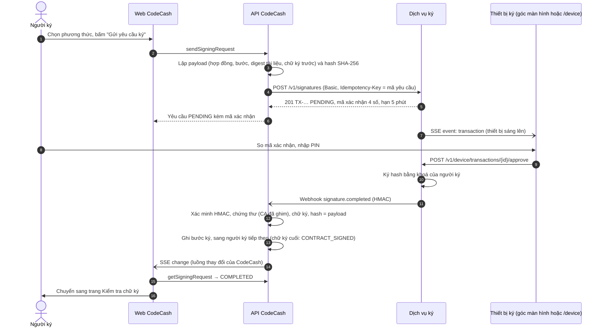
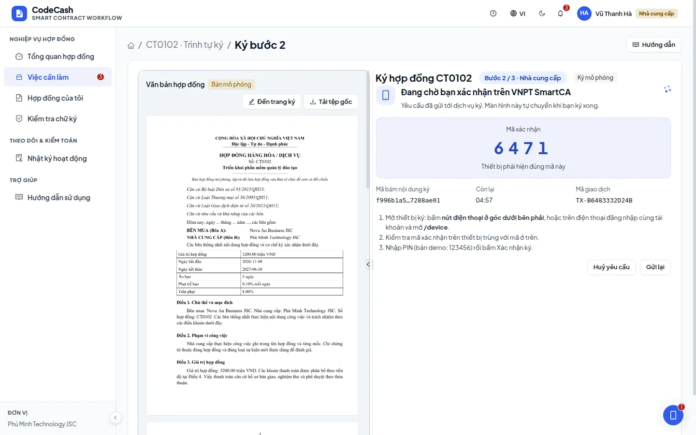
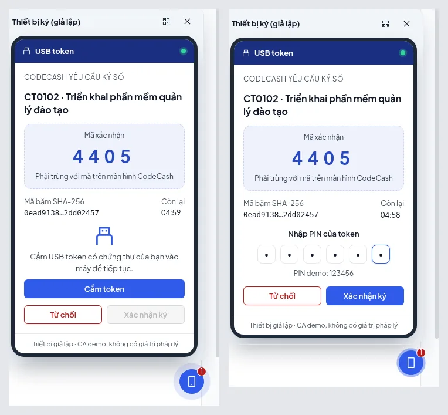
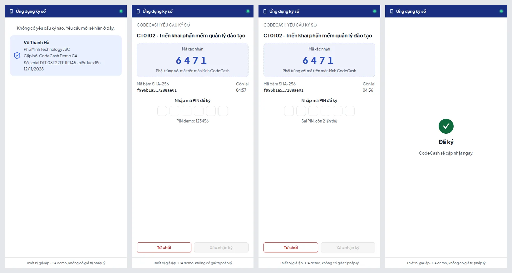
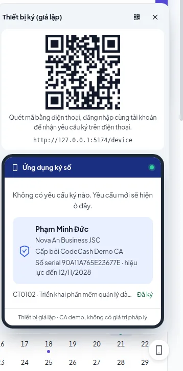
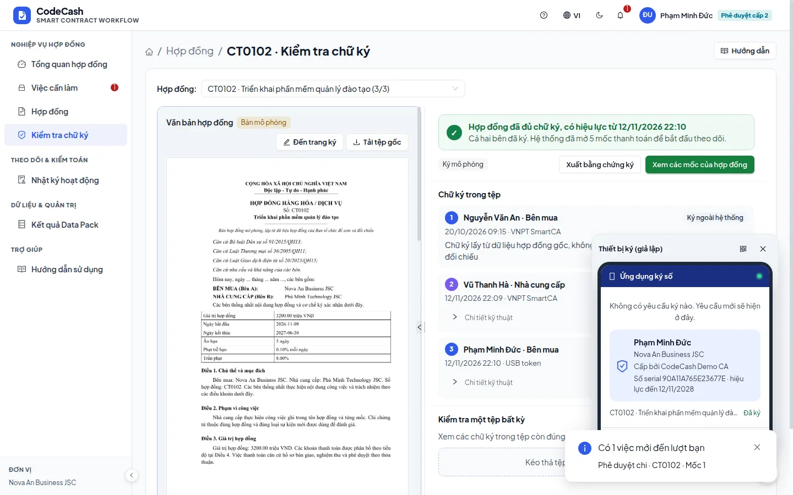

# 10. Dịch vụ ký số từ xa (mô phỏng) và thiết bị ký

Tài liệu này mô tả cách CodeCash ký hợp đồng qua một **dịch vụ ký tách riêng** (`apps/signer`), đóng vai nhà cung cấp chữ ký số từ xa (như các dịch vụ ký trên điện thoại hoặc USB token ngoài thực tế). Mục tiêu: luồng ký giống thật nhất có thể, mỗi thành phần là một dịch vụ độc lập giao tiếp qua hợp đồng rõ ràng, và sẵn sàng thay bằng nhà cung cấp thật.

> **Giới hạn pháp lý.** CA trong dịch vụ là CA demo (`policy: DEMO_NOT_QUALIFIED`), không nằm trong danh sách tin cậy nào. Chữ ký tạo ra chỉ dùng để học và trình diễn, không có giá trị như chữ ký số công cộng. Mọi màn liên quan đều ghi "giả lập".

## 1. Các thành phần

| Thành phần | Mã nguồn | Vai trò | Dữ liệu riêng |
| --- | --- | --- | --- |
| Web CodeCash | `apps/web` | Màn ký (gửi yêu cầu, chờ), nút thiết bị ở góc, trang `/device` cho điện thoại | Không |
| API CodeCash (bên dùng dịch vụ, *relying party*) | `apps/api` | Lập nội dung cần ký và mã băm, gọi dịch vụ ký, nhận webhook, xác minh lại, ghi bước ký | Kho CodeCash (file/Mongo) + khoá CA đã ghim (`<DATA_DIR>-trust/signer-ca.json`) |
| Dịch vụ ký (*signing provider*) | `apps/signer` | Giữ khoá và chứng thư của từng người, nhận mã băm, hỏi người ký trên thiết bị, ký sau PIN, gửi webhook | `SIGNER_DATA_DIR/signer.json` + khoá (`keys/*.pem`) |
| Thiết bị ký | `apps/web/src/features/signing/device` | Ứng dụng ký trên điện thoại hoặc USB token, mô phỏng trong trình duyệt; nói chuyện **thẳng với dịch vụ ký**, không qua API CodeCash | Không |

Hợp đồng dịch vụ (OpenAPI 3.1): [`apps/signer/openapi.yaml`](../apps/signer/openapi.yaml).

## 2. Luồng ký



Nếu webhook không tới (mạng, API khởi động lại), màn chờ hỏi lại mỗi 3 giây; mỗi lần hỏi, API gọi `GET /v1/signatures/{id}` và tự áp kết quả. Dịch vụ ký vẫn là nơi giữ quyết định của người ký.

## 3. Bảo mật

- **Máy với máy:** API gọi dịch vụ ký bằng HTTP Basic (`SIGNER_CLIENT_ID` / `SIGNER_CLIENT_SECRET`). Trình duyệt không bao giờ có client secret.
- **Thiết bị:** API cấp **phiên thiết bị** cho người đang đăng nhập (`GET /api/v1/signing/device-session` → dịch vụ ký `POST /v1/device-sessions`). Token ký HMAC, hạn 12 giờ, chỉ đọc và quyết định yêu cầu của chính người đó; thiết bị của người khác nhận 404.
- **Webhook:** header `X-Signer-Signature: sha256=<HMAC của thân gửi đi>`. API xác minh trên đúng byte nhận được (`rawBody`), sai là 401.
- **Ghim CA:** khoá công khai của CA được ghim lần đầu, hoặc khớp `SIGNER_CA_FINGERPRINT` nếu có đặt. CA khác bị từ chối với lỗi `SIGNER_CA_MISMATCH`; muốn đổi CA phải xoá file ghim có chủ đích.
- **Không tin dịch vụ một cách mù quáng:** trước khi tính một bước là đã ký, API kiểm tra:
  - chứng thư do đúng CA đã ghim ký;
  - chứng thư đứng tên đúng người ký và còn hiệu lực;
  - hash bằng đúng `sha256(canonical(payload))` mà CodeCash đã lập;
  - chữ ký khớp hash với khoá trong chứng thư.

  Trang Kiểm tra chữ ký chạy lại toàn bộ các bước này.
- **PIN:** chỉ lưu băm scrypt có salt. Sai 3 lần thì khoá 5 phút. PIN demo là `123456` (`SIGNER_DEFAULT_PIN`) và được ghi ngay trên thiết bị giả lập.
- **Mã xác nhận 4 số** hiện ở cả màn CodeCash và thiết bị, để người ký biết hai bên đang nói về cùng một yêu cầu, giống ứng dụng ký thật.
- **Ký mã băm, không gửi tài liệu:** dịch vụ ký chỉ nhận hash và nhãn hiển thị.

## 4. Xử lý lỗi

| Tình huống | Hành vi |
| --- | --- |
| Dịch vụ ký không chạy khi gửi yêu cầu | Yêu cầu dừng với lý do; màn ký báo "Không kết nối được dịch vụ ký", có thể gửi lại |
| Gửi lại cùng yêu cầu (mạng chập chờn) | `Idempotency-Key` trả đúng giao dịch cũ, không tạo giao dịch mới |
| Gửi yêu cầu mới khi yêu cầu cũ đang chờ | Dịch vụ ký huỷ yêu cầu cũ trên thiết bị |
| Webhook thất bại | Dịch vụ thử lại sau 1, 5, 25 giây; màn chờ hỏi lại mỗi 3 giây |
| Webhook đến hai lần | Lần thứ hai không đổi gì (yêu cầu đã hết trạng thái chờ) |
| Quá 5 phút | Dịch vụ đánh dấu hết hạn và báo; màn ký mở lại để gửi yêu cầu mới |
| Người ký từ chối trên thiết bị | Yêu cầu thành "đã từ chối"; màn ký báo và cho gửi lại |
| Huỷ trên CodeCash | Dịch vụ ký rút yêu cầu khỏi thiết bị |
| Sai PIN | Thiết bị báo số lần còn lại; sai 3 lần thì khoá |
| CA của dịch vụ bị đổi (dữ liệu dịch vụ bị khởi tạo lại) | `SIGNER_CA_MISMATCH`; xoá `<DATA_DIR>-trust/signer-ca.json` nếu việc đổi là có chủ đích |

## 5. Chạy và cấu hình

Phát triển: `pnpm dev` chạy cả API, web và dịch vụ ký (cổng 3200). Bật ký qua dịch vụ trong `.env`:

```
SIGNING_PROVIDER=remote
SIGNER_URL=http://127.0.0.1:3200
```

Các giá trị `SIGNER_CLIENT_SECRET`, `SIGNER_WEBHOOK_SECRET` để trống trong môi trường phát triển sẽ dùng chung giá trị mặc định ở cả hai phía (dịch vụ in cảnh báo). Môi trường thật phải đặt giá trị riêng và giống nhau ở API và dịch vụ ký.

- Trình duyệt tới dịch vụ ký qua cổng `/signer-api`: Vite proxy khi phát triển, nginx khi triển khai (`infra/nginx/default.conf.template`, có tắt gom đệm cho SSE).
- `SIGNING_PROVIDER=local` (mặc định của test) vẫn ký ngay trong app như trước.
- Docker: image `signer` (`docker build --target signer`), dịch vụ `signer` trong `infra/compose.prod.yaml`, có volume dữ liệu riêng và không mở cổng ra ngoài máy chủ.

## 6. Demo hai cách

Trước khi demo: chạy `pnpm dev` với `SIGNING_PROVIDER=remote`. Dùng CT0102: bước 2 là `supplier@phuminh.vn`, bước cuối là `secondary@novaan.vn`.

**Cách 1 — chỉ một máy tính (nút ở góc)**

1. Đăng nhập `supplier@phuminh.vn`, mở CT0102 → Trình tự ký → bước 2.
2. Chọn phương thức (VNPT SmartCA, Viettel MySign hoặc USB token), bấm **Gửi yêu cầu ký**. Màn chuyển sang "Đang chờ bạn xác nhận…" với mã xác nhận, mã băm và đồng hồ đếm ngược.
3. Nút điện thoại ở góc dưới bên phải sáng lên. Bấm vào để mở thiết bị giả lập: kiểm tra mã xác nhận trùng, nhập PIN `123456` (USB token: bấm **Cắm token** trước), bấm **Xác nhận ký**.
4. Màn CodeCash tự chuyển sang trang Kiểm tra chữ ký; bước 2 hiện "Hợp lệ".





**Cách 2 — máy tính và điện thoại (giống thật nhất)**

1. Cho điện thoại vào được máy chạy web:
   - chạy `pnpm dev:api`, `pnpm dev:signer` và `pnpm dev:web:lan` (web mở cho cả mạng LAN, thay cho `pnpm dev`);
   - điện thoại và máy tính dùng chung mạng Wi-Fi;
   - mở `http://<IP máy tính>:5173`.
2. Trên điện thoại, đăng nhập **cùng tài khoản** `supplier@phuminh.vn` và mở `/device`. Cách khác: trên máy tính, bấm nút ở góc → biểu tượng QR, rồi quét bằng điện thoại.
3. Trên máy tính, gửi yêu cầu ký như cách 1. Điện thoại nhận yêu cầu ngay qua luồng SSE của dịch vụ ký, không cần tải lại trang.
4. Trên điện thoại: so mã xác nhận, nhập PIN, xác nhận. Màn máy tính tự chuyển sang trang Kiểm tra chữ ký.






5. Thử thêm:
   - nhập sai PIN để thấy số lần còn lại;
   - bấm **Từ chối** để thấy màn máy tính báo bị từ chối;
   - chờ quá 5 phút để thấy yêu cầu hết hạn.

Nên mở bảng **Nhật ký hoạt động** để thấy các hành động "Gửi yêu cầu ký tới dịch vụ ký" và "Nhận kết quả ký từ dịch vụ ký".

## 7. Chuyển sang ký thật

Phía CodeCash chỉ phụ thuộc hợp đồng: gửi hash, nhận chữ ký kèm chứng thư một cách bất đồng bộ, webhook có ký. Khi có nhà cung cấp thật:

1. **Ký từ xa thật** (dịch vụ có API cho đối tác):
   - viết adapter trong `apps/api/src/trust/remote-signer.ts` gọi API nhà cung cấp theo hình dạng hiện có (tạo giao dịch, hỏi trạng thái, huỷ);
   - đổi phần xác minh sang chứng thư X.509 và chuỗi CA thật (kèm kiểm tra thu hồi OCSP/CRL);
   - nhúng chữ ký vào PDF theo chuẩn PAdES.

   Thường phải đăng ký đối tác để có môi trường thử (sandbox) và thông tin xác thực.
2. **USB token thật:**
   - trình duyệt không nói chuyện trực tiếp với token; cần một chương trình nhỏ trên máy người ký, giao tiếp với token qua PKCS#11 (như plugin ký số của các nhà cung cấp);
   - giai đoạn phát triển có thể dùng SoftHSM2 (token phần mềm, cùng giao diện PKCS#11);
   - chương trình này đứng ở vị trí "thiết bị", hợp đồng phía CodeCash giữ nguyên.
3. **USB thường làm "token":** chỉ để demo (lưu khoá trong file mã hoá bằng PIN). USB thường không có chip bảo mật nên khoá có thể bị sao chép, và không đạt chuẩn chữ ký số công cộng.

## 8. Đối chiếu nguyên lý SOA

| Nguyên lý | Trong thiết kế này |
| --- | --- |
| Hợp đồng dịch vụ chuẩn hoá | OpenAPI 3.1 (`apps/signer/openapi.yaml`), mã lỗi thống nhất `{ code }`, sự kiện webhook có tên |
| Liên kết lỏng | CodeCash chỉ biết URL, client và webhook secret; không dùng chung code hay cơ sở dữ liệu. Thay nhà cung cấp = thay adapter |
| Trừu tượng hoá | Dịch vụ ký không biết hợp đồng hay mốc; chỉ nhận hash và nhãn hiển thị |
| Tự chủ | Tiến trình, kho dữ liệu, khoá và vòng đời giao dịch riêng (tự hết hạn, tự khoá PIN) |
| Phi trạng thái phía phiên | Token thiết bị tự chứa (HMAC), dịch vụ không giữ bảng phiên |
| Khả năng khám phá | `GET /health`, `GET /v1/ca`, tài liệu OpenAPI |
| Khả năng kết hợp | Một luồng nghiệp vụ ghép ba dịch vụ: web, API, dịch vụ ký; cùng mẫu với cổng thanh toán (gọi ngoài transaction rồi ghi kết quả) |
| Giao tiếp bất đồng bộ | Webhook có chữ ký HMAC + SSE cho thiết bị + hỏi lại định kỳ làm dự phòng |
| Tin cậy ở biên | Xác thực máy–máy, ghim CA, xác minh lại chữ ký, idempotency |
| Cổng truy cập (API gateway) | Trình duyệt chỉ thấy `/api` và `/signer-api` qua nginx/Vite |

## 9. Kiểm thử

- `tests/foundation/signer.test.mjs`: chạy dịch vụ ký như một tiến trình riêng và kiểm tra:
  - xác thực máy–máy, idempotency, ký sau PIN, khoá sau 3 lần sai;
  - yêu cầu mới thay yêu cầu cũ, thiết bị người khác không đụng được yêu cầu;
  - phía CodeCash: ghim CA, xác minh chữ ký, loại payload bị đổi, sai người ký, chứng thư bị sửa, webhook giả.
- `tests/foundation/trust.test.mjs` và `workflow.test.mjs`: luồng ký `local` như trước.
- Kiểm tra tay hai thiết bị: xem mục 6.
