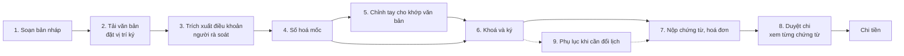
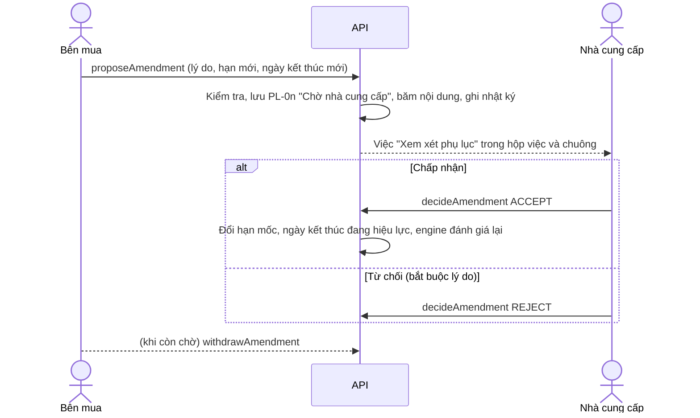

# 11. Hợp đồng soạn trong ứng dụng: mốc, chứng từ, hoá đơn và phụ lục

Tài liệu này đi từng bước một hợp đồng do người dùng lập trong CodeCash, từ bản nháp đến khi chi tiền và điều chỉnh sau ký. Mỗi bước ghi: ai làm, hệ thống làm gì, vì sao làm như vậy, quy tắc kiểm và mã lỗi, ví dụ có thể đối chiếu trên màn hình demo, và các lưu ý.

Quy tắc nghiệp vụ gốc nằm ở [Đặc tả nghiệp vụ](NGHIEP_VU.md), mục 6.2a, 6.3 và 9.4; tài liệu này giải thích chúng theo trình tự làm việc. Hợp đồng của Data Pack (100 hợp đồng, 405 mốc của BTC) **không đi qua luồng này**: chúng được nhập nguyên trạng và niêm phong.

## 1. Tổng quan



| Vai trò | Tài khoản demo | Làm gì trong luồng này |
| --- | --- | --- |
| Cán bộ hợp đồng bên mua (`LEGAL_REVIEWER`) | `legal@novaan.vn` | Soạn, rà trích xuất, số hoá và chỉnh tay, lập phụ lục, nộp chứng từ phía bên mua |
| Chủ hợp đồng (`CONTRACT_OWNER`) | `owner@novaan.vn` | Như trên (trừ rà soát), ký, phê duyệt chi, lập phụ lục |
| Phê duyệt tài chính (`FINANCE_APPROVER`) | `finance@novaan.vn` | Phê duyệt chi khi chính sách yêu cầu, duyệt lệnh chi |
| Nhà cung cấp (`SUPPLIER`) | `supplier@phuminh.vn` | Ký, nộp chứng từ phía mình và hoá đơn, trả lời phụ lục |

Mật khẩu demo xem [Kịch bản demo](KICH_BAN_DEMO.md). Danh tính và quyền luôn lấy từ người đăng nhập; API bỏ qua vai trò, mã người hay tổ chức do trình duyệt gửi lên.

## 2. Bước 1: soạn bản nháp

**Ai:** cán bộ hợp đồng hoặc chủ hợp đồng bên mua. **Màn:** Tải hợp đồng lên, bước 1.

Người soạn chọn loại hợp đồng (quyết định quy trình mốc), nhà cung cấp, giá trị, thời hạn, chính sách phê duyệt, ân hạn, mức phạt mỗi ngày, trần phạt, người ký và người rà soát.

| Quy tắc | Mã lỗi | Vì sao |
| --- | --- | --- |
| Giá trị là số thập phân dương, tối đa 2 chữ số lẻ, không quá 1.000.000 triệu | `INVALID_VALUE` | Tiền luôn là chuỗi thập phân, tính theo phần trăm đồng (xu), không dùng số thực |
| Ngày kết thúc **sau** ngày bắt đầu | `INVALID_DATES` | Các mốc được rải trong thời hạn (bước 4); thời hạn 0 ngày dồn mọi mốc vào một ngày |
| Ân hạn 0–60 ngày, phạt 0–5%/ngày | `INVALID_PENALTY` | Biên an toàn của bộ luật |
| Trần phạt không quá 8% | `PENALTY_OVER_LEGAL_CAP` | Luật Thương mại 2005, Điều 301 |
| Mức phạt và trần cùng bằng 0 hoặc cùng lớn hơn 0 | `PENALTY_INCONSISTENT` | "0,10%/ngày, trần 0%" hoặc "0%/ngày, trần 8%" là điều khoản phạt không bao giờ áp được |
| Có từ 2 người ký thì cần cả hai bên | `SIGNERS_BOTH_SIDES` | Hợp đồng hai bên |

**Lưu ý.** Đổi loại hợp đồng, quy trình hoặc thời hạn sau khi đã chỉnh tay mốc (bước 5) sẽ **bỏ** phần chỉnh tay, vì các chỉnh sửa gắn với một quy trình và một thời hạn cụ thể.

## 3. Bước 2–3: văn bản và trích xuất điều khoản

Người soạn tải PDF hoặc DOCX lên (hoặc tạo văn bản mẫu từ chính bản nháp), đặt vị trí chữ ký trên trang thật, rồi chạy **Trích xuất điều khoản**. Phần trích xuất (Gemini khi bật, nếu không thì đọc văn bản bằng quy tắc) **chỉ đề xuất 6 trường**: giá trị, ân hạn, mức phạt, trần phạt, ngày bắt đầu, ngày kết thúc. Mỗi đề xuất kèm trang và câu trích; người rà soát đối chiếu, sửa nếu cần và xác nhận.

**Lưu ý quan trọng.** Trích xuất **không đọc lịch mốc** trong văn bản. Lịch mốc ở bước 4 do hệ thống dựng từ quy trình; người dùng phải đối chiếu và chỉnh ở bước 5. Màn số hoá nói rõ điều này.

**Tinh chỉnh đợt này.** Trước đây ô nhập trên bảng trích xuất bị xoá trắng mỗi khi dữ liệu được tải lại, mà cập nhật trực tiếp (SSE) tải lại dữ liệu mỗi khi có thay đổi ở bất kỳ đâu. Nay các ô chỉ được đặt lại khi có đề xuất mới hoặc khi đã xác nhận, nên giá trị đang nhập dở không bị mất.

## 4. Bước 4: số hoá mốc

### 4.1. Mốc lấy từ đâu

| Nguồn | Khi nào |
| --- | --- |
| Quy trình chuẩn của loại hợp đồng (4 quy trình của Data Pack) | Mặc định |
| Quy trình riêng `APP_…` của phiên bản luật đang công bố | Khi người soạn chọn ở ô "Quy trình mốc" (NGHIEP_VU 6.3) |

Mỗi giai đoạn của quy trình chuẩn được rút từ `milestones.csv`: loại mốc, tên, chứng từ bắt buộc, cờ phạt, **tỷ lệ thanh toán phổ biến nhất** và **trung vị số ngày từ ngày bắt đầu tới hạn**.

| Quy trình | Giai đoạn (tỷ lệ, số ngày chuẩn) |
| --- | --- |
| Cung cấp hàng hoá | Ký 20% (5) · Giao hàng 40% (45) · Nghiệm thu 30% (64) · Bảo hành 10% (94) |
| Triển khai phần mềm | Ký 10% (8) · Duyệt yêu cầu 15% (46) · UAT 25% (123) · Go-live 40% (174) · Đóng bảo hành 10% (212) |
| Dịch vụ | Khởi động 15% (12) · Bàn giao giữa kỳ 35% (68) · Nghiệm thu cuối 40% (123) · Đóng bảo hành 10% (150) |
| Bảo trì | Kích hoạt 30% (14) · Hoàn thành dịch vụ 50% (179) · Nghiệm thu cuối 20% (236) |

### 4.2. Hạn mốc: co giãn theo thời hạn hợp đồng

Trong Data Pack, mỗi giai đoạn nằm ở một **tỷ lệ cố định của thời hạn** hợp đồng, và mốc cuối luôn rơi đúng ngày kết thúc (100/100 hợp đồng). Vì vậy số ngày chuẩn được hiểu là **lịch chuẩn**, rồi co giãn theo thời hạn của từng hợp đồng:

```
hạn(giai đoạn) = ngày bắt đầu + làm tròn( số ngày chuẩn × thời hạn / số ngày chuẩn lớn nhất )
```

Kiểm chứng trên dữ liệu BTC: dựng lại 405 hạn mốc theo công thức này lệch tối đa 1 ngày. Cách cũ (cộng thẳng số ngày chuẩn vào ngày bắt đầu) lệch tới 96 ngày và đẩy 64 mốc ra sau ngày kết thúc.

**Ví dụ, đối chiếu được trên màn demo:** hợp đồng CT0101 (hàng hoá), bắt đầu 02/11/2026, kết thúc 31/05/2027, thời hạn 210 ngày.

| Mốc | Số ngày chuẩn | Tính | Hạn |
| --- | --- | --- | --- |
| MS1 Ký hợp đồng | 5 | 5 × 210 / 94 = 11,2 → 11 | 13/11/2026 |
| MS2 Giao hàng | 45 | 45 × 210 / 94 = 100,5 → 101 | 11/02/2027 |
| MS3 Nghiệm thu | 64 | 64 × 210 / 94 = 143,0 → 143 | 25/03/2027 |
| MS4 Bảo hành | 94 | đúng ngày kết thúc | gợi ý 31/05/2027, cần xác nhận |

Hợp đồng demo dựng sẵn đã có mốc (`SEED`, CT0102–CT0104) giữ hạn cũ, vì sự kiện trong kịch bản demo được hẹn theo đó. CT0101 là bản nháp chưa số hoá nên đi đúng luồng mới (ví dụ trên).

### 4.3. Giá trị mốc

```
giá trị mốc = giá trị hợp đồng × tỷ lệ, tính bằng xu và cắt phần lẻ; mốc cuối nhận phần còn lại
```

Nhờ vậy tổng các mốc luôn đúng bằng giá trị hợp đồng, không lệch 0,01 nào. Ví dụ CT0101, 2.400,00 triệu: 480,00 · 960,00 · 720,00 · 240,00.

### 4.4. Điều kiện chi của mỗi mốc

Hệ thống ghép điều kiện theo cùng mẫu với Data Pack:

```
EVENT:<chứng từ 1> AND EVENT:<chứng từ 2> ... AND APPROVAL_QUORUM:<số vai trò> AND NO_OPEN_DISPUTE
```

| Phần | Lấy từ |
| --- | --- |
| Chứng từ bắt buộc | Giai đoạn của quy trình (hoặc chỉnh tay) |
| Vai trò và số người phê duyệt | Chính sách phê duyệt của hợp đồng; giai đoạn miễn duyệt thì không có |
| Phạt trễ | Cờ phạt của giai đoạn; mức, trần, ân hạn của hợp đồng |
| Mã luật áp dụng | `<bộ luật>:<loại mốc>` |

Kiểm chứng: dựng lại toàn bộ 405 mốc của BTC bằng chính bộ sinh mốc này thì khớp mọi cột (điều kiện, số người duyệt, vai trò, phạt, ân hạn, mã luật, số tiền). Chỉ lệch cờ `invoice_required` ở 15 mốc kích hoạt bảo trì: đó là cách hiểu A08 BTC chưa chốt, cờ không tham gia luật nên không đổi quyết định.

### 4.5. Màn số hoá hiển thị gì

| Cột | Ý nghĩa |
| --- | --- |
| Giá trị | Số tiền và tỷ lệ |
| Hạn | Theo 4.2; bảo hành ghi "Chưa rõ" tới khi xác nhận |
| Chứng từ bắt buộc | Mỗi chứng từ kèm bên phải nộp, ví dụ "Hoá đơn (Nhà cung cấp)" |
| Phê duyệt | Vai trò duyệt **của riêng mốc đó**; "Không cần" nếu giai đoạn miễn duyệt |
| Phạt chậm | "0,10%/ngày sau 3 ngày ân hạn, trần 8%" hoặc "Không" |
| Nguồn | **Theo quy trình mẫu**, **Cần xác nhận** (bảo hành), **Đã xác nhận**, **Đã chỉnh tay** |

Mục "Điều khoản" ghi số điều của văn bản mẫu hệ thống (Điều 3 giá trị, 4 lịch mốc, 6 phê duyệt, 8 phạt chậm). Số trang và câu trích **chỉ** hiện khi phần trích xuất đã rà soát thật sự tìm thấy giá trị đó trong tệp; hệ thống không bịa số trang.

**Bảo hành.** Văn bản thường chỉ ghi "sau N tháng bảo hành", nên hạn này phải do người nhập. N được tính từ khoảng cách giữa mốc liền trước và ngày gợi ý. Ngày gợi ý là ngày kết thúc hợp đồng. Ngày nhập phải nằm giữa hạn mốc liền trước và mốc liền sau (hoặc ngày kết thúc), nếu không API trả `DUE_DATE_OUT_OF_RANGE`. Để trống thì mốc bị giữ (BR-15) tới khi có phụ lục bổ sung hạn.

## 5. Bước 5: chỉnh tay cho khớp văn bản

**Ai:** cán bộ hoặc chủ hợp đồng bên mua, khi bản nháp chưa khoá. **Màn:** Số hoá, nút **Chỉnh sửa mốc**. **Hành động API:** `drafts.editDigitizedMilestones`.

| Được sửa | Không được sửa (và vì sao) |
| --- | --- |
| Tỷ lệ thanh toán từng mốc | Số mốc, thứ tự, loại mốc: mỗi loại mốc có phạm vi luật riêng (`<bộ luật>:<loại mốc>`); thêm hoặc bớt giai đoạn là việc của quy trình riêng trong phiên bản luật, có kiểm tra an toàn |
| Hạn từng mốc (để trống được) | Chính sách phê duyệt chung: sửa ở bước 1 |
| Chứng từ bắt buộc (1–6, không trùng) | |
| Có áp phạt trễ hay không | |
| Phê duyệt theo chính sách, hoặc miễn duyệt | |

| Kiểm tra (ở API, màn hình chỉ hỗ trợ) | Mã lỗi |
| --- | --- |
| Đủ mọi mốc của quy trình, đúng số thứ tự | `MILESTONE_EDIT_INVALID` |
| Tỷ lệ mỗi mốc lớn hơn 0, tối đa 2 chữ số lẻ | `PERCENT_INVALID` |
| Tổng tỷ lệ đúng 100,00% (so theo phần trăm của phần trăm, không làm tròn) | `PERCENT_TOTAL` |
| 1–6 chứng từ khác nhau, thuộc 11 loại của bảng thẩm quyền (mục 2.1 đặc tả) | `INVALID_EVENTS` |
| Hạn theo thứ tự mốc, trong khoảng ngày bắt đầu – ngày kết thúc | `DUE_DATE_OUT_OF_RANGE` |
| Chỉ người soạn của bên mua, bản nháp còn mở | `BUYER_EDITORS_ONLY`, `DRAFT_LOCKED` |

Kết quả:

- dòng nào khác đề xuất của quy trình thì mang nhãn **Đã chỉnh tay**;
- đầu bảng ghi người sửa và thời điểm;
- nhật ký ghi `DIGITIZATION_EDITED` kèm số mốc đã sửa;
- **Khôi phục theo quy trình** bỏ toàn bộ chỉnh sửa.

**Lưu ý.**

- Chỉnh tay **không** tăng phiên bản bản nháp, nên phần trích xuất đã rà soát vẫn còn hiệu lực.
- Khi khoá, API kiểm tra lại toàn bộ chỉnh sửa theo bản nháp tại thời điểm đó, vì thời hạn có thể đã đổi qua trích xuất.
- Nút **Xác nhận** bị khoá khi đang ở chế độ sửa, để không khoá nhầm bản chưa lưu.
- Miễn duyệt một mốc nghĩa là mốc được chi ngay khi đủ chứng từ và không có tranh chấp. Đây là nới kiểm soát, nên có nhật ký và hiện rõ ở cột Phê duyệt.

## 6. Bước 6: khoá bản số hoá và ký

**Xác nhận bản số hoá** tạo các mốc thật theo bản đã chỉnh, mở lượt ký cho người ký đầu tiên, và cho engine đánh giá các mốc mới như mọi mốc khác.

Khi chữ ký cuối hoàn tất:

- hợp đồng chuyển sang trạng thái có hiệu lực;
- sự kiện **Hợp đồng đã ký** (`CONTRACT_SIGNED`) được ghi cho **mọi** mốc có điều kiện này. Trước đây chỉ mốc đầu được ghi, nên một quy trình riêng có hai giai đoạn cần chữ ký thì giai đoạn sau không bao giờ đủ điều kiện;
- nếu ký xong sau ngày bắt đầu, trang hợp đồng hiện cảnh báo `SIGNED_AFTER_START` để người dùng xem lại lịch (bước 9).

Chi tiết luồng ký số: [10 Dịch vụ ký số](10_DICH_VU_KY_SO.md).

## 7. Bước 7: nộp chứng từ và hoá đơn

**Ai:** bên có thẩm quyền với từng loại chứng từ (mục 2.1 đặc tả). Ví dụ: nhà cung cấp nộp giao hàng và hoá đơn, bên mua nộp biên bản nghiệm thu. **Màn:** Nộp chứng từ.

Mỗi chứng từ là một tệp thật (PDF, PNG, JPEG, DOCX, XLSX, tối đa 20 MB):

- API lưu tệp theo mã băm SHA-256;
- người nộp ký lên mã băm đó;
- khi tải hoặc xem lại, tệp được băm lại để chắc chắn không bị thay.

### 7.1. Hoá đơn

Chọn tệp cho ô **Hoá đơn** sẽ mở form **Thông tin hoá đơn**. Người nộp nhập đúng các thông tin in trên hoá đơn điện tử (Nghị định 123/2020/NĐ-CP, Thông tư 78/2021/TT-BTC):

| Trường | Quy tắc định dạng (dùng chung cho form và API) | Mã lỗi |
| --- | --- | --- |
| Ký hiệu | 7 ký tự: loại (1–9), C/K (có/không mã cơ quan thuế), 2 số năm, 1 chữ loại (T, D, L, M, N, B, G, H), 2 chữ của người bán. Ví dụ `1C26TAA` | `INVOICE_SYMBOL_INVALID` |
| Số hoá đơn | 1–8 chữ số, khác 0; lưu thành 8 chữ số (`00000128`) | `INVOICE_NUMBER_INVALID` |
| Ngày lập | Ngày thật, cùng năm với ký hiệu | `INVOICE_DATE_INVALID`, `INVOICE_YEAR_MISMATCH` |
| Mã số thuế người bán | 10 chữ số, 10 chữ số kèm `-XXX` (chi nhánh), hoặc 12 chữ số | `INVOICE_TAX_CODE_INVALID` |
| Tổng tiền | Số dương, tối đa 2 chữ số lẻ | `INVOICE_AMOUNT_INVALID` |

API kiểm thêm những điều cần đến hợp đồng:

| Quy tắc | Mã lỗi | Vì sao |
| --- | --- | --- |
| Có dữ liệu hoá đơn | `INVOICE_DATA_REQUIRED` | Hoá đơn không có số, ngày, người bán thì không đối chiếu được |
| Tổng tiền **bằng đúng** giá trị mốc | `INVOICE_AMOUNT_MISMATCH` | 140/140 hoá đơn Data Pack bằng giá trị mốc. Tiền phạt trừ vào khoản chi, không trừ trên hoá đơn |
| Ngày lập không trước ngày ký hợp đồng, không sau hôm nay | `INVOICE_BEFORE_SIGNING`, `INVOICE_DATE_FUTURE` | Hoá đơn trước khi có hợp đồng, hoặc ghi ngày tương lai, là dấu hiệu sai |
| Cùng mã số thuế, ký hiệu và số chưa từng dùng, ở bất kỳ hợp đồng nào | `INVOICE_DUPLICATE` | Chống dùng một hoá đơn để đòi tiền hai lần |

**Ví dụ:** CT0104 mốc 2 (Hoàn thành dịch vụ) có giá trị 480,00 triệu. Hoá đơn `1C26TAA` số `00700713`, ngày lập hôm nay, MST `0109876543`, tổng 480,00 thì hợp lệ. Nhập 479,99 sẽ bị từ chối với `INVOICE_AMOUNT_MISMATCH`.

Nút "Điền mẫu" trong form chỉ để demo; nó điền một số hoá đơn mới theo thời gian để không trùng.

## 8. Bước 8: duyệt chi, xem từng chứng từ

**Ai:** vai trò phê duyệt mà chính sách yêu cầu. **Màn:** Phê duyệt chi.

Mỗi chứng từ trong mục **Bằng chứng hợp lệ** có nút **Xem**, mở ngăn bên cạnh với:

| Phần | Nội dung |
| --- | --- |
| Tệp gốc | PDF hoặc ảnh hiển thị ngay trên trang. API băm lại trước khi gửi; tệp đã đổi thì báo lỗi |
| Chữ ký người nộp | Xanh: tệp nguyên vẹn, có chữ ký của ai lúc nào. Đỏ: tệp đã đổi hoặc không còn, không dựa vào chứng từ này |
| Hoá đơn | Ký hiệu · số, ngày lập, MST người bán, tổng tiền, kèm nhãn **Khớp giá trị mốc** hoặc **Lệch** |
| Không kèm tệp | Chứng từ của dữ liệu BTC hoặc hợp đồng demo dựng sẵn chỉ có mã tài liệu; màn hình nói rõ nguồn và nhắc đối chiếu bản giấy |

Bảng sự kiện ở trang hợp đồng và trang quyết định cũng hiện ký hiệu, số và tổng tiền của hoá đơn.

**Lưu ý.** Việc xem chứng từ không bắt buộc về mặt kỹ thuật trước khi bấm duyệt, nhưng là bước người duyệt phải làm. Ghi chú vẫn bắt buộc khi từ chối hoặc yêu cầu bổ sung.

## 9. Bước 9: phụ lục khi cần đổi lịch sau ký

**Ai đề xuất:** cán bộ hoặc chủ hợp đồng bên mua. **Ai trả lời:** nhà cung cấp của hợp đồng. **Màn:** trang hợp đồng, nút **Lập phụ lục**, tab **Phụ lục**. **Hành động API:** `amendments.proposeAmendment`, `decideAmendment`, `withdrawAmendment` (quyền `contracts:amend`).



| Quy tắc | Mã lỗi | Vì sao |
| --- | --- | --- |
| Chỉ hợp đồng đã ký, không phải của Data Pack | `CONTRACT_NOT_SIGNED`, `DATA_PACK_LOCKED` | Dữ liệu BTC giữ nguyên để chấm |
| Đề xuất: bên mua; trả lời: nhà cung cấp | `CANNOT_AMEND`, `CANNOT_DECIDE_AMENDMENT` | Hai bên của hợp đồng, mỗi bên một việc |
| Có lý do; phải thay đổi ít nhất một thứ | `NOTE_REQUIRED`, `AMENDMENT_EMPTY` | Phụ lục là văn bản có căn cứ |
| Mỗi hợp đồng một phụ lục chờ | `AMENDMENT_PENDING` | Tránh hai phụ lục chồng nhau |
| Mốc đã quyết định chi (đủ điều kiện chi, đã chi có phạt, đã chi, bị từ chối) giữ hạn | `MILESTONE_CLOSED` | Dời hạn lúc đó là sửa tiền phạt sau khi đã quyết |
| Hạn mới theo thứ tự mốc, trong thời hạn (tính cả ngày kết thúc mới) | `DUE_DATE_OUT_OF_RANGE`, `INVALID_DATES` | Như bước 5 |
| Khi chấp nhận, kiểm tra lại theo trạng thái lúc đó | như trên | Có thể đã có mốc được chi trong lúc chờ |
| Phụ lục đã xử lý không trả lời lại được | `AMENDMENT_CLOSED` | |

**Vì sao không sửa điều khoản đã ký.** Chữ ký hợp đồng gắn với mã băm các điều khoản (gồm cả `end_date`). Nếu phụ lục sửa thẳng các trường đó thì hợp đồng gốc sẽ bị báo "đã thay đổi". Vì vậy:

- `end_date` đã ký giữ nguyên; ngày kết thúc mới ghi vào `amendedEndDate` và màn hình hiện ngày đang hiệu lực;
- hạn mốc (không nằm trong mã băm) được cập nhật để engine tính lại ngày trễ;
- mỗi phụ lục có mã băm SHA-256 của nội dung thay đổi, và mọi bước đều nằm trong nhật ký chuỗi băm.

Kiểm tra "Hợp đồng thông minh" và "Kiểm tra chữ ký" vẫn báo nguyên vẹn sau phụ lục.

**Ví dụ:** CT0103 mốc 3 (Nghiệm thu) có hạn 31/10/2026. Bên mua lập PL-01 với lý do "Bên mua chậm bàn giao mặt bằng lắp đặt 20 ngày" và hạn mới 20/11/2026. Nhà cung cấp chấp nhận, hạn đổi và mốc được đánh giá lại. Hạn MS1 hiện "Đã quyết định chi" nên không sửa được.

## 10. Cảnh báo ở đầu trang hợp đồng

| Mã | Khi nào | Nên làm gì |
| --- | --- | --- |
| `MISSING_DUE_DATE` | Mốc còn mở chưa có hạn | Lập phụ lục bổ sung hạn đã thống nhất; trước đó mốc bị giữ |
| `SIGNED_AFTER_START` | Ký xong sau ngày bắt đầu | Xem lại lịch; lập phụ lục nếu các bên đồng ý dời |
| `PAST_END` | Đã qua ngày kết thúc đang hiệu lực mà còn mốc mở | Gia hạn bằng phụ lục, hoặc xử lý dứt điểm các mốc còn lại |
| `SETTLED` | Mọi mốc đã chi hoặc đã đóng | Không cần làm gì |

Các cảnh báo do API tính, giao diện chỉ hiển thị; cảnh báo cần hành động có nút **Lập phụ lục** khi người xem có quyền.

## 11. Kiểm thử và cách tự kiểm lại

| Kiểm tra | Ở đâu |
| --- | --- |
| Lịch co giãn, cột mới của bản số hoá, chỉnh tay (tất cả trường hợp lỗi) và mốc tạo theo bản đã chỉnh | `tests/foundation/workflow.test.mjs`, "a new contract is cut into Data Pack milestones…" |
| Quy tắc hoá đơn đủ các mã lỗi, chống trùng giữa hai hợp đồng | `tests/foundation/business-rules.test.mjs`, "evidence: an invoice states its own data…" |
| Phụ lục: quyền, niêm phong Data Pack, chờ/chấp nhận/từ chối/rút lại, engine đánh giá lại, chữ ký vẫn nguyên vẹn, nhật ký | `business-rules.test.mjs`, "amendment: …" |
| Ma trận quyền của mọi hành động ghi (gồm 4 hành động mới) | `business-rules.test.mjs`, "who: …" |
| Mức phạt mâu thuẫn, ngày kết thúc | `business-rules.test.mjs`, "draft: terms are validated exactly…" |
| Nộp hoá đơn qua HTTP, thiếu dữ liệu bị từ chối | `scripts/smoke.mjs` |
| Ảnh hướng dẫn của từng bước | `scripts/guide-screenshots.mjs` (`evidence-invoice`, `approval-evidence`, `upload-digitize-edit`, `amendment-form`, `amendment-review`) |

Chạy: `pnpm check` (typecheck, lint, định dạng, build, test), các smoke trên stack riêng như [30 Tiếp quản](30_HUONG_DAN_TIEP_QUAN_VA_PHAT_TRIEN_TIEP.md).

## 12. Demo nhanh từng bước

1. `legal@novaan.vn`: mở hồ sơ CT0101 → đặt vị trí ký → trích xuất, nạp đề xuất, xác nhận → ở màn số hoá đọc dòng "Mốc được dựng từ quy trình mẫu…", bấm **Chỉnh sửa mốc**, đổi MS1 thành 15% và MS2 thành 45% (tổng vẫn 100%), lưu → thấy nhãn **Đã chỉnh tay** → nhập hạn bảo hành → xác nhận.
2. `supplier@phuminh.vn`: việc **Nộp chứng từ** CT0104 mốc 2 → chọn tệp cho Hoá đơn → thử nhập tổng 479,99 để thấy bị từ chối → **Điền mẫu** → đính kèm → nộp.
3. `owner@novaan.vn`: việc **Phê duyệt chi** → bấm **Xem** ở Hoá đơn → thấy tệp, chữ ký và **Khớp giá trị mốc** → phê duyệt.
4. `legal@novaan.vn`: CT0103 → **Lập phụ lục**, dời hạn MS3 thêm 20 ngày kèm lý do → gửi.
5. `supplier@phuminh.vn`: chuông có việc **Xem xét phụ lục** → tab Phụ lục → **Chấp nhận** → hạn MS3 đổi; mở **Kiểm tra chữ ký**: vẫn nguyên vẹn.

## 13. Giới hạn hiện tại và hướng tiếp

| Giới hạn | Hướng tiếp |
| --- | --- |
| Mốc không được đọc từ văn bản; người phải đối chiếu và chỉnh tay | Trích bảng mốc từ văn bản (AI đề xuất, người xác nhận) như 6 điều khoản chung |
| Phụ lục chỉ đổi lịch (hạn mốc, ngày kết thúc) | Phụ lục đổi giá trị hoặc tỷ lệ; cần tính lại mốc chưa chi và quy định cho mốc đã chi |
| Phụ lục được hai bên xác nhận trong hệ thống, chưa ký số văn bản phụ lục | Ký phụ lục qua dịch vụ ký (cùng luồng mục 10) |
| Mã băm chữ ký chưa bao gồm lịch mốc đã số hoá (văn bản tải lên thì đã nằm trong băm) | Đưa lịch mốc vào băm điều khoản ở phiên bản sau; cần tái lập chữ ký demo |
| Hoá đơn chỉ kiểm định dạng và đối chiếu nội bộ | Tra cứu hoá đơn điện tử trên hệ thống của cơ quan thuế; khớp MST người bán với hồ sơ nhà cung cấp |
| Phê duyệt: đủ mọi vai trò của chính sách, mỗi vai trò một người | Duyệt "k trên n", ngưỡng theo số tiền, uỷ quyền khi vắng (engine cần chấp nhận quorum khác số vai trò) |

## 14. Bản đồ mã nguồn

| Phần | Tệp |
| --- | --- |
| Lịch co giãn, chia tiền | `apps/api/src/domain/templates.ts` (`scheduleDueDates`, `shareOf`) |
| Bản nháp, số hoá, chỉnh tay, khoá | `apps/api/src/domain/drafts.ts` (`saveDraft`, `digitization`, `checkMilestoneEdits`, `editMilestones`, `confirmDigitization`) |
| Kiểm tra trường dùng chung (bản nháp, hoá đơn) | `apps/api/src/common/field-validation.ts` = `packages/contracts/src/field-validation.ts` |
| Chứng từ, hoá đơn | `apps/api/src/domain/actions/evidence.ts`, `apps/api/src/evidence-documents.ts` |
| Phụ lục | `apps/api/src/domain/actions/amendments.ts`; cảnh báo ở `views/contracts.ts`; việc ở `views/tasks.ts` |
| Sự kiện ký cho mọi mốc | `apps/api/src/domain/signing.ts` (`complete`) |
| Màn số hoá và trình sửa mốc | `apps/web/src/features/signing/pages/DigitizeReviewPage.tsx`, `components/MilestoneEditor.tsx` |
| Form hoá đơn, ngăn xem chứng từ | `apps/web/src/features/milestones/components/InvoiceFormModal.tsx`, `EvidenceViewer.tsx` |
| Phụ lục và cảnh báo trên trang hợp đồng | `apps/web/src/features/milestones/components/AmendmentsPanel.tsx` |
