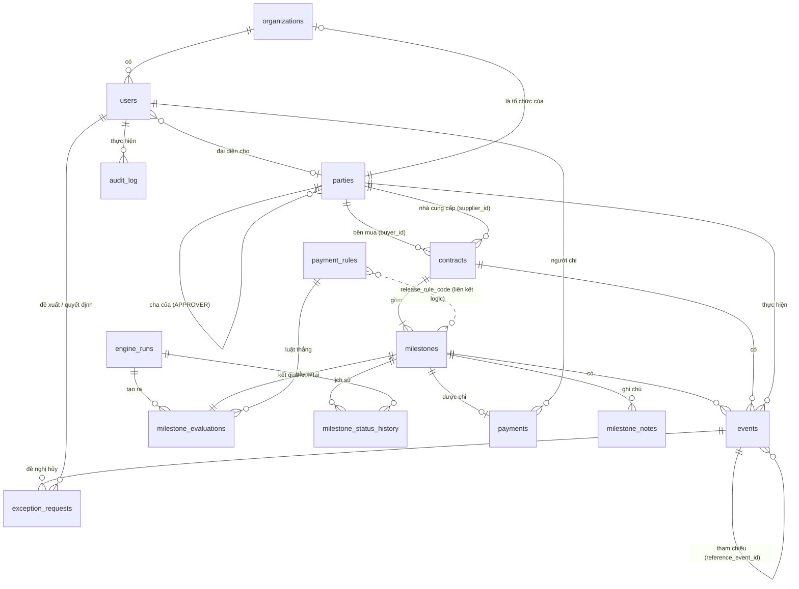

# 31. Thiết kế CSDL PostgreSQL cho CodeCash

Trạng thái: **NHÁP, chờ duyệt**. Thiết kế chuyển kho dữ liệu của CodeCash (hiện là tệp JSON hoặc MongoDB) sang PostgreSQL có khoá ngoại, ràng buộc và trigger. SQL tham khảo ở phụ lục A–C.

Nguồn: lấy từ `docs/THIET_KE_CSDL.md` của repo Contract Smart (bản viết lại theo hướng PostgreSQL), ngày 25/11/2026. Nội dung §1–10 và phụ lục giữ nguyên; §11 bổ sung những cấu trúc CodeCash có thêm sau khi thiết kế được viết. Repo đó còn có thiết kế "thư viện mốc" (mốc mẫu có phiên bản, loại hợp đồng ghép từ mốc, luật riêng cho từng hợp đồng): xem [33 Luồng nghiệp vụ đầu–cuối](33_LUONG_NGHIEP_VU_DAU_CUOI.md) §9.

CodeCash hiện **chưa** dùng PostgreSQL. Tài liệu này dùng khi muốn chuyển, và làm tài liệu tham khảo cho phần thiết kế dữ liệu của bài tập lớn.

Phạm vi đợt 1 là phần lõi: tài khoản, Data Pack, kết quả engine, thao tác nghiệp vụ (phê duyệt qua sự kiện, ngoại lệ, thanh toán) và nhật ký audit. Ký số, bản nháp hợp đồng, phụ lục, tệp đính kèm, trích xuất AI để đợt sau (mục 7).

## 1. Nguyên tắc

| # | Nguyên tắc | Lý do |
|---|---|---|
| N1 | 5 bảng Data Pack giữ **đúng tên cột** của BTC (`contract_id`, `planned_payment_vnd_mn`...) | Engine Python nhận đúng các cột này; dễ đối chiếu với đề |
| N2 | Khóa chính của dữ liệu Data Pack là **mã của BTC** (`CT0001`, `MS0001`, `EV00001`) | Mã có nghĩa, dùng chung với engine và tài liệu; bản ghi tạo trong app sinh mã cùng mẫu |
| N3 | Tiền dùng `numeric(18,2)`, đơn vị **triệu VND**, tên cột có hậu tố `_vnd_mn` | Không dùng float (quy định dự án) |
| N4 | Danh sách (`allowed_event_types`, `required_event_types`) lưu `text[]` | Truy vấn SQL được (`'INVOICE' = ANY(...)`); khi xuất cho engine thì nối bằng `;` |
| N5 | Giá trị liệt kê dùng `text` + `CHECK (... IN (...))` | Thêm giá trị mới chỉ cần sửa CHECK, dễ hơn `ENUM` của Postgres |
| N6 | Mọi bảng có `created_at`, `updated_at` (`timestamptz`); bảng sửa được có `version int` | `version` để khóa lạc quan: hai người sửa cùng lúc thì người sau bị báo xung đột |
| N7 | Cột `origin` ∈ `DATA_PACK`, `SEED`, `APP` trên bảng nghiệp vụ | Giữ nguyên dữ liệu BTC (R08): dòng `DATA_PACK` không cho sửa/xóa |
| N8 | Tên bảng, cột rõ nghĩa và có `COMMENT ON` bằng tiếng Việt | Để text2sql đọc schema và sinh SQL đúng |
| N9 | Sự kiện (`events`) và audit **chỉ thêm, không sửa/xóa** | Sự kiện là sự thật nghiệp vụ; hủy sự kiện đi qua `exception_requests` |

## 2. Sơ đồ quan hệ (ERD)



## 3. Nhóm tài khoản

### `organizations`: tổ chức dùng hệ thống
| Cột | Kiểu | Ràng buộc | Ghi chú |
|---|---|---|---|
| `id` | text | PK | Bằng `party_id` của bên mua/NCC (`B009`, `S021`); `OPS` cho đơn vị vận hành |
| `code` | text | UNIQUE | Mã ngắn hiển thị |
| `name` | text | NOT NULL | |
| `kind` | text | CHECK IN (`BUYER`,`SUPPLIER`,`INTERNAL`) | |
| `party_id` | text | FK → `parties`, NULL với `OPS` | |
| `email`, `tax_code`, `address` | text | | Không có trong Data Pack (dữ liệu SEED) |
| `origin` | text | CHECK | |

### `users`: tài khoản đăng nhập
| Cột | Kiểu | Ràng buộc | Ghi chú |
|---|---|---|---|
| `id` | uuid | PK | |
| `email` | text | UNIQUE (không phân biệt hoa thường) | |
| `password_hash` | text | NOT NULL | bcrypt |
| `display_name`, `title` | text | | |
| `role` | text | CHECK IN (`CONTRACT_OWNER`,`FINANCE_APPROVER`,`SECONDARY_APPROVER`,`LEGAL_REVIEWER`,`ADMIN_AUDITOR`,`SYSTEM_ADMIN`,`AUDITOR`,`SUPPLIER`) | Một vai trò/người, giống bản cũ |
| `organization_id` | text | FK → `organizations` | Phạm vi dữ liệu người dùng được thấy |
| `party_id` | text | FK → `parties`, NULL với nhân sự nội bộ | Bên mà người dùng đại diện khi ghi sự kiện |
| `active` | boolean | default true | Khóa tài khoản thay vì xóa |

## 4. Nhóm Data Pack (giữ cột của BTC)

Mỗi bảng thêm: `origin`, `version`, `created_at`, `updated_at`. Cột `data_is_synthetic` giữ nguyên.

### `parties` (65 dòng)
- PK `party_id`; `parent_party_id` FK → `parties` (approver thuộc bên mua).
- `party_type` CHECK (`BUYER`,`SUPPLIER`,`APPROVER`); `approval_role`, `approval_level int`.
- `approval_limit_vnd_mn numeric(18,2)` NULL; `allowed_event_types text[]`.
- `can_approve_payment`, `can_raise_dispute` là `boolean` thật (CSV là chuỗi `TRUE/FALSE`).

### `contracts` (100 dòng)
- PK `contract_id`; `buyer_id`, `supplier_id` FK → `parties`.
- `contract_value_vnd_mn numeric(18,2)`; `signing_date`, `start_date`, `end_date` kiểu `date`; CHECK `start_date >= signing_date`, `end_date >= start_date`.
- `approval_quorum int`, `auto_release_allowed boolean`, `grace_period_days int`, `penalty_rate_pct_per_day numeric(7,4)`, `max_penalty_pct numeric(7,4)`.
- Cột của app: `lifecycle` CHECK (`DRAFT`,`SIGNING`,`ACTIVE`,`CLOSED`), `amended_end_date date` NULL.

### `milestones` (405 dòng)
- PK `milestone_id`; `contract_id` FK → `contracts`; UNIQUE (`contract_id`, `milestone_sequence`).
- `due_date date`, `payment_percent numeric(5,2)`, `planned_payment_vnd_mn numeric(18,2)`.
- `required_event_types text[]`, `required_approval_roles text[]`.
- `release_rule_code text`: nối logic sang `payment_rules.release_rule_code` (không làm FK vì phía rules không duy nhất).

### `events` (1134 dòng)
- PK `event_id`; FK `contract_id`, `milestone_id`, `actor_party_id`; `reference_event_id` FK → `events` (giải quyết tranh chấp trỏ về sự kiện mở tranh chấp).
- `event_timestamp timestamp` (**không** múi giờ, giữ đúng dữ liệu BTC); `amount_vnd_mn numeric(18,2)` NULL.
- `event_type`, `event_status`, `actor_party_type`, `actor_role`, `event_source` có CHECK.
- Cột của app: `recorded_by_user_id uuid` FK → `users` (NULL với dòng Data Pack).
- Phê duyệt (`APPROVAL`), từ chối (`REJECTION`) và tranh chấp (`DISPUTE_OPENED/RESOLVED`) **đều là sự kiện**, không có bảng riêng, đúng như Data Pack.
- Index: (`milestone_id`, `event_timestamp`), (`contract_id`).

### `payment_rules` (128 dòng)
- PK `rule_id`; index (`release_rule_code`, `priority`).
- `condition_expression`, `payable_amount_formula`, `penalty_amount_formula` giữ là `text` (engine tự biên dịch).
- `decision` CHECK (`RELEASE`,`HOLD`,`REJECT`,`PENALTY`); `stop_processing`, `active` là `boolean`.

## 5. Nhóm kết quả engine

### `engine_runs`: mỗi lần chạy engine
`run_id` (PK, text), `trigger` (thao tác gây ra lần chạy), `triggered_by_user_id` FK → `users` NULL, `input_fingerprint` (SHA-256 đầu vào), `milestone_count`, `changed_count`, `duration_ms`, `invariant_violations text[]`, `engine_build`, `started_at`.

### `milestone_evaluations`: kết quả **hiện tại** của mỗi mốc
| Cột | Kiểu | Ghi chú |
|---|---|---|
| `milestone_id` | text | PK + FK → `milestones` (mỗi mốc một dòng) |
| `contract_id` | text | FK, để lọc nhanh |
| `run_id` | text | FK → `engine_runs` |
| `decision`, `reason_code`, `status` | text | CHECK |
| `rule_id` | text | FK → `payment_rules` NULL |
| `payable_vnd_mn`, `penalty_vnd_mn`, `raw_penalty_vnd_mn` | numeric(18,2) | |
| `open_dispute` | boolean | |
| `valid_approval_count`, `approval_quorum`, `valid_rejection_count`, `days_late` | int | |
| `completed_at` | timestamp | NULL nếu chưa hoàn thành |
| `missing_event_types`, `evidence_event_ids` | text[] | |
| `details` | jsonb | Phần chẩn đoán ít dùng: duplicates, unrelated, voided, issues, warnings, notes, explanation |
| `evaluated_at` | timestamptz | |

Các cột hay lọc, hay thống kê là cột thật; phần chi tiết để `jsonb` cho gọn.

### `milestone_status_history`: chỉ ghi khi quyết định/trạng thái **thay đổi**
`id`, `milestone_id` FK, `contract_id`, `run_id` FK, `changed_at`, `from_decision`, `from_status`, `to_decision`, `to_status`, `trigger`.

## 6. Nhóm thao tác nghiệp vụ và audit

### `exception_requests`: đề nghị hủy hiệu lực một sự kiện (BR-19)
`id` uuid PK, `event_id` FK → `events`, `milestone_id`, `contract_id` FK, `action` CHECK (`VOID`), `reason`, `proposed_by` FK → `users`, `proposed_at`, `status` CHECK (`PROPOSED`,`APPROVED`,`REJECTED`), `decided_by` FK → `users` NULL, `decided_at`, `decision_note`, `version`.
- CHECK `decided_by <> proposed_by` (người đề xuất không tự duyệt).
- Index duy nhất một phần: mỗi sự kiện tối đa một đề nghị `PROPOSED`.

### `payments`: lệnh chi cho mốc đủ điều kiện
`id` uuid PK (cũng là khóa chống chi trùng gửi cho cổng thanh toán), `milestone_id` FK **UNIQUE** (mỗi mốc chi một lần), `contract_id` FK, `run_id` FK, `decision` (`RELEASE`/`PENALTY` tại lúc chi), `amount_vnd_mn numeric(18,2)` CHECK ≥ 0, `transferred_by` FK → `users`, `transferred_at`, `gateway_reference`, `gateway_status`.

### `milestone_notes`: yêu cầu bổ sung thông tin, ghi chú tranh chấp
`id` uuid PK, `milestone_id` FK, `kind` CHECK (`REQUEST_INFO`,`DISPUTE_NOTE`), `body`, `author_id` FK → `users`, `created_at`.

### `audit_log`: nhật ký chuỗi hash
| Cột | Kiểu | Ghi chú |
|---|---|---|
| `seq` | bigint | PK, liên tục từ 1 |
| `id` | text | UNIQUE |
| `occurred_at` | timestamptz | |
| `actor_id` | uuid | FK → `users` NULL (hệ thống) |
| `organization_id` | text | |
| `action` | text | Ví dụ `EVENT_RECORDED`, `PAYMENT_TRANSFERRED` |
| `resource`, `resource_id` | text | Bảng và dòng bị tác động |
| `payload` | jsonb | Nội dung thay đổi |
| `prev_hash`, `hash` | text | `hash = SHA256(JSON chuẩn hóa của dòng, không gồm hash)` |

- Ghi audit **trong cùng transaction** với thao tác nghiệp vụ; khóa đầu chuỗi bằng `SELECT ... ORDER BY seq DESC LIMIT 1 FOR UPDATE` để hai request không chèn cùng `seq`.
- Trigger chặn `UPDATE`/`DELETE` trên `audit_log` và `events`; user ứng dụng chỉ được `INSERT`, `SELECT` trên hai bảng này.

## 7. Để đợt sau (không tạo bảng ở đợt 1)
`contract_drafts`, `contract_templates`, `milestone_templates`, `amendments` (phụ lục), `attachments`, `documents`, `signing_requests`, `signing_profiles`, `anchor_jobs`, `extraction_proposals`, `rule_versions`, `settings`. Thiết kế khi tới module tương ứng.

## 8. Chuẩn bị cho text2sql
- Schema `analytics` chứa view đã nối sẵn, ví dụ: `v_contract_overview` (hợp đồng + tổng đã chi/còn giữ), `v_milestone_decisions` (mốc + quyết định hiện tại), `v_payments_by_month`, `v_party_activity`.
- Role `codecash_readonly`: chỉ `SELECT` trên schema `analytics`; không thấy `users.password_hash`, không ghi được gì.
- Mọi bảng, cột, view có `COMMENT ON` tiếng Việt (lấy từ `data_dictionary.csv` của BTC cho 5 bảng Data Pack).

## 9. Cách engine dùng các bảng này
Không đổi so với bản cũ: API đọc 5 bảng Data Pack (cùng danh sách sự kiện đã bị hủy hợp lệ từ `exception_requests`), ghi ra CSV tạm theo đúng thứ tự cột của BTC, chạy `apps/engine/cli.py`, rồi cập nhật `engine_runs`, `milestone_evaluations`, `milestone_status_history` trong một transaction kèm dòng audit.

## 10. Câu hỏi cần duyệt
1. **Khóa chính** dùng mã BTC (`CT0001`) như N2, hay dùng `uuid` và để mã BTC là cột UNIQUE?
2. **Kết quả engine**: chỉ giữ kết quả hiện tại + lịch sử thay đổi (như trên), hay lưu toàn bộ kết quả của mọi lần chạy (nhiều dữ liệu hơn, tiện thống kê theo thời gian)?
3. **Liệt kê**: `text` + CHECK (N5) hay `ENUM` của Postgres?
4. **Một người một vai trò** như bản cũ, hay cần bảng `user_roles` (một người nhiều vai trò)?
5. Có thiếu bảng/cột nào môn học yêu cầu (ví dụ bảng phân quyền chi tiết `permissions`, `role_permissions`)?

## Phụ lục A. DDL PostgreSQL (đã chạy thử trên Postgres 17)

Đoạn SQL dưới đây là bản cài đặt của thiết kế trên, đã chạy thử thành công trên PostgreSQL 17.6 và nạp đủ Data Pack (65 bên, 100 hợp đồng, 405 mốc, 1134 sự kiện, 128 luật). Dùng làm điểm xuất phát khi viết migration ở project mới; sửa lại theo các câu trả lời ở mục 10.

```sql
-- CodeCash PostgreSQL schema, phase 1 (core). Design notes: docs/31_THIET_KE_CSDL_POSTGRES.md
-- Data Pack tables keep the organiser's column names so the engine receives exactly those columns.
-- Money is numeric in VND million (suffix _vnd_mn); never floating point.

BEGIN;

CREATE EXTENSION IF NOT EXISTS citext;

-- ---------------------------------------------------------------------------------------------
-- Shared helpers
-- ---------------------------------------------------------------------------------------------

-- Keeps updated_at current and bumps version on every UPDATE (optimistic locking in the API).
CREATE FUNCTION touch_row() RETURNS trigger LANGUAGE plpgsql AS $$
BEGIN
  NEW.updated_at := now();
  NEW.version := OLD.version + 1;
  RETURN NEW;
END $$;

-- Rows imported from the Data Pack stay as given (risk R08). TG_ARGV lists the app-owned columns
-- that may still change on such a row (for example contracts.lifecycle).
CREATE FUNCTION protect_data_pack_row() RETURNS trigger LANGUAGE plpgsql AS $$
DECLARE
  free text[] := TG_ARGV || ARRAY['version', 'updated_at'];
BEGIN
  IF OLD.origin = 'DATA_PACK' THEN
    IF TG_OP = 'DELETE' THEN
      RAISE EXCEPTION 'DATA_PACK_ROW_IS_READ_ONLY: % %', TG_TABLE_NAME, OLD
        USING ERRCODE = 'check_violation';
    END IF;
    IF (to_jsonb(NEW) - free) IS DISTINCT FROM (to_jsonb(OLD) - free) THEN
      RAISE EXCEPTION 'DATA_PACK_ROW_IS_READ_ONLY: %', TG_TABLE_NAME
        USING ERRCODE = 'check_violation';
    END IF;
  END IF;
  RETURN CASE WHEN TG_OP = 'DELETE' THEN OLD ELSE NEW END;
END $$;

-- Business events and the audit log are append-only.
CREATE FUNCTION forbid_change() RETURNS trigger LANGUAGE plpgsql AS $$
BEGIN
  RAISE EXCEPTION 'APPEND_ONLY_TABLE: %', TG_TABLE_NAME USING ERRCODE = 'check_violation';
END $$;

-- ---------------------------------------------------------------------------------------------
-- Data Pack: parties, contracts, milestones, events, payment_rules
-- ---------------------------------------------------------------------------------------------

CREATE TABLE parties (
  party_id               text PRIMARY KEY,
  party_name             text NOT NULL,
  party_type             text NOT NULL CHECK (party_type IN ('BUYER', 'SUPPLIER', 'APPROVER')),
  parent_party_id        text REFERENCES parties (party_id),
  organization_category  text NOT NULL,
  region                 text NOT NULL,
  country                text NOT NULL DEFAULT 'VN',
  approval_role          text NOT NULL CHECK (approval_role IN
                           ('NONE', 'CONTRACT_OWNER', 'FINANCE_APPROVER', 'SECONDARY_APPROVER')),
  approval_level         integer NOT NULL DEFAULT 0 CHECK (approval_level >= 0),
  approval_limit_vnd_mn  numeric(18, 2) CHECK (approval_limit_vnd_mn >= 0),
  allowed_event_types    text[] NOT NULL DEFAULT '{}',
  can_approve_payment    boolean NOT NULL DEFAULT false,
  can_raise_dispute      boolean NOT NULL DEFAULT false,
  status                 text NOT NULL DEFAULT 'ACTIVE' CHECK (status IN ('ACTIVE', 'INACTIVE')),
  data_is_synthetic      boolean NOT NULL DEFAULT true,
  origin                 text NOT NULL DEFAULT 'APP' CHECK (origin IN ('DATA_PACK', 'SEED', 'APP')),
  version                integer NOT NULL DEFAULT 1,
  created_at             timestamptz NOT NULL DEFAULT now(),
  updated_at             timestamptz NOT NULL DEFAULT now(),
  CHECK ((party_type = 'APPROVER') = (parent_party_id IS NOT NULL))
);

CREATE TABLE contracts (
  contract_id               text PRIMARY KEY,
  contract_title            text NOT NULL,
  contract_type             text NOT NULL CHECK (contract_type IN
                              ('GOODS_SUPPLY', 'SERVICES', 'SOFTWARE_IMPLEMENTATION', 'MAINTENANCE')),
  buyer_id                  text NOT NULL REFERENCES parties (party_id),
  supplier_id               text NOT NULL REFERENCES parties (party_id),
  contract_value_vnd_mn     numeric(18, 2) NOT NULL CHECK (contract_value_vnd_mn >= 0),
  currency                  text NOT NULL DEFAULT 'VND' CHECK (currency = 'VND'),
  signing_date              date NOT NULL,
  start_date                date NOT NULL,
  end_date                  date NOT NULL,
  workflow_template         text NOT NULL CHECK (workflow_template IN
                              ('WF_GOODS_4STAGE', 'WF_SERVICE_4STAGE', 'WF_SOFTWARE_5STAGE', 'WF_MAINTENANCE_3STAGE')),
  rule_set_id               text NOT NULL,
  approval_policy           text NOT NULL CHECK (approval_policy IN
                              ('AUTO_IF_ALL_CONDITIONS', 'SINGLE_BUYER_APPROVAL', 'DUAL_APPROVAL', 'FINANCE_PLUS_OWNER')),
  approval_quorum           integer NOT NULL CHECK (approval_quorum >= 0),
  auto_release_allowed      boolean NOT NULL,
  grace_period_days         integer NOT NULL CHECK (grace_period_days >= 0),
  penalty_rate_pct_per_day  numeric(7, 4) NOT NULL CHECK (penalty_rate_pct_per_day >= 0),
  max_penalty_pct           numeric(7, 4) NOT NULL CHECK (max_penalty_pct >= 0),
  initial_contract_status   text NOT NULL DEFAULT 'ACTIVE',
  data_is_synthetic         boolean NOT NULL DEFAULT true,
  -- App-owned columns.
  lifecycle                 text NOT NULL DEFAULT 'ACTIVE' CHECK (lifecycle IN ('DRAFT', 'SIGNING', 'ACTIVE', 'CLOSED')),
  amended_end_date          date,
  origin                    text NOT NULL DEFAULT 'APP' CHECK (origin IN ('DATA_PACK', 'SEED', 'APP')),
  version                   integer NOT NULL DEFAULT 1,
  created_at                timestamptz NOT NULL DEFAULT now(),
  updated_at                timestamptz NOT NULL DEFAULT now(),
  CHECK (buyer_id <> supplier_id),
  CHECK (start_date >= signing_date),
  CHECK (end_date >= start_date)
);
CREATE INDEX contracts_buyer_idx ON contracts (buyer_id);
CREATE INDEX contracts_supplier_idx ON contracts (supplier_id);

CREATE TABLE milestones (
  milestone_id              text PRIMARY KEY,
  contract_id               text NOT NULL REFERENCES contracts (contract_id),
  milestone_sequence        integer NOT NULL CHECK (milestone_sequence >= 1),
  milestone_type            text NOT NULL,
  milestone_name            text NOT NULL,
  due_date                  date NOT NULL,
  payment_percent           numeric(5, 2) NOT NULL CHECK (payment_percent BETWEEN 0 AND 100),
  planned_payment_vnd_mn    numeric(18, 2) NOT NULL CHECK (planned_payment_vnd_mn >= 0),
  condition_logic           text NOT NULL DEFAULT 'ALL' CHECK (condition_logic = 'ALL'),
  required_event_types      text[] NOT NULL,
  required_condition        text NOT NULL,
  invoice_required          boolean NOT NULL,
  approval_required         boolean NOT NULL,
  required_approval_quorum  integer NOT NULL CHECK (required_approval_quorum >= 0),
  required_approval_roles   text[] NOT NULL DEFAULT '{}',
  hold_on_open_dispute      boolean NOT NULL DEFAULT true,
  late_penalty_applicable   boolean NOT NULL,
  grace_period_days         integer NOT NULL CHECK (grace_period_days >= 0),
  penalty_rate_pct_per_day  numeric(7, 4) NOT NULL CHECK (penalty_rate_pct_per_day >= 0),
  max_penalty_pct           numeric(7, 4) NOT NULL CHECK (max_penalty_pct >= 0),
  release_rule_code         text NOT NULL,
  initial_milestone_status  text NOT NULL DEFAULT 'PLANNED',
  data_is_synthetic         boolean NOT NULL DEFAULT true,
  origin                    text NOT NULL DEFAULT 'APP' CHECK (origin IN ('DATA_PACK', 'SEED', 'APP')),
  version                   integer NOT NULL DEFAULT 1,
  created_at                timestamptz NOT NULL DEFAULT now(),
  updated_at                timestamptz NOT NULL DEFAULT now(),
  UNIQUE (contract_id, milestone_sequence)
);
CREATE INDEX milestones_rule_code_idx ON milestones (release_rule_code);

CREATE TABLE payment_rules (
  rule_id                    text PRIMARY KEY,
  rule_set_id                text NOT NULL,
  release_rule_code          text NOT NULL,
  workflow_template          text NOT NULL,
  contract_type              text NOT NULL,
  applies_to_milestone_type  text NOT NULL,
  priority                   integer NOT NULL,
  evaluation_order           text NOT NULL DEFAULT 'ASCENDING_PRIORITY',
  rule_name                  text NOT NULL,
  rule_group                 text NOT NULL CHECK (rule_group IN
                               ('BLOCKING', 'VALIDATION', 'PENALTY', 'RELEASE', 'FALLBACK')),
  condition_expression       text NOT NULL,
  decision                   text NOT NULL CHECK (decision IN ('RELEASE', 'HOLD', 'REJECT', 'PENALTY')),
  reason_code                text NOT NULL,
  stop_processing            boolean NOT NULL DEFAULT true,
  payable_amount_formula     text NOT NULL,
  penalty_amount_formula     text NOT NULL,
  parameter_source           text NOT NULL,
  rule_description_vi        text NOT NULL,
  active                     boolean NOT NULL DEFAULT true,
  data_is_synthetic          boolean NOT NULL DEFAULT true,
  origin                     text NOT NULL DEFAULT 'APP' CHECK (origin IN ('DATA_PACK', 'SEED', 'APP')),
  version                    integer NOT NULL DEFAULT 1,
  created_at                 timestamptz NOT NULL DEFAULT now(),
  updated_at                 timestamptz NOT NULL DEFAULT now(),
  UNIQUE (release_rule_code, priority)
);

-- ---------------------------------------------------------------------------------------------
-- Accounts
-- ---------------------------------------------------------------------------------------------

CREATE TABLE organizations (
  id          text PRIMARY KEY,
  code        text NOT NULL UNIQUE,
  name        text NOT NULL,
  kind        text NOT NULL CHECK (kind IN ('BUYER', 'SUPPLIER', 'INTERNAL')),
  party_id    text UNIQUE REFERENCES parties (party_id),
  email       citext,
  tax_code    text,
  address     text,
  origin      text NOT NULL DEFAULT 'APP' CHECK (origin IN ('DATA_PACK', 'SEED', 'APP')),
  version     integer NOT NULL DEFAULT 1,
  created_at  timestamptz NOT NULL DEFAULT now(),
  updated_at  timestamptz NOT NULL DEFAULT now(),
  CHECK ((kind = 'INTERNAL') = (party_id IS NULL))
);

CREATE TABLE users (
  id               uuid PRIMARY KEY DEFAULT gen_random_uuid(),
  email            citext NOT NULL UNIQUE,
  password_hash    text NOT NULL,
  display_name     text NOT NULL,
  title            text,
  role             text NOT NULL CHECK (role IN ('CONTRACT_OWNER', 'FINANCE_APPROVER', 'SECONDARY_APPROVER',
                     'LEGAL_REVIEWER', 'ADMIN_AUDITOR', 'SYSTEM_ADMIN', 'AUDITOR', 'SUPPLIER')),
  organization_id  text NOT NULL REFERENCES organizations (id),
  party_id         text REFERENCES parties (party_id),
  active           boolean NOT NULL DEFAULT true,
  last_login_at    timestamptz,
  origin           text NOT NULL DEFAULT 'APP' CHECK (origin IN ('DATA_PACK', 'SEED', 'APP')),
  version          integer NOT NULL DEFAULT 1,
  created_at       timestamptz NOT NULL DEFAULT now(),
  updated_at       timestamptz NOT NULL DEFAULT now()
);
CREATE INDEX users_organization_idx ON users (organization_id);

-- Events reference users (who recorded them in the app), so they come after users.
CREATE TABLE events (
  event_id                 text PRIMARY KEY,
  contract_id              text NOT NULL REFERENCES contracts (contract_id),
  milestone_id             text NOT NULL REFERENCES milestones (milestone_id),
  contract_event_sequence  integer NOT NULL CHECK (contract_event_sequence >= 1),
  event_timestamp          timestamp NOT NULL,  -- no time zone: kept exactly as the Data Pack gives it
  event_type               text NOT NULL,
  event_status             text NOT NULL CHECK (event_status IN ('CONFIRMED', 'APPROVED', 'REJECTED', 'OPEN', 'RESOLVED')),
  actor_party_id           text NOT NULL REFERENCES parties (party_id),
  actor_party_type         text NOT NULL CHECK (actor_party_type IN ('BUYER', 'SUPPLIER', 'APPROVER')),
  actor_role               text NOT NULL CHECK (actor_role IN
                             ('BUYER', 'SUPPLIER', 'CONTRACT_OWNER', 'FINANCE_APPROVER', 'SECONDARY_APPROVER')),
  event_source             text NOT NULL CHECK (event_source IN ('PORTAL', 'API', 'WORKFLOW_ENGINE', 'MANUAL_ENTRY')),
  document_id              text,
  amount_vnd_mn            numeric(18, 2) CHECK (amount_vnd_mn >= 0),
  -- Deferred: an event may reference one inserted later in the same transaction.
  reference_event_id       text REFERENCES events (event_id) DEFERRABLE INITIALLY DEFERRED,
  event_note               text NOT NULL DEFAULT '',
  data_is_synthetic        boolean NOT NULL DEFAULT true,
  -- App-owned columns.
  recorded_by_user_id      uuid REFERENCES users (id),
  origin                   text NOT NULL DEFAULT 'APP' CHECK (origin IN ('DATA_PACK', 'SEED', 'APP')),
  created_at               timestamptz NOT NULL DEFAULT now(),
  UNIQUE (contract_id, contract_event_sequence)
);
CREATE INDEX events_milestone_time_idx ON events (milestone_id, event_timestamp);
CREATE INDEX events_actor_idx ON events (actor_party_id);
CREATE INDEX events_type_idx ON events (event_type);

-- ---------------------------------------------------------------------------------------------
-- Engine results
-- ---------------------------------------------------------------------------------------------

CREATE TABLE engine_runs (
  run_id                text PRIMARY KEY,
  trigger               text NOT NULL,
  triggered_by_user_id  uuid REFERENCES users (id),
  input_fingerprint     text NOT NULL,
  milestone_count       integer NOT NULL CHECK (milestone_count >= 0),
  changed_count         integer NOT NULL CHECK (changed_count >= 0),
  duration_ms           integer NOT NULL CHECK (duration_ms >= 0),
  invariant_violations  text[] NOT NULL DEFAULT '{}',
  engine_build          text,
  started_at            timestamptz NOT NULL DEFAULT now()
);
CREATE INDEX engine_runs_started_idx ON engine_runs (started_at DESC);

CREATE TABLE milestone_evaluations (
  milestone_id           text PRIMARY KEY REFERENCES milestones (milestone_id),
  contract_id            text NOT NULL REFERENCES contracts (contract_id),
  run_id                 text NOT NULL REFERENCES engine_runs (run_id),
  decision               text NOT NULL CHECK (decision IN ('RELEASE', 'HOLD', 'REJECT', 'PENALTY')),
  reason_code            text NOT NULL,
  status                 text NOT NULL CHECK (status IN ('PLANNED', 'IN_PROGRESS', 'WAITING_EVIDENCE',
                           'WAITING_APPROVAL', 'ON_HOLD', 'REJECTED', 'ELIGIBLE_FOR_PAYMENT',
                           'PAID_WITH_PENALTY', 'COMPLETED')),
  rule_id                text REFERENCES payment_rules (rule_id),
  payable_vnd_mn         numeric(18, 2) NOT NULL CHECK (payable_vnd_mn >= 0),
  penalty_vnd_mn         numeric(18, 2) NOT NULL CHECK (penalty_vnd_mn >= 0),
  raw_penalty_vnd_mn     numeric(18, 2) NOT NULL CHECK (raw_penalty_vnd_mn >= 0),
  open_dispute           boolean NOT NULL,
  approval_required      boolean NOT NULL,
  valid_approval_count   integer NOT NULL CHECK (valid_approval_count >= 0),
  approval_quorum        integer NOT NULL CHECK (approval_quorum >= 0),
  valid_rejection_count  integer NOT NULL CHECK (valid_rejection_count >= 0),
  days_late              integer NOT NULL CHECK (days_late >= 0),
  completed_at           timestamp,
  missing_event_types    text[] NOT NULL DEFAULT '{}',
  evidence_event_ids     text[] NOT NULL DEFAULT '{}',
  details                jsonb NOT NULL DEFAULT '{}',
  evaluated_at           timestamptz NOT NULL DEFAULT now()
);
CREATE INDEX milestone_evaluations_contract_idx ON milestone_evaluations (contract_id);
CREATE INDEX milestone_evaluations_decision_idx ON milestone_evaluations (decision, status);

CREATE TABLE milestone_status_history (
  id             bigint GENERATED ALWAYS AS IDENTITY PRIMARY KEY,
  milestone_id   text NOT NULL REFERENCES milestones (milestone_id),
  contract_id    text NOT NULL REFERENCES contracts (contract_id),
  run_id         text NOT NULL REFERENCES engine_runs (run_id),
  changed_at     timestamptz NOT NULL DEFAULT now(),
  from_decision  text,
  from_status    text,
  to_decision    text NOT NULL,
  to_status      text NOT NULL,
  trigger        text NOT NULL
);
CREATE INDEX milestone_status_history_milestone_idx ON milestone_status_history (milestone_id, changed_at);

-- ---------------------------------------------------------------------------------------------
-- Workflow actions
-- ---------------------------------------------------------------------------------------------

-- A request to void one event (BR-19). The controller decides; nobody decides their own request.
CREATE TABLE exception_requests (
  id             uuid PRIMARY KEY DEFAULT gen_random_uuid(),
  event_id       text NOT NULL REFERENCES events (event_id),
  milestone_id   text NOT NULL REFERENCES milestones (milestone_id),
  contract_id    text NOT NULL REFERENCES contracts (contract_id),
  action         text NOT NULL DEFAULT 'VOID' CHECK (action = 'VOID'),
  reason         text NOT NULL CHECK (length(trim(reason)) > 0),
  proposed_by    uuid NOT NULL REFERENCES users (id),
  proposed_at    timestamptz NOT NULL DEFAULT now(),
  status         text NOT NULL DEFAULT 'PROPOSED' CHECK (status IN ('PROPOSED', 'APPROVED', 'REJECTED')),
  decided_by     uuid REFERENCES users (id),
  decided_at     timestamptz,
  decision_note  text,
  version        integer NOT NULL DEFAULT 1,
  created_at     timestamptz NOT NULL DEFAULT now(),
  updated_at     timestamptz NOT NULL DEFAULT now(),
  CHECK (decided_by IS NULL OR decided_by <> proposed_by),
  CHECK ((status = 'PROPOSED') = (decided_by IS NULL AND decided_at IS NULL))
);
-- At most one open request per event.
CREATE UNIQUE INDEX exception_requests_one_open_idx ON exception_requests (event_id) WHERE status = 'PROPOSED';

-- One payment per milestone; id doubles as the idempotency key sent to the payment gateway.
CREATE TABLE payments (
  id                 uuid PRIMARY KEY DEFAULT gen_random_uuid(),
  milestone_id       text NOT NULL UNIQUE REFERENCES milestones (milestone_id),
  contract_id        text NOT NULL REFERENCES contracts (contract_id),
  run_id             text NOT NULL REFERENCES engine_runs (run_id),
  decision           text NOT NULL CHECK (decision IN ('RELEASE', 'PENALTY')),
  amount_vnd_mn      numeric(18, 2) NOT NULL CHECK (amount_vnd_mn >= 0),
  transferred_by     uuid NOT NULL REFERENCES users (id),
  transferred_at     timestamptz NOT NULL DEFAULT now(),
  gateway_reference  text,
  gateway_status     text NOT NULL DEFAULT 'PENDING' CHECK (gateway_status IN ('PENDING', 'SENT', 'CONFIRMED', 'FAILED')),
  version            integer NOT NULL DEFAULT 1,
  created_at         timestamptz NOT NULL DEFAULT now(),
  updated_at         timestamptz NOT NULL DEFAULT now()
);
CREATE INDEX payments_contract_idx ON payments (contract_id);

CREATE TABLE milestone_notes (
  id            uuid PRIMARY KEY DEFAULT gen_random_uuid(),
  milestone_id  text NOT NULL REFERENCES milestones (milestone_id),
  kind          text NOT NULL CHECK (kind IN ('REQUEST_INFO', 'DISPUTE_NOTE')),
  body          text NOT NULL CHECK (length(trim(body)) > 0),
  author_id     uuid NOT NULL REFERENCES users (id),
  created_at    timestamptz NOT NULL DEFAULT now()
);
CREATE INDEX milestone_notes_milestone_idx ON milestone_notes (milestone_id, created_at);

-- ---------------------------------------------------------------------------------------------
-- Audit log: hash chain. The API computes hash = SHA-256(canonical JSON of the row without hash)
-- and writes it in the same transaction as the change, after locking the chain head.
-- ---------------------------------------------------------------------------------------------

CREATE TABLE audit_log (
  seq              bigint PRIMARY KEY CHECK (seq >= 1),
  id               text NOT NULL UNIQUE,
  occurred_at      timestamptz NOT NULL,
  actor_id         uuid REFERENCES users (id),
  organization_id  text,
  action           text NOT NULL,
  resource         text NOT NULL,
  resource_id      text,
  payload          jsonb NOT NULL DEFAULT '{}',
  prev_hash        text,
  hash             text NOT NULL UNIQUE,
  CHECK ((seq = 1) = (prev_hash IS NULL))
);
CREATE INDEX audit_log_resource_idx ON audit_log (resource, resource_id);
CREATE INDEX audit_log_actor_idx ON audit_log (actor_id, occurred_at);

-- ---------------------------------------------------------------------------------------------
-- Triggers
-- ---------------------------------------------------------------------------------------------

CREATE TRIGGER parties_touch BEFORE UPDATE ON parties FOR EACH ROW EXECUTE FUNCTION touch_row();
CREATE TRIGGER contracts_touch BEFORE UPDATE ON contracts FOR EACH ROW EXECUTE FUNCTION touch_row();
CREATE TRIGGER milestones_touch BEFORE UPDATE ON milestones FOR EACH ROW EXECUTE FUNCTION touch_row();
CREATE TRIGGER payment_rules_touch BEFORE UPDATE ON payment_rules FOR EACH ROW EXECUTE FUNCTION touch_row();
CREATE TRIGGER organizations_touch BEFORE UPDATE ON organizations FOR EACH ROW EXECUTE FUNCTION touch_row();
CREATE TRIGGER users_touch BEFORE UPDATE ON users FOR EACH ROW EXECUTE FUNCTION touch_row();
CREATE TRIGGER exception_requests_touch BEFORE UPDATE ON exception_requests FOR EACH ROW EXECUTE FUNCTION touch_row();
CREATE TRIGGER payments_touch BEFORE UPDATE ON payments FOR EACH ROW EXECUTE FUNCTION touch_row();

-- *_protect sorts before *_touch, so it fires first; it ignores version and updated_at anyway.
CREATE TRIGGER parties_protect BEFORE UPDATE OR DELETE ON parties
  FOR EACH ROW EXECUTE FUNCTION protect_data_pack_row();
CREATE TRIGGER contracts_protect BEFORE UPDATE OR DELETE ON contracts
  FOR EACH ROW EXECUTE FUNCTION protect_data_pack_row('lifecycle', 'amended_end_date');
CREATE TRIGGER milestones_protect BEFORE UPDATE OR DELETE ON milestones
  FOR EACH ROW EXECUTE FUNCTION protect_data_pack_row();
CREATE TRIGGER payment_rules_protect BEFORE UPDATE OR DELETE ON payment_rules
  FOR EACH ROW EXECUTE FUNCTION protect_data_pack_row();

CREATE TRIGGER events_append_only BEFORE UPDATE OR DELETE ON events
  FOR EACH ROW EXECUTE FUNCTION forbid_change();
CREATE TRIGGER audit_log_append_only BEFORE UPDATE OR DELETE ON audit_log
  FOR EACH ROW EXECUTE FUNCTION forbid_change();
-- TRUNCATE skips row triggers, so block it separately.
CREATE TRIGGER events_no_truncate BEFORE TRUNCATE ON events
  FOR EACH STATEMENT EXECUTE FUNCTION forbid_change();
CREATE TRIGGER audit_log_no_truncate BEFORE TRUNCATE ON audit_log
  FOR EACH STATEMENT EXECUTE FUNCTION forbid_change();

COMMIT;
```

## Phụ lục B. View phân tích và role chỉ đọc (cho text2sql)

```sql
-- Read-only reporting layer for dashboards and the future text2sql module.
-- text2sql connects as a login role that is granted codecash_readonly: it sees the analytics views
-- only (never users.password_hash, never the base tables) and cannot write anything.

BEGIN;

CREATE SCHEMA analytics;
COMMENT ON SCHEMA analytics IS 'View tổng hợp chỉ đọc cho báo cáo và text2sql.';

CREATE VIEW analytics.v_milestone_decisions AS
SELECT m.milestone_id, m.contract_id, c.contract_title, c.contract_type,
       c.buyer_id, b.party_name AS buyer_name, c.supplier_id, s.party_name AS supplier_name,
       m.milestone_sequence, m.milestone_type, m.milestone_name, m.due_date,
       m.planned_payment_vnd_mn,
       e.decision, e.reason_code, e.status, e.payable_vnd_mn, e.penalty_vnd_mn, e.days_late,
       e.open_dispute, e.completed_at, e.evaluated_at,
       p.amount_vnd_mn AS paid_vnd_mn, p.transferred_at AS paid_at
FROM milestones m
JOIN contracts c ON c.contract_id = m.contract_id
JOIN parties b ON b.party_id = c.buyer_id
JOIN parties s ON s.party_id = c.supplier_id
LEFT JOIN milestone_evaluations e ON e.milestone_id = m.milestone_id
LEFT JOIN payments p ON p.milestone_id = m.milestone_id;
COMMENT ON VIEW analytics.v_milestone_decisions IS
  'Mỗi mốc thanh toán kèm hợp đồng, hai bên, quyết định hiện tại của engine và khoản đã chi (nếu có). Tiền: triệu VND.';

CREATE VIEW analytics.v_contract_overview AS
SELECT c.contract_id, c.contract_title, c.contract_type, c.lifecycle,
       c.buyer_id, b.party_name AS buyer_name, c.supplier_id, s.party_name AS supplier_name,
       c.signing_date, c.start_date, coalesce(c.amended_end_date, c.end_date) AS end_date,
       c.contract_value_vnd_mn,
       count(m.milestone_id) AS milestone_count,
       count(*) FILTER (WHERE e.decision = 'RELEASE') AS release_count,
       count(*) FILTER (WHERE e.decision = 'PENALTY') AS penalty_count,
       count(*) FILTER (WHERE e.decision = 'HOLD') AS hold_count,
       count(*) FILTER (WHERE e.decision = 'REJECT') AS reject_count,
       coalesce(sum(p.amount_vnd_mn), 0) AS paid_vnd_mn,
       coalesce(sum(e.penalty_vnd_mn), 0) AS penalty_vnd_mn,
       bool_or(e.open_dispute) AS has_open_dispute
FROM contracts c
JOIN parties b ON b.party_id = c.buyer_id
JOIN parties s ON s.party_id = c.supplier_id
LEFT JOIN milestones m ON m.contract_id = c.contract_id
LEFT JOIN milestone_evaluations e ON e.milestone_id = m.milestone_id
LEFT JOIN payments p ON p.milestone_id = m.milestone_id
GROUP BY c.contract_id, b.party_name, s.party_name;
COMMENT ON VIEW analytics.v_contract_overview IS
  'Mỗi hợp đồng một dòng: giá trị, số mốc theo từng quyết định, tổng đã chi, tổng phạt, có tranh chấp mở không. Tiền: triệu VND.';

CREATE VIEW analytics.v_payments_by_month AS
SELECT date_trunc('month', p.transferred_at)::date AS month, c.contract_type,
       count(*) AS payment_count, sum(p.amount_vnd_mn) AS paid_vnd_mn
FROM payments p
JOIN contracts c ON c.contract_id = p.contract_id
GROUP BY 1, 2;
COMMENT ON VIEW analytics.v_payments_by_month IS 'Số lệnh chi và tổng tiền đã chi theo tháng và loại hợp đồng. Tiền: triệu VND.';

CREATE VIEW analytics.v_events AS
SELECT ev.event_id, ev.contract_id, ev.milestone_id, ev.event_timestamp, ev.event_type, ev.event_status,
       ev.actor_party_id, pa.party_name AS actor_name, ev.actor_party_type, ev.actor_role, ev.event_source,
       ev.amount_vnd_mn, ev.reference_event_id, ev.origin
FROM events ev
JOIN parties pa ON pa.party_id = ev.actor_party_id;
COMMENT ON VIEW analytics.v_events IS 'Sự kiện nghiệp vụ kèm tên bên thực hiện.';

CREATE VIEW analytics.v_party_activity AS
SELECT pa.party_id, pa.party_name, pa.party_type, pa.region,
       count(c.contract_id) AS contract_count,
       coalesce(sum(c.contract_value_vnd_mn), 0) AS contract_value_vnd_mn
FROM parties pa
LEFT JOIN contracts c ON pa.party_id IN (c.buyer_id, c.supplier_id)
GROUP BY pa.party_id;
COMMENT ON VIEW analytics.v_party_activity IS
  'Mỗi bên: số hợp đồng tham gia (làm bên mua hoặc nhà cung cấp) và tổng giá trị các hợp đồng đó. Tiền: triệu VND.';

CREATE ROLE codecash_readonly NOLOGIN;
GRANT USAGE ON SCHEMA analytics TO codecash_readonly;
GRANT SELECT ON ALL TABLES IN SCHEMA analytics TO codecash_readonly;
ALTER DEFAULT PRIVILEGES IN SCHEMA analytics GRANT SELECT ON TABLES TO codecash_readonly;

COMMIT;
```

## Phụ lục C. Nạp Data Pack

Cách đã chạy thử: nạp từng file CSV của BTC vào bảng tạm toàn cột `text` bằng `COPY ... WITH (FORMAT csv, HEADER true)` (dòng tiêu đề có BOM UTF-8 nên phải bỏ qua bằng `HEADER`), rồi `INSERT ... SELECT` có ép kiểu:

- Số và tiền: `::int`, `::numeric`; ngày: `::date`; thời điểm sự kiện: `::timestamp`; `TRUE`/`FALSE`: `::boolean`.
- Danh sách ngăn bởi `;`: `coalesce(string_to_array(cot, ';'), '{}')`.
- Ô trống trong CSV tự thành `NULL`.
- Thứ tự nạp: `parties` (bên mua, NCC trước, approver sau vì có `parent_party_id`), `contracts`, `milestones`, `payment_rules`, `events` (khóa ngoại `reference_event_id` để `DEFERRABLE INITIALLY DEFERRED`).
- Mọi dòng nạp từ Data Pack gắn `origin = 'DATA_PACK'`; sau đó tạo một `organizations` cho mỗi bên mua/NCC và tổ chức `OPS`.
- Chú thích cột (`COMMENT ON COLUMN`) của 5 bảng Data Pack sinh tự động từ `02_metadata/data_dictionary.csv`.

## 11. Bổ sung theo CodeCash hiện tại (25/11/2026)

Các tính năng làm sau khi thiết kế trên được viết. DDL ở phụ lục A **chưa** có các phần này; khi viết migration, thêm theo bảng dưới. Mọi tiền vẫn là `numeric(18,2)` triệu VND; mọi bảng có `version`, `created_at`, `updated_at`.

| Phần | Thêm vào CSDL | Ràng buộc quan trọng | Nguồn trong CodeCash |
| --- | --- | --- | --- |
| Hoá đơn (Thông tư 78/2021) | Bảng `invoices`: `event_id` FK → `events` UNIQUE, `symbol`, `number` (8 chữ số), `issue_date date`, `seller_tax_code`, `amount_vnd_mn` | **UNIQUE (`seller_tax_code`, `symbol`, `number`)** trên toàn hệ thống (chống dùng một hoá đơn hai lần, kể cả hai yêu cầu đồng thời); CHECK định dạng ký hiệu và mã số thuế | `actions/evidence.ts` (`checkedInvoice`), [11](11_HOP_DONG_TRONG_UNG_DUNG.md) §7.1 |
| Mã số thuế, địa chỉ tổ chức | Đã có `organizations.tax_code`, `address` (§3) | CHECK `tax_code ~ '^(\d{10}(-\d{3})?|\d{12})$'` | `domain/seed.ts`, `resources.json` |
| Phụ lục | Bảng `amendments`: `contract_id` FK, `number`, `state` CHECK (`PROPOSED`,`ACCEPTED`,`REJECTED`,`WITHDRAWN`), `reason`, `end_date_from/to`, `proposed_by/at`, `decided_by/at`, `decision_note`, `digest`; bảng con `amendment_due_dates` (`amendment_id`, `milestone_id`, `from_date`, `to_date`) | Index duy nhất một phần: mỗi hợp đồng tối đa một phụ lục `PROPOSED`; trigger chặn sửa phụ lục đã đóng | `actions/amendments.ts` |
| Ngày kết thúc đang hiệu lực | Đã có `contracts.amended_end_date` (§4); `end_date` đã ký **không** bao giờ đổi | | |
| Thanh lý | Bảng `liquidations`: `contract_id` FK, `state` (như phụ lục), `note`, `value/paid/penalty/rejected_vnd_mn`, `proposed_by/at`, `decided_by/at`, `decision_note`, `digest` | Mỗi hợp đồng tối đa một biên bản `PROPOSED`; CHECK `paid + penalty + rejected = value` khi `ACCEPTED`; `contracts.lifecycle` thêm giá trị cho đã thanh lý, trigger chặn ghi sự kiện vào hợp đồng đã thanh lý | `actions/liquidation.ts` |
| Thời hạn thanh toán và lãi chậm trả | `contracts.payment_term_days int`, `late_payment_rate_pct numeric(7,4)`; `payments.late_interest_vnd_mn` | `late_interest_vnd_mn >= 0`; số chuyển = số được chi + lãi | `domain/types.ts` (`paymentTermDays`, `lateInterestMillion`) |
| Yêu cầu nghiệm thu | Bảng `acceptance_requests`: `milestone_id` FK, `state`, `event_types text[]`, `requested_by/at`, `respond_by`, `decided_by/at`; `events.acceptance_request_id` FK, `events.recorded_at` | Sự kiện nghiệm thu lấy thời điểm của yêu cầu (`event_timestamp`), còn `recorded_at` là lúc ghi thật | `actions/acceptance.ts` |
| Chỉnh tay bản số hoá | `contract_drafts.milestone_edits jsonb` (đến khi khoá; sau đó mốc là dòng thật trong `milestones`) | Kiểm tổng tỷ lệ = 100,00 khi khoá | `domain/drafts.ts` (`checkMilestoneEdits`) |
| Tệp chứng từ đã ký | Bảng `evidence_documents`: `event_id` FK UNIQUE, `sha256`, `file_name`, `size_bytes`, `media_type`, `signed_by`, `signed_at`, `proof jsonb` | Chỉ thêm, không sửa | `actions/evidence.ts` (`signedEvidence`) |

