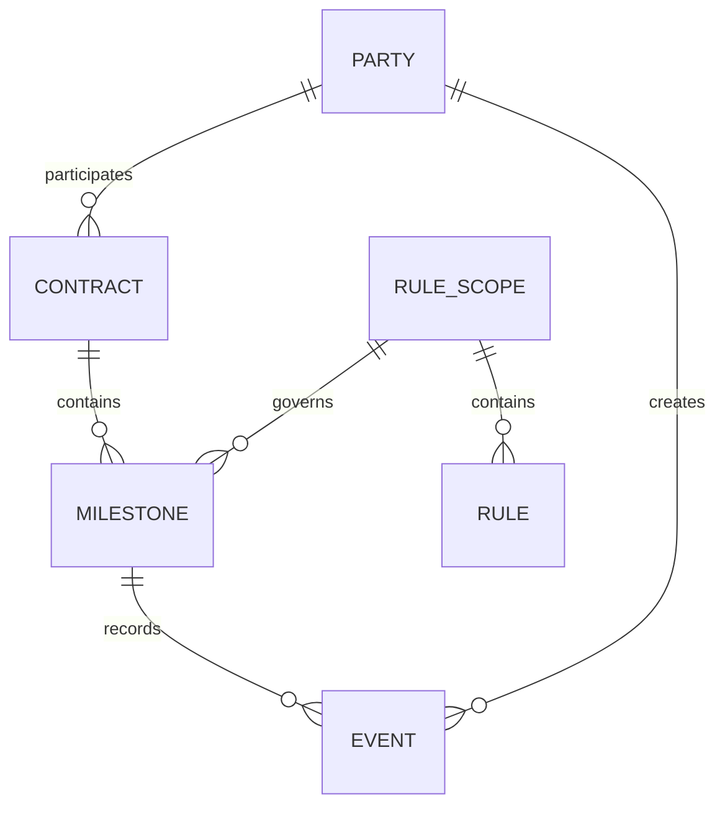

> **LƯU TRỮ — không dùng làm căn cứ.** Phiên bản 0.4 (rà soát lần 2, 21/10/2026), tên cũ `docs/Nghiệp vụ/soát nghiệp vụ lần 2.md`. Đã được thay bằng [04_DAC_TA_NGHIEP_VU.md](../../04_DAC_TA_NGHIEP_VU.md); lý do các thay đổi ở Phụ lục E của bản chuẩn. Nội dung bên dưới giữ nguyên như lúc lưu trữ.

# CASE 4 — SMART CONTRACT WORKFLOW

**Tài liệu định nghĩa và phân tích nghiệp vụ — bản rà soát 0.4**

| Mục | Nội dung |
| --- | --- |
| Cuộc thi | Festival Chuyển đổi số 2026 — Vòng sơ khảo — Bảng D — Case 4 |
| Phiên bản | 0.4 (đã làm rõ mục 9: rule theo Data Pack và trạng thái tham khảo; còn các giả định nghiệp vụ chờ xác nhận) |
| Ngày lập | 20/10/2026 |
| Ngày rà soát | 21/10/2026 |
| Nguồn | Đề thi Bảng D; Data Pack v1.0 (snapshot 18/10/2026): README, data dictionary, 5 file dữ liệu, 2 file mẫu; submission_output_template.csv đã được bổ sung và đối chiếu với manifest cùng dữ liệu nguồn |
| Đối tượng đọc | Toàn đội thi (nghiệp vụ, kỹ thuật, thuyết trình) |
| Mục đích | Thống nhất cách hiểu bài toán, thuật ngữ và quy tắc nghiệp vụ trước khi thiết kế giải pháp |

## Quy ước nhãn độ tin cậy
Mỗi khẳng định quan trọng trong tài liệu mang một nhãn để đội biết nên tin đến mức nào.

| Nhãn | Ý nghĩa |
| --- | --- |
| [ĐỀ] | Nêu trực tiếp trong đề thi hoặc README của BTC |
| [DỮ LIỆU] | Quan sát từ các tệp CSV được cung cấp; không phải ground truth. Các phép kiểm tra đã chạy trong lần rà soát được liệt kê ở Phụ lục A |
| [SAMPLE] | Quan sát hoặc suy luận từ mẫu công khai; không đồng nghĩa engine đã được kiểm thử khớp 20/20 |
| [GIẢ ĐỊNH] | Đội tạm chọn, cần xác nhận với BTC hoặc ghi rõ trong hồ sơ (xem mục 13) |

## Quy ước ngôn ngữ
Thuật ngữ nghiệp vụ dùng tiếng Việt, kèm tên tiếng Anh/tên trường dữ liệu lần đầu xuất hiện, ví dụ: mốc thanh toán (milestone).
Bốn quyết định luôn viết hoa, giữ nguyên tiếng Anh: RELEASE, HOLD, REJECT, PENALTY.
Đơn vị tiền luôn là triệu VND (hậu tố _vnd_mn). Tỷ lệ phần trăm lưu dạng số phần trăm (0.10 nghĩa là 0,10%, không phải 10%).
Mã định danh viết dạng code: CT0001 (hợp đồng), MS0001 (milestone), EV00001 (event), PR0001 (rule).
## 1. Tóm tắt điều hành
Bài toán. Trong mua bán và cung ứng, tiền được trả theo từng mốc (ký, giao hàng, nghiệm thu, bảo hành...). Kiểm tra thủ công dễ dẫn tới trả tiền khi chưa đủ điều kiện, xử lý chậm và thiếu dấu vết. Đội cần mô phỏng một hệ thống tự động kiểm tra điều kiện của từng mốc, ra quyết định và giải thích được quyết định đó.

Cốt lõi nghiệp vụ trong một câu. Với mỗi mốc thanh toán, hệ thống gom các sự kiện làm bằng chứng, khử trùng lặp, phân loại và giữ dấu vết sự kiện sai thẩm quyền, rồi áp dụng bộ rule theo thứ tự ưu tiên để ra một trong bốn quyết định kèm số tiền và lý do.

Năm điều cần nhớ.

Đơn vị ra quyết định là milestone (405 mốc), không phải hợp đồng. [ĐỀ]
Rule chạy theo first-match, ưu tiên từ 10 đến 80: chặn trước, tính tiền sau. [ĐỀ]
Khi dữ liệu thiếu hoặc không rõ, mặc định HOLD, không bao giờ tự RELEASE. [ĐỀ]
Trọng tâm KPI là Unauthorized Payment Rate gần 0: sai theo hướng "giữ thừa" an toàn hơn sai theo hướng "trả nhầm". [ĐỀ]
Không được hard-code theo 20 sample công khai, vì BTC có ground truth và hidden test riêng. [ĐỀ]
Tình trạng kiểm chứng. Bản nháp ghi engine khớp 20/20 mẫu, nhưng hồ sơ đính kèm chưa có mã nguồn, output và log kiểm thử để tái lập. Bản rà soát chưa xác nhận kết quả này. Khớp mẫu công khai, nếu được chứng minh, cũng không chứng minh đúng toàn bộ ground truth hay hidden test.

## 2. Bối cảnh và phạm vi
### 2.1. Vấn đề nghiệp vụ
Thanh toán thường gắn với các mốc như ký hợp đồng, giao hàng, nghiệm thu, phê duyệt và bảo hành. Kiểm tra thủ công có thể dẫn tới: [ĐỀ]

thanh toán khi chưa đủ điều kiện;
xử lý chậm;
khó theo dõi trạng thái;
thiếu lịch sử kiểm tra (audit trail).
### 2.2. Mục tiêu của hệ thống
Mô hình hóa chuỗi Hợp đồng → Milestone → Sự kiện → Kiểm tra rule → Quyết định → Audit log.
Kiểm tra: sự kiện bắt buộc, quyền của người tạo sự kiện, ngưỡng phê duyệt, tranh chấp/từ chối và điều kiện thời hạn.
Ra quyết định RELEASE / HOLD / REJECT / PENALTY theo thứ tự ưu tiên của rule.
Tính số tiền được thanh toán và tiền phạt khi vi phạm thời hạn.
Truy vết được: quyết định dựa trên sự kiện nào, rule nào, người nào.
### 2.3. Ngoài phạm vi
Không bắt buộc blockchain, Solidity, tiền mã hóa hoặc ví điện tử. [ĐỀ]
Kết quả không phải quyết định pháp lý, thanh toán hay giải ngân thực tế. Toàn bộ dữ liệu là giả lập. [ĐỀ]
### 2.4. Nguyên tắc thiết kế

| Nguyên tắc | Hệ quả |
| --- | --- |
| An toàn trước, nhanh sau | Có nghi ngờ thì HOLD |
| Giải thích được | Mỗi quyết định gắn với rule, sự kiện và người tạo sự kiện |
| Không hard-code | Rule đọc từ dữ liệu, không viết điều kiện theo mã milestone cụ thể |
| Đơn giản nhưng đúng | Đề đánh giá cao workflow đúng logic hơn giải pháp công nghệ phức tạp |

## 3. Bảng thuật ngữ nghiệp vụ

| Thuật ngữ (tên trường) | Định nghĩa | Không nhầm với |
| --- | --- | --- |
| Hợp đồng (contract) | Thỏa thuận mua bán/cung ứng giữa một bên mua và một nhà cung cấp, có giá trị tổng và các tham số chung (phê duyệt, phạt). Có 100 hợp đồng. | Milestone: hợp đồng là cả thỏa thuận, milestone là một giai đoạn của nó |
| Mốc thanh toán (milestone) | Một giai đoạn của hợp đồng gắn với một việc cụ thể, một hạn và một phần giá trị hợp đồng. Hoàn thành đúng điều kiện thì phần tiền đó được thanh toán. Có 405 mốc. Đây là đơn vị ra quyết định. | Event: milestone là "kết quả cần đạt", event là "việc đã xảy ra" |
| Sự kiện (event) | Một sự việc đã xảy ra và được ghi lại: giao hàng, hóa đơn, nghiệm thu, phê duyệt, từ chối, mở/đóng tranh chấp... Có 1.134 sự kiện. |  |
| Bằng chứng (evidence) | Sự kiện hợp lệ được dùng để chứng minh điều kiện hoặc blocker. Event bị loại vẫn được giữ trong audit để giải thích quyết định. | Sự kiện thô: có sự kiện không phải bằng chứng (bản lặp, sai thẩm quyền) |
| Sự kiện bắt buộc (required_event_types) | Danh sách loại sự kiện mà milestone phải có. Mỗi loại cần ít nhất một sự kiện hợp lệ. | Sự kiện hỗ trợ (phê duyệt, tranh chấp, từ chối) |
| Bên tham gia / người tạo sự kiện (party / actor) | Tổ chức hoặc vai trò tạo ra sự kiện. Có 3 loại: bên mua, nhà cung cấp, người phê duyệt. |  |
| Phê duyệt (APPROVAL) | Sự kiện do người phê duyệt có quyền xác nhận cho phép thanh toán một milestone. | Nghiệm thu: nghiệm thu do bên mua xác nhận chất lượng, phê duyệt là cho phép chi tiền |
| Ngưỡng phê duyệt (quorum) | Số phê duyệt hợp lệ tối thiểu để milestone được thanh toán (0, 1 hoặc 2). Mỗi người phê duyệt chỉ tính một lần. | Số lượng sự kiện APPROVAL thô |
| Tranh chấp (dispute) | Một bên phản đối milestone, được ghi bằng DISPUTE_OPENED. Đang mở khi chưa có DISPUTE_RESOLVED tham chiếu tới nó. Dispute đang mở chặn thanh toán. | Từ chối |
| Từ chối (rejection) | Người phê duyệt từ chối milestone (REJECTION). Kết quả là REJECT, milestone chưa được thanh toán. | Tranh chấp: tranh chấp có thể được giải quyết để quy trình tiếp tục, từ chối hiện tại; cơ chế rút lại hoặc mở lại chưa được đặc tả |
| Ân hạn (grace_period_days) | Số ngày sau hạn (due_date) mà chưa bị tính phạt. | Hạn thanh toán |
| Phạt chậm (penalty) | Khoản trừ vào tiền milestone khi hoàn thành muộn hơn hạn cộng ân hạn. Chỉ áp dụng nếu late_penalty_applicable = TRUE. |  |
| Giá trị kế hoạch (planned_payment_vnd_mn) | Số tiền dự kiến thanh toán cho milestone nếu mọi điều kiện đạt. | Số tiền thực được thanh toán |
| Số tiền được thanh toán (payable_amount_vnd_mn) | Số tiền hệ thống cho phép thanh toán sau khi áp dụng quyết định: RELEASE bằng giá trị kế hoạch, PENALTY bằng kế hoạch trừ phạt, HOLD và REJECT bằng 0. |  |
| RELEASE | Đủ điều kiện, cho thanh toán toàn bộ giá trị kế hoạch. |  |
| HOLD | Tạm giữ thanh toán vì thiếu điều kiện hoặc có yếu tố chặn. Có thể tiếp tục khi điều kiện được bổ sung. | REJECT |
| REJECT | Từ chối milestone do có rejection hợp lệ. Chưa được thanh toán. | HOLD |
| PENALTY | Milestone được xử lý nhưng bị khấu trừ do hoàn thành trễ hạn. Số tiền đủ điều kiện sau khấu trừ có thể bằng 0; chưa có thanh toán thực tế. |  |
| Khử trùng lặp (deduplication) | Gộp các sự kiện cùng một sự việc bị ghi nhiều lần thành một bằng chứng. | Xóa dữ liệu |
| Sự kiện sai thẩm quyền (unauthorized event) | Sự kiện bắt buộc do một bên không có quyền tạo loại sự kiện đó. Không được tính là bằng chứng hợp lệ. | Sự kiện bị thiếu |
| Rule first-match | Duyệt rule theo ưu tiên tăng dần, rule đầu tiên có điều kiện đúng thì áp dụng và dừng. |  |
| Dấu vết kiểm toán (audit trail) | Bản ghi cho biết ai, khi nào, dựa trên sự kiện và rule nào đã dẫn tới quyết định. |  |
| Snapshot | Ngày snapshot ghi trong metadata: 18/10/2026; chưa mặc định là ngày cắt sự kiện. | Thời điểm các sự kiện xảy ra (có sự kiện mang ngày sau snapshot, xem mục 12) |
| Ngày hoàn thành thực tế | Ngày muộn nhất trong bộ bằng chứng bắt buộc hợp lệ được chọn. Cách chọn bằng chứng khi có nhiều sự kiện cùng loại cần xác nhận. [GIẢ ĐỊNH] | Ngày phê duyệt |

## 4. Các bên tham gia và quyền hạn
### 4.1. Ba loại bên

| Loại | Số lượng | Làm gì trong quy trình |
| --- | --- | --- |
| Bên mua (BUYER) | 10 | Ký hợp đồng, xác nhận khởi động, nghiệm thu, giải quyết tranh chấp |
| Nhà cung cấp (SUPPLIER) | 25 | Giao hàng/dịch vụ, gửi hóa đơn, hoàn tất bảo hành |
| Người phê duyệt (APPROVER) | 30 | Phê duyệt hoặc từ chối thanh toán. Mỗi người thuộc về một bên mua |

Ba vai trò phê duyệt, mỗi vai có 10 người: CONTRACT_OWNER (chủ hợp đồng), FINANCE_APPROVER (phê duyệt tài chính), SECONDARY_APPROVER (phê duyệt thứ hai). [DỮ LIỆU]

### 4.2. Ma trận "loại sự kiện → bên được phép tạo"
Bảng này là ma trận ứng viên suy ra từ dữ liệu và ví dụ README. Các ánh xạ mở rộng chưa được BTC xác nhận là quy tắc đầy đủ. Lưu ma trận thành cấu hình có phiên bản; không suy quyền tự động chỉ từ các actor đang xuất hiện. [GIẢ ĐỊNH]

| Loại sự kiện | Bên tạo hợp lệ | Ghi chú |
| --- | --- | --- |
| CONTRACT_SIGNED, KICKOFF_CONFIRMED, REQUIREMENTS_APPROVED, UAT_PASSED, ACCEPTANCE | Bên mua |  |
| DELIVERY, INVOICE, GO_LIVE, SERVICE_ACTIVATED, SERVICE_COMPLETED, WARRANTY_COMPLETED | Nhà cung cấp |  |
| APPROVAL | Người phê duyệt, có vai trò thuộc required_approval_roles của milestone | Phải thuộc đúng bên mua của hợp đồng |
| REJECTION | Người phê duyệt (6/6 trường hợp do CONTRACT_OWNER) |  |
| DISPUTE_OPENED | Bên mua (12) hoặc nhà cung cấp (6) | Cần bên có quyền mở tranh chấp |
| DISPUTE_RESOLVED | Bên mua (8/8 trường hợp) | Phải tham chiếu tới một DISPUTE_OPENED |

Bằng chứng kiểm tra bổ sung: mọi sự kiện của bên mua/nhà cung cấp đều do đúng bên mua/nhà cung cấp của hợp đồng đó tạo, và mọi approver thuộc đúng bên mua của hợp đồng (497/497 phê duyệt). [DỮ LIỆU] Vì vậy kiểm tra "đúng bên của hợp đồng" nên được đưa vào để bắt các trường hợp ẩn.

### 4.3. Chính sách phê duyệt
Chính sách đặt ở cấp hợp đồng và được cụ thể hóa tại từng milestone. [DỮ LIỆU]

| Chính sách (approval_policy) | Số hợp đồng | Số milestone | Cần phê duyệt | Ngưỡng | Vai trò được tính | Tự động RELEASE |
| --- | --- | --- | --- | --- | --- | --- |
| AUTO_IF_ALL_CONDITIONS | 16 | 66 | Không | 0 | (không có) | Có |
| SINGLE_BUYER_APPROVAL | 40 | 163 | Có | 1 | CONTRACT_OWNER | Không |
| DUAL_APPROVAL | 27 | 108 | Có | 2 | CONTRACT_OWNER và SECONDARY_APPROVER | Không |
| FINANCE_PLUS_OWNER | 17 | 68 | Có | 2 | CONTRACT_OWNER và FINANCE_APPROVER | Không |

Quy tắc đọc: với ngưỡng 2, cần hai phê duyệt hợp lệ; theo README, hai phê duyệt phải tương ứng với hai vai trò liệt kê. [ĐỀ]

### 4.4. Cảnh báo về cột allowed_event_types
So khớp chuỗi trực tiếp giữa event_type và allowed_event_types cho **145/1.134 sự kiện không khớp**. Trong đó 26 là DISPUTE_OPENED/DISPUTE_RESOLVED, trong khi quyền dùng nhãn DISPUTE; 119 còn lại thuộc các loại khác. Con số 119 không phải số sự kiện hợp lệ bị từ chối nhầm. [DỮ LIỆU]

Có 6 sự kiện lệch loại bên so với ma trận ứng viên, nhưng không đủ căn cứ gọi đó là toàn bộ sự kiện sai quyền theo ground truth.

Cách xử lý đề xuất [GIẢ ĐỊNH]:
- Giữ nguyên allowed_event_types và can_approve_payment/can_raise_dispute làm nguồn quyền.
- Xây bảng ánh xạ tên sự kiện và cấu hình ngoại lệ rõ ràng cho các trường hợp thiếu hoặc khác nhãn; xin BTC xác nhận phạm vi quyền, đặc biệt quyền giải quyết tranh chấp.
- Kiểm tra actor_party_id với parties, đối chiếu loại/vai trò khai báo trong event, đúng buyer/supplier và parent_party_id của approver.
- Nếu quyền mâu thuẫn chưa được giải quyết, HOLD và ghi lý do; không tự bỏ qua cột quyền để tăng tỷ lệ khớp mẫu.
- Nếu dùng cấu hình tương thích Data Pack để thử nghiệm, ghi phiên bản và giả định trong output/audit; không coi cấu hình này là chính sách quyền dùng ngoài thực tế.

## 5. Mô hình dữ liệu và liên kết
### 5.1. Sơ đồ quan hệ


Sơ đồ rút gọn: buyer_id và supplier_id là hai liên kết riêng tới PARTY; EVENT còn tham chiếu EVENT qua reference_event_id.

### 5.2. Bảng khóa

| Từ | Đến | Quan hệ | Dùng để |
| --- | --- | --- | --- |
| milestones.contract_id | contracts.contract_id | nhiều-1 | Lấy giá trị, chính sách phê duyệt, tham số phạt |
| events.milestone_id | milestones.milestone_id | nhiều-1 | Gom bằng chứng cho từng mốc |
| events.contract_id | contracts.contract_id | nhiều-1 | Kiểm tra sự kiện thuộc đúng hợp đồng |
| contracts.buyer_id, supplier_id | parties.party_id | nhiều-1 | Xác định hai bên của hợp đồng |
| events.actor_party_id | parties.party_id | nhiều-1 | Kiểm tra quyền người tạo sự kiện |
| parties.parent_party_id | parties.party_id | nhiều-1 | Người phê duyệt thuộc bên mua nào |
| events.reference_event_id | events.event_id | nhiều-1 | DISPUTE_RESOLVED trỏ về DISPUTE_OPENED |
| milestones.release_rule_code | payment_rules.release_rule_code | Nhiều-nhiều qua mã phạm vi dùng chung | Lấy bộ 8 rule của milestone |

release_rule_code có dạng <rule_set_id>:<milestone_type>, ví dụ R_GOODS_STD:ACCEPTANCE. Có 16 mã, mỗi mã có đúng 8 rule. [DỮ LIỆU]

### 5.3. Kiểm tra tính toàn vẹn [DỮ LIỆU]

| Kiểm tra | Kết quả |
| --- | --- |
| Khóa chính trùng | Không |
| Khóa ngoại mồ côi (events → hợp đồng, milestone, party; tham chiếu giữa các event) | Không |
| Sự kiện có contract_id khác hợp đồng của milestone | 0 |
| Tổng payment_percent mỗi hợp đồng | Đều bằng 100% |
| Tổng tiền các milestone so với giá trị hợp đồng | Khớp cho cả 100 hợp đồng |
| milestone_id trong template so với milestones.csv | Đã kiểm tra: 405 ID duy nhất, khớp toàn bộ milestones.csv; 22 cột đúng thứ tự manifest |
| Milestone không có sự kiện nào | 0 |
| Ân hạn ở milestone khác hợp đồng | 0 milestone |
| Mức phạt mỗi ngày và trần phạt ở milestone khác hợp đồng | 185 milestone khác ở mỗi trường; dùng tham số milestone theo parameter_source của rule |

### 5.4. Quy ước dữ liệu [ĐỀ]
Ngày: YYYY-MM-DD. Thời điểm: YYYY-MM-DDTHH:MM:SS.
Tiền: triệu VND. 1250.00 là 1.250 triệu VND (1,25 tỷ).
Mã dạng CTdddd, MSdddd, EVddddd, PRdddd, Bddd, Sddd, Addd.
## 6. Cấu trúc workflow theo loại hợp đồng
Mỗi loại hợp đồng dùng một mẫu workflow cố định và một bộ rule.

### 6.1. Hàng hóa — WF_GOODS_4STAGE

| STT | Milestone | Sự kiện bắt buộc |
| --- | --- | --- |
| 1 | SIGNING | CONTRACT_SIGNED |
| 2 | DELIVERY | DELIVERY, INVOICE |
| 3 | ACCEPTANCE | ACCEPTANCE |
| 4 | WARRANTY | WARRANTY_COMPLETED |

### 6.2. Dịch vụ — WF_SERVICE_4STAGE

| STT | Milestone | Sự kiện bắt buộc |
| --- | --- | --- |
| 1 | KICKOFF | CONTRACT_SIGNED, KICKOFF_CONFIRMED |
| 2 | INTERIM_DELIVERY | DELIVERY, INVOICE |
| 3 | FINAL_ACCEPTANCE | ACCEPTANCE, INVOICE |
| 4 | WARRANTY_CLOSE | WARRANTY_COMPLETED |

### 6.3. Triển khai phần mềm — WF_SOFTWARE_5STAGE

| STT | Milestone | Sự kiện bắt buộc |
| --- | --- | --- |
| 1 | SIGNING | CONTRACT_SIGNED |
| 2 | REQUIREMENTS_APPROVAL | REQUIREMENTS_APPROVED |
| 3 | UAT_PASS | UAT_PASSED, INVOICE |
| 4 | GO_LIVE_ACCEPTANCE | GO_LIVE, ACCEPTANCE, INVOICE |
| 5 | WARRANTY_CLOSE | WARRANTY_COMPLETED |

### 6.4. Bảo trì — WF_MAINTENANCE_3STAGE

| STT | Milestone | Sự kiện bắt buộc |
| --- | --- | --- |
| 1 | ACTIVATION | CONTRACT_SIGNED, SERVICE_ACTIVATED |
| 2 | SERVICE_COMPLETION | SERVICE_COMPLETED, INVOICE |
| 3 | FINAL_ACCEPTANCE | ACCEPTANCE |

Mỗi milestone tham chiếu một phạm vi có 8 rule trong Data Pack hiện tại. Nhiều milestone dùng chung phạm vi; không phải 405 bộ rule riêng. Công thức tính tiền được chuẩn hóa ở BR-11 và BR-12.

## 7. Quy trình nghiệp vụ
### 7.1. Vòng đời của một hợp đồng
Hợp đồng được chia thành các milestone. Mỗi lần bổ sung sự kiện, hệ thống có thể đánh giá lại mốc liên quan, lưu một phiên bản quyết định mới và audit.

Thứ tự milestone_sequence dùng để trình bày tiến độ. Chưa tự đặt điều kiện “mốc trước phải RELEASE thì mốc sau mới được đánh giá” vì chưa có quy tắc chặn liên mốc rõ ràng trong nguồn. Quan hệ phụ thuộc và phạm vi tranh chấp cấp hợp đồng cần xác nhận. [GIẢ ĐỊNH]

### 7.2. Quy trình xử lý một milestone (8 bước)

| Bước | Hành động | Dữ liệu dùng | Kết quả |
| --- | --- | --- | --- |
| 1 | Lấy thông tin milestone và hợp đồng | milestones, contracts | Điều kiện cần, chính sách phê duyệt, tham số phạt |
| 2 | Lấy mọi sự kiện của milestone | events theo milestone_id | Danh sách sự kiện thô |
| 3 | Khử trùng lặp | khóa mục 8 (BR-03) | Danh sách sự kiện không trùng |
| 4 | Kiểm tra thẩm quyền | parties, ma trận mục 4.2 | Sự kiện hợp lệ / sai thẩm quyền |
| 5 | Xác định dispute và rejection | DISPUTE_*, REJECTION, reference_event_id | Có dispute đang mở? Có rejection hợp lệ? |
| 6 | Kiểm tra sự kiện bắt buộc và phê duyệt | required_event_types, quorum, vai trò | Thiếu gì? Đủ quorum chưa? |
| 7 | Xác định dữ kiện thời hạn | bộ bằng chứng bắt buộc đã chọn, hạn, ân hạn | Ngày hoàn thành và số ngày trễ; chỉ ghi penalty đầu ra nếu rule PENALTY thắng |
| 8 | Áp dụng rule theo ưu tiên (first-match) | payment_rules | Quyết định, mã lý do, số tiền, rule áp dụng |

Sau bước 8: ghi audit log (mã truy vết, rule, sự kiện làm bằng chứng, thời điểm, thời gian xử lý).

### 7.3. Vai trò trong mốc giao hàng minh họa

| Thứ tự | Bên | Việc làm | Sự kiện ghi nhận |
| --- | --- | --- | --- |
| 1 | Nhà cung cấp | Giao hàng | DELIVERY |
| 2 | Nhà cung cấp | Gửi hóa đơn | INVOICE |
| 3 | Người phê duyệt (chủ hợp đồng, và người thứ hai nếu hợp đồng yêu cầu) | Cho phép thanh toán | APPROVAL (1 hoặc 2) |
| 4 | Hệ thống | Đối chiếu và ra quyết định | Audit log |

Ví dụ trong dữ liệu giả lập: hợp đồng CT0001, milestone MS0002 — EV00002 (DELIVERY) và EV00003 (INVOICE) cùng do S021 tạo, đúng nhà cung cấp của hợp đồng. [DỮ LIỆU]

### 7.4. Vòng đời trạng thái milestone [GIẢ ĐỊNH]
README gợi ý bộ trạng thái dưới đây; cách ánh xạ từ quyết định sang trạng thái là đề xuất của đội, cần ghi rõ trong hồ sơ nếu dùng.

| Quyết định / lý do | Trạng thái đề xuất |
| --- | --- |
| RELEASE | ELIGIBLE_FOR_PAYMENT |
| PENALTY | ELIGIBLE_WITH_PENALTY |
| REJECT | REJECTED |
| HOLD — thiếu sự kiện bắt buộc | WAITING_EVIDENCE |
| HOLD — chưa đủ quorum | WAITING_APPROVAL |
| HOLD — dispute đang mở hoặc sự kiện sai thẩm quyền | ON_HOLD |

ELIGIBLE_WITH_PENALTY là tên do đội đề xuất để tránh hiểu nhầm đã chi tiền. PLANNED và IN_PROGRESS dùng trước khi đánh giá; COMPLETED phải có định nghĩa riêng, không tự gán chỉ vì đủ điều kiện thanh toán. Trạng thái hợp đồng tổng hợp theo mục 14.

## 8. Quy tắc nghiệp vụ
### 8.1. Thứ tự ưu tiên của rule [ĐỀ]
Rule giống hệt nhau ở cả 16 mã release_rule_code; chỉ phạm vi áp dụng khác nhau. [DỮ LIỆU]

| Ưu tiên | Điều kiện | Quyết định | Mã lý do | Điều kiện | Lý do nghiệp vụ |
| --- | --- | --- | --- | --- | --- |
| 10 | Có dispute đang mở | HOLD | OPEN_DISPUTE | open_dispute == TRUE | Đang có tranh chấp thì không chi tiền |
| 20 | Có rejection hợp lệ | REJECT | REJECTION_PRESENT | valid_rejection_event_count > 0 | Người có thẩm quyền đã từ chối |
| 30 | Sự kiện bắt buộc do bên sai thẩm quyền | HOLD | UNAUTHORIZED_EVENT | unauthorized_required_event_count > 0 | Bằng chứng không đáng tin, cần kiểm tra |
| 40 | Thiếu sự kiện bắt buộc | HOLD | MISSING_REQUIRED_EVENT | required_event_completion_rate < 1.0 | Chưa đủ chứng từ |
| 50 | Chưa đạt quorum phê duyệt | HOLD | APPROVAL_QUORUM_NOT_MET | approval_required == TRUE AND valid_approval_count < required_approval_quorum | Chưa đủ người chịu trách nhiệm xác nhận |
| 60 | Hoàn thành trễ vượt ân hạn | PENALTY | LATE_COMPLETION | late_penalty_applicable == TRUE AND actual_completion_date > due_date + grace_period_days | Đủ điều kiện nhưng vi phạm thời hạn: trả sau khi trừ phạt |
| 70 | Đủ mọi điều kiện | RELEASE | ALL_CONDITIONS_MET | all_required_conditions_met == TRUE AND open_dispute == FALSE AND valid_rejection_event_count == 0 | Chi đủ |
| 80 | Còn lại | HOLD | UNRESOLVED_CONDITION | ELSE | Không rõ thì giữ lại |

Triết lý của thứ tự: chặn trước, tính tiền sau. Các yếu tố ngăn thanh toán sai (10 đến 50) luôn được kiểm tra trước việc tính tiền phạt (60). Nếu cùng lúc có dispute mở và rejection, kết quả là HOLD vì dispute có ưu tiên 10. [DỮ LIỆU]

### 8.2. Danh mục quy tắc chi tiết
#### BR-01. Mỗi milestone có đúng một quyết định hiện hành cho mỗi lần đánh giá. [ĐỀ] Đánh giá không tự chặn theo mốc trước là lựa chọn triển khai; phạm vi dispute cấp hợp đồng và phụ thuộc liên mốc cần làm rõ. [GIẢ ĐỊNH]

#### BR-02. Rule áp dụng theo first-match. Duyệt theo priority tăng dần; rule đầu tiên có điều kiện đúng quyết định kết quả và dừng. [ĐỀ]

#### BR-03. Khử trùng lặp sự kiện.

Khóa ứng viên: contract_id, milestone_id, event_type, document_id, actor_party_id. Đây là giả định tương thích các bản lặp quan sát được, không phải khóa duy nhất do BTC bắt buộc. Nếu document_id trống, hoặc trạng thái/reference_event_id khác nhau, không tự gộp chỉ theo khóa này.
Với các bản lặp tương đương, chọn event_timestamp sớm nhất, dùng event_id phân xử khi bằng nhau. Không có thời điểm tiếp nhận nên không gọi là “đến sớm nhất”. Giữ toàn bộ bản gốc và ánh xạ duplicate_of trong audit.
Không dựa vào nội dung event_note ("Repeated submission received") để nhận diện, vì đó chỉ là dấu hiệu của dữ liệu mẫu.
Lý do: duplicate không được tính nhiều lần và không làm phát sinh thanh toán nhiều lần. Duplicate không làm milestone bị HOLD nếu sau khi khử trùng vẫn đủ bằng chứng. [ĐỀ] (khóa khử trùng cụ thể: [GIẢ ĐỊNH], có thể đối chiếu SC019, SC020)
#### BR-04. Sự kiện bắt buộc hợp lệ. Một required event được tính vào điều kiện khi đồng thời thỏa:

event_type thuộc required_event_types của milestone;
trạng thái sự kiện hợp lệ;
người tạo đúng loại bên (ma trận mục 4.2) và đúng bên của hợp đồng;
không phải bản lặp (BR-03). [ĐỀ]
#### BR-05. Sự kiện bắt buộc đầy đủ. condition_logic = ALL: mỗi loại sự kiện bắt buộc cần ít nhất một sự kiện hợp lệ sau khử trùng. [DỮ LIỆU]

#### BR-06. Phân biệt "sai thẩm quyền" và "thiếu".

Sai thẩm quyền: có ít nhất một required event sai quyền theo chính sách đã chốt. Rule 30 kiểm tra số lượng > 0, nên vẫn chặn ngay cả khi đồng thời có một required event cùng loại hợp lệ; không sửa thành “chỉ có event sai quyền”.
Thiếu điều kiện: không có bằng chứng hợp lệ cho ít nhất một loại bắt buộc, kể cả khi có event nhưng sai trạng thái hoặc sai quyền. Có thể đồng thời vừa thiếu vừa sai quyền; rule 30 thắng rule 40.
Hai trường hợp cho hai mã lý do khác nhau (ưu tiên 30 và 40). [SAMPLE]
#### BR-07. Dispute.

Một DISPUTE_OPENED hợp lệ đang mở nếu chưa có DISPUTE_RESOLVED hợp lệ tham chiếu đúng event, đúng phạm vi hợp đồng/mốc và có thời gian không trước lúc mở. Một event đóng không được đóng mọi tranh chấp. Quyền đóng và phạm vi ảnh hưởng chờ xác nhận.
Dispute đang mở → HOLD.
Sau khi được giải quyết, quy trình tiếp tục đánh giá các điều kiện còn lại; cặp mở/đóng vẫn phải lưu trong audit. Việc không đưa chúng vào evidence_event_ids chỉ là quy ước quan sát từ sample, không phải xóa lịch sử. [SAMPLE] (SC009, SC010)
#### BR-08. Rejection. Có REJECTION hợp lệ và không có blocker ưu tiên cao hơn → REJECT, payable bằng 0. Không tự giới hạn người từ chối là CONTRACT_OWNER chỉ vì 6 mẫu hiện tại dùng vai trò này. Cơ chế hủy rejection hoặc mở lại cần xác nhận.

#### BR-09. Phê duyệt và quorum. Nếu approval_required = TRUE:

chỉ tính APPROVAL có trạng thái APPROVED, actor là APPROVER có can_approve_payment = TRUE, vai trò tra từ parties phù hợp required_approval_roles và không mâu thuẫn với event;
mỗi người phê duyệt chỉ tính một lần;
người phê duyệt phải thuộc bên mua của hợp đồng;
số người phê duyệt hợp lệ phải đạt required_approval_quorum, đồng thời bao phủ các vai trò bắt buộc; hai người cùng vai trò không thay thế hai vai trò khác nhau. [ĐỀ]

Nếu số người đủ nhưng thiếu vai trò, vẫn HOLD. Cần định nghĩa valid_approval_count là số phê duyệt đáp ứng các vị trí vai trò, hoặc thêm bước kiểm tra vai trò vào fact trước rule; không để trường hợp này lọt xuống PENALTY. Hạn mức approval_limit_vnd_mn được dictionary ghi là kiểm tra nâng cao tùy chọn; không âm thầm thêm vào baseline.
#### BR-10. Ngày hoàn thành thực tế. Tạm lấy ngày muộn nhất trong bộ required event hợp lệ được chọn, không tính APPROVAL nếu không nằm trong required_event_types. [GIẢ ĐỊNH] Khi có nhiều event cùng loại không phải duplicate, phải chốt chính sách chọn bằng chứng (sớm nhất đủ điều kiện hay bản thay thế mới nhất). Khi thiếu required event, để ngày hoàn thành chưa xác định, không tính penalty đầu ra. Ví dụ MS0020 có ACCEPTANCE ngày 12/11 và INVOICE ngày 13/11, hoàn thành thực tế là 13/11. [SAMPLE] (phù hợp cách diễn giải các ca phạt công khai; chưa đủ chứng minh mọi trường hợp)

#### BR-11. Phạt chậm.

Điều kiện: late_penalty_applicable = TRUE và ngày hoàn thành thực tế lớn hơn due_date + grace_period_days. [ĐỀ]
Số ngày trễ: days_late_after_grace = max(0, ngày_hoàn_thành − (due_date + grace_period_days)), tính theo ngày lịch. [ĐỀ]
Tiền phạt:
```text
penalty = min(
    days_late_after_grace * penalty_rate_pct_per_day / 100 * planned_payment,
    max_penalty_pct / 100 * planned_payment
)
```
Sample hiển thị 2 chữ số thập phân nhưng chưa đủ xác định chế độ làm tròn. [GIẢ ĐỊNH] Đội đề xuất số thập phân chính xác, ROUND_HALF_UP tới 0,01 triệu VND; làm tròn penalty rồi trừ khỏi planned_payment để bảo đảm đối soát. Cần kiểm tra ca đúng nửa đơn vị và xin xác nhận BTC. Các trường phần trăm lưu theo giá trị phần trăm.
Ví dụ:

0.10
ở penalty_rate_pct_per_day nghĩa là:

0,10%/ngày

không phải 10%.

Ngày hoàn thành bằng đúng due_date + grace chưa bị phạt (điều kiện là "lớn hơn"). [ĐỀ]
Milestone không áp dụng phạt thì không bao giờ có PENALTY, dù trễ.
#### BR-12. Số tiền được thanh toán.

| Quyết định | payable_amount_vnd_mn | penalty_amount_vnd_mn |
| --- | --- | --- |
| RELEASE | = giá trị kế hoạch | 0 |
| PENALTY | = max(0, kế hoạch − phạt) | = phạt |
| HOLD | 0 | 0 |
| REJECT | 0 | 0 |

[ĐỀ]

#### BR-13. Mặc định an toàn. Khi điều kiện không rõ hoặc không rơi vào rule nào, kết quả là HOLD (rule 80). Không bao giờ tự RELEASE khi chưa chắc. [ĐỀ]

#### BR-14. Truy vết. Mỗi quyết định ghi: milestone, rule áp dụng, các sự kiện làm bằng chứng, người tạo, số tiền, thời điểm xử lý, mã truy vết. [ĐỀ]

#### BR-15. Chế độ đánh giá thời gian. Khi tái hiện sample, đề xuất dùng toàn bộ event trong Data Pack, không cắt theo snapshot. Đây là đánh giá hồi cứu trên dữ liệu giả lập, không khẳng định các event tương lai đã xảy ra ngoài thực tế. Nếu chạy chế độ as-of thì chỉ dùng event_timestamp <= evaluation_time và ghi rõ chế độ trong audit. Sample SC005 (MS0020) có sự kiện hoàn thành ngày 13/11/2026, tức sau snapshot, nhưng vẫn mang nhãn PENALTY với số ngày trễ tính theo chính sự kiện đó. Ngoài ra 19 sự kiện của các milestone thuộc 20 sample cũng mang ngày sau snapshot. [SAMPLE], [GIẢ ĐỊNH]

#### BR-16. Không hard-code. Không viết điều kiện theo mã milestone, mã scenario hay mã hợp đồng cụ thể; rule đọc từ payment_rules.csv. [ĐỀ]

### 8.3. Danh sách bằng chứng (evidence_event_ids) [SAMPLE]
Qua đối chiếu 20 dòng mẫu, danh sách bằng chứng gồm:

các sự kiện bắt buộc hợp lệ (đã khử trùng lặp);
các phê duyệt hợp lệ;
thêm sự kiện dispute đang mở hoặc rejection khi đó là lý do quyết định.
Để tương thích sample có thể không đưa các bản lặp, sự kiện sai quyền và dispute đã đóng vào evidence_event_ids. Tuy nhiên, audit chi tiết phải giữ các event này cùng lý do sử dụng/loại bỏ. Quyết định UNAUTHORIZED_EVENT cần truy ra chính event sai quyền, dù không nằm trong danh sách bằng chứng được chấp nhận.

### 8.4. Ví dụ tính phạt
Milestone MS0020 (CT0005): kế hoạch 900 triệu, hạn 02/11/2026, ân hạn 5 ngày, mức phạt 0,15%/ngày.

| Bước | Tính | Kết quả |
| --- | --- | --- |
| Hạn cuối không phạt | 02/11 + 5 ngày | 07/11/2026 |
| Ngày hoàn thành thực tế | INVOICE (EV00038) ngày 13/11 | 13/11/2026 |
| Số ngày trễ sau ân hạn | 13/11 − 07/11 | 6 ngày |
| Tiền phạt | 6 × 0,15 / 100 × 900 | 8,10 triệu |
| Trần phạt | max_penalty_pct × 900 / 100 | Không chạm trần |
| Số tiền được thanh toán | 900 − 8,10 | 891,90 triệu |

Kết quả khớp đáp án mẫu SC005. [SAMPLE]

## 9. Bảng quyết định và ánh xạ trạng thái

### 9.1. Quy tắc quyết định theo Data Pack

**Phần này tổng hợp logic từ payment_rules.csv, không phải bảng ví dụ để tùy ý đổi quyết định hoặc thứ tự ưu tiên.** Kiểm tra 128 rule cho thấy 8 mẫu logic được dùng theo các phạm vi áp dụng. Khi triển khai, phải lấy đúng nhóm rule của milestone bằng release_rule_code, đối chiếu rule_set_id và các trường phạm vi liên quan, chỉ dùng rule đang hoạt động rồi duyệt priority tăng dần. Rule khớp đầu tiên quyết định kết quả và dừng xử lý. [ĐỀ], [DỮ LIỆU]

Mỗi dòng chỉ được xét khi tất cả dòng ưu tiên trước chưa khớp. Không áp dụng các dòng độc lập và không chọn quyết định theo mức độ nghiêm trọng do nhóm tự đặt.

Ký hiệu: P = planned_payment_vnd_mn; F = penalty_amount_vnd_mn tính theo công thức bên dưới. Đơn vị tiền là triệu VND.

| Priority | Điều kiện nghiệp vụ diễn giải | Quyết định | reason_code | Payable | Penalty |
| --- | --- | --- | --- | --- | --- |
| 10 | Có tranh chấp hợp lệ đang mở trong phạm vi đánh giá | HOLD | OPEN_DISPUTE | 0 | 0 |
| 20 | Có rejection hợp lệ | REJECT | REJECTION_PRESENT | 0 | 0 |
| 30 | Có ít nhất một required event sai thẩm quyền | HOLD | UNAUTHORIZED_EVENT | 0 | 0 |
| 40 | Chưa đủ bằng chứng bắt buộc hợp lệ | HOLD | MISSING_REQUIRED_EVENT | 0 | 0 |
| 50 | Yêu cầu phê duyệt và số phê duyệt hợp lệ chưa đạt quorum | HOLD | APPROVAL_QUORUM_NOT_MET | 0 | 0 |
| 60 | Có áp dụng phạt và ngày hoàn thành thực tế sau due_date + grace_period_days | PENALTY | LATE_COMPLETION | max(0, P − F) | F |
| 70 | Toàn bộ điều kiện bắt buộc đạt, không có tranh chấp mở và không có rejection hợp lệ | RELEASE | ALL_CONDITIONS_MET | P | 0 |
| 80 | Không khớp các rule trên | HOLD | UNRESOLVED_CONDITION | 0 | 0 |

Công thức khi rule PENALTY thắng:

```text
days_late_after_grace = max(0, actual_completion_date - (due_date + grace_period_days))
F = min(
    days_late_after_grace * penalty_rate_pct_per_day / 100 * P,
    max_penalty_pct / 100 * P
)
payable_amount_vnd_mn = max(0, P - F)
```

Dùng tham số tại milestone theo parameter_source của rule. Chính sách chọn ngày hoàn thành và làm tròn vẫn phải được chốt theo mục 13; bảng này không biến các giả định đó thành quy định của BTC.

### 9.2. Cách hiểu điều kiện trước khi áp dụng rule

- **Sai quyền và thiếu bằng chứng:** có event không đồng nghĩa có bằng chứng hợp lệ. Required event sai trạng thái hoặc sai quyền không được tính là đáp ứng. Nếu có required event sai quyền, rule 30 vẫn khớp dù đồng thời có event cùng loại đúng quyền; không xóa dấu vết sai quyền trước khi tính fact.
- **Phê duyệt:** biểu thức gốc của rule 50 là `approval_required == TRUE AND valid_approval_count < required_approval_quorum`. README còn yêu cầu đúng actor, đúng role và không đếm một approver nhiều lần. Vì vậy, valid_approval_count phải được xây từ các phê duyệt hợp lệ, đồng thời thiết kế kiểm tra vai trò để trường hợp đủ số người nhưng thiếu vai trò bắt buộc vẫn HOLD, không lọt xuống PENALTY hoặc RELEASE. Cách biểu diễn kiểm tra vai trò trong fact là thiết kế triển khai cần được nhóm duyệt; không trình bày điều kiện bổ sung như nguyên văn biểu thức rule CSV.
- **Quorum và vai trò theo từng mốc:** lấy required_approval_quorum và required_approval_roles của milestone. Ví dụ quorum 2 với CONTRACT_OWNER và FINANCE_APPROVER trong mục 9 README chỉ minh họa một cấu hình, không áp cho mọi milestone.
- **Tranh chấp và rejection:** phải là sự kiện hợp lệ; quyền resolve/reject và phạm vi tranh chấp còn chưa rõ được quản lý tại mục 13. Không suy rộng chính sách chỉ từ các actor có mặt trong sample.
- **Ưu tiên chặn trước tính tiền:** có dispute mở và rejection thì HOLD ở priority 10; thiếu evidence dù đã quá hạn thì HOLD ở priority 40; chưa đủ approval dù trễ thì HOLD ở priority 50. Các trường hợp đó có payable và penalty đầu ra bằng 0.
- **Công thức không đổi ý nghĩa:** PENALTY có payable là max(0, P − F), không chỉ ghi P − F. Quyết định này không chứng minh đã có giao dịch chi tiền.

### 9.3. Ánh xạ trạng thái do nhóm đề xuất — mang tính tham khảo

**Bảng dưới là lựa chọn thiết kế của nhóm.** README mục 15 đưa ra gợi ý trạng thái và cho phép dùng tập khác nếu giải thích rõ mapping. Nhóm có thể đổi tên trạng thái, nhưng không được làm thay đổi decision, reason_code hoặc số tiền do rule xác định. [GIẢ ĐỊNH]

| Quyết định / lý do | Trạng thái đề xuất | Ý nghĩa hiển thị |
| --- | --- | --- |
| RELEASE | ELIGIBLE_FOR_PAYMENT | Đủ điều kiện thanh toán, chưa xác nhận đã chi tiền |
| PENALTY | ELIGIBLE_WITH_PENALTY | Đủ điều kiện xử lý sau khấu trừ phạt; payable có thể bằng 0 |
| REJECT | REJECTED | Mốc bị từ chối theo kết quả đánh giá hiện hành |
| HOLD / MISSING_REQUIRED_EVENT | WAITING_EVIDENCE | Chờ đủ bằng chứng hợp lệ |
| HOLD / APPROVAL_QUORUM_NOT_MET | WAITING_APPROVAL | Chờ đủ phê duyệt hợp lệ và vai trò bắt buộc |
| HOLD / OPEN_DISPUTE | ON_HOLD | Tạm giữ do tranh chấp đang mở |
| HOLD / UNAUTHORIZED_EVENT | ON_HOLD | Tạm giữ để xử lý bằng chứng sai quyền |
| HOLD / UNRESOLVED_CONDITION | ON_HOLD | Tạm giữ vì điều kiện chưa được giải quyết |

ELIGIBLE_WITH_PENALTY là tên nhóm đề xuất thay cho cách gọi PAID_WITH_PENALTY trong danh sách gợi ý README, nhằm tránh biểu thị đã thanh toán. Không coi tên này là giá trị bắt buộc do BTC quy định. Trạng thái hợp đồng tổng hợp theo mục 14, không đồng nhất với quyết định của từng milestone.

## 10. Tình huống minh họa từ 20 sample công khai (Có thể đọc nếu muốn hiểu hơn)

| Nhóm tình huống | Sample | Milestone | Dữ kiện chính | Kết quả |
| --- | --- | --- | --- | --- |
| Đủ điều kiện | SC001 | MS0003 | Có ACCEPTANCE hợp lệ (EV00004), không dispute, không cần phê duyệt | RELEASE 387 |
| Trễ hạn | SC005 | MS0020 | Hoàn thành trễ 6 ngày sau ân hạn | PENALTY, phạt 8,10, trả 891,90 |
| Trễ hạn | SC006 | MS0041 | Trễ 3 ngày sau ân hạn, kế hoạch 1.472 | PENALTY, phạt 6,62, trả 1.465,38 |
| Dispute đang mở | SC007 | MS0011 | Đủ sự kiện và 1/1 phê duyệt nhưng có dispute chưa đóng | HOLD, payable 0 |
| Dispute đã giải quyết | SC009 | MS0024 | Dispute có sự kiện giải quyết tham chiếu; điều kiện còn lại đủ | RELEASE 2.250 |
| Thiếu sự kiện | SC011 | MS0045 | 0/1 sự kiện bắt buộc hợp lệ | HOLD |
| Thiếu sự kiện | SC012 | MS0098 | 1/2 sự kiện bắt buộc hợp lệ | HOLD |
| Thiếu phê duyệt | SC013 | MS0048 | Đủ sự kiện, mới 1/2 phê duyệt | HOLD |
| Từ chối | SC015 | MS0007 | Có REJECTION hợp lệ (EV00010) | REJECT, payable 0 |
| Sai thẩm quyền | SC017 | MS0067 | 2 sự kiện bắt buộc, 1 hợp lệ, 1 do bên sai tạo (EV00177) | HOLD |
| Sự kiện lặp | SC019 | MS0172 | EV00484 là bản lặp của EV00482 (cùng chứng từ DN-CT0043-02); bỏ bản lặp thì vẫn đủ | RELEASE 752,5 (một lần) |

Điểm đáng chú ý của SC019: cùng một lô hàng bị gửi hai lần cách nhau 2 phút. Hệ thống chỉ tính một bằng chứng; nếu đếm theo số dòng sẽ tính là hai bằng chứng và có thể RELEASE sai khi còn thiếu INVOICE.

## 11. Phân tích dữ liệu (Giảm tải)
### 11.1. Quy mô

| Đối tượng | Số lượng |
| --- | --- |
| Hợp đồng | 100 (hàng hóa 40, dịch vụ 25, phần mềm 20, bảo trì 15) |
| Party | 65 (bên mua 10, nhà cung cấp 25, người phê duyệt 30) |
| Milestone | 405 |
| Rule | 128 (16 mã × 8 rule), tất cả đang hoạt động |
| Sự kiện | 1.134 (trung bình khoảng 2,8 sự kiện mỗi milestone) |
| Giá trị hợp đồng | từ 360 đến 13.650 triệu; trung bình khoảng 4.223 triệu; tổng 422.340 triệu |

Phân bố sự kiện: APPROVAL 497, INVOICE 140, CONTRACT_SIGNED 100, ACCEPTANCE 97, WARRANTY_COMPLETED 85, DELIVERY 68, KICKOFF_CONFIRMED 25, GO_LIVE 20, REQUIREMENTS_APPROVED 20, UAT_PASSED 20, DISPUTE_OPENED 18, SERVICE_COMPLETED 15, SERVICE_ACTIVATED 15, DISPUTE_RESOLVED 8, REJECTION 6. [DỮ LIỆU]

### 11.2. Thời gian [DỮ LIỆU]

| Chỉ tiêu | Kết quả |
| --- | --- |
| Khoảng thời gian của sự kiện | 24/01/2026 đến 27/05/2027 |
| Sự kiện có ngày sau snapshot 18/10/2026 | 267 (khoảng 23,5%), thuộc 93 milestone |
| Milestone có hạn sau snapshot | 95 |
| Phê duyệt có thời điểm sớm hơn sự kiện bắt buộc cuối | 0 trên 497 |
| Sự kiện trước ngày ký hợp đồng | 0 |
| Thời gian giải quyết dispute (đã giải quyết) | đều 2 ngày |

### 11.3. Kết quả engine được bản nháp báo cáo — chưa xác nhận

Bản nháp nêu: RELEASE 348; PENALTY 15; HOLD 36 (10 dispute, 10 thiếu event, 10 thiếu approval, 6 sai quyền); REJECT 6. Tổng là 405. Bản nháp cũng nêu payable khoảng 365.786 triệu và penalty khoảng 102 triệu.

**Không dùng những số này làm KPI đã đạt hoặc ground truth.** Lần rà soát này chưa có mã engine, output đầy đủ và log so sánh để tái lập. Chuyển sang trạng thái “kết quả do bản nháp báo cáo, chờ kiểm chứng”. Muốn công bố cần lưu mã/phiên bản engine, cấu hình quyền, chế độ thời gian, fingerprint dữ liệu, output 405 dòng và kết quả so sánh từng sample.

Không suy đoán cấu trúc hidden test từ các số lượng tròn trong dữ liệu.

### 11.4. Danh mục bất thường và chỉ báo cần kiểm tra

| Loại | Số lượng | Dấu hiệu nhận biết |
| --- | --- | --- |
| Sự kiện lặp | 5 cặp (5 sự kiện thừa) | Cùng milestone, loại, chứng từ, người tạo; cách nhau 2 phút |
| Sự kiện lệch loại bên theo ma trận ứng viên | 6 | Không đồng nghĩa đã biết toàn bộ sự kiện sai quyền theo BTC |
| Dispute mở | 18 | 8 đã giải quyết, 10 còn mở |
| Rejection | 6 | Đều do CONTRACT_OWNER |
| Milestone thiếu sự kiện bắt buộc | 10 theo bản nháp, chưa xác nhận engine | Cần phân biệt thiếu loại event với thiếu bằng chứng hợp lệ |
| Milestone thiếu phê duyệt | 10 theo bản nháp, chưa xác nhận engine | Phụ thuộc chính sách quyền và cách kiểm tra vai trò |
| Milestone trễ hạn bị phạt | 15 theo bản nháp, chưa xác nhận engine | Chỉ xác nhận sau khi chạy đủ rule và chốt ngày hoàn thành |

Sáu sự kiện sai bên: ACCEPTANCE do nhà cung cấp tạo (2), DELIVERY do bên mua tạo (2), SERVICE_COMPLETED do bên mua tạo (1), UAT_PASSED do nhà cung cấp tạo (1). Danh sách milestone ở Phụ lục B.

Lưu ý: MANUAL_ENTRY trùng khớp với 6 sự kiện sai bên trong dữ liệu hiện tại, nhưng không được dùng làm tiêu chí loại sự kiện, vì đó là dấu hiệu của dữ liệu mẫu chứ không phải quy tắc nghiệp vụ. Hidden test có thể có sự kiện sai bên nhưng đi qua kênh khác.

## 12. Các bẫy và lưu ý

| Bẫy | Cách xử lý |
| --- | --- |
| Bỏ allowed_event_types hoàn toàn hoặc so khớp tên quá máy móc | Chốt ánh xạ và ngoại lệ có phiên bản; quyền mâu thuẫn thì HOLD |
| Lọc theo snapshot mà không biết chế độ đánh giá | Tách đánh giá toàn bộ pack và as-of; đối chiếu sample trong đúng chế độ |
| Lấy ngày approval làm ngày hoàn thành | Chốt bộ required evidence và chính sách chọn event |
| Xóa sự kiện sai quyền trước khi tính fact | Giữ unauthorized_required_event_count và dấu vết event sai quyền |
| Đếm số dòng thay vì đủ từng loại required event | Khử trùng, kiểm quyền/trạng thái, kiểm tra từng loại |
| Đếm đủ người nhưng thiếu vai trò | Kiểm cả actor duy nhất, quorum và coverage vai trò |
| Chỉ có một event resolve mà đóng mọi dispute | Đối chiếu từng reference_event_id và phạm vi |
| Quên chia 100 | Dùng tỷ lệ phần trăm đúng đơn vị |
| Lấy tham số phạt cấp hợp đồng thay milestone | Dùng parameter_source của rule, không ghi đè 185 mốc khác tham số |
| Ghi PAID ngay khi đủ điều kiện | Dùng trạng thái ELIGIBLE; đây là mô phỏng, chưa chi tiền |
| Khớp 20 sample rồi tuyên bố đúng 405 mốc | Tách accuracy trên sample, kiểm tra bất biến toàn pack và test bổ sung |
| Dùng event_source/event_note làm nhãn lỗi | Chỉ dùng điều kiện nghiệp vụ có căn cứ |

## 13. Các giả định và câu hỏi cần xác nhận

| Mã | Vấn đề | Phương án tạm thời | Điều kiện chốt |
| --- | --- | --- | --- |
| A01 | Quyền thiếu/khác tên trong allowed_event_types | Cấu hình ánh xạ, giữ xung đột trong audit; chưa rõ thì HOLD | BTC xác nhận ma trận quyền |
| A02 | Snapshot có phải thời điểm cắt dữ liệu? | Đánh giá toàn pack để đối chiếu mẫu; tách as-of | BTC xác nhận chế độ chấm |
| A03 | Nhiều event cùng loại, không phải duplicate | Chọn bộ evidence theo chính sách đã công bố | Chốt định nghĩa actual_completion_date |
| A04 | Duplicate có chứng từ trống hoặc trạng thái thay đổi | Không tự gộp | Quy định khóa và cửa sổ thời gian |
| A05 | Tranh chấp ảnh hưởng mốc hay cả hợp đồng? | Không suy rộng từ một mốc sang cả hợp đồng nếu chưa có chỉ dẫn | BTC xác nhận scope |
| A06 | Ai có quyền resolve/reject? Có rút lại rejection? | Không suy quyền chỉ từ người xuất hiện trong sample | Ma trận quyền và vòng đời được duyệt |
| A07 | Quy tắc làm tròn tiền | Decimal, 2 chữ số, HALF_UP; ghi rõ thứ tự làm tròn | BTC xác nhận hoặc test tham chiếu |
| A08 | auto_release_allowed và approval_required mâu thuẫn | HOLD để kiểm tra; không diễn giải FALSE là cấm RELEASE sau khi đủ approval | Quy định nguồn ưu tiên |
| A09 | Phụ thuộc giữa các milestone | Không tự thêm khóa chặn theo milestone_sequence | BTC xác nhận nếu có dependency |
| A10 | Quy ước các trường đầu ra, đặc biệt confidence_score | Template đã xác minh; confidence không coi là xác suất đúng | BTC xác nhận định dạng, tính bắt buộc và cách diễn giải trường; ô trống trong mẫu không chứng minh được phép bỏ trống khi nộp |

Mỗi giả định phải có người phụ trách, ngày chốt, phiên bản cấu hình và các test bị ảnh hưởng. Khi BTC trả lời, cập nhật đặc tả, engine và test cùng lúc.

## 14. Trạng thái tổng hợp và đánh giá lại

### 14.1. Trạng thái hợp đồng đề xuất [GIẢ ĐỊNH]

| Điều kiện | Trạng thái tổng hợp |
| --- | --- |
| Có mốc REJECT | NEEDS_REVIEW |
| Không có REJECT nhưng có HOLD | PENDING_CONDITIONS |
| Mọi mốc là RELEASE/PENALTY | ALL_MILESTONES_ELIGIBLE |
| Chưa đánh giá đủ mốc | IN_PROGRESS |

Đây là trạng thái phục vụ dashboard; vẫn hiển thị số lượng từng quyết định để không che khuất HOLD khi đồng thời có REJECT. Không tự tuyên bố hợp đồng đã thanh toán hoặc hoàn tất pháp lý.

### 14.2. Đánh giá lại và chống ghi nhận trùng

- Mỗi lượt chạy có run_id, phiên bản engine/rule/quyền, chế độ thời gian và fingerprint đầu vào.
- Mỗi milestone có một kết quả hiện hành trong lượt chạy; lịch sử các lượt trước được giữ.
- Cùng dữ liệu và cùng cấu hình phải cho cùng decision/amount/reason; evaluated_at và processing_time_ms có thể khác.
- Khử trùng event không tự bảo đảm chống thanh toán hai lần. Nếu bổ sung lệnh chi mô phỏng, cần khóa idempotency riêng theo nghĩa vụ thanh toán và cơ chế ghi nhận nguyên tử.
- Không có kết nối ngân hàng hoặc giải ngân thực tế trong phạm vi này.

## 15. Hợp đồng đầu ra và audit

### 15.1. Schema output

Đã đọc trực tiếp submission_output_template.csv: 405 dòng dữ liệu (không tính header), 22 cột, 405 milestone_id duy nhất. Tập ID khớp toàn bộ milestones.csv. Sáu trường nguồn ở tất cả 405 dòng khớp contracts.csv/milestones.csv, bao gồm planned_payment_vnd_mn được đối chiếu theo giá trị thập phân. Thứ tự cột và SHA-256 đều khớp dataset_manifest_final.csv. [DỮ LIỆU]

Toàn bộ 16 cột do đội sinh hiện đang để trống ở tất cả các dòng. Đây là mẫu cấu trúc để điền kết quả, không phải đáp án hay output của engine.

| Nhóm | Trường |
| --- | --- |
| 6 trường nguồn | contract_id, milestone_id, contract_type, milestone_sequence, milestone_type, planned_payment_vnd_mn |
| Quyết định/trạng thái | predicted_decision, predicted_milestone_status |
| Điều kiện | conditions_met, missing_conditions |
| Tiền | payable_amount_vnd_mn, penalty_amount_vnd_mn |
| Giải thích | reason_code, decision_reason, evidence_event_ids, rule_id_applied |
| Vận hành | confidence_score, processing_time_ms, evaluated_at, engine_name, audit_trace_id, notes |

Không đổi ID hoặc số dòng. Giữ đúng thứ tự 22 cột của template đã được cung cấp và giữ nguyên 6 cột nguồn; ghép kết quả theo contract_id và milestone_id, không ghép theo vị trí dòng. Nếu lỗi dữ liệu khiến không đánh giá được một mốc, giữ dòng output, HOLD và ghi lỗi rõ ràng. Không gán rule_id_applied của BTC nếu thực tế chưa chạy rule đó; ghi lỗi tiền xử lý trong audit và thống nhất quy ước xuất với BTC.

confidence_score chưa có định nghĩa xác suất. Không điền 1.0 chỉ vì engine tất định. Để trống nếu template cho phép; nếu bắt buộc thì công bố thang đo chất lượng bằng chứng và cách tính, không gọi là độ chính xác.

### 15.2. Audit tối thiểu

Audit lưu input IDs, facts đã tính, bằng chứng được dùng, event bị loại và lý do, duplicate_of, cặp mở/đóng dispute, approval theo actor/role, rule được xét và rule thắng, tham số/các bước tính tiền, cấu hình thời gian và phiên bản chính sách.

Một mốc thiếu event có thể không có evidence_event_ids. Audit vẫn đầy đủ nếu nêu đúng loại event bị thiếu, rule và tập đầu vào đã kiểm tra; không tạo event giả để lấp trường trống.

## 16. KPI và tiêu chí nghiệm thu

| KPI | Cách đo | Điều kiện diễn giải |
| --- | --- | --- |
| Decision accuracy | Số decision đúng / số mẫu có nhãn | Báo cáo trên 20 mẫu công khai; không suy thành accuracy toàn pack |
| Scenario pass rate | Số ca đạt đầy đủ kỳ vọng / tổng ca test | Tách sample BTC và ca tự xây |
| Unauthorized Payment Rate | Số mốc chưa đủ điều kiện nhưng bị RELEASE/PENALTY / tổng mốc chưa đủ điều kiện có nhãn | Tính cả PENALTY có payable 0; mẫu số 0 thì N/A |
| Amount accuracy | Tỷ lệ khớp payable và penalty sau quy ước làm tròn | Ghi sai số tuyệt đối và ngưỡng nếu có |
| Audit completeness | Số quyết định có đủ trường truy vết áp dụng / tổng quyết định | Event thiếu được biểu diễn bằng điều kiện thiếu, không bắt buộc event giả |
| Processing time | Thời gian toàn lượt và phân bố thời gian từng mốc | Ghi cấu hình máy, số lần chạy, phần xử lý được đo |
| Output coverage | Số milestone có đúng một output / 405 | Phải đạt 405/405, không mất hoặc trùng ID |

Mục tiêu đề xuất: 20/20 sample về decision và amount; 0 unauthorized payment trên bộ test có đáp án; output và audit đầy đủ. Đây là mục tiêu nghiệm thu, không phải kết quả đã đạt.

## 17. Bộ kiểm thử nghiệp vụ tối thiểu

| ID | Tình huống | Kỳ vọng |
| --- | --- | --- |
| T01 | Đủ required event, approval, không blocker, đúng hạn | RELEASE |
| T02 | Thiếu một loại required event | HOLD / MISSING_REQUIRED_EVENT |
| T03 | Thiếu approver | HOLD / APPROVAL_QUORUM_NOT_MET |
| T04 | Đủ số người nhưng thiếu vai trò bắt buộc | HOLD; không lọt xuống PENALTY |
| T05 | Một approver gửi nhiều APPROVAL | Chỉ tính một người |
| T06 | Dispute hợp lệ đang mở | HOLD / OPEN_DISPUTE |
| T07 | Resolve sai tham chiếu/sai quyền/trước thời điểm mở | Không đóng dispute hợp lệ |
| T08 | Dispute được giải quyết đúng, điều kiện khác đủ | Đánh giá tiếp; RELEASE hoặc PENALTY tùy thời hạn |
| T09 | Có rejection hợp lệ, không có dispute mở | REJECT |
| T10 | Cùng có dispute mở và rejection | HOLD theo priority 10 |
| T11 | Có required event sai quyền và cùng loại hợp lệ | HOLD theo priority 30 |
| T12 | Event đúng loại nhưng trạng thái không hợp lệ | Không tính evidence; HOLD nếu thiếu điều kiện |
| T13 | Duplicate tương đương | Không tăng evidence/quorum; audit giữ bản lặp |
| T14 | Cùng khóa ứng viên nhưng khác trạng thái/reference | Không tự gộp |
| T15 | Hoàn thành đúng due_date + grace | Không bị phạt |
| T16 | Hoàn thành sau ân hạn, đủ điều kiện | PENALTY theo công thức |
| T17 | Phạt vượt trần | Dùng max_penalty_pct của milestone |
| T18 | Thiếu evidence nhưng đã quá hạn | HOLD, payable/penalty đầu ra bằng 0 |
| T19 | Tham số milestone khác hợp đồng | Tôn trọng parameter_source của rule |
| T20 | Event sau evaluation_time trong chế độ as-of | Không dùng cho quyết định tại thời điểm đó |
| T21 | Dữ liệu giống nhau chạy lại | Decision, amount, reason nhất quán; không ghi nhận chi trùng |
| T22 | Điểm làm tròn đúng nửa đơn vị | Khớp chế độ làm tròn đã công bố |
| T23 | Quyền hoặc cấu hình chưa rõ, khóa tham chiếu lỗi | HOLD có lý do; không âm thầm RELEASE |

Test kỳ vọng do người phụ trách nghiệp vụ duyệt độc lập với người viết engine. Với các giả định chưa chốt, test phải ghi rõ cấu hình đang dùng.

## 18. Phân công rà soát cho nhóm 6 người

| Nhân sự | Trách nhiệm | Kết quả bàn giao |
| --- | --- | --- |
| Năm 4 — 1 | Chủ trì nghiệp vụ; chốt A01–A10; duyệt đáp án test | Đặc tả đã duyệt và nhật ký quyết định |
| Năm 4 — 2 | Rule engine, facts, phê duyệt và tính tiền | Mã nguồn, output, tài liệu cấu hình |
| Năm 4 — 3 | Tích hợp, audit, trạng thái và xuất kết quả | Demo và output đúng schema |
| Năm 2 — 1 | Kiểm tra CSV, khóa, tổng tiền, lập danh sách bất thường | Báo cáo dữ liệu có cách tái lập; không tự sửa dữ liệu gốc |
| Năm 2 — 2 | Chạy sample/test đã được duyệt, ghi sai khác, tính KPI | Bảng expected/actual và log kiểm thử |
| Năm 2 — 3 | Mockup, sơ đồ, slide, chuẩn bị demo | Màn hình và tài liệu nhất quán với đặc tả |

## 19. Phụ lục A — Kết quả rà soát và thay đổi

### 19.1. Các kiểm tra đã chạy trong lần rà soát 21/10/2026

| Kiểm tra | Kết quả |
| --- | --- |
| Khóa chính 5 bảng chính | Không trùng |
| Event trỏ hợp đồng, milestone, actor | Không có khóa mồ côi |
| contract_id của event so với milestone | Không lệch |
| Tổng tỷ lệ và tổng tiền milestone theo hợp đồng | Khớp 100/100 hợp đồng |
| Tổng giá trị kế hoạch | 422.340 triệu VND |
| Milestone không có event | 0 |
| Duplicate theo khóa ứng viên 4 trường trong bản nháp | 5 dòng thừa; chưa phải chính sách gộp tổng quát |
| So khớp literal allowed_event_types | 145 event không khớp; 26 dispute, 119 còn lại |
| Tham số grace khác hợp đồng | 0 |
| Tham số penalty_rate/max_penalty khác hợp đồng | 185 milestone ở mỗi trường |
| Event sau ngày snapshot | 267 event, thuộc 93 milestone |
| Milestone có due_date sau snapshot | 95 |
| Template thực tế (bổ sung bản 0.3) | 405 dòng, 22 cột; 405 ID duy nhất; 6 trường nguồn khớp; 16 cột đầu ra trống; SHA-256 khớp manifest |
| Engine khớp 20/20 và phân bố decision toàn pack | Chưa tái lập; thiếu mã nguồn/output/log |

Các thống kê khác được giữ để tham khảo từ bản nháp không nên dùng làm bằng chứng nghiệm thu nếu chưa có phép tính tái lập. Kết quả kiểm tra cấu trúc không chứng minh mọi event đúng nghiệp vụ.

### 19.2. Những sửa đổi quan trọng

1. Sửa 119 thành 145 khi nói về so khớp quyền trực tiếp; tách 26 event dispute và không đánh đồng “không khớp chuỗi” với “sai quyền”.
2. Bỏ chỉ dẫn vô điều kiện bỏ allowed_event_types; chuyển ma trận mở rộng thành giả định có kiểm soát.
3. Sửa kết luận tham số phạt không khác nhau: có 185 milestone khác ở rate và cap.
4. Ở bản 0.2, bỏ khẳng định đối chiếu template khi chưa có tệp. Bản 0.3 đã nhận tệp và xác nhận 405 ID, 22 cột, sáu trường nguồn và SHA-256 khớp; cập nhật kết luận theo bằng chứng mới.
5. Chuyển kết quả engine 20/20 và phân bố toàn pack thành báo cáo chưa kiểm chứng.
6. Sửa BR-06 để giữ rule 30 khi đồng thời có event đúng và sai quyền.
7. Bổ sung coverage vai trò, trạng thái event, quyền actor và xác thực resolve.
8. Đổi trạng thái PENALTY thành ELIGIBLE_WITH_PENALTY, tránh biểu thị đã chi tiền.
9. Tách evidence đầu ra khỏi audit đầy đủ; giữ cả event bị loại và dispute đã đóng.
10. Bổ sung chính sách thời gian, rounding, quan hệ liên mốc, output, KPI, test và phân công.
11. Sửa quan hệ join rule: nhiều milestone dùng chung phạm vi; không phải một phạm vi riêng cho từng mốc.
12. Bản TXT nguồn dừng giữa T7; các mục từ 13 trở đi là nội dung bổ sung của lần rà soát, không phải phục hồi nguyên văn phần bị thiếu.

## 20. Phụ lục B — Các trường hợp lệch loại bên theo ma trận ứng viên

| Event | Milestone |
| --- | --- |
| EV00177 | MS0067 |
| EV00319 | MS0116 |
| EV00541 | MS0193 |
| EV00805 | MS0287 |
| EV00967 | MS0345 |
| EV01006 | MS0362 |

Danh sách này chỉ phục vụ truy vết và test; không hard-code các ID trong engine.

## 21. Nguồn và giới hạn rà soát

- Bản nháp: `Văn bản đã dán (1)(20261021-023901).txt`, phiên bản 0.1 ngày 20/10/2026, bị ngắt giữa mục T7.
- Hướng dẫn Data Pack: `Markdown đã dán (1)(1).md`.
- Đề: `DeThi2026_BangD_SmartContractWorkflow.pdf` đã đọc trong phiên làm việc.
- Dữ liệu đối chiếu: `contracts.csv`, `parties.csv`, `milestones.csv`, `events.csv`, `payment_rules.csv`.
- Metadata: `data_dictionary.csv`, `dataset_manifest_final.csv`.
- Mẫu tham chiếu: `scenario_labels_sample.csv`, `decision_sample.csv`. Bản scenario có hậu tố `(1)` là bản trùng, không tạo thêm mẫu độc lập.
- Đã bổ sung `submission_output_template.csv` và xác minh trực tiếp. Chưa có mã engine của bản nháp hoặc ground truth đầy đủ. Bản này là đặc tả đã rà soát, không phải chứng nhận engine đúng 405/405 mốc.

## 22. Bổ sung bản 0.3 — Hướng dẫn điền và nghiệm thu output

### 22.1. Trách nhiệm với từng cột theo đúng thứ tự template

| STT | Cột | Cách xử lý |
| --- | --- | --- |
| 1 | contract_id | Giữ nguyên từ template; dùng cùng milestone_id để ghép kết quả |
| 2 | milestone_id | Giữ nguyên, không thiếu hoặc lặp |
| 3 | contract_type | Giữ nguyên |
| 4 | milestone_sequence | Giữ nguyên |
| 5 | milestone_type | Giữ nguyên |
| 6 | planned_payment_vnd_mn | Giữ nguyên giá trị và đơn vị triệu VND |
| 7 | predicted_decision | RELEASE, HOLD, REJECT hoặc PENALTY |
| 8 | predicted_milestone_status | Theo bảng ánh xạ trạng thái đã công bố |
| 9 | conditions_met | Liệt kê các điều kiện thực sự đạt; định dạng cần thống nhất |
| 10 | missing_conditions | Liệt kê điều kiện còn thiếu/chưa đạt; không ghi thiếu nếu thực tế chỉ có blocker khác |
| 11 | payable_amount_vnd_mn | Theo rule thắng; HOLD/REJECT bằng 0 |
| 12 | penalty_amount_vnd_mn | Theo công thức khi PENALTY thắng; các decision còn lại bằng 0 |
| 13 | reason_code | Theo rule thắng hoặc quy ước lỗi tiền xử lý được chấp thuận |
| 14 | decision_reason | Giải thích bằng dữ kiện cụ thể, không chỉ lặp tên decision |
| 15 | evidence_event_ids | ID bằng chứng theo quy ước đã chốt; giữ dấu vết event bị loại trong audit |
| 16 | rule_id_applied | ID rule thực sự áp dụng, đúng scope; không tạo ID BTC giả |
| 17 | confidence_score | Chờ chốt ý nghĩa/thang đo; không tự suy là xác suất hay accuracy |
| 18 | processing_time_ms | Thời gian thực đo cho phạm vi xử lý đã công bố, đơn vị ms |
| 19 | evaluated_at | Thời điểm chạy đánh giá; phân biệt với evaluation_time dùng cắt event |
| 20 | engine_name | Tên engine, nên kèm phiên bản hoặc liên kết tới phiên bản trong audit |
| 21 | audit_trace_id | Tham chiếu tới bản audit của đúng lượt chạy và milestone |
| 22 | notes | Ghi giả định, chế độ thời gian, cảnh báo; không dùng thay các trường bắt buộc khác |

Các diễn giải cách điền là đặc tả đề xuất của đội dựa trên README/rule. Template trống chỉ xác nhận tên cột, thứ tự và dữ liệu điền sẵn; không tự xác nhận kiểu dữ liệu, miền giá trị hoặc tính nullable của mọi trường.

### 22.2. Checklist trước khi xuất CSV

- Header đúng 22 cột và đúng thứ tự; không thêm cột index.
- Đúng 405 dòng, mỗi cặp contract_id/milestone_id xuất hiện đúng một lần.
- Sáu cột nguồn không bị sửa; ưu tiên giữ thứ tự dòng của template để thuận tiện đối chiếu.
- Không bỏ dòng khi engine lỗi; ghi HOLD và lý do theo chính sách lỗi đã chốt.
- Kiểm tra decision hợp lệ và quan hệ decision–amount–reason–rule.
- ID bằng chứng tồn tại và thuộc đúng phạm vi; audit_trace_id tra được bản ghi tương ứng.
- Thời gian xử lý được đo, không điền số giả; evaluated_at là thời gian chạy thật.
- Ghi CSV bằng thư viện hỗ trợ quoting để dấu phẩy/xuống dòng trong lời giải thích không làm lệch cột; dùng encoding nhất quán, ưu tiên UTF-8.
- Đọc lại CSV sau khi ghi để kiểm tra header, số dòng, ID và số tiền.
- Việc template khớp nguồn không thay thế kiểm thử engine với decision_sample.csv.

### 22.3. Cập nhật công việc của nhóm

Bạn năm 2 phụ trách dữ liệu có thể đóng đầu việc “kiểm tra template” với các kết quả đã xác minh ở mục 15.1. Bạn phụ trách kiểm thử bổ sung kiểm tra cấu trúc output theo checklist trên. Anh năm 4 phụ trách tích hợp dùng trực tiếp template để ghép kết quả và giữ schema. Các vấn đề về quyền actor, ngày hoàn thành, rounding và confidence_score vẫn cần chốt riêng.

## 23. Nhật ký sửa đổi bản 0.4

- Tách mục 9 thành bảng quyết định theo Data Pack, cách hiểu điều kiện và bảng trạng thái tham khảo.
- Dùng priority 10–80 và ghi rõ first-match trong đúng phạm vi rule.
- Sửa payable của PENALTY thành max(0, P − F), bổ sung công thức phạt ngay tại mục 9.
- Làm rõ “chưa đủ bằng chứng hợp lệ”, trường hợp đồng thời có event đúng/sai quyền và yêu cầu bao phủ vai trò phê duyệt.
- Giữ nguyên biểu thức rule 50 khi trích dẫn; phân biệt yêu cầu README với cách triển khai kiểm tra vai trò.
- Phân biệt ví dụ quorum trong mục 9 README với quy tắc cần áp dụng cho từng milestone; ghi rõ các trạng thái do nhóm đề xuất.
