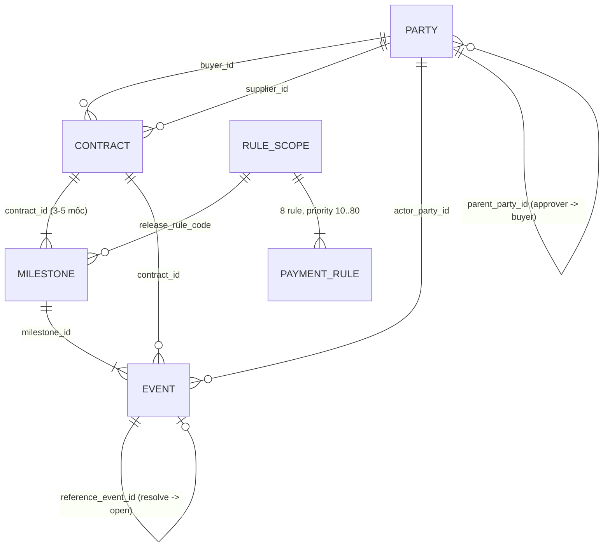

> **LƯU TRỮ — không dùng làm căn cứ.** Phiên bản 0.5 (chuẩn hoá lần 1, 21/10/2026), tên cũ `docs/Nghiệp vụ/TaiLieu_NghiepVu_v0.5.md`. Đã được thay bằng [04_DAC_TA_NGHIEP_VU.md](../../04_DAC_TA_NGHIEP_VU.md); lý do các thay đổi ở Phụ lục E của bản chuẩn. Nội dung bên dưới giữ nguyên như lúc lưu trữ, chỉ cập nhật đường dẫn tương đối.

# CASE 4 — SMART CONTRACT WORKFLOW

**Tài liệu định nghĩa và phân tích nghiệp vụ — bản chuẩn hoá 0.5**

| Mục | Nội dung |
| --- | --- |
| Cuộc thi | Festival Chuyển đổi số 2026 — Vòng sơ khảo — Bảng D — Case 4 |
| Phiên bản | 0.5 — hợp nhất bản nháp 0.1 và hai bản rà soát 0.2, 0.4; mọi số liệu đã kiểm chứng lại bằng script |
| Ngày chuẩn hoá | 21/10/2026 |
| Thay thế | `TaiLieu_NghiepVu_nháp.md` (0.1), `soát nghiệp vụ lần 1.md` (0.2), `soát nghiệp vụ lần 2.md` (0.4). Ba bản cũ giữ lại để tra lịch sử, không dùng làm căn cứ. |
| Nguồn | [Đề thi PDF](../../../BangD-Case4/DeThi2026_BangD_SmartContractWorkflow.pdf); Data Pack v1.0-final, snapshot 18/10/2026: [README](../../../BangD-Case4/DataPack-CASE4_SmartContractWorkflow/README.md), [data dictionary](../../../BangD-Case4/DataPack-CASE4_SmartContractWorkflow/02_metadata/data_dictionary.csv), [manifest](../../../BangD-Case4/DataPack-CASE4_SmartContractWorkflow/02_metadata/dataset_manifest_final.csv), 5 tệp `01_data`, 2 tệp `03_labels_sample`, [template nộp](../../../BangD-Case4/DataPack-CASE4_SmartContractWorkflow/04_output_templates/submission_output_template.csv) |
| Kiểm chứng | [`tools/kiem_chung_nghiep_vu.py`](../../../tools/kiem_chung_nghiep_vu.py) — chạy `python3 tools/kiem_chung_nghiep_vu.py` từ thư mục gốc repo (Phụ lục D) |
| Đối tượng đọc | Toàn đội: nghiệp vụ, kỹ thuật, thuyết trình |
| Mục đích | Một nguồn duy nhất về cách hiểu bài toán, thuật ngữ, quy tắc quyết định và quy ước đầu ra |

## Quy ước nhãn độ tin cậy

| Nhãn | Ý nghĩa | Mức tin |
| --- | --- | --- |
| **[ĐỀ]** | Nêu trực tiếp trong đề PDF, README, data dictionary hoặc `payment_rules.csv` của BTC | Cao nhất |
| **[SAMPLE]** | Được 20 mẫu công khai của BTC xác nhận; script khớp 20/20 | Cao, nhưng chỉ chứng minh cho loại tình huống có mẫu |
| **[DỮ LIỆU]** | Đếm hoặc kiểm trên CSV bằng script; là sự thật về dữ liệu, **không phải** ground truth | Tái lập được |
| **[GIẢ ĐỊNH]** | Đội tự chọn khi nguồn không nói rõ; luôn kèm tác động đo được và mã câu hỏi ở mục 13 | Phải nêu trong hồ sơ |

Khi các nguồn mâu thuẫn, thứ tự ưu tiên là: **[ĐỀ] (rule và dictionary) → [SAMPLE] → [DỮ LIỆU] → [GIẢ ĐỊNH]**. Ví dụ ở mục 4.4: cột `allowed_event_types` thua 20 sample vì sample là nhãn đáp án của BTC.

## Quy ước ngôn ngữ và ký hiệu

- Thuật ngữ dùng tiếng Việt, kèm tên trường dữ liệu ở lần đầu: *mốc thanh toán (milestone)*.
- Bốn quyết định giữ nguyên tiếng Anh, viết hoa: **RELEASE, HOLD, REJECT, PENALTY**.
- Tiền tính bằng **triệu VND** (hậu tố `_vnd_mn`). Phần trăm lưu dạng số phần trăm: `0.10` là 0,10%, không phải 10%.
- Mã: `CTdddd` hợp đồng, `MSdddd` milestone, `EVddddd` event, `PRdddd` rule, `Bddd` bên mua, `Sddd` nhà cung cấp, `Addd` người phê duyệt.
- Ký hiệu: P = `planned_payment_vnd_mn`; F = tiền phạt.

---

## 1. Tóm tắt điều hành

**Bài toán.** Hợp đồng được trả tiền theo từng mốc (ký, giao hàng, nghiệm thu, bảo hành...). Kiểm tra thủ công dễ dẫn tới trả tiền khi chưa đủ điều kiện, xử lý chậm và thiếu dấu vết. Hệ thống cần tự kiểm tra điều kiện từng mốc, ra quyết định và giải thích được quyết định. **[ĐỀ]**

**Cốt lõi trong một câu.** Với mỗi milestone, hệ thống gom sự kiện, khử trùng lặp, phân loại sự kiện hợp lệ / sai thẩm quyền / bị loại (vẫn giữ dấu vết), tính các fact, rồi áp 8 rule của `payment_rules.csv` theo first-match để ra một quyết định kèm số tiền, lý do, rule áp dụng và bằng chứng.

**Năm điều cần nhớ.**

1. Đơn vị ra quyết định là **milestone** (405 mốc), không phải hợp đồng. **[ĐỀ]**
2. 8 rule chạy **first-match**, priority 10 → 80, đọc từ `payment_rules.csv`. Logic giống hệt nhau ở cả 16 phạm vi rule. **[ĐỀ] [DỮ LIỆU]**
3. **Chặn trước, tính tiền sau.** Dữ liệu hoặc điều kiện chưa rõ thì HOLD, không tự RELEASE. **[ĐỀ]**
4. Đề ưu tiên **Rule Execution Accuracy** và **tỷ lệ tình huống xử lý đúng**; **Unauthorized Payment Rate càng gần 0 càng tốt**. Khi buộc phải sai, sai theo hướng giữ tiền an toàn hơn trả nhầm. **[ĐỀ]**
5. Không hard-code theo sample. BTC có ground truth riêng. Manifest cho thấy tập chấm nhiều khả năng là **250 mốc nằm trong chính 405 mốc** của template (mục 11.6). **[ĐỀ] [DỮ LIỆU]**

**Tình trạng kiểm chứng.** Script tham chiếu cài đúng đặc tả này và khớp **20/20 sample trên cả 17 cột so sánh**: quyết định, reason_code, payable, penalty, planned_payment, evidence_event_ids, missing_required_events và 10 cột fact. Trên toàn pack, phân bố là RELEASE 348, PENALTY 15, HOLD 36, REJECT 6. **[SAMPLE] [DỮ LIỆU]** Đây là kết quả theo đặc tả, không phải ground truth của BTC.

**Bốn lựa chọn ảnh hưởng kết quả nhiều nhất** (đo bằng script, mục 13):

| Lựa chọn | Đặc tả chọn | Nếu chọn khác |
| --- | --- | --- |
| Nguồn kiểm thẩm quyền | Ma trận mục 4.2 | Dùng nguyên `allowed_event_types`: **108/405 mốc** đổi kết quả, sample chỉ còn khớp **15/20** |
| Phạm vi tranh chấp | Theo milestone | Theo cả hợp đồng: **31 mốc** chuyển sang HOLD |
| `invoice_required` | Không thay `required_event_types` | Bắt buộc hoá đơn: **15 mốc** ACTIVATION chuyển sang HOLD |
| Làm tròn tiền phạt | ROUND_HALF_UP | HALF_EVEN: **1 mốc** (MS0396) lệch 0,01 |

---

## 2. Bối cảnh, phạm vi và hồ sơ nộp

### 2.1. Vấn đề và mục tiêu **[ĐỀ]**

- Mô hình hoá chuỗi **Contract → Milestone → Event → Rule Check → Decision → Audit Log**.
- Kiểm tra: required event, quyền của actor, approval quorum, dispute/rejection và điều kiện thời hạn.
- Ra quyết định RELEASE / HOLD / REJECT / PENALTY theo thứ tự ưu tiên của rule.
- Tính số tiền đủ điều kiện thanh toán và tiền phạt.
- Truy vết quyết định về event, rule và actor; có giao diện theo dõi trạng thái **hợp đồng và từng milestone**.

### 2.2. Ngoài phạm vi **[ĐỀ]**

- Không bắt buộc blockchain, Solidity, tiền mã hoá, ví điện tử.
- Kết quả không phải quyết định pháp lý, thanh toán hay giải ngân thực tế. Toàn bộ dữ liệu là giả lập.

### 2.3. Nguyên tắc thiết kế

| Nguyên tắc | Hệ quả |
| --- | --- |
| An toàn trước, nhanh sau | Có nghi ngờ thì HOLD. Bất thường dữ liệu chỉ được **chặn** thanh toán, không bao giờ **mở** thanh toán (BR-15) |
| Mở dễ, đóng khó | Mọi `DISPUTE_OPENED` đều chặn; chỉ `DISPUTE_RESOLVED` hợp lệ mới gỡ chặn (BR-08) |
| Giải thích được | Mỗi quyết định gắn với rule_id, event làm bằng chứng, actor, công thức tiền |
| Không hard-code | Rule đọc từ `payment_rules.csv`; không viết điều kiện theo mã milestone, hợp đồng hay sample |
| Đơn giản nhưng đúng | Đề đánh giá workflow đúng logic cao hơn công nghệ phức tạp |

### 2.4. Hồ sơ vòng sơ khảo **[ĐỀ]**

| Hạng mục | Yêu cầu |
| --- | --- |
| Bắt buộc | Bản đề xuất 5–10 trang (PDF); slide tối đa 15 trang (PDF); tên tệp `HSSK_<TenDoi>_D.pdf` |
| Tuỳ chọn | Phụ lục: wireframe, sơ đồ trạng thái, bảng rule, audit trace mẫu, kết quả thử nghiệm |
| Thang điểm | Phù hợp vấn đề 25 · Thiết kế kỹ thuật và đo lường 30 · Đầu ra và tuân thủ 20 · Kế hoạch MVP 15 · Trình bày 10 |

Mục 8 của đề không liệt kê tệp CSV 405 dòng, trong khi README gọi template là "bắt buộc". Đội vẫn chuẩn bị CSV và dùng nó làm minh chứng trong phụ lục (câu hỏi A15). Tài liệu này là nguồn để viết hồ sơ; hồ sơ chỉ cần trích các mục 1, 4.2, 8.1, 9, 15 và 16.

---

## 3. Thuật ngữ

| Thuật ngữ (tên trường) | Định nghĩa | Không nhầm với |
| --- | --- | --- |
| Hợp đồng (`contract`) | Thoả thuận giữa một bên mua và một nhà cung cấp, có giá trị tổng, mẫu workflow, bộ rule và tham số phê duyệt/phạt. 100 hợp đồng. | Milestone |
| Mốc thanh toán (`milestone`) | Một giai đoạn của hợp đồng gắn với việc cần đạt, hạn (`due_date`) và một phần giá trị. **Đơn vị ra quyết định.** 405 mốc. | Event |
| Sự kiện (`event`) | Việc đã xảy ra và được ghi nhận: giao hàng, hoá đơn, nghiệm thu, phê duyệt, từ chối, mở/đóng tranh chấp... 1.134 event. | Bằng chứng |
| Bằng chứng (`evidence`) | Event **hợp lệ** dùng để chứng minh một điều kiện hoặc một yếu tố chặn. Event bị loại không là bằng chứng nhưng vẫn nằm trong audit. | Event thô |
| Required event (`required_event_types`) | Các loại event mà milestone bắt buộc phải có; mỗi loại cần ít nhất một event hợp lệ. | Event hỗ trợ: APPROVAL, REJECTION, DISPUTE_* |
| Bên tham gia / actor (`party`) | Tổ chức hoặc người tạo event: BUYER, SUPPLIER, APPROVER. | |
| Phê duyệt (`APPROVAL`) | Người phê duyệt có quyền cho phép chi tiền một milestone. | Nghiệm thu (`ACCEPTANCE`): bên mua xác nhận chất lượng |
| Ngưỡng phê duyệt (`required_approval_quorum`) | Số vai trò phê duyệt bắt buộc phải đạt (0, 1 hoặc 2). Mỗi người chỉ tính một lần. | Số event APPROVAL thô |
| Tranh chấp (`dispute`) | Một bên phản đối milestone bằng `DISPUTE_OPENED`. Còn mở khi chưa có `DISPUTE_RESOLVED` hợp lệ tham chiếu đúng nó. | Từ chối |
| Từ chối (`REJECTION`) | Người phê duyệt của bên mua bác milestone. Dẫn tới REJECT. Dữ liệu không có cơ chế rút lại. | Tranh chấp: có thể được giải quyết để quy trình tiếp tục |
| Ân hạn (`grace_period_days`) | Số ngày sau `due_date` chưa bị tính phạt. | |
| Phạt chậm (`penalty`) | Khoản trừ khi hoàn thành sau `due_date + grace_period_days`; chỉ khi `late_penalty_applicable = TRUE`. | |
| Giá trị kế hoạch (P) | Số tiền dự kiến của milestone nếu đủ điều kiện. | Số tiền được thanh toán |
| Số tiền được thanh toán (`payable_amount_vnd_mn`) | RELEASE: P; PENALTY: P − F; HOLD, REJECT: 0. Là số **đủ điều kiện chi**, không phải số đã chi. | |
| Ngày hoàn thành thực tế | Thời điểm toàn bộ required event có bằng chứng hợp lệ (BR-11). | Ngày phê duyệt, ngày event cuối |
| Khử trùng lặp (`deduplication`) | Gộp các bản ghi của cùng một sự việc thành một bằng chứng; bản lặp vẫn giữ trong audit. | Xoá dữ liệu |
| Sự kiện sai thẩm quyền | Required event do bên không được phép tạo loại đó (sai loại bên hoặc không thuộc hợp đồng). | Event bị thiếu |
| Phạm vi rule (`release_rule_code`) | Bộ 8 rule áp cho một cặp `rule_set_id:milestone_type`. 16 phạm vi, dùng chung giữa nhiều mốc. | Rule |
| First-match | Duyệt rule theo priority tăng dần; rule đầu tiên đúng thì áp dụng và dừng. | |
| Fact | Biến đã tính từ dữ liệu, dùng trong biểu thức rule (mục 7.3). | Cột dữ liệu thô |
| Cổng chất lượng dữ liệu | Bước chặn khi dữ liệu không đủ tin cậy để đánh giá tự động; ra HOLD theo rule 80 (BR-15). | |
| Snapshot | Ngày chốt dữ liệu ghi trong metadata: 18/10/2026. **Không** dùng để cắt event (BR-16). | Thời điểm event |
| Audit trail | Bản ghi đủ để tái hiện: đầu vào, fact, event dùng/bị loại, rule thắng, công thức tiền, thời điểm, phiên bản. | |

---

## 4. Các bên và thẩm quyền

### 4.1. Ba loại bên **[DỮ LIỆU]**

| Loại | Số lượng | Việc làm trong dữ liệu |
| --- | --- | --- |
| Bên mua (`BUYER`) | 10 | Ký hợp đồng, xác nhận khởi động, duyệt yêu cầu, xác nhận UAT, nghiệm thu; mở và giải quyết tranh chấp |
| Nhà cung cấp (`SUPPLIER`) | 25 | Giao hàng, gửi hoá đơn, go-live, kích hoạt và hoàn tất dịch vụ, hoàn tất bảo hành; mở tranh chấp |
| Người phê duyệt (`APPROVER`) | 30 | Phê duyệt hoặc từ chối thanh toán |

Mỗi bên mua có đúng **3 người phê duyệt**, mỗi người một vai trò: `CONTRACT_OWNER`, `FINANCE_APPROVER`, `SECONDARY_APPROVER` (liên kết qua `parent_party_id`). Cả 30 người đều có `can_approve_payment = TRUE`. Chỉ `CONTRACT_OWNER` có thêm quyền `DISPUTE`.

### 4.2. Ma trận thẩm quyền tạo required event

Đây là **nguồn kiểm quyền chính** cho required event (BR-04). Người tạo hợp lệ phải đúng **loại bên** trong bảng **và** đúng bên của hợp đồng đó (`buyer_id` hoặc `supplier_id`).

| Loại event | Bên được tạo | Có trong `allowed_event_types`? | Căn cứ |
| --- | --- | --- | --- |
| `CONTRACT_SIGNED` | BUYER | Có | [ĐỀ] cột quyền; dữ liệu 100/100 do bên mua |
| `ACCEPTANCE` | BUYER | Có | [ĐỀ] README mục 6; [SAMPLE] SC001 hợp lệ |
| `UAT_PASSED` | BUYER | **Không** | [SAMPLE] SC004 (bên mua tạo, RELEASE); SC017 (NCC tạo, UNAUTHORIZED) |
| `KICKOFF_CONFIRMED` | BUYER | **Không** | [GIẢ ĐỊNH] chưa có sample; dữ liệu 25/25 do bên mua |
| `REQUIREMENTS_APPROVED` | BUYER | **Không** | [GIẢ ĐỊNH] chưa có sample; dữ liệu 20/20 do bên mua |
| `DELIVERY` | SUPPLIER | Có | [ĐỀ] README mục 6; [SAMPLE] SC019 hợp lệ, SC018 (bên mua tạo) UNAUTHORIZED |
| `INVOICE` | SUPPLIER | Có | [SAMPLE] SC002 và các sample có hoá đơn |
| `WARRANTY_COMPLETED` | SUPPLIER | Có | [ĐỀ] cột quyền; dữ liệu 85/85 do NCC |
| `SERVICE_COMPLETED` | SUPPLIER | **Không** | [SAMPLE] SC003, SC012–SC014 coi là hợp lệ |
| `GO_LIVE` | SUPPLIER | **Không** | [GIẢ ĐỊNH] chưa có sample; dữ liệu 20/20 do NCC |
| `SERVICE_ACTIVATED` | SUPPLIER | **Không** | [GIẢ ĐỊNH] chưa có sample; dữ liệu 15/15 do NCC |

Quyền với các event hỗ trợ:

| Loại event | Hợp lệ khi | Căn cứ |
| --- | --- | --- |
| `APPROVAL` | Người tạo là APPROVER đang ACTIVE, thuộc bên mua của hợp đồng, `can_approve_payment = TRUE`, vai trò (tra trong `parties`) nằm trong `required_approval_roles` | [ĐỀ] README mục 9; [SAMPLE] |
| `REJECTION` | Người tạo là APPROVER đang ACTIVE, thuộc bên mua của hợp đồng, có `REJECTION` trong `allowed_event_types`. **Không** giới hạn theo `required_approval_roles` | [SAMPLE] SC015: mốc không cần phê duyệt vẫn REJECT |
| `DISPUTE_OPENED` | Mọi bản ghi đều được tính là tranh chấp (mở dễ). Trong dữ liệu: bên mua 12, NCC 6, tất cả có `can_raise_dispute = TRUE` | [GIẢ ĐỊNH] an toàn |
| `DISPUTE_RESOLVED` | Do phía bên mua: chính bên mua của hợp đồng, hoặc approver của bên mua có quyền `DISPUTE` | [GIẢ ĐỊNH] (A06); dữ liệu 8/8 do bên mua |

Hệ thống luôn tra loại bên và vai trò trong `parties.csv`, không tin cột `actor_party_type`/`actor_role` của event. Hiện hai nguồn khớp 1.134/1.134, nhưng hidden test có thể cố ý làm lệch. **[DỮ LIỆU]**

### 4.3. Chính sách phê duyệt **[DỮ LIỆU]**

| `approval_policy` | Hợp đồng | Milestone | `approval_required` | Quorum | Vai trò bắt buộc | `auto_release_allowed` |
| --- | --- | --- | --- | --- | --- | --- |
| `AUTO_IF_ALL_CONDITIONS` | 16 | 66 | FALSE | 0 | (trống) | TRUE |
| `SINGLE_BUYER_APPROVAL` | 40 | 163 | TRUE | 1 | `CONTRACT_OWNER` | FALSE |
| `DUAL_APPROVAL` | 27 | 108 | TRUE | 2 | `CONTRACT_OWNER;SECONDARY_APPROVER` | FALSE |
| `FINANCE_PLUS_OWNER` | 17 | 68 | TRUE | 2 | `CONTRACT_OWNER;FINANCE_APPROVER` | FALSE |

- Chính sách đặt ở hợp đồng và được chép xuống từng milestone. Engine đọc **tham số tại milestone** (theo `parameter_source` của rule).
- Ở cả 405/405 mốc, quorum bằng đúng số vai trò bắt buộc, và `auto_release_allowed` khớp với `approval_required`. Hai câu hỏi cũ về mâu thuẫn cấu hình (A10, A11) vì vậy đã đóng.
- Hạn mức `approval_limit_vnd_mn` (CONTRACT_OWNER 20.000, FINANCE 30.000, SECONDARY 8.000) không bao giờ bị vượt: mốc lớn nhất là 5.460. Kiểm hạn mức là tuỳ chọn Silver và không đổi kết quả.

### 4.4. Vì sao không dùng nguyên cột `allowed_event_types` **[DỮ LIỆU] [SAMPLE]**

Nội dung cột trong `parties.csv`:

| Loại bên | `allowed_event_types` |
| --- | --- |
| BUYER | `CONTRACT_SIGNED;ACCEPTANCE;DISPUTE;CONTRACT_CLOSE_REQUEST` |
| SUPPLIER | `DELIVERY;INVOICE;WARRANTY_COMPLETED;DISPUTE` |
| APPROVER | `APPROVAL;REJECTION` (CONTRACT_OWNER thêm `DISPUTE`) |

So khớp nguyên văn `event_type` với cột này cho **145/1.134 event lệch**:

- 26 event `DISPUTE_OPENED`/`DISPUTE_RESOLVED`: cột dùng nhãn gộp `DISPUTE`, nên đây không phải vi phạm.
- 119 event còn lại, gồm:
  - **6 vi phạm thật** theo ma trận 4.2 (danh sách ở mục 11.4);
  - **113 event bắt nhầm**: các loại KICKOFF_CONFIRMED, REQUIREMENTS_APPROVED, UAT_PASSED, GO_LIVE, SERVICE_ACTIVATED, SERVICE_COMPLETED, vốn không có trong cột của bên nào.

Nếu kiểm quyền bằng nguyên cột, **108/405 milestone** đổi kết quả (99 RELEASE thành HOLD) và **5 sample BTC bị sai** (SC003, SC004, SC012, SC013, SC014). Vì vậy:

1. Required event được kiểm quyền bằng **ma trận 4.2**.
2. `allowed_event_types` vẫn được dùng làm nguồn cho quyền `APPROVAL`, `REJECTION` và `DISPUTE` (nhãn `DISPUTE` bao gồm `DISPUTE_OPENED`/`DISPUTE_RESOLVED`).
3. `CONTRACT_CLOSE_REQUEST` có trong cột nhưng không xuất hiện trong event nào và không dùng.
4. Bốn loại chưa có sample (KICKOFF_CONFIRMED, REQUIREMENTS_APPROVED, GO_LIVE, SERVICE_ACTIVATED) được nêu là giả định trong hồ sơ và gửi BTC xác nhận (A01).

---

## 5. Mô hình dữ liệu

### 5.1. Sơ đồ quan hệ



### 5.2. Khoá liên kết

| Từ | Đến | Quan hệ | Dùng để |
| --- | --- | --- | --- |
| `milestones.contract_id` | `contracts.contract_id` | N:1 | Lấy bên mua/NCC, chính sách, giá trị |
| `events.milestone_id` | `milestones.milestone_id` | N:1 | **Gom bằng chứng theo mốc** |
| `events.contract_id` | `contracts.contract_id` | N:1 | Kiểm event thuộc đúng hợp đồng của mốc |
| `contracts.buyer_id`, `supplier_id` | `parties.party_id` | N:1 | Xác định hai bên của hợp đồng |
| `events.actor_party_id` | `parties.party_id` | N:1 | Kiểm quyền người tạo |
| `parties.parent_party_id` | `parties.party_id` | N:1 | Approver thuộc bên mua nào |
| `events.reference_event_id` | `events.event_id` | N:1 | `DISPUTE_RESOLVED` trỏ về `DISPUTE_OPENED` (chỉ loại này dùng trường) |
| `milestones.release_rule_code` | `payment_rules.release_rule_code` | N mốc : 1 phạm vi : 8 rule | Lấy bộ rule của mốc |

`release_rule_code = rule_set_id + ":" + milestone_type` đúng ở 405/405 mốc. Có 16 phạm vi, mỗi phạm vi đủ 8 rule (priority 10..80); bảng rule_id ở Phụ lục C. **[DỮ LIỆU]**

### 5.3. Kiểm tra toàn vẹn **[DỮ LIỆU]**

| Kiểm tra | Kết quả |
| --- | --- |
| SHA-256 của 9 tệp CSV công khai so với manifest | Khớp 9/9 |
| Khoá chính trùng (contracts, milestones, events, rules) | 0 |
| Khoá ngoại mồ côi của events (hợp đồng, milestone, actor, reference) | 0 |
| `events.contract_id` khác hợp đồng của milestone | 0 |
| Tổng `payment_percent` = 100% / tổng P = giá trị hợp đồng | 100/100 / 100/100 |
| Milestone không có event | 0 |
| `document_id` trống | 0 |
| `event_status` đúng theo loại event (BR-05) | 1.134/1.134 |
| `actor_party_type`/`actor_role` của event khớp `parties` | 1.134/1.134 |
| Event do bên mua/NCC không thuộc hợp đồng | 0 |
| Thứ tự `contract_event_sequence` khớp thứ tự thời gian | 100/100 hợp đồng |
| `amount_vnd_mn` của INVOICE / APPROVAL / REJECTION bằng P | 140/140, 497/497, 6/6 |
| Mốc có phạt (220): grace, rate, cap bằng hợp đồng | 220/220 |
| Mốc không phạt (185): rate = cap = 0,00 | 185/185. Đây là lý do "185 mốc khác tham số hợp đồng" trong bản 0.2; không phải khác biệt nghiệp vụ |
| `grace_period_days` của mốc bằng hợp đồng | 405/405 |
| `required_condition` nhất quán với `required_event_types` và quorum | 405/405 |
| `invoice_required = TRUE` nhưng INVOICE không nằm trong `required_event_types` | **15 mốc** (mọi ACTIVATION của bảo trì), không có event INVOICE nào → xem BR-06, A08 |
| Template: 405 dòng, 22 cột, 405 ID duy nhất, khớp tập `milestones.csv` | Đạt |

Đường dẫn thực tế khác README: `02_metadata/dataset_manifest_final.csv` (README ghi `dataset_manifest.csv`), `04_output_templates/` (README ghi `04_output_template/`). Dùng đường dẫn thực tế. **[DỮ LIỆU]**

### 5.4. Quy ước dữ liệu **[ĐỀ]**

- Ngày `YYYY-MM-DD`; thời điểm `YYYY-MM-DDTHH:MM:SS`, không múi giờ.
- Tiền: triệu VND; `1250.00` là 1,25 tỷ VND.
- Phần trăm: chia 100 khi tính.
- Danh sách trong một ô phân cách bằng `;`.

---

## 6. Workflow theo loại hợp đồng **[DỮ LIỆU]**

Mỗi loại hợp đồng có một mẫu workflow, một `rule_set_id` và số mốc cố định. Việc cần phê duyệt phụ thuộc chính sách của hợp đồng (mục 4.3), không phụ thuộc loại mốc. Việc áp phạt phụ thuộc loại mốc và đồng nhất trong từng loại.

| Workflow (số HĐ) | STT | `milestone_type` | `required_event_types` | Áp phạt |
| --- | --- | --- | --- | --- |
| `WF_GOODS_4STAGE` (40) | 1 | SIGNING | CONTRACT_SIGNED | Không |
| | 2 | DELIVERY | DELIVERY; INVOICE | Có |
| | 3 | ACCEPTANCE | ACCEPTANCE | Có |
| | 4 | WARRANTY | WARRANTY_COMPLETED | Không |
| `WF_SERVICE_4STAGE` (25) | 1 | KICKOFF | CONTRACT_SIGNED; KICKOFF_CONFIRMED | Không |
| | 2 | INTERIM_DELIVERY | DELIVERY; INVOICE | Có |
| | 3 | FINAL_ACCEPTANCE | ACCEPTANCE; INVOICE | Có |
| | 4 | WARRANTY_CLOSE | WARRANTY_COMPLETED | Không |
| `WF_SOFTWARE_5STAGE` (20) | 1 | SIGNING | CONTRACT_SIGNED | Không |
| | 2 | REQUIREMENTS_APPROVAL | REQUIREMENTS_APPROVED | Có |
| | 3 | UAT_PASS | UAT_PASSED; INVOICE | Có |
| | 4 | GO_LIVE_ACCEPTANCE | GO_LIVE; ACCEPTANCE; INVOICE | Có |
| | 5 | WARRANTY_CLOSE | WARRANTY_COMPLETED | Không |
| `WF_MAINTENANCE_3STAGE` (15) | 1 | ACTIVATION | CONTRACT_SIGNED; SERVICE_ACTIVATED | Không |
| | 2 | SERVICE_COMPLETION | SERVICE_COMPLETED; INVOICE | Có |
| | 3 | FINAL_ACCEPTANCE | ACCEPTANCE | Có |

Tổng cộng 220 mốc có áp phạt và 185 mốc không. Tên `FINAL_ACCEPTANCE` dùng ở cả dịch vụ (ACCEPTANCE; INVOICE) và bảo trì (ACCEPTANCE), nên phải tra rule theo `release_rule_code`, không chỉ theo `milestone_type`.

---

## 7. Quy trình nghiệp vụ

### 7.1. Vòng đời hợp đồng

```text
Ký hợp đồng → chia thành 3–5 milestone (theo workflow)
   └─ Với mỗi milestone:
        các bên tạo EVENT (giao hàng, hoá đơn, nghiệm thu, phê duyệt, tranh chấp...)
        → HỆ THỐNG đánh giá (7.2) → QUYẾT ĐỊNH + SỐ TIỀN + AUDIT
        → HOLD thì chờ bổ sung event và đánh giá lại; mỗi lần đánh giá là một phiên bản mới
   └─ Trạng thái hợp đồng = tổng hợp trạng thái các mốc (9.3)
```

Mỗi milestone được đánh giá **độc lập**. `payment_rules.csv` không có rule nào chặn mốc sau theo mốc trước, nên không tự thêm điều kiện "mốc trước phải RELEASE" (A09). Nếu cần, dashboard cảnh báo "mốc trước đang bị giữ" nhưng không đổi quyết định.

### 7.2. Quy trình xử lý một milestone (9 bước)

| Bước | Hành động | Đầu vào | Kết quả | Quy tắc |
| --- | --- | --- | --- | --- |
| 1 | Nạp milestone, hợp đồng, phạm vi rule; kiểm lỗi cấu trúc | `milestones`, `contracts`, `payment_rules` | Tham số mốc; 8 rule đã sắp xếp; danh sách lỗi | BR-02, BR-15 |
| 2 | Gom mọi event theo `milestone_id`, sắp theo `(event_timestamp, event_id)` | `events` | Danh sách event thô (giữ nguyên) | BR-16 |
| 3 | Khử trùng lặp | Khoá BR-03 | Event duy nhất + ánh xạ `duplicate_of` | BR-03 |
| 4 | Phân loại và kiểm từng event: required / approval / rejection / dispute; kiểm trạng thái và thẩm quyền | `parties`, ma trận 4.2 | Hợp lệ / sai thẩm quyền / sai trạng thái / bất thường | BR-04, BR-05, BR-09 |
| 5 | Tính fact tranh chấp và từ chối | DISPUTE_*, REJECTION | `open_dispute`, `valid_rejection_event_count` | BR-08, BR-09 |
| 6 | Tính fact bằng chứng và phê duyệt | Kết quả bước 4 | completion rate, thiếu gì, số sai quyền, `valid_approval_count` | BR-06, BR-07, BR-10 |
| 7 | Tính fact thời hạn | Bằng chứng hợp lệ, `due_date`, ân hạn | Ngày hoàn thành, số ngày trễ | BR-11 |
| 8 | Áp 8 rule first-match; tính tiền theo công thức của rule thắng | Fact (7.3) | Quyết định, reason_code, rule_id, payable, penalty | BR-02, BR-12, BR-13 |
| 9 | Ghi output và audit | Mọi kết quả trên | Một dòng output + một bản audit | BR-17, mục 14 |

### 7.3. Từ điển fact

Tên fact giống tên biến trong `condition_expression` của rule và tên cột trong `decision_sample.csv`, để so khớp trực tiếp. **[ĐỀ] [SAMPLE]**

| Fact | Định nghĩa | Rule dùng | Cột sample |
| --- | --- | --- | --- |
| `open_dispute` | Có ít nhất một `DISPUTE_OPENED` của mốc chưa được đóng hợp lệ (BR-08) | 10, 70 | `open_dispute` |
| `valid_rejection_event_count` | Số REJECTION hợp lệ (BR-09) | 20, 70 | `valid_rejection_count` |
| `unauthorized_required_event_count` | Số event (sau khử lặp) thuộc loại required nhưng sai thẩm quyền (BR-04) | 30 | `unauthorized_required_event_count` |
| `required_event_count` | Số **loại** trong `required_event_types` | — | `required_event_count` |
| `valid_required_event_count` | Số loại required có ít nhất một event hợp lệ | — | `valid_required_event_count` |
| `required_event_completion_rate` | `valid_required_event_count / required_event_count` | 40 | — |
| `missing_required_events` | Các loại required chưa có event hợp lệ, theo thứ tự trong `required_event_types`; **gồm cả loại chỉ có event sai quyền** | — | `missing_required_events` |
| `duplicate_event_count` | Số bản lặp bị loại ở bước 3 | — | `duplicate_event_count` |
| `approval_required`, `required_approval_quorum` | Lấy từ milestone | 50 | cùng tên |
| `valid_approval_count` | Số **vai trò** trong `required_approval_roles` đã có approval hợp lệ, mỗi approver tính một lần (BR-10) | 50 | `valid_approval_count` |
| `actual_completion_date` | Phần ngày của thời điểm hoàn thành (BR-11); trống nếu còn thiếu required event | 60 | — |
| `days_late_after_grace` | `max(0, actual_completion_date − (due_date + grace_period_days))` theo ngày lịch; 0 nếu chưa hoàn thành | 60 | `days_late_after_grace` |
| `all_required_conditions_met` | `completion_rate = 1` **và** không có required event sai quyền **và** (không cần phê duyệt **hoặc** `valid_approval_count ≥ quorum`) | 70 | — |
| `late_penalty_applicable`, `due_date`, `grace_period_days`, `penalty_rate_pct_per_day`, `max_penalty_pct`, P | Lấy từ **milestones.csv** theo `parameter_source` | 60 | — |

**Hệ quả quan trọng.** Với các định nghĩa trên, nếu rule 10–60 đều không khớp thì rule 70 chắc chắn khớp. Vì vậy rule 80 (`UNRESOLVED_CONDITION`) chỉ xảy ra qua **cổng chất lượng dữ liệu** (BR-15). Trên dữ liệu hiện tại có 0 mốc đi vào rule 80. **[DỮ LIỆU]**

### 7.4. Ví dụ phân vai: mốc giao hàng của hợp đồng hàng hoá

| Thứ tự | Bên | Việc | Event |
| --- | --- | --- | --- |
| 1 | Nhà cung cấp của hợp đồng | Giao hàng | `DELIVERY` |
| 2 | Nhà cung cấp của hợp đồng | Gửi hoá đơn | `INVOICE` |
| 3 | Approver của bên mua theo chính sách (0, 1 hoặc 2 vai trò) | Cho phép chi | `APPROVAL` |
| 4 | Hệ thống | Đối chiếu, ra quyết định | Output + audit |

Ví dụ trong dữ liệu: `CT0001` / `MS0002`: `EV00002` (DELIVERY) và `EV00003` (INVOICE) đều do `S021`, đúng nhà cung cấp của hợp đồng. Hợp đồng dùng `AUTO_IF_ALL_CONDITIONS` nên không cần APPROVAL. **[DỮ LIỆU]**

---

## 8. Quy tắc nghiệp vụ

### 8.1. Tám rule theo thứ tự ưu tiên **[ĐỀ]**

Logic giống hệt nhau ở cả 16 phạm vi (mỗi priority chỉ có 1 biến thể biểu thức/quyết định/công thức). Mọi rule `active = TRUE`, `stop_processing = TRUE`. **[DỮ LIỆU]**

| Priority | `condition_expression` (nguyên văn) | Quyết định | `reason_code` | Payable | Penalty | Ý nghĩa |
| --- | --- | --- | --- | --- | --- | --- |
| 10 | `open_dispute == TRUE` | HOLD | `OPEN_DISPUTE` | 0 | 0 | Đang tranh chấp thì không chi |
| 20 | `valid_rejection_event_count > 0` | REJECT | `REJECTION_PRESENT` | 0 | 0 | Người có thẩm quyền đã bác |
| 30 | `unauthorized_required_event_count > 0` | HOLD | `UNAUTHORIZED_EVENT` | 0 | 0 | Có bằng chứng không đáng tin, cần kiểm tra |
| 40 | `required_event_completion_rate < 1.0` | HOLD | `MISSING_REQUIRED_EVENT` | 0 | 0 | Chưa đủ chứng từ |
| 50 | `approval_required == TRUE AND valid_approval_count < required_approval_quorum` | HOLD | `APPROVAL_QUORUM_NOT_MET` | 0 | 0 | Chưa đủ số lượng/vai trò phê duyệt |
| 60 | `late_penalty_applicable == TRUE AND actual_completion_date > due_date + grace_period_days` | PENALTY | `LATE_COMPLETION` | `MAX(0, P − F)` | `MIN(days_late × rate / 100 × P, max_pct / 100 × P)` | Đủ điều kiện nhưng trễ: trả sau khấu trừ |
| 70 | `all_required_conditions_met == TRUE AND open_dispute == FALSE AND valid_rejection_event_count == 0` | RELEASE | `ALL_CONDITIONS_MET` | P | 0 | Chi đủ |
| 80 | `ELSE` | HOLD | `UNRESOLVED_CONDITION` | 0 | 0 | Không đánh giá tự động được thì giữ lại |

**Chặn trước, tính tiền sau.** Các yếu tố chặn (10–50) luôn được xét trước phạt (60). Hai kiểu chồng điều kiện có thật trong dữ liệu và đã được sample xác nhận **[SAMPLE] [DỮ LIỆU]**:

- Rejection + thiếu quorum → **REJECT** (4 mốc: MS0148, MS0168, MS0185, MS0295; sample SC016).
- Sai thẩm quyền + thiếu required event → **UNAUTHORIZED_EVENT** (6 mốc; sample SC017, SC018).

Ca "dispute mở + rejection" thì ra HOLD theo priority 10 **[ĐỀ]**; dữ liệu hiện không có ca nào như vậy.

### 8.2. Quy tắc chi tiết

**BR-01. Một quyết định hiện hành cho mỗi milestone trong mỗi lượt đánh giá.** Mỗi lượt có `run_id`; lịch sử các lượt trước được giữ. **[ĐỀ]**

**BR-02. Rule đọc từ dữ liệu, first-match.** Lấy các rule có `release_rule_code` của milestone và `active = TRUE`, sắp `priority` tăng dần. Rule đầu tiên có điều kiện đúng quyết định kết quả, `rule_id_applied` và công thức tiền, rồi dừng. Không chọn quyết định theo "mức nghiêm trọng" tự đặt. **[ĐỀ]**

**BR-03. Khử trùng lặp.**

- Hai event là cùng một sự việc khi trùng **toàn bộ**: `contract_id`, `milestone_id`, `event_type`, `document_id`, `actor_party_id`, `event_status`, `reference_event_id`.
- `document_id` trống thì không gộp.
- Giữ bản có `(event_timestamp, event_id)` nhỏ nhất; các bản còn lại ghi `duplicate_of` trong audit.
- Không dùng cửa sổ thời gian (cùng chứng từ, cùng người gửi là cùng sự việc). Không dựa vào `event_note` ("Repeated submission received.") hay `event_source`.
- Duplicate không làm mốc bị HOLD nếu sau khử lặp vẫn đủ bằng chứng.
- Căn cứ: **[ĐỀ]** README mục 7; khoá và bản giữ lại **[SAMPLE]** SC019, SC020. Trên dữ liệu: 5 cặp, đều cách nhau 2 phút.

**BR-04. Thẩm quyền của required event.** Một event thuộc `required_event_types` là **đúng thẩm quyền** khi:

1. actor tồn tại trong `parties` và `status = ACTIVE`;
2. `party_type` của actor (tra trong `parties`) đúng ma trận 4.2;
3. actor chính là `buyer_id` hoặc `supplier_id` của hợp đồng.

Sai bất kỳ điều nào thì event là **sai thẩm quyền**: được đếm vào `unauthorized_required_event_count` và không bao giờ là bằng chứng. Ma trận: **[SAMPLE]** cho 7 loại, **[GIẢ ĐỊNH]** cho 4 loại (A01). Điều 3: **[GIẢ ĐỊNH]**, dữ liệu có 0 vi phạm.

**BR-05. Trạng thái hợp lệ theo loại event.** Event nghiệp vụ: `CONFIRMED`; `APPROVAL`: `APPROVED`; `REJECTION`: `REJECTED`; `DISPUTE_OPENED`: `OPEN`; `DISPUTE_RESOLVED`: `RESOLVED`. Event đúng thẩm quyền nhưng sai trạng thái không phải bằng chứng và không bị tính là sai thẩm quyền, nên có thể dẫn tới thiếu (rule 40). **[GIẢ ĐỊNH]**; dữ liệu khớp 1.134/1.134.

**BR-06. Đủ required event.** `condition_logic = ALL`: mỗi loại trong `required_event_types` cần ít nhất một event đúng thẩm quyền và đúng trạng thái, sau khử lặp. **Chỉ** `required_event_types` quyết định danh sách loại bắt buộc. `invoice_required` và `required_condition` là trường mô tả: dictionary ghi `required_condition` "phục vụ minh hoạ; rule chính thức nằm trong payment_rules.csv". Riêng 15 mốc ACTIVATION có `invoice_required = TRUE` nhưng không yêu cầu INVOICE, nên không đòi hoá đơn và gắn cờ A08. **[ĐỀ] [GIẢ ĐỊNH]**

**BR-07. Sai thẩm quyền và thiếu.**

- Rule 30 khớp khi có **ít nhất một** required event sai thẩm quyền, kể cả khi đã có event cùng loại đúng thẩm quyền.
- Không xoá event sai quyền trước khi tính fact.
- Loại required chỉ có event sai quyền vẫn nằm trong `missing_required_events` (SC017 liệt kê `UAT_PASSED`; SC018 liệt kê `DELIVERY`).
- Một mốc có thể vừa sai quyền vừa thiếu; rule 30 thắng rule 40.
- **[ĐỀ] [SAMPLE]**

**BR-08. Tranh chấp.**

- Mỗi `DISPUTE_OPENED` của milestone (sau khử lặp) là một tranh chấp, bất kể ai mở. Nguyên tắc "mở dễ" giữ thanh toán an toàn. **[GIẢ ĐỊNH]**
- Tranh chấp **đã đóng** khi có một `DISPUTE_RESOLVED` thoả **cả** 5 điều kiện:
  1. trạng thái `RESOLVED`;
  2. `reference_event_id` trỏ đúng tranh chấp đó;
  3. cùng milestone;
  4. thời điểm không trước lúc mở;
  5. do phía bên mua tạo (BR-04 mục 4.2).
- Mỗi bản resolve chỉ đóng đúng tranh chấp nó tham chiếu. Còn ít nhất một tranh chấp mở thì `open_dispute = TRUE`.
- **Phạm vi là milestone.** Lý do: lời giải thích của sample ghi "tranh chấp đang mở **tại milestone**", và `open_dispute` trong `decision_sample` là thuộc tính của từng mốc. Nếu tính theo hợp đồng thì thêm 31 mốc HOLD (A05). **[SAMPLE] [GIẢ ĐỊNH]**
- Cặp đã đóng không đưa vào `evidence_event_ids` nhưng vẫn nằm trong audit. **[SAMPLE]** SC009, SC010.
- `hold_on_open_dispute` là TRUE ở cả 405 mốc. Rule 10 không phụ thuộc trường này nên luôn áp.

**BR-09. Từ chối.**

- REJECTION hợp lệ khi người tạo là approver ACTIVE của bên mua, có quyền `REJECTION`, và trạng thái là `REJECTED`.
- Không giới hạn theo `required_approval_roles`: SC015 có mốc không cần phê duyệt mà vẫn REJECT. Cũng không giới hạn chỉ `CONTRACT_OWNER`: cột quyền cho cả 3 vai trò, dù 6/6 rejection trong dữ liệu do CONTRACT_OWNER.
- REJECTION **không hợp lệ** là bất thường dữ liệu: không kích hoạt rule 20, nhưng chặn mọi kết quả trả tiền theo BR-15.
- **[SAMPLE] [GIẢ ĐỊNH]**

**BR-10. Phê duyệt và quorum.** Chỉ xét khi `approval_required = TRUE`. Một APPROVAL hợp lệ khi:

1. trạng thái `APPROVED`;
2. người tạo là approver ACTIVE thuộc bên mua của hợp đồng;
3. `can_approve_payment = TRUE`;
4. vai trò tra trong `parties` nằm trong `required_approval_roles`.

`valid_approval_count` = số vai trò bắt buộc đã được phủ bởi approval hợp lệ; mỗi approver tính một lần, mỗi vai trò tính một lần. Do đó hai người cùng vai trò không thay được hai vai trò khác nhau, và một người duyệt hai lần vẫn tính một. Định nghĩa này đúng khi quorum bằng số vai trò (405/405 mốc). Gặp cấu hình khác thì chuyển sang BR-15.

- Không kiểm thứ tự giữa approval và bằng chứng (dữ liệu có 0 approval sớm hơn required event cuối).
- Không áp `approval_limit_vnd_mn` ở baseline (0 approval vượt hạn mức).
- Căn cứ: **[ĐỀ]** README mục 9, mô tả rule 50 ("chưa đủ số lượng/vai trò"); **[SAMPLE]** SC013, SC014.

**BR-11. Ngày hoàn thành thực tế.**

- Với mỗi loại required, lấy event hợp lệ **sớm nhất**. Thời điểm hoàn thành `actual_completion_timestamp` là thời điểm **muộn nhất** trong các event đó, tức lúc mọi điều kiện bằng chứng lần đầu được thoả. `actual_completion_date` là phần ngày.
- Không tính APPROVAL. Manifest cho thấy ground truth của BTC tách hai cột `actual_completion_timestamp` và `last_event_timestamp`. Kiểm thêm: nếu tính cả approval thì 0 mốc đổi kết quả. **[DỮ LIỆU]**
- Còn thiếu required event thì ngày hoàn thành để trống và không có phạt.
- Ví dụ: MS0020 có ACCEPTANCE 12/11 và INVOICE 13/11 nên hoàn thành ngày 13/11. **[SAMPLE]** SC005, SC006.

**BR-12. Phạt chậm.**

- Điều kiện: `late_penalty_applicable = TRUE` **và** `actual_completion_date > due_date + grace_period_days` (so sánh **lớn hơn**; hoàn thành đúng ngày hạn + ân hạn thì không phạt). **[ĐỀ]**
- `days_late_after_grace = actual_completion_date − (due_date + grace_period_days)`, tính theo ngày lịch. Ba cách đếm (hiệu ngày, floor, ceil theo timestamp) cho cùng kết quả ở 15/15 ca. **[DỮ LIỆU]**
- `F = MIN(days_late × penalty_rate_pct_per_day / 100 × P, max_penalty_pct / 100 × P)`, dùng tham số **tại milestone**. **[ĐỀ]**
- Mốc không áp phạt thì không bao giờ ra PENALTY, dù trễ (dữ liệu có 0 ca trễ ở mốc không phạt).
- Trần phạt chưa bao giờ bị chạm (mức phạt cao nhất 1,20% so với trần nhỏ nhất 5%), nhưng vẫn phải cài `MIN`. **[DỮ LIỆU]**

**BR-13. Số tiền và làm tròn.**

| Quyết định | `payable_amount_vnd_mn` | `penalty_amount_vnd_mn` |
| --- | --- | --- |
| RELEASE | P | 0.00 |
| PENALTY | `MAX(0, P − F)` | F |
| HOLD, REJECT | 0.00 | 0.00 |

- Tính bằng số thập phân chính xác (`Decimal`), không dùng float.
- Làm tròn F tới 0,01 theo **ROUND_HALF_UP**, rồi mới tính `P − F`, để payable + penalty = P đối soát được.
- Phải chỉ định HALF_UP tường minh, vì `Decimal` của Python mặc định là HALF_EVEN. Ca biên duy nhất là MS0396: F thô 10,605 → 10,61 theo HALF_UP, 10,60 theo HALF_EVEN (A07).
- Xuất 2 chữ số thập phân. **[SAMPLE]** (2 ca phạt khớp) **[GIẢ ĐỊNH]** (chế độ làm tròn)

**BR-14. Mặc định an toàn.** Điều kiện không rõ hoặc không rơi vào rule nào thì ra HOLD theo rule 80. Không bao giờ tự RELEASE khi chưa chắc. **[ĐỀ]**

**BR-15. Cổng chất lượng dữ liệu.** Có hai loại vấn đề:

- **Lỗi cấu trúc** (không đánh giá được): phạm vi rule thiếu hoặc không đủ 8 priority; quorum khác số vai trò; `approval_required = FALSE` mà quorum > 0; event có `contract_id` khác hợp đồng của milestone; ngày không đọc được. Xử lý: **HOLD / `UNRESOLVED_CONDITION` / rule priority 80** ngay, ghi lỗi vào `notes` và audit.
- **Bất thường** (vẫn đánh giá được): actor không tồn tại ở event không phải required; `event_type` lạ; REJECTION không hợp lệ. Xử lý: chạy rule bình thường. Nếu kết quả là RELEASE hoặc PENALTY thì **hạ xuống rule 80**; nếu đã là HOLD/REJECT thì giữ nguyên.

Mục đích là bất thường chỉ được chặn tiền, không được đổi lý do chặn. Dữ liệu hiện tại có 0 mốc đi qua cổng này. **[GIẢ ĐỊNH]**

**BR-16. Chế độ thời gian.**

- Mặc định **đánh giá toàn pack**: dùng mọi event trong dữ liệu, không cắt theo snapshot. Lý do: SC005 dùng event ngày 13/11/2026 (sau snapshot) và vẫn ra PENALTY. Có 267 event sau snapshot, thuộc 93 mốc, trong đó 19 event thuộc mốc sample. Nếu cắt theo snapshot thì 92 mốc đổi kết quả và sample chỉ còn khớp 14/20. **[SAMPLE] [DỮ LIỆU]**
- Chế độ **as-of** (tuỳ chọn, cho demo): chỉ dùng event có `event_timestamp ≤ evaluation_time`, và ghi rõ chế độ trong `notes` và audit.

**BR-17. Bằng chứng và truy vết.**

- `evidence_event_ids` gồm:
  - các required event hợp lệ (bản sớm nhất mỗi loại);
  - các approval hợp lệ (mỗi approver một bản);
  - thêm các `DISPUTE_OPENED` còn mở nếu lý do là `OPEN_DISPUTE`;
  - thêm các REJECTION hợp lệ nếu lý do là `REJECTION_PRESENT`.
- Sắp tăng dần theo `event_id`, phân cách `;`.
- Không đưa vào: bản lặp, event sai quyền, event sai trạng thái, cặp tranh chấp đã đóng. Tất cả vẫn nằm trong audit kèm lý do loại.
- Mốc thiếu toàn bộ bằng chứng có thể có `evidence_event_ids` chỉ gồm approval (SC011). Không tạo event giả để lấp chỗ trống.
- **[SAMPLE]** 20/20.

**BR-18. Không hard-code.** Không viết điều kiện theo mã milestone, hợp đồng, scenario; không dùng `event_note`, `event_source` (6/6 event sai bên đều là `MANUAL_ENTRY`, nhưng đó là dấu vết của bộ sinh dữ liệu chứ không phải quy tắc) hay số lượng "tròn" của từng nhóm. **[ĐỀ]**

### 8.3. Ví dụ tính phạt: MS0020 (CT0005) **[SAMPLE]**

| Bước | Tính | Kết quả |
| --- | --- | --- |
| Tham số | P = 900; hạn 02/11/2026; ân hạn 5 ngày; 0,15%/ngày; trần 8% | |
| Hạn cuối không phạt | 02/11 + 5 ngày | 07/11/2026 |
| Ngày hoàn thành | Muộn nhất của ACCEPTANCE `EV00037` (12/11) và INVOICE `EV00038` (13/11) | 13/11/2026 |
| Số ngày trễ | 13/11 − 07/11 | 6 |
| Phạt theo ngày | 6 × 0,15 / 100 × 900 | 8,10 |
| Trần | 8 / 100 × 900 | 72,00 → không chạm |
| F | min(8,10; 72,00) | **8,10** |
| Payable | max(0; 900 − 8,10) | **891,90** |
| Rule áp dụng | priority 60 của `R_SERVICE_STD:FINAL_ACCEPTANCE` | `PR0062` |

---

## 9. Bảng quyết định và trạng thái

### 9.1. Bảng quyết định

| Priority | Khi nào | Quyết định | `reason_code` | Payable | Penalty | Trạng thái milestone |
| --- | --- | --- | --- | --- | --- | --- |
| 10 | Có tranh chấp hợp lệ đang mở tại mốc | HOLD | `OPEN_DISPUTE` | 0 | 0 | `ON_HOLD` |
| 20 | Có REJECTION hợp lệ | REJECT | `REJECTION_PRESENT` | 0 | 0 | `REJECTED` |
| 30 | Có ≥ 1 required event sai thẩm quyền | HOLD | `UNAUTHORIZED_EVENT` | 0 | 0 | `ON_HOLD` |
| 40 | Thiếu bằng chứng hợp lệ cho ≥ 1 loại required | HOLD | `MISSING_REQUIRED_EVENT` | 0 | 0 | `WAITING_EVIDENCE` |
| 50 | Cần phê duyệt và chưa phủ đủ vai trò | HOLD | `APPROVAL_QUORUM_NOT_MET` | 0 | 0 | `WAITING_APPROVAL` |
| 60 | Áp phạt và hoàn thành sau hạn + ân hạn | PENALTY | `LATE_COMPLETION` | max(0, P − F) | F | `PAID_WITH_PENALTY` |
| 70 | Đủ mọi điều kiện, không tranh chấp, không rejection | RELEASE | `ALL_CONDITIONS_MET` | P | 0 | `ELIGIBLE_FOR_PAYMENT` |
| 80 | Lỗi cấu trúc hoặc bất thường chặn trả tiền (BR-15) | HOLD | `UNRESOLVED_CONDITION` | 0 | 0 | `ON_HOLD` |

Mỗi dòng chỉ được xét khi mọi dòng phía trên chưa khớp.

### 9.2. Trạng thái milestone **[GIẢ ĐỊNH]** (A12)

- Dùng **đúng tên trong README mục 15**. Manifest cho thấy ground truth có cột `expected_milestone_status`, nên tự đặt tên mới sẽ có rủi ro lệch khi chấm.
- `PAID_WITH_PENALTY` được hiểu là "đủ điều kiện chi sau khấu trừ". Hệ thống chỉ mô phỏng, không chi tiền thật; ghi rõ điều này trong hồ sơ.
- Bản 0.2–0.4 đổi tên thành `ELIGIBLE_WITH_PENALTY`; bản này quay lại tên của README.
- Với output batch, chỉ 6 trạng thái ở bảng 9.1 được dùng. `PLANNED`, `IN_PROGRESS` dành cho chế độ as-of: `PLANNED` là mốc chưa có event nào trước `evaluation_time`; `IN_PROGRESS` là mốc đã có event nhưng chưa tới `due_date` và chưa đủ bằng chứng. Dữ liệu không có event nào xác nhận đã chi tiền nên không dùng `COMPLETED`.

### 9.3. Trạng thái hợp đồng **[GIẢ ĐỊNH]**

Đề yêu cầu theo dõi trạng thái **hợp đồng** và từng milestone. **[ĐỀ]** Trạng thái hợp đồng được tổng hợp từ các mốc, chỉ phục vụ dashboard và không thay quyết định của mốc.

| Điều kiện (xét từ trên xuống) | Trạng thái | Số HĐ theo đặc tả |
| --- | --- | --- |
| Có mốc REJECT | `NEEDS_REVIEW` | 6 |
| Không REJECT, có mốc HOLD | `PENDING_CONDITIONS` | 36 |
| Mọi mốc RELEASE/PENALTY | `ALL_MILESTONES_ELIGIBLE` | 58 |
| Chế độ as-of: còn mốc `PLANNED`/`IN_PROGRESS` | `IN_PROGRESS` | — |

Dashboard luôn hiển thị số mốc theo từng quyết định, để REJECT không che mất HOLD. Hợp đồng có tranh chấp mở ở một mốc thì hiện cảnh báo cho cả hợp đồng, không đổi quyết định các mốc khác.

---

## 10. Hai mươi sample công khai và điều chúng chứng minh **[SAMPLE]**

| Sample | Mốc (loại) | Dữ kiện chính | Kết quả BTC | Chứng minh cho |
| --- | --- | --- | --- | --- |
| SC001 | MS0003 (ACCEPTANCE) | ACCEPTANCE `EV00004`; không cần phê duyệt | RELEASE 387,00 | Luồng chuẩn |
| SC002 | MS0072 (FINAL_ACCEPTANCE, dịch vụ) | ACCEPTANCE + INVOICE; không cần phê duyệt | RELEASE 556,00 | Hai required event |
| SC003 | MS0079 (SERVICE_COMPLETION) | SERVICE_COMPLETED **do NCC**; 2/2 vai trò | RELEASE 1.280,00 | Ma trận 4.2: loại không có trong `allowed_event_types` vẫn hợp lệ |
| SC004 | MS0112 (UAT_PASS) | UAT_PASSED **do bên mua** + INVOICE | RELEASE 1.525,00 | Như trên |
| SC005 | MS0020 (FINAL_ACCEPTANCE) | Hoàn thành 13/11, hạn chót 07/11 | PENALTY 8,10 / trả 891,90 | BR-11, BR-12; dùng event sau snapshot |
| SC006 | MS0041 (FINAL_ACCEPTANCE) | Hoàn thành 30/09, hạn chót 27/09; 0,15% × 1.472 | PENALTY 6,62 / trả 1.465,38 | Làm tròn 6,624 → 6,62 |
| SC007 | MS0011 (ACCEPTANCE) | Dispute `EV00018` mở trước nghiệm thu, chưa đóng; còn lại đủ | HOLD | Evidence gồm cả dispute |
| SC008 | MS0015 (UAT_PASS) | Dispute `EV00026` chưa đóng | HOLD | Rule 10 |
| SC009 | MS0024 (ACCEPTANCE) | `EV00048` được `EV00049` đóng | RELEASE 2.250,00 | Dispute đã đóng không chặn, không vào evidence |
| SC010 | MS0033 (ACCEPTANCE) | `EV00080` được `EV00081` đóng; 2/2 vai trò | RELEASE 609,00 | Như trên |
| SC011 | MS0045 (ACCEPTANCE) | Không có ACCEPTANCE; chỉ có approval | HOLD | Evidence chỉ gồm approval |
| SC012 | MS0098 (SERVICE_COMPLETION) | Có SERVICE_COMPLETED, thiếu INVOICE | HOLD | `missing_required_events = INVOICE` |
| SC013 | MS0048 (SERVICE_COMPLETION) | Có OWNER, thiếu SECONDARY → 1/2 | HOLD | Rule 50 theo vai trò |
| SC014 | MS0058 (SERVICE_COMPLETION) | Có OWNER, thiếu FINANCE → 1/2 | HOLD | Như trên |
| SC015 | MS0007 (ACCEPTANCE) | REJECTION `EV00010`; mốc không cần phê duyệt | REJECT | Rejection không phụ thuộc `required_approval_roles` |
| SC016 | MS0148 (ACCEPTANCE) | REJECTION + 0/2 phê duyệt | REJECT | Priority 20 thắng 50 |
| SC017 | MS0067 (UAT_PASS) | UAT_PASSED `EV00177` **do NCC**; 2/2 vai trò | HOLD | Rule 30; loại sai quyền nằm trong missing; event sai không vào evidence |
| SC018 | MS0116 (INTERIM_DELIVERY) | DELIVERY `EV00319` **do bên mua** | HOLD | Như trên |
| SC019 | MS0172 (INTERIM_DELIVERY) | `EV00484` lặp `EV00482` (cùng `DN-CT0043-02`, cách 2 phút) | RELEASE 752,50 | BR-03, giữ bản sớm |
| SC020 | MS0210 (INTERIM_DELIVERY) | `EV00597` lặp `EV00595` | RELEASE 1.144,50 | Như trên |

Mẫu câu giải thích của BTC ở cột `reference_reason_vi` được dùng làm khung cho `decision_reason` (mục 14.4).

---

## 11. Phân tích dữ liệu **[DỮ LIỆU]**

### 11.1. Quy mô

| Đối tượng | Số lượng |
| --- | --- |
| Hợp đồng | 100: hàng hoá 40, dịch vụ 25, phần mềm 20, bảo trì 15 |
| Party | 65: bên mua 10, NCC 25, approver 30 |
| Milestone | 405 (220 có áp phạt) |
| Rule | 128 = 16 phạm vi × 8, tất cả active |
| Event | 1.134, trung bình 2,8 event/mốc |
| Giá trị hợp đồng | 360 → 13.650; trung bình 4.223,40; tổng 422.340 |

Phân bố event: APPROVAL 497, INVOICE 140, CONTRACT_SIGNED 100, ACCEPTANCE 97, WARRANTY_COMPLETED 85, DELIVERY 68, KICKOFF_CONFIRMED 25, REQUIREMENTS_APPROVED 20, UAT_PASSED 20, GO_LIVE 20, DISPUTE_OPENED 18, SERVICE_ACTIVATED 15, SERVICE_COMPLETED 15, DISPUTE_RESOLVED 8, REJECTION 6.

### 11.2. Thời gian

| Chỉ tiêu | Kết quả |
| --- | --- |
| Khoảng thời gian event | 24/01/2026 09:50 → 27/05/2027 17:10 |
| Event sau snapshot 18/10/2026 | 267 (23,5%), thuộc 93 mốc; 19 event thuộc mốc sample |
| Mốc có `due_date` sau snapshot | 95 |
| Approval sớm hơn required event cuối | 0/497 |
| Event trước ngày ký hợp đồng | 0 |
| Thời gian từ mở tới đóng tranh chấp | 8/8 ca đúng 2 ngày 2 giờ 15 phút |
| Khoảng cách giữa bản gốc và bản lặp | 5/5 cặp đúng 2 phút |

### 11.3. Phân bố quyết định theo đặc tả

Đây là kết quả của script theo đúng đặc tả này, không phải ground truth của BTC.

| Quyết định | `reason_code` | Số mốc |
| --- | --- | --- |
| RELEASE | `ALL_CONDITIONS_MET` | 348 (gồm 5 mốc có bản lặp) |
| PENALTY | `LATE_COMPLETION` | 15 |
| HOLD | `OPEN_DISPUTE` | 10 |
| HOLD | `MISSING_REQUIRED_EVENT` | 10 |
| HOLD | `APPROVAL_QUORUM_NOT_MET` | 10 |
| HOLD | `UNAUTHORIZED_EVENT` | 6 |
| REJECT | `REJECTION_PRESENT` | 6 |
| HOLD | `UNRESOLVED_CONDITION` | 0 |
| **Tổng** | | **405** |

Về tiền: tổng kế hoạch 422.340,00 = được trả 365.785,87 + phạt 102,13 + tạm giữ/từ chối 56.452,00.

Không suy ra cấu trúc hidden test từ các số "tròn" (10/10/10/6/6/15). Engine phải đúng vì logic, không vì khớp phân bố.

### 11.4. Bất thường trong dữ liệu

| Loại | Số lượng | Chi tiết |
| --- | --- | --- |
| Bản lặp | 5 cặp | DELIVERY ×3, ACCEPTANCE ×2; cùng chứng từ, cùng người gửi, cách 2 phút |
| Required event sai bên | 6 | Xem bảng dưới; cả 6 có `event_source = MANUAL_ENTRY` (không dùng làm tiêu chí, BR-18) |
| Tranh chấp | 18 mở; 8 đã đóng, 10 còn mở | 10 tranh chấp còn mở: 9 do bên mua mở, 1 do NCC (MS0055); các điều kiện khác của 10 mốc này đều đã đủ |
| Rejection | 6 | Đều do CONTRACT_OWNER; 2 mốc không cần phê duyệt, 4 mốc 0/2 phê duyệt |
| Thiếu required event | 10 mốc | 5 thiếu ACCEPTANCE, 5 thiếu INVOICE |
| Thiếu phê duyệt | 10 mốc | 5 mốc 0/1, 5 mốc 1/2 |
| Hoàn thành trễ | 15 mốc | Trễ 2–8 ngày sau ân hạn; không ca nào chạm trần |
| `invoice_required` mâu thuẫn | 15 mốc | Mọi ACTIVATION (BR-06, A08) |

| Event sai bên | Milestone | Loại | Người tạo | Phải là |
| --- | --- | --- | --- | --- |
| `EV00177` | MS0067 | UAT_PASSED | SUPPLIER | BUYER |
| `EV00319` | MS0116 | DELIVERY | BUYER | SUPPLIER |
| `EV00541` | MS0193 | DELIVERY | BUYER | SUPPLIER |
| `EV00805` | MS0287 | ACCEPTANCE | SUPPLIER | BUYER |
| `EV00967` | MS0345 | SERVICE_COMPLETED | BUYER | SUPPLIER |
| `EV01006` | MS0362 | ACCEPTANCE | SUPPLIER | BUYER |

Những gì dữ liệu **chưa** thử thách, cần test tự tạo (mục 16): approval sai vai trò, approver của bên mua khác, một approver duyệt hai lần, resolve sai tham chiếu, event của bên ngoài hợp đồng, ca trúng đúng biên hạn + ân hạn, ca chạm trần phạt, ca trễ ở mốc không áp phạt. Tất cả đều có 0 ca trong dữ liệu.

### 11.5. Độ phủ của sample

20 sample chỉ thuộc 5/13 loại milestone: ACCEPTANCE (7), SERVICE_COMPLETION (4), FINAL_ACCEPTANCE (3), UAT_PASS (3), INTERIM_DELIVERY (3). **8 loại chưa có sample**: SIGNING, DELIVERY (hàng hoá), KICKOFF, REQUIREMENTS_APPROVAL, GO_LIVE_ACCEPTANCE, ACTIVATION, WARRANTY, WARRANTY_CLOSE. Các loại này cần test tự tạo và kiểm tay trước khi tuyên bố đúng.

### 11.6. Thông tin từ manifest

Manifest công khai liệt kê 6 tệp **chỉ dành cho BTC**: `decision_ground_truth.csv` (405 dòng, 31 cột), `evaluation_split_Case4.csv` (405 dòng), `hidden_test_ids_Case4.csv` (250 dòng), `evaluation_config_Case4.csv` (10 metric), `evaluation_script_Case4.py`, `generation_log_Case4.csv`. Đội không có các tệp này; chỉ dùng **tên cột** để định hướng:

- Ground truth có `expected_milestone_status`, `conditions_met`, `missing_conditions`, `rule_id_applied`, `evidence_event_ids`. Các trường này nhiều khả năng được chấm, nên phải điền đầy đủ và nhất quán (mục 14).
- Ground truth tách `actual_completion_timestamp` khỏi `last_event_timestamp` → hỗ trợ BR-11.
- `hidden_test_ids` có `milestone_id`, `planned_payment_vnd_mn`; `evaluation_split` có 405 dòng kèm `score_eligible`. Tập chấm nhiều khả năng là **250 mốc nằm trong 405 mốc của template**, không phải dữ liệu mới (A16).
- `evaluation_config` có `missing_value_policy`, nên ô để trống có thể bị trừ điểm. Không bỏ trống trường nào (mục 14.2).

---

## 12. Bẫy và cách tránh

| # | Bẫy | Hậu quả đo được | Cách tránh |
| --- | --- | --- | --- |
| B01 | Kiểm quyền bằng nguyên cột `allowed_event_types` | 108 mốc sai, 5/20 sample sai | Ma trận 4.2 (mục 4.4) |
| B02 | Tin `actor_party_type`/`actor_role` trong event thay vì tra `parties` | Hiện 0 lệch; hỏng nếu hidden test cố ý làm lệch | Luôn tra `parties` |
| B03 | Xoá event sai quyền trước khi tính fact | Mất rule 30, ra MISSING thay vì UNAUTHORIZED (6 mốc) | Giữ để đếm, chỉ loại khỏi bằng chứng |
| B04 | Đếm số dòng event thay vì số loại required có bằng chứng | Bản lặp làm "đủ" giả, có thể RELEASE sai | BR-03, BR-06 |
| B05 | Đếm số APPROVAL thay vì số vai trò phủ bởi người khác nhau | Quorum đạt giả | BR-10 |
| B06 | Coi mọi `DISPUTE_OPENED` là đang mở | 8 mốc HOLD sai; sample còn 18/20 | Đối chiếu resolve hợp lệ (BR-08) |
| B07 | Một bản resolve đóng mọi tranh chấp | Mở thanh toán khi còn tranh chấp | Mỗi resolve chỉ đóng tranh chấp nó tham chiếu |
| B08 | Mở rộng tranh chấp ra cả hợp đồng | 31 mốc HOLD (A05) | Phạm vi milestone + cảnh báo cấp hợp đồng |
| B09 | Lọc event theo snapshot | 92 mốc đổi kết quả; sample còn 14/20 | Chế độ toàn pack (BR-16) |
| B10 | Lấy ngày approval hoặc ngày chạy chương trình làm ngày hoàn thành | Sai ngày trễ, sai tiền phạt | BR-11 |
| B11 | So "≥" thay vì ">" khi xét trễ | Phạt oan ca đúng biên (0 ca trong dữ liệu, dễ có trong test) | BR-12 |
| B12 | Quên chia 100 các tỷ lệ | Phạt gấp 100 lần | BR-12 |
| B13 | Bỏ `MIN` vì dữ liệu chưa chạm trần | Sai khi gặp ca chạm trần | Luôn cài trần |
| B14 | Phạt ở mốc `late_penalty_applicable = FALSE` | PENALTY sai | Kiểm cờ trước |
| B15 | Lấy tham số phạt ở hợp đồng thay vì milestone | Hiện trùng nhau ở 220 mốc có phạt; sai nếu dữ liệu ẩn khác | Đọc theo `parameter_source` |
| B16 | Tính tiền bằng float hoặc `Decimal` mặc định (HALF_EVEN) | MS0396 lệch 0,01 | `Decimal` + ROUND_HALF_UP (BR-13) |
| B17 | Bắt buộc INVOICE theo `invoice_required` | 15 mốc HOLD sai (A08) | Chỉ theo `required_event_types` |
| B18 | Chặn mốc sau khi mốc trước bị HOLD | 55 mốc HOLD sai (A09) | Đánh giá độc lập; cảnh báo trên dashboard |
| B19 | Dùng `event_note`, `event_source` hoặc số "tròn" làm tín hiệu | Hỏng trên dữ liệu ẩn | BR-18 |
| B20 | Đặt tên trạng thái khác README | Có thể lệch `expected_milestone_status` | Mục 9.2 |
| B21 | Để trống `confidence_score`, `conditions_met`... | Có thể bị trừ theo `missing_value_policy` | Mục 14.2 |
| B22 | Sửa số dòng, thứ tự cột hoặc 6 cột nguồn của template | Vi phạm quy định nộp | Mục 14.6 |
| B23 | Khớp 20 sample rồi tuyên bố đúng 405 mốc | Không chứng minh được; 8 loại mốc chưa có sample | Báo cáo KPI kèm phạm vi đo (mục 15) |

---

## 13. Giả định và câu hỏi cần xác nhận

Trạng thái: **Đóng** = có căn cứ đủ, không cần hỏi; **Đóng tạm** = có căn cứ nhưng nên nêu trong hồ sơ; **Mở** = cần BTC trả lời, hiện dùng phương án an toàn/khớp sample.

| Mã | Vấn đề | Đội chọn | Căn cứ | Tác động trên dữ liệu nếu chọn khác | Trạng thái |
| --- | --- | --- | --- | --- | --- |
| A01 | Nguồn kiểm thẩm quyền required event | Ma trận 4.2 | 5 sample bác bỏ cách dùng nguyên cột | Nguyên cột: 108 mốc, 15/20 sample | Đóng tạm (hỏi BTC xác nhận 4 loại chưa có sample) |
| A02 | Event sau snapshot | Dùng toàn bộ | SC005 | Cắt theo snapshot: 92 mốc, sample còn 14/20 | Đóng |
| A03 | Ngày hoàn thành | BR-11 | SC005, SC006; manifest | Tính cả approval: 0 mốc | Đóng tạm |
| A04 | Khoá khử lặp, bản giữ lại | BR-03 | SC019, SC020 | 0 ca biên | Đóng tạm |
| A05 | Tranh chấp theo mốc hay hợp đồng | Theo mốc | Câu giải thích sample "tại milestone" | Theo hợp đồng: +31 mốc HOLD | **Mở** |
| A06 | Ai được đóng tranh chấp; ai được từ chối | Đóng: phía bên mua. Từ chối: mọi approver của bên mua | Dữ liệu 8/8, cột quyền | 0 mốc | **Mở** (không ảnh hưởng dữ liệu hiện tại) |
| A07 | Chế độ làm tròn | ROUND_HALF_UP, 2 chữ số, làm tròn F trước khi trừ | 2 ca phạt sample khớp | HALF_EVEN: MS0396 lệch 0,01 | **Mở** |
| A08 | `invoice_required = TRUE` nhưng INVOICE không bắt buộc | Theo `required_event_types` | Dictionary, `required_condition` | Bắt buộc INVOICE: +15 mốc HOLD | **Mở** |
| A09 | Phụ thuộc giữa các mốc | Độc lập | `payment_rules.csv` không có rule phụ thuộc | Chặn tuần tự: +55 mốc HOLD | Đóng |
| A10 | `auto_release_allowed` mâu thuẫn `approval_required` | Không có mâu thuẫn | 405/405 nhất quán | — | Đóng |
| A11 | Quorum khác số vai trò | Chuyển cổng BR-15 | 405/405 bằng nhau | — | Đóng |
| A12 | Tên trạng thái milestone | Tên README | README mục 15; cột ground truth | — | Đóng tạm |
| A13 | Định dạng `conditions_met`, `missing_conditions` | Token DSL của `required_condition` (mục 14.3) | Ngôn ngữ của BTC trong dữ liệu | Không đo được | **Mở** |
| A14 | Ý nghĩa `confidence_score` | Quy ước 1,00 / 0,80 / 0,50 (mục 14.2) | Không có định nghĩa từ BTC | 46 mốc nhận 0,80 | **Mở** |
| A15 | Vòng sơ khảo có nộp CSV không | Chuẩn bị đủ, đưa vào phụ lục | Đề mục 8 chỉ yêu cầu 2 PDF | — | **Mở** |
| A16 | Tập chấm ẩn | 250 mốc trong 405 mốc | Manifest | — | Đóng tạm |
| A17 | `approval_limit_vnd_mn` | Không áp ở baseline; bật ở Silver | Dictionary | 0 approval vượt hạn mức | Đóng |
| A18 | Approval trước khi đủ bằng chứng | Không kiểm thứ tự | Không có nguồn | 0 ca | Đóng tạm |

**Câu hỏi gửi BTC** (gộp từ các mục Mở): A01 (4 loại event), A05, A06, A07, A08, A13, A14, A15. Mỗi câu nêu phương án đội đang dùng để BTC chỉ cần xác nhận. Khi BTC trả lời, cập nhật đặc tả, script, engine và test trong **cùng một lần sửa**.

---

## 14. Đầu ra và audit

### 14.1. Template **[DỮ LIỆU]**

[`submission_output_template.csv`](../../../BangD-Case4/DataPack-CASE4_SmartContractWorkflow/04_output_templates/submission_output_template.csv): 405 dòng, 22 cột, SHA-256 khớp manifest. 6 cột đầu điền sẵn và khớp nguồn; 16 cột sau để trống.

### 14.2. Cách điền từng cột

| # | Cột | Quy ước |
| --- | --- | --- |
| 1–6 | `contract_id`, `milestone_id`, `contract_type`, `milestone_sequence`, `milestone_type`, `planned_payment_vnd_mn` | Giữ nguyên; ghép kết quả theo `milestone_id`, không theo vị trí dòng |
| 7 | `predicted_decision` | `RELEASE`/`HOLD`/`REJECT`/`PENALTY` của rule thắng |
| 8 | `predicted_milestone_status` | Bảng 9.1 |
| 9 | `conditions_met` | Token đã đạt (14.3), phân cách `;` |
| 10 | `missing_conditions` | Token chưa đạt (14.3); trống nếu không có |
| 11 | `payable_amount_vnd_mn` | BR-13, 2 chữ số thập phân |
| 12 | `penalty_amount_vnd_mn` | BR-13, 2 chữ số thập phân |
| 13 | `reason_code` | Của rule thắng |
| 14 | `decision_reason` | Mẫu 14.4, có số liệu cụ thể |
| 15 | `evidence_event_ids` | BR-17 |
| 16 | `rule_id_applied` | `rule_id` thật của rule thắng trong phạm vi của mốc (Phụ lục C); ví dụ MS0020 → `PR0062` |
| 17 | `confidence_score` | **1.00** nếu kết quả không phụ thuộc giả định Mở; **0.80** nếu có thể đổi khi BTC trả lời khác một giả định Mở (A05, A07, A08; ghi mã vào `notes`); **0.50** nếu đi qua cổng BR-15. Đây là thang chắc chắn của đội, **không** phải xác suất đúng. Theo đặc tả: 359 mốc 1.00, 46 mốc 0.80, 0 mốc 0.50 |
| 18 | `processing_time_ms` | Thời gian đo thật của bước 2–9 cho mốc đó; không điền số giả |
| 19 | `evaluated_at` | Thời điểm chạy `YYYY-MM-DDTHH:MM:SS`; khác với `evaluation_time` của chế độ as-of |
| 20 | `engine_name` | Tên engine kèm phiên bản, ví dụ `<TenDoi>-RuleEngine v1.0` |
| 21 | `audit_trace_id` | `<run_id>-<milestone_id>`, tra được bản audit |
| 22 | `notes` | Chế độ thời gian; bản lặp đã loại (`EV00484>EV00482`); mã giả định ảnh hưởng; cảnh báo (mốc trước bị giữ, tranh chấp ở mốc khác của hợp đồng) |

Ví dụ ba dòng theo đặc tả (bỏ các cột vận hành):

| milestone_id | decision | status | conditions_met | missing_conditions | payable | penalty | reason_code | evidence | rule |
| --- | --- | --- | --- | --- | --- | --- | --- | --- | --- |
| MS0020 | PENALTY | PAID_WITH_PENALTY | EVENT:ACCEPTANCE;EVENT:INVOICE;APPROVAL_QUORUM:1;NO_OPEN_DISPUTE | | 891.90 | 8.10 | LATE_COMPLETION | EV00037;EV00038;EV00039 | PR0062 |
| MS0067 | HOLD | ON_HOLD | EVENT:INVOICE;APPROVAL_QUORUM:2;NO_OPEN_DISPUTE | EVENT:UAT_PASSED | 0.00 | 0.00 | UNAUTHORIZED_EVENT | EV00178;EV00179;EV00180 | PR0115 |
| MS0148 | REJECT | REJECTED | EVENT:ACCEPTANCE;NO_OPEN_DISPUTE | APPROVAL_QUORUM:2 | 0.00 | 0.00 | REJECTION_PRESENT | EV00411;EV00412 | PR0002 |

### 14.3. Token điều kiện **[GIẢ ĐỊNH]** (A13)

Dùng đúng ngôn ngữ của cột `required_condition` mà BTC đã ghi cho từng mốc, gồm 3 loại token: `EVENT:<loại>`, `APPROVAL_QUORUM:<n>`, `NO_OPEN_DISPUTE`.

- `EVENT:<loại>` đạt khi loại đó có bằng chứng hợp lệ. Loại chỉ có event sai quyền là **chưa đạt**.
- `APPROVAL_QUORUM:<n>` đạt khi `valid_approval_count ≥ n`.
- `NO_OPEN_DISPUTE` đạt khi `open_dispute = FALSE`.
- Rejection, sai thẩm quyền và trễ hạn không phải điều kiện trong DSL. Chúng được thể hiện qua `reason_code` và `decision_reason`.

### 14.4. Mẫu `decision_reason`

Khung lấy từ `reference_reason_vi` của BTC, bổ sung số liệu cụ thể.

| `reason_code` | Câu của BTC | Mẫu của đội |
| --- | --- | --- |
| `ALL_CONDITIONS_MET` | Đầy đủ required event và phê duyệt hợp lệ, không có tranh chấp/rejection; milestone đủ điều kiện RELEASE. | Đủ {k}/{k} loại bằng chứng ({ids}); phê duyệt {v}/{q}; không tranh chấp mở, không rejection; hoàn thành {ngày}, trong hạn {due} + {grace} ngày. RELEASE {P} triệu. |
| (có bản lặp) | Sau khi khử event lặp, các điều kiện và phê duyệt vẫn đầy đủ; milestone đủ điều kiện RELEASE một lần. | Như trên + "Đã loại {dup} là bản lặp của {gốc}." |
| `LATE_COMPLETION` | Hoàn thành muộn {d} ngày sau grace period; áp dụng penalty {F} triệu VND. | Hoàn thành {ngày} ({id}), muộn {d} ngày sau hạn {due} + ân hạn {grace}; phạt {d} × {rate}% × {P} = {F} (trần {cap}% = {trần}); được trả {P − F}. |
| `OPEN_DISPUTE` | Có tranh chấp đang mở tại milestone nên thanh toán phải tạm giữ. | Tranh chấp {id} do {bên} mở ngày {ngày} chưa có DISPUTE_RESOLVED hợp lệ; tạm giữ {P} triệu. |
| `REJECTION_PRESENT` | Có sự kiện REJECTION hợp lệ nên milestone bị từ chối và chưa được thanh toán. | {approver} ({vai trò}) từ chối tại {id} ngày {ngày}; không thanh toán. |
| `UNAUTHORIZED_EVENT` | Có required event do bên/vai trò không có thẩm quyền tạo; bằng chứng đó không được tính hợp lệ. | {loại} ({id}) do {actor} ({loại bên}) tạo, trong khi phải do {bên đúng} của hợp đồng; giữ để kiểm tra. |
| `MISSING_REQUIRED_EVENT` | Chưa đủ required event nên milestone chưa đủ điều kiện giải ngân. | Thiếu bằng chứng hợp lệ cho {các loại}; mới có {k}/{n} loại. |
| `APPROVAL_QUORUM_NOT_MET` | Mới có {v}/{q} phê duyệt hợp lệ; chưa đạt approval quorum. | Mới có {v}/{q} phê duyệt hợp lệ; còn thiếu vai trò {vai trò}. |
| `UNRESOLVED_CONDITION` | (BTC chưa có mẫu) | Không đánh giá tự động được do {lỗi/bất thường}; giữ để kiểm tra thủ công. |

### 14.5. Audit tối thiểu cho mỗi mốc

- `run_id`, `audit_trace_id`, phiên bản engine, phiên bản ma trận quyền, chế độ thời gian, SHA-256 dữ liệu đầu vào.
- Toàn bộ event thô của mốc kèm phân loại: hợp lệ / bản lặp (`duplicate_of`) / sai thẩm quyền / sai trạng thái / bất thường, và lý do.
- Các cặp tranh chấp mở–đóng; danh sách approval theo actor và vai trò.
- Toàn bộ fact (mục 7.3); các rule đã xét kèm kết quả đúng/sai; rule thắng.
- Tham số và các bước tính tiền (như bảng 8.3).
- Cùng dữ liệu và cùng phiên bản phải cho cùng decision, amount, reason, rule; chỉ `evaluated_at` và `processing_time_ms` được khác.

### 14.6. Checklist trước khi xuất CSV

- [ ] Header đúng 22 cột, đúng thứ tự template; không thêm cột chỉ số.
- [ ] Đúng 405 dòng; mỗi `milestone_id` đúng một lần; 6 cột nguồn không đổi.
- [ ] Không ô nào trống trừ `missing_conditions` của mốc đạt đủ điều kiện.
- [ ] Bộ (decision, reason_code, rule_id, payable, penalty, status) nhất quán theo bảng 9.1; payable + penalty = P với PENALTY.
- [ ] Mọi `evidence_event_ids` tồn tại và thuộc đúng mốc; mọi `audit_trace_id` tra được.
- [ ] Ghi bằng thư viện CSV có quoting, UTF-8; đọc lại để kiểm số dòng, ID và tổng tiền.
- [ ] So từng dòng với `--export` của script tham chiếu; mọi khác biệt phải giải thích được.

---

## 15. KPI và cách đo **[ĐỀ]**

| KPI | Công thức | Hiện đo được |
| --- | --- | --- |
| Rule Execution Accuracy | Số mốc đúng quyết định / số mốc có nhãn | 20/20 sample |
| Scenario Accuracy / Macro-F1 | Tỷ lệ scenario đúng; F1 trung bình đều trên 4 lớp quyết định để không bỏ qua lớp ít (REJECT, PENALTY) | 20/20; Macro-F1 = 1,00 trên sample |
| Unauthorized Payment Rate | Số mốc bị RELEASE/PENALTY trong khi nhãn là HOLD/REJECT / tổng mốc có nhãn HOLD/REJECT; tính cả PENALTY có payable 0 | 0/10 trên sample |
| Over-hold Rate (đội đề xuất) | Số mốc bị HOLD/REJECT trong khi nhãn là RELEASE/PENALTY / tổng mốc có nhãn RELEASE/PENALTY. Dùng để chứng minh hệ thống không "an toàn giả" bằng cách giữ hết | 0/10 trên sample |
| Payment / Penalty Amount Accuracy | Tỷ lệ mốc khớp tuyệt đối sau làm tròn; kèm sai số tuyệt đối lớn nhất | 20/20 khớp tuyệt đối |
| Audit Trace Completeness | Số quyết định truy được về event, rule, actor, số tiền, thời điểm / tổng quyết định | Đo trên output |
| Processing Time | Tổng thời gian lượt chạy; trung vị và p95 mỗi mốc; ghi cấu hình máy | Đo trên output |
| Output Coverage | Số mốc có đúng một dòng output / 405 | Phải 405/405 |

Báo cáo trung thực: luôn ghi KPI đo trên tập nào (20 sample công khai, bộ test tự tạo, hay toàn pack theo đặc tả). Không tuyên bố độ chính xác trên dữ liệu ẩn. Mục tiêu nghiệm thu: 20/20 sample, UPR = 0 trên mọi bộ test có đáp án, Output Coverage 405/405, audit đầy đủ.

---

## 16. Bộ kiểm thử nghiệp vụ

"Có trong pack" là ca có sẵn trong dữ liệu (ghi sample hoặc mốc); "Tự tạo" là ca phải dựng dữ liệu giả. Đáp án kỳ vọng do người phụ trách nghiệp vụ duyệt, độc lập với người viết engine.

| ID | Tình huống | Kỳ vọng | Căn cứ | Nguồn ca |
| --- | --- | --- | --- | --- |
| T01 | Đủ điều kiện, không cần phê duyệt | RELEASE, payable = P | Rule 70 | SC001 |
| T02 | Đủ điều kiện, quorum 2 đủ 2 vai trò | RELEASE | BR-10 | SC003 |
| T03 | Thiếu một loại required | HOLD / MISSING; missing liệt kê đúng loại | BR-06 | SC011, SC012 |
| T04 | Không có required event nào, chỉ có approval | HOLD / MISSING; evidence chỉ gồm approval | BR-17 | SC011 |
| T05 | Required event do sai loại bên | HOLD / UNAUTHORIZED; loại đó vào missing; event sai không vào evidence | BR-04, BR-07 | SC017, SC018 |
| T06 | Cùng loại có một event đúng quyền và một event sai quyền | HOLD / UNAUTHORIZED | BR-07 | Tự tạo |
| T07 | Required event do bên mua/NCC của hợp đồng **khác** tạo | HOLD / UNAUTHORIZED | BR-04 | Tự tạo |
| T08 | Loại không có trong `allowed_event_types` nhưng đúng ma trận | Hợp lệ | Mục 4.4 | SC003, SC004 |
| T09 | Đúng quyền nhưng sai trạng thái | Không là bằng chứng; HOLD / MISSING | BR-05 | Tự tạo |
| T10 | Bản lặp, sau khử vẫn đủ | RELEASE một lần; evidence giữ bản sớm | BR-03 | SC019, SC020 |
| T11 | Bản lặp không thay được một loại khác đang thiếu | HOLD / MISSING | BR-03 | Tự tạo |
| T12 | Cùng chứng từ nhưng khác người gửi | Không gộp | BR-03 | Tự tạo |
| T13 | Tranh chấp mở | HOLD / OPEN_DISPUTE; evidence có event tranh chấp | BR-08 | SC007, SC008 |
| T14 | Tranh chấp được đóng đúng | Đánh giá tiếp; cặp tranh chấp không vào evidence | BR-08 | SC009, SC010 |
| T15 | Resolve sai tham chiếu / khác mốc / trước lúc mở / do NCC | Không đóng → HOLD | BR-08 | Tự tạo |
| T16 | Hai tranh chấp, chỉ một được đóng | HOLD | BR-08 | Tự tạo |
| T17 | Tranh chấp mở + rejection | HOLD / OPEN_DISPUTE | Priority | Tự tạo |
| T18 | Rejection ở mốc không cần phê duyệt | REJECT | BR-09 | SC015 |
| T19 | Rejection + thiếu quorum | REJECT | Priority | SC016 |
| T20 | Rejection do FINANCE/SECONDARY của bên mua | REJECT | BR-09 | Tự tạo |
| T21 | REJECTION do NCC, các điều kiện khác đủ | HOLD / UNRESOLVED (rule 80) | BR-09, BR-15 | Tự tạo |
| T22 | Quorum 2, mới đủ 1 vai trò | HOLD / QUORUM | BR-10 | SC013, SC014 |
| T23 | Quorum 1, chưa có approval | HOLD / QUORUM | BR-10 | MS0095 (không có sample) |
| T24 | Một approver duyệt hai lần, quorum 2 | HOLD / QUORUM | BR-10 | Tự tạo |
| T25 | Hai approver cùng vai trò, cần hai vai trò khác nhau | HOLD / QUORUM | BR-10 | Tự tạo |
| T26 | Approval sai vai trò / của bên mua khác / `can_approve_payment = FALSE` | Không tính | BR-10 | Tự tạo |
| T27 | Hoàn thành sau ân hạn, đủ điều kiện | PENALTY đúng công thức | BR-12 | SC005, SC006 |
| T28 | Hoàn thành đúng ngày hạn + ân hạn | RELEASE, không phạt | BR-12 | Tự tạo |
| T29 | Trễ ở mốc không áp phạt | RELEASE | BR-12 | Tự tạo |
| T30 | Phạt vượt trần | F = trần; payable = P − trần | BR-12 | Tự tạo |
| T31 | Trễ nhưng thiếu bằng chứng hoặc thiếu phê duyệt | HOLD; penalty 0 | Priority | Tự tạo |
| T32 | F thô đúng nửa đơn vị (10,605) | 10,61 | BR-13 | MS0396 |
| T33 | Event sau snapshot ở chế độ toàn pack | Vẫn dùng | BR-16 | SC005 |
| T34 | Event sau `evaluation_time` ở chế độ as-of | Không dùng | BR-16 | Tự tạo |
| T35 | `invoice_required = TRUE` nhưng INVOICE không bắt buộc | Không đòi INVOICE | BR-06 | 15 mốc ACTIVATION |
| T36 | Lỗi cấu trúc: quorum ≠ số vai trò, thiếu phạm vi rule | HOLD / UNRESOLVED (rule 80) | BR-15 | Tự tạo |
| T37 | Chạy lại cùng dữ liệu | Kết quả giống hệt (trừ thời gian) | 14.5 | Toàn pack |
| T38 | 8 loại mốc chưa có sample: mỗi loại ít nhất 1 ca RELEASE kiểm tay | Khớp đặc tả | 11.5 | Toàn pack |
| T39 | Output đủ 405 dòng, 22 cột, không ô trống bắt buộc | Đạt checklist 14.6 | 14.6 | Toàn pack |

---

## 17. Đầu mối và việc tiếp theo

Phân công chi tiết ở [03 — Lộ trình và checklist](../../03_LO_TRINH_VA_CHECKLIST_NOP_BAI.md). Riêng tài liệu này:

1. **Chủ trì nghiệp vụ** gửi BTC các câu hỏi Mở ở mục 13 và cập nhật đặc tả khi có trả lời.
2. **Engine** cài theo mục 7–8 và 14; mọi khác biệt so với `--export` của script phải được giải thích hoặc sửa.
3. **Kiểm thử** dựng các ca "Tự tạo" ở mục 16, ưu tiên T06, T07, T15, T21, T24–T26, T28–T31, T36.
4. **Hồ sơ** trích mục 1, 4.2, 8.1, 9, 15, 16 và nêu rõ các giả định A01, A05, A07, A08.

---

## Phụ lục A. Giá trị hợp lệ **[ĐỀ]**

| Trường | Giá trị |
| --- | --- |
| `predicted_decision` | RELEASE, HOLD, REJECT, PENALTY |
| `reason_code` | OPEN_DISPUTE, REJECTION_PRESENT, UNAUTHORIZED_EVENT, MISSING_REQUIRED_EVENT, APPROVAL_QUORUM_NOT_MET, LATE_COMPLETION, ALL_CONDITIONS_MET, UNRESOLVED_CONDITION |
| `predicted_milestone_status` (README) | PLANNED, IN_PROGRESS, WAITING_EVIDENCE, WAITING_APPROVAL, ON_HOLD, REJECTED, ELIGIBLE_FOR_PAYMENT, PAID_WITH_PENALTY, COMPLETED |
| `contract_type` | GOODS_SUPPLY, SERVICES, SOFTWARE_IMPLEMENTATION, MAINTENANCE |
| `approval_policy` | AUTO_IF_ALL_CONDITIONS, SINGLE_BUYER_APPROVAL, DUAL_APPROVAL, FINANCE_PLUS_OWNER |
| `approval_role` | NONE, CONTRACT_OWNER, FINANCE_APPROVER, SECONDARY_APPROVER |
| `event_type` | CONTRACT_SIGNED, DELIVERY, INVOICE, ACCEPTANCE, APPROVAL, REJECTION, DISPUTE_OPENED, DISPUTE_RESOLVED, REQUIREMENTS_APPROVED, UAT_PASSED, GO_LIVE, KICKOFF_CONFIRMED, WARRANTY_COMPLETED, SERVICE_ACTIVATED, SERVICE_COMPLETED |
| `event_status` | CONFIRMED, APPROVED, REJECTED, OPEN, RESOLVED |
| `event_source` | PORTAL (716), WORKFLOW_ENGINE (221), API (191), MANUAL_ENTRY (6) |
| Token điều kiện | `EVENT:<event_type>`, `APPROVAL_QUORUM:<n>`, `NO_OPEN_DISPUTE` |

## Phụ lục B. Danh sách milestone theo nhóm (theo đặc tả, **[DỮ LIỆU]**)

Chỉ dùng để đối chiếu và làm test, **không** đưa vào engine.

| Nhóm | Số | Milestone |
| --- | --- | --- |
| HOLD / OPEN_DISPUTE | 10 | MS0011 MS0015 MS0028 MS0055 MS0076 MS0130 MS0240 MS0322 MS0349 MS0379 |
| REJECT | 6 | MS0007 MS0148 MS0168 MS0185 MS0189 MS0295 |
| HOLD / UNAUTHORIZED_EVENT | 6 | MS0067 MS0116 MS0193 MS0287 MS0345 MS0362 |
| HOLD / MISSING (thiếu ACCEPTANCE) | 5 | MS0045 MS0203 MS0264 MS0268 MS0337 |
| HOLD / MISSING (thiếu INVOICE) | 5 | MS0098 MS0151 MS0177 MS0313 MS0387 |
| HOLD / QUORUM 0/1 | 5 | MS0095 MS0102 MS0107 MS0256 MS0392 |
| HOLD / QUORUM 1/2 | 5 | MS0048 MS0058 MS0091 MS0144 MS0310 |
| PENALTY | 15 | Bảng dưới |
| RELEASE có bản lặp | 5 | MS0172 (EV00484>EV00482), MS0210 (EV00597>EV00595), MS0214 (EV00612>EV00610), MS0333 (EV00931>EV00930), MS0404 (EV01129>EV01128) |

| Milestone | Ngày trễ | Mức/ngày | Trần | F thô | F | Được trả |
| --- | --- | --- | --- | --- | --- | --- |
| MS0020 | 6 | 0,15% | 8% | 8,100 | 8,10 | 891,90 |
| MS0041 | 3 | 0,15% | 8% | 6,624 | 6,62 | 1.465,38 |
| MS0052 | 5 | 0,05% | 5% | 0,500 | 0,50 | 199,50 |
| MS0083 | 5 | 0,10% | 5% | 6,900 | 6,90 | 1.373,10 |
| MS0121 | 8 | 0,10% | 8% | 22,800 | 22,80 | 2.827,20 |
| MS0138 | 4 | 0,10% | 8% | 0,320 | 0,32 | 79,68 |
| MS0207 | 5 | 0,15% | 10% | 1,1475 | 1,15 | 151,85 |
| MS0219 | 3 | 0,10% | 8% | 8,250 | 8,25 | 2.741,75 |
| MS0224 | 6 | 0,20% | 5% | 8,316 | 8,32 | 684,68 |
| MS0228 | 5 | 0,15% | 5% | 16,5375 | 16,54 | 2.188,46 |
| MS0252 | 7 | 0,05% | 8% | 5,474 | 5,47 | 1.558,53 |
| MS0280 | 2 | 0,20% | 8% | 5,640 | 5,64 | 1.404,36 |
| MS0299 | 3 | 0,05% | 8% | 0,510 | 0,51 | 339,49 |
| MS0326 | 5 | 0,05% | 5% | 0,395 | 0,40 | 157,60 |
| MS0396 | 7 | 0,10% | 10% | **10,605** | **10,61** | 1.504,39 |

## Phụ lục C. `rule_id` theo phạm vi **[DỮ LIỆU]**

Trong mỗi phạm vi, rule_id tăng theo priority: rule đầu là priority 10, rule cuối là priority 80. Ví dụ `R_SERVICE_STD:FINAL_ACCEPTANCE`: PR0057 = 10, PR0062 = 60, PR0064 = 80. Engine phải tra rule_id từ CSV, không tính theo công thức này.

| `release_rule_code` | rule_id | `release_rule_code` | rule_id |
| --- | --- | --- | --- |
| R_GOODS_STD:ACCEPTANCE | PR0001..PR0008 | R_SERVICE_STD:INTERIM_DELIVERY | PR0065..PR0072 |
| R_GOODS_STD:DELIVERY | PR0009..PR0016 | R_SERVICE_STD:KICKOFF | PR0073..PR0080 |
| R_GOODS_STD:SIGNING | PR0017..PR0024 | R_SERVICE_STD:WARRANTY_CLOSE | PR0081..PR0088 |
| R_GOODS_STD:WARRANTY | PR0025..PR0032 | R_SOFTWARE_STD:GO_LIVE_ACCEPTANCE | PR0089..PR0096 |
| R_MAINTENANCE_STD:ACTIVATION | PR0033..PR0040 | R_SOFTWARE_STD:REQUIREMENTS_APPROVAL | PR0097..PR0104 |
| R_MAINTENANCE_STD:FINAL_ACCEPTANCE | PR0041..PR0048 | R_SOFTWARE_STD:SIGNING | PR0105..PR0112 |
| R_MAINTENANCE_STD:SERVICE_COMPLETION | PR0049..PR0056 | R_SOFTWARE_STD:UAT_PASS | PR0113..PR0120 |
| R_SERVICE_STD:FINAL_ACCEPTANCE | PR0057..PR0064 | R_SOFTWARE_STD:WARRANTY_CLOSE | PR0121..PR0128 |

## Phụ lục D. Tái lập

```bash
# từ thư mục gốc repo, Python 3.9+, chỉ thư viện chuẩn
python3 tools/kiem_chung_nghiep_vu.py                       # in toàn bộ số liệu của tài liệu
python3 tools/kiem_chung_nghiep_vu.py --export ket_qua.csv  # kết quả từng mốc để so với engine của đội
```

Script đọc rule từ `payment_rules.csv` và đánh giá `condition_expression`, `payable_amount_formula`, `penalty_amount_formula` bằng bộ phân tích có giới hạn (không dùng `eval`). Script in 9 phần:

1. Quy mô.
2. Toàn vẹn dữ liệu.
3. Thẩm quyền.
4. Thời gian.
5. So khớp 20 sample.
6. Phân bố quyết định.
7. Trạng thái hợp đồng.
8. Độ nhạy theo giả định.
9. Mốc phụ thuộc giả định Mở.

Mọi số có nhãn [DỮ LIỆU] trong tài liệu này phải trùng với output của script. Khi sửa đặc tả thì sửa script trong cùng commit.

## Phụ lục E. Thay đổi so với các bản trước

| # | Nội dung | 0.1 (nháp) | 0.2 / 0.4 (rà soát) | 0.5 |
| --- | --- | --- | --- | --- |
| 1 | Nguồn kiểm thẩm quyền | Ma trận (đúng) | Giữ `allowed_event_types`, mâu thuẫn thì HOLD (**sai**: 108 mốc, 15/20 sample) | Ma trận, có bằng chứng sample; tách 145 = 26 + 6 + 113 |
| 2 | Tham số phạt mốc so với hợp đồng | "Không khác" | "185 mốc khác" (gây hiểu nhầm) | 220/220 mốc có phạt trùng hợp đồng; 185 mốc không phạt đặt 0 |
| 3 | Kết quả 20/20 và phân bố toàn pack | Nêu, chưa có mã | "Chưa xác nhận" | Đã tái lập bằng script, khớp 17 cột |
| 4 | Trạng thái của PENALTY | `PAID_WITH_PENALTY` | `ELIGIBLE_WITH_PENALTY` | Quay về tên README, vì ground truth có cột trạng thái |
| 5 | Ưu tiên KPI | "Trọng tâm là UPR" | Giữ nguyên | Sửa theo đề: Accuracy và scenario trước, UPR → 0 |
| 6 | Macro-F1 | Có | Bị bỏ | Thêm lại (có trong đề) |
| 7 | Định nghĩa fact, `all_required_conditions_met`, khi nào rule 80 chạy | Không có | Không có | Mục 7.3, BR-15 |
| 8 | `invoice_required` mâu thuẫn (15 mốc) | Không có | Không có | BR-06, A08 |
| 9 | Phạm vi tranh chấp | Không nêu | Câu hỏi mở | Chọn theo mốc, có căn cứ sample; tác động 31 mốc |
| 10 | Làm tròn | 2 chữ số | HALF_UP, chưa có ca | HALF_UP; ca thật MS0396 |
| 11 | Rejection có phụ thuộc vai trò bắt buộc? | Không nêu | Không nêu | Không (SC015) |
| 12 | Thông tin từ manifest (ground truth, hidden test 250 mốc) | Không có | Không có | Mục 11.6 |
| 13 | Trễ tối đa | "2 đến 7 ngày" (sai) | — | 2–8 ngày (MS0121) |
| 14 | Phụ lục danh sách, bảng phạt, mẫu câu | Có | Bị mất (bản rà soát chỉ có nháp bị cắt ở T7) | Khôi phục và kiểm lại |
| 15 | Cổng chất lượng dữ liệu | Không có | Nêu chung "HOLD có lý do" | BR-15: lỗi cấu trúc → rule 80; bất thường chỉ hạ lệnh trả tiền |
| 16 | `confidence_score`, định dạng điều kiện | Quy ước của đội (chưa định nghĩa) | "Để trống nếu được phép" | Quy ước cụ thể, không để trống (mục 14.2, 14.3) |
| 17 | Nguồn tham chiếu | Đường dẫn repo | Tên tệp dán từ chat | Đường dẫn repo + script |
