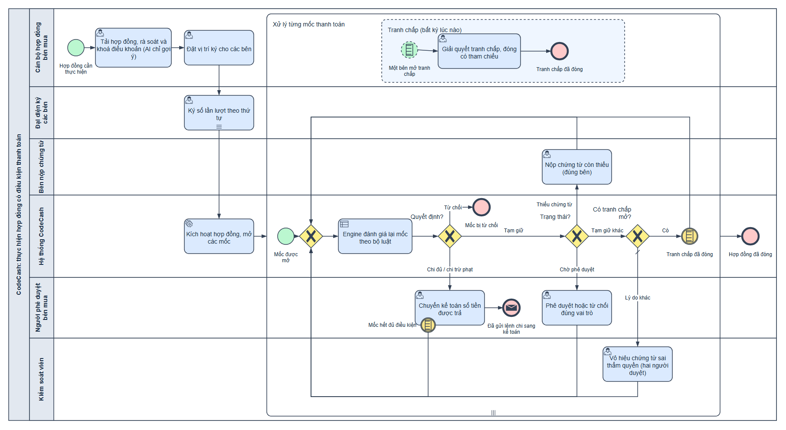

# Luồng tổng thể theo vai trò (BPMN)

Sơ đồ BPMN 2.0 của quy trình thực hiện hợp đồng trên CodeCash, từ lúc có hợp đồng tới khi mọi mốc được chuyển chi hoặc bị từ chối. Đây là bản vẽ lại sơ đồ ở slide "Luồng tổng thể theo vai trò". Căn cứ: [NGHIEP_VU.md](../NGHIEP_VU.md) mục 2 và 4, ma trận quyền `packages/contracts/permissions.json`, các thao tác trong `apps/api/src/workflow.controller.ts`.

| Tệp | Nội dung |
| --- | --- |
| [luong-tong-the-theo-vai-tro.drawio](luong-tong-the-theo-vai-tro.drawio) | Bản đen trắng, chỉnh sửa được bằng draw.io |
| [luong-tong-the-theo-vai-tro_Co_mau.drawio](luong-tong-the-theo-vai-tro_Co_mau.drawio) | Cùng mô hình, cùng bố cục, chỉ khác màu |
| [previews/normal](previews/normal/01-luong-tong-the-theo-vai-tro.png), [previews/color](previews/color/01-luong-tong-the-theo-vai-tro.png) | Ảnh PNG và SVG của hai bản |
| [build_luong_tong_the.py](build_luong_tong_the.py) | Script sinh lại hai tệp `.drawio` |
| [kien-truc-he-thong.md](kien-truc-he-thong.md) | Sơ đồ kiến trúc hệ thống (C4, mức container), giải thích riêng |



## Đọc sơ đồ

**Một pool, sáu làn.** Mọi bên làm việc trên cùng một quy trình do CodeCash điều phối, nên vẽ một pool và chia làn theo vai trò:

- **Cán bộ hợp đồng bên mua:** số hoá và khoá điều khoản, đặt vị trí ký, giải quyết tranh chấp.
- **Đại diện ký các bên:** ký số.
- **Bên nộp chứng từ:** nhà cung cấp, hoặc bên mua với các chứng từ phía mình.
- **Hệ thống CodeCash:** kích hoạt hợp đồng và chạy engine.
- **Người phê duyệt bên mua:** phê duyệt hoặc từ chối mốc. Riêng việc chuyển kế toán chỉ phê duyệt tài chính được làm.
- **Kiểm soát viên:** xử lý ngoại lệ.

Kế toán là hệ thống bên ngoài (trong demo là mô phỏng), nên chỉ xuất hiện qua sự kiện kết thúc gửi thông điệp.

**Phần hợp đồng.** Các bước chạy lần lượt:

1. Tải hợp đồng, rà soát và khoá điều khoản. AI chỉ gợi ý điều khoản; con người xác nhận.
2. Đặt vị trí ký cho các bên.
3. Ký số lần lượt. Dấu ba gạch ngang là đa phiên bản tuần tự: mỗi người ký là một lượt, đúng thứ tự.
4. Hệ thống kích hoạt hợp đồng và mở các mốc.

**Phần mốc.** Tiến trình con "Xử lý từng mốc thanh toán" có dấu ba gạch dọc: mỗi mốc chạy một lượt riêng, song song và độc lập. Điều này khớp với đặc tả mục 4: mỗi mốc được đánh giá độc lập. Trong mỗi lượt:

1. Engine đánh giá lại mốc theo bộ luật. Đây là tác vụ luật nghiệp vụ, chạy lại sau mỗi event mới.
2. Gateway "Quyết định?" chỉ đọc kết quả engine vừa tạo, không tự quyết.
   - **Từ chối:** mốc kết thúc ở "Mốc bị từ chối".
   - **Chi đủ hoặc chi trừ phạt:** người phê duyệt tài chính chuyển kế toán, rồi kết thúc ở "Đã gửi lệnh chi sang kế toán".
   - **Tạm giữ:** đi tiếp tới gateway "Trạng thái?" để biết đang chờ ai:
     - **Thiếu chứng từ:** đúng bên nộp chứng từ còn thiếu.
     - **Chờ phê duyệt:** đúng vai trò phê duyệt hoặc từ chối.
     - **Tạm giữ khác:** đi tới gateway "Có tranh chấp mở?". Có thì chờ sự kiện "Tranh chấp đã đóng". Các lý do còn lại (chứng từ sai thẩm quyền, dữ liệu lỗi) đi theo nhánh mặc định có gạch chéo: hai kiểm soát viên khác nhau xử lý ngoại lệ.
3. Mọi nhánh tạm giữ đều quay về gateway gộp trước bước đánh giá: có event mới thì engine đánh giá lại.

**Tranh chấp.** Tranh chấp có thể mở vào bất kỳ lúc nào trong lượt của mốc. Phần này được vẽ thành tiến trình con sự kiện, khung nét đứt. Sự kiện bắt đầu có vòng nét đứt nghĩa là không ngắt luồng chính. Cán bộ hợp đồng giải quyết tranh chấp bằng một bản đóng có tham chiếu. Engine xét tranh chấp trước mọi luật khác, nên mốc có tranh chấp mở luôn bị tạm giữ.

**Chặn chi khi mốc đổi trạng thái.** Tác vụ "Chuyển kế toán" có sự kiện biên điều kiện, loại ngắt: "Mốc hết đủ điều kiện". Ví dụ, nếu tranh chấp vừa mở thì yêu cầu chuyển chi bị huỷ và mốc quay về đánh giá lại. Điều này khớp với API, vốn từ chối chuyển chi khi quyết định hiện tại không còn là RELEASE hoặc PENALTY (`NOT_PAYABLE`).

**Kết thúc hợp đồng.** Khi mọi lượt mốc đã kết thúc (chuyển chi hoặc từ chối), tiến trình con hoàn tất và hợp đồng chuyển sang trạng thái đã đóng (`CLOSED`, đặc tả mục 4).

## Yêu cầu và phần tử

| Yêu cầu | Căn cứ | Phần tử | Loại |
| --- | --- | --- | --- |
| Cán bộ hợp đồng số hoá điều khoản, đặt vị trí ký | Mục 2.2; `contracts:digitize`, `contracts:signature-slots` | T1, T2 (User Task) | Dữ kiện |
| Ký theo trình tự các bên | `signing:sign`; mục 1 Gold | T3 (đa phiên bản tuần tự) | Dữ kiện |
| Đủ chữ ký thì hợp đồng hiệu lực và mở mốc | Mục 4 | T4 (Service Task) | Dữ kiện |
| Mỗi mốc đánh giá độc lập, sau mỗi event mới | Mục 4 | Tiến trình con đa phiên bản song song, vòng quay về gateway gộp | Dữ kiện |
| Engine quyết định, trình duyệt không quyết định | Mục 1, nguyên tắc 3 | Tác vụ luật nghiệp vụ; các gateway chỉ đọc kết quả | Dữ kiện |
| RELEASE, PENALTY, HOLD, REJECT và các trạng thái chờ | Mục 4 (bảng trạng thái) | Gateway "Quyết định?", "Trạng thái?", "Có tranh chấp mở?" | Dữ kiện |
| Chứng từ do đúng bên nộp | Mục 2.1; `evidence:submit` | Tác vụ "Nộp chứng từ còn thiếu" | Dữ kiện |
| Phê duyệt hoặc từ chối đúng vai trò | Mục 2.1; `approvals:vote` | Tác vụ "Phê duyệt hoặc từ chối" | Dữ kiện |
| Chỉ phê duyệt tài chính được chuyển kế toán | `payments:transfer`; `transferToAccounting` | Tác vụ "Chuyển kế toán" trong làn người phê duyệt | Dữ kiện |
| Kế toán là hệ thống ngoài | Mục 4 (`COMPLETED`); kiến trúc | Sự kiện kết thúc gửi thông điệp | Dữ kiện |
| Tranh chấp mở bất kỳ lúc nào, bên mua đóng | Mục 2.1, 2.2; `disputes:open`, `disputes:resolve` | Tiến trình con sự kiện không ngắt | Dữ kiện |
| Ngoại lệ do hai kiểm soát viên khác nhau xử lý | Mục 2.2, SoD-2 | Tác vụ "Vô hiệu chứng từ sai thẩm quyền" | Dữ kiện |
| Không chi khi mốc hết đủ điều kiện | `NOT_PAYABLE` trong `transferToAccounting` | Sự kiện biên điều kiện, loại ngắt | Suy ra từ code |
| Hợp đồng đóng khi mọi mốc đã chi hoặc bị từ chối | Mục 4 (`CLOSED`) | Sự kiện kết thúc "Hợp đồng đã đóng" | Dữ kiện |

## Kịch bản đã đi qua trên sơ đồ

Đây là đi tay trên đồ thị, không phải chạy mô phỏng bằng engine BPMN.

| Kịch bản | Đường đi | Kết thúc |
| --- | --- | --- |
| Mốc sạch | Mở mốc → đánh giá → Quyết định: chi đủ → chuyển kế toán | Đã gửi lệnh chi |
| Thiếu chứng từ rồi đủ | Đánh giá → Tạm giữ → Thiếu chứng từ → nộp → đánh giá → chi | Đã gửi lệnh chi |
| Cần hai vai trò phê duyệt | Hai lần vòng "Chờ phê duyệt", mỗi lần một vai trò | Đã gửi lệnh chi hoặc bị từ chối |
| Người phê duyệt từ chối | Phê duyệt hoặc từ chối → đánh giá → Quyết định: từ chối | Mốc bị từ chối |
| Tranh chấp mở khi đang chờ chứng từ | Tiến trình con sự kiện chạy song song; lần đánh giá kế tiếp: Tạm giữ khác → Có tranh chấp → chờ "Tranh chấp đã đóng" → đánh giá lại | Tuỳ kết quả sau khi đóng |
| Tranh chấp mở ngay trước lúc chuyển chi | Sự kiện biên ngắt "Chuyển kế toán" → đánh giá lại → tạm giữ | Không chi khi còn tranh chấp |
| Chứng từ do bên không có thẩm quyền tạo | Tạm giữ khác → không có tranh chấp → nhánh mặc định → hai kiểm soát viên vô hiệu → đánh giá lại → thường là thiếu chứng từ | Đúng bên nộp lại |
| Hợp đồng nhiều mốc | Mỗi mốc một lượt song song; tiến trình con chỉ xong khi mọi lượt xong | Hợp đồng đã đóng |

## Giả định và ngoài phạm vi

- **Một pool:** cả bên mua và nhà cung cấp làm việc trên quy trình chung do CodeCash điều phối. Nếu cần nhấn mạnh ranh giới tổ chức, có thể tách nhà cung cấp thành pool riêng và nối bằng luồng thông điệp.
- **Tiến trình con đè qua các làn:** các phần tử bên trong vẫn thuộc làn chứa chúng. Khung được để trong suốt để vẫn thấy ranh giới làn.
- **Lược bớt có chủ ý:**
  - huỷ ký trước khi có chữ ký đầu tiên (hợp đồng trở về bản nháp);
  - nhiều tranh chấp cùng lúc (mỗi tranh chấp là một lượt của tiến trình con sự kiện);
  - chế độ as-of;
  - việc quản trị hệ thống công bố phiên bản luật.
- **Trạng thái sau chuyển chi:** trạng thái `COMPLETED` do kế toán ghi nhận không vẽ, vì nó nằm ở phía hệ thống kế toán.
- **Tranh chấp do ai đóng:** trong ứng dụng, chủ hợp đồng cũng đóng được tranh chấp. Sơ đồ đặt việc này ở làn cán bộ hợp đồng cho gọn.

## Những điểm đã sửa so với sơ đồ cũ trên slide

| Sơ đồ cũ | Vấn đề | Bản mới |
| --- | --- | --- |
| Sự kiện kết thúc vẽ vòng mảnh như sự kiện bắt đầu | Sai ký hiệu: sự kiện kết thúc phải là vòng đậm | Mọi sự kiện kết thúc là vòng đậm; có loại kết thúc gửi thông điệp |
| Một luồng duy nhất cho cả hợp đồng | Hợp đồng có 3 đến 5 mốc chạy độc lập | Tiến trình con đa phiên bản song song |
| Tranh chấp chỉ là một ghi chú | Ghi chú không có ngữ nghĩa thực thi | Tiến trình con sự kiện không ngắt, cùng nhánh chờ tranh chấp đóng |
| Gateway "Đủ điều kiện?" chỉ có ba nhánh | Thiếu từ chối, tranh chấp, sai thẩm quyền: token bị kẹt | Ba gateway đọc quyết định và trạng thái, nhánh mặc định cho lý do khác |
| "Phê duyệt đúng vai trò" chỉ có một kết cục | Người phê duyệt còn có thể từ chối | Tác vụ "Phê duyệt hoặc từ chối", kết quả do engine đọc |
| "Chi đủ hoặc chi sau trừ phạt" nằm ở làn hệ thống, "Chuyển kế toán" ở làn người phê duyệt | Hệ thống không chi tiền; quyết định đã có ở bước đánh giá | Chi đủ hay trừ phạt là nhánh của gateway; chuyển kế toán là việc của phê duyệt tài chính |
| Ký là một tác vụ đơn | Ký nhiều bên theo thứ tự | Tác vụ đa phiên bản tuần tự |
| Các tác vụ không có loại | Không phân biệt người làm và máy làm | User Task, Service Task, tác vụ luật nghiệp vụ |
| Không có pool | Làn không có participant chứa | Pool CodeCash chứa sáu làn |

## Cách vẽ lại và kiểm tra

Sinh lại hai tệp từ script (Python 3.10+):

```bash
python docs/bpmn/build_luong_tong_the.py docs/bpmn/luong-tong-the-theo-vai-tro.drawio
```

Dựng ảnh và kiểm bằng skill `bpmn-drawio` (cần bản draw.io nguồn ở commit `17b367b91dbab91804f852645788d7ffb46dcb79`):

```bash
K=.claude/skills/bpmn-drawio/scripts
python $K/render_drawio.py docs/bpmn/luong-tong-the-theo-vai-tro.drawio --drawio-root DRAWIO --output-dir docs/bpmn/previews/normal --text-mode plain
python $K/render_drawio.py docs/bpmn/luong-tong-the-theo-vai-tro_Co_mau.drawio --drawio-root DRAWIO --output-dir docs/bpmn/previews/color --text-mode plain
python $K/audit_drawio.py docs/bpmn/luong-tong-the-theo-vai-tro.drawio --render-dir docs/bpmn/previews/normal --palette monochrome --report docs/bpmn/previews/check-normal.json
python $K/audit_drawio.py docs/bpmn/luong-tong-the-theo-vai-tro_Co_mau.drawio --render-dir docs/bpmn/previews/color --compare docs/bpmn/luong-tong-the-theo-vai-tro.drawio --palette bizagi-inspired --report docs/bpmn/previews/check-color.json
```

## Kết quả kiểm tra

Mỗi lớp kiểm được ghi riêng.

- **Nghiệp vụ:** đối chiếu bằng tay với đặc tả, ma trận quyền và mã API (bảng ở trên). Chưa có người làm chủ quy trình duyệt; nhóm cần đọc lại.
- **Ký hiệu:** `audit_drawio.py` không báo lỗi, không có phần tử ngoài phạm vi hỗ trợ. Công cụ này chỉ kiểm một số ràng buộc BPMN chọn lọc, không chứng minh sơ đồ chạy đúng.
- **Bảng màu:**
  - bản đen trắng đạt hồ sơ `monochrome`;
  - bản màu đạt hồ sơ `bizagi-inspired`;
  - hai bản giống hệt nhau ngoài màu sắc.
  
  Màu chỉ là quy ước trình bày, không phải yêu cầu của BPMN; mọi sự kiện kết thúc đều đỏ, kể cả kết thúc thành công.
- **Ảnh và bố cục:**
  - kiểm bố cục tự động không còn lỗi nào;
  - đã xem bằng mắt ảnh cả hai bản, phóng to các dấu: vòng nét đứt của sự kiện không ngắt, vòng kép nét liền của sự kiện biên ngắt, phong bì đặc của sự kiện gửi, gạch chéo nhánh mặc định, dấu đa phiên bản tuần tự và song song.
- **Nguồn dựng:**
  - draw.io commit `17b367b91dbab91804f852645788d7ffb46dcb79`, viewer sha256 `15777571ef7c042b2a4a6c6d29052f416fbaaaae5dcf868521c4a3a75f2147d8`;
  - skill `bpmn-drawio` 1.0.0-rc.2;
  - chế độ chữ `plain`, Chrome trên Windows.
