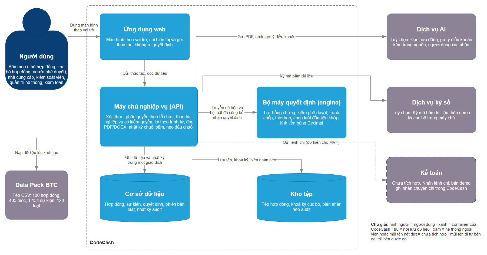

# Kiến trúc hệ thống (C4, mức container)

Đây là bản vẽ lại sơ đồ ở slide "Kiến trúc hệ thống: trình duyệt không ra quyết định", dùng ký hiệu [C4 model](https://c4model.com/) mức container. Căn cứ:

- [06: Kiến trúc monorepo](../06_KIEN_TRUC_MONOREPO_VA_TAI_SU_DUNG.md) mục 3 và 5;
- [07: Triển khai](../07_HUONG_DAN_TRIEN_KHAI.md) mục 1;
- mã trong `apps/api/src`: `domain/engine.ts`, `domain/datapack.ts`, `trust/rules-service.ts`, `trust/signing-provider.ts`, `trust/gemini-extractor.ts`, `trust/anchor-provider.ts`, `domain/actions/payments.ts`.

| Tệp | Nội dung |
| --- | --- |
| [kien-truc-he-thong.drawio](kien-truc-he-thong.drawio) | Bản chỉnh sửa được, dùng hình C4 có sẵn của draw.io |
| [previews/kien-truc](previews/kien-truc/01-kien-truc-he-thong-c4-container.png) | Ảnh PNG và SVG |
| [build_kien_truc.py](build_kien_truc.py) | Script sinh lại tệp `.drawio` |



## Ký hiệu

| Hình | Nghĩa |
| --- | --- |
| Hình người | Người dùng (C4 Person) |
| Khung nét đứt "CodeCash" | Ranh giới hệ thống: mọi thứ bên trong do đội xây và vận hành |
| Hộp xanh | Container: ứng dụng hoặc tiến trình chạy riêng |
| Hình trụ xanh | Container lưu dữ liệu |
| Hộp xám | Hệ thống ngoài |
| Viền hoặc mũi tên nét đứt | Chưa tích hợp, dự kiến cho MVP |
| Mũi tên một chiều | Bên gọi → bên được gọi. Nhãn ghi việc bên gọi làm |

Để slide gọn, ảnh không ghi loại phần tử và công nghệ trong ngoặc vuông như mẫu C4 đầy đủ. Công nghệ thực tế:

- ứng dụng web: React 19, Ant Design, phục vụ bằng nginx;
- máy chủ nghiệp vụ: NestJS trên Node 24;
- bộ máy quyết định: Python, gọi như tiến trình con, nhận dữ liệu dạng CSV;
- cơ sở dữ liệu: MongoDB 7 (replica set);
- kho tệp: volume `/data`;
- dịch vụ AI: hiện là Gemini (`EXTRACTION_PROVIDER=gemini`);
- giao tiếp giữa web, máy chủ và các dịch vụ ngoài: HTTPS, xác thực bằng JWT.

## Đối chiếu với sơ đồ cũ

| Sơ đồ cũ | Thực tế trong mã | Bản mới |
| --- | --- | --- |
| "Bộ luật có phiên bản" là một khối riêng; engine "đọc luật" từ đó | Phiên bản luật lưu trong cơ sở dữ liệu (`rule-versions`, bảng luật). API ghi bộ luật đã công bố ra tệp CSV rồi gọi engine; engine không tự đọc kho nào | Bộ luật nằm trong mô tả của cơ sở dữ liệu; mũi tên API → engine ghi rõ "truyền dữ liệu và bộ luật đã công bố" |
| Data Pack có mũi tên nạp thẳng vào kho dữ liệu | `DomainService.bootstrap()` trong API đọc CSV của Data Pack rồi ghi vào kho | Mũi tên API → Data Pack: "nạp dữ liệu lúc khởi tạo" |
| "Xử lý văn bản" là khối riêng, tự gọi AI | Đọc PDF/DOCX là module trong API (`trust/extraction-service.ts`), chính API gọi dịch vụ AI | Gộp vào API; mũi tên API → dịch vụ AI |
| Mũi tên "gợi ý" hướng từ xử lý văn bản sang AI | Mũi tên phải đi từ bên gọi tới bên được gọi | "Gửi PDF, nhận gợi ý điều khoản" |
| Kế toán nhận "chuyển chi" như một tích hợp đang chạy | `transferToAccounting` chỉ ghi bản ghi chuyển chi trong CodeCash; chưa gọi hệ thống kế toán nào | Kế toán viền nét đứt, mũi tên nét đứt "gửi lệnh chi (dự kiến cho MVP)" |
| Mũi tên hai chiều API ↔ kho dữ liệu | C4 dùng mũi tên một chiều theo bên khởi xướng | API → cơ sở dữ liệu: "ghi dữ liệu và nhật ký trong một giao dịch" |
| Không có nơi lưu tệp | Tệp hợp đồng, khoá ký cục bộ, biên nhận neo audit nằm ở volume `/data` (`DATA_DIR`, `TRUST_DIR`) | Thêm container "Kho tệp" |
| Không có chú giải | C4 yêu cầu chú giải cho mọi ký hiệu | Có chú giải ở góc phải dưới |

Những điểm sơ đồ cũ đã đúng thì vẫn giữ:

- web không ra quyết định;
- engine chạy lại sau mỗi thao tác;
- ký số là dịch vụ ngoài tuỳ chọn, bản demo ký cục bộ;
- AI chỉ gợi ý kèm trang nguồn.

## Chủ động lược bớt

Các phần sau không vẽ để slide gọn:

- Reverse proxy TLS trên máy chủ. Container `web` (nginx) vừa phục vụ trang web vừa chuyển tiếp `/api`.
- LibreOffice dùng để xem trước DOCX. Đây là công cụ cài sẵn trong image API, không phải container riêng.
- Biến `ENGINE_URL`, cho phép chạy engine thành worker HTTP riêng thay vì tiến trình con.
- Bên làm chứng neo audit. Hiện nó dùng khoá cục bộ trên cùng máy chủ, nằm trong kho tệp; xem [NGHIEP_VU.md](../NGHIEP_VU.md) mục 9.

## Cách vẽ lại

```bash
python docs/bpmn/build_kien_truc.py docs/bpmn/kien-truc-he-thong.drawio
python .claude/skills/bpmn-drawio/scripts/render_drawio.py docs/bpmn/kien-truc-he-thong.drawio --drawio-root DRAWIO --output-dir docs/bpmn/previews/kien-truc --text-mode preserve
```

## Kiểm tra

- **Nội dung:** đối chiếu bằng tay với tài liệu 06, tài liệu 07 và mã API (bảng ở trên).
- **Ảnh:** dựng bằng draw.io commit `17b367b91dbab91804f852645788d7ffb46dcb79`, đã xem bằng mắt. Chế độ chữ `preserve` vì nhãn dùng HTML để tách tên và mô tả.
- **Công cụ kiểm tự động:** `audit_drawio.py` của skill chỉ kiểm BPMN nên không áp dụng cho sơ đồ C4 này.
