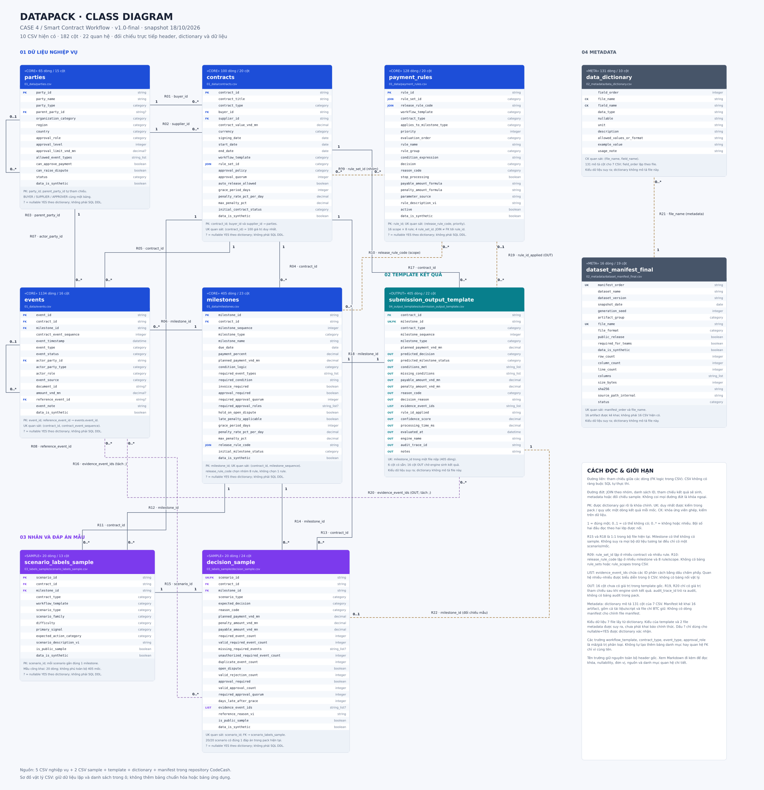

# Class diagram — toàn bộ bảng CSV trong Data Pack

Sơ đồ đối chiếu trực tiếp **10 file CSV hiện có, 182 cột, 22 quan hệ** của Data Pack v1.0-final (snapshot 18/10/2026). Không thêm bảng ứng dụng hoặc bảng danh mục không có trong pack.

[Mở SVG để phóng to](datapack-class-diagram.svg) · [Chỉnh sửa bằng draw.io](datapack-class-diagram.drawio) · [PDF vector](datapack-class-diagram.pdf) · [Ảnh PNG](datapack-class-diagram.png) · [Mermaid source](datapack-class-diagram.mmd) · [Schema và kiểm chứng JSON](datapack-class-diagram.validation.json)



## Phạm vi và ký hiệu

- Đây là mô hình các bản ghi CSV, không phải schema SQL có FK tự thực thi. Giữ nguyên tên bảng, thứ tự cột và trường dữ liệu lặp.
- `PK`: dictionary gọi rõ là primary key. `UK`: tính duy nhất được kiểm trên pack hoặc quy ước một dòng output/mốc. `CK`: thành phần khóa ứng viên ghép, không tuyên bố là PK chính thức.
- `FK`: tham chiếu đến khóa dòng; một số được xác nhận bằng đối chiếu dữ liệu thay vì dictionary khai báo rõ. `JOIN`: nối theo mã nhóm không duy nhất. `LIST`: nhiều ID nằm trong một ô, tách bằng `;`. `OUT`: dữ liệu chờ engine sinh.
- Đường liền: quan hệ tham chiếu dòng. Đường đứt: JOIN nhóm, danh sách, tham chiếu output, liên kết metadata hoặc đối chiếu mẫu.
- `?` chỉ biểu thị `nullable=YES` do dictionary xác nhận. Kiểu và nullability của template/metadata không được dictionary mô tả: kiểu trong sơ đồ là suy ra; số ô trống thực tế không tự trở thành ràng buộc nullable.
- `0..*` là miền tổng quát cho số dòng con; không dùng số dòng quan sát để ép mọi contract luôn có đúng 3–5 milestone hoặc mọi milestone luôn có event. R15/R18 được ghi 1:1 trong các file hiện tại.
- Cardinality quan hệ JOIN và LIST là liên kết giá trị, không ngụ ý có bảng nối vật lý. Các thuộc tính không có hàm/phương thức vì sơ đồ mô tả bảng dữ liệu.

## Các bảng hiện có

| Bảng | Nhóm | Dòng | Cột | Khóa |
|---|---|---:|---:|---|
| [parties.csv](../../BangD-Case4/DataPack-CASE4_SmartContractWorkflow/01_data/parties.csv) | CORE | 65 | 15 | PK: party_id |
| [contracts.csv](../../BangD-Case4/DataPack-CASE4_SmartContractWorkflow/01_data/contracts.csv) | CORE | 100 | 20 | PK: contract_id |
| [payment_rules.csv](../../BangD-Case4/DataPack-CASE4_SmartContractWorkflow/01_data/payment_rules.csv) | CORE | 128 | 20 | PK: rule_id |
| [data_dictionary.csv](../../BangD-Case4/DataPack-CASE4_SmartContractWorkflow/02_metadata/data_dictionary.csv) | META | 131 | 10 | CK quan sát: (file_name, field_name) |
| [dataset_manifest_final.csv](../../BangD-Case4/DataPack-CASE4_SmartContractWorkflow/02_metadata/dataset_manifest_final.csv) | META | 16 | 19 | UK quan sát: manifest_order; file_name |
| [events.csv](../../BangD-Case4/DataPack-CASE4_SmartContractWorkflow/01_data/events.csv) | CORE | 1134 | 16 | PK: event_id |
| [milestones.csv](../../BangD-Case4/DataPack-CASE4_SmartContractWorkflow/01_data/milestones.csv) | CORE | 405 | 23 | PK: milestone_id |
| [submission_output_template.csv](../../BangD-Case4/DataPack-CASE4_SmartContractWorkflow/04_output_templates/submission_output_template.csv) | OUTPUT | 405 | 22 | UK: milestone_id trong một file nộp |
| [scenario_labels_sample.csv](../../BangD-Case4/DataPack-CASE4_SmartContractWorkflow/03_labels_sample/scenario_labels_sample.csv) | SAMPLE | 20 | 13 | PK: scenario_id |
| [decision_sample.csv](../../BangD-Case4/DataPack-CASE4_SmartContractWorkflow/03_labels_sample/decision_sample.csv) | SAMPLE | 20 | 24 | UK quan sát: scenario_id |

## Danh mục quan hệ

| Mã | Lớp A | Bội số A | Lớp B | Bội số B | Loại | Cách nối và điều kiện |
|---|---|---|---|---|---|---|
| R01 | `parties` | 1 | `contracts` | 0..* | FK | contracts.buyer_id → parties.party_id; party_type phải là BUYER. |
| R02 | `parties` | 1 | `contracts` | 0..* | FK | contracts.supplier_id → parties.party_id; party_type phải là SUPPLIER. |
| R03 | `parties` | 0..1 | `parties` | 0..* | FK | parties.parent_party_id → parties.party_id; APPROVER thuộc BUYER; BUYER/SUPPLIER để trống. |
| R04 | `contracts` | 1 | `milestones` | 0..* | FK | milestones.contract_id → contracts.contract_id. Pack này có 3–5 milestone/hợp đồng. |
| R05 | `contracts` | 1 | `events` | 0..* | FK | events.contract_id → contracts.contract_id; phải bằng contract_id của milestone tương ứng. |
| R06 | `milestones` | 1 | `events` | 0..* | FK | events.milestone_id → milestones.milestone_id; không suy ra rằng mỗi milestone luôn có event. |
| R07 | `parties` | 1 | `events` | 0..* | FK | events.actor_party_id → parties.party_id. actor_party_type/actor_role là dữ liệu lặp, không phải FK. |
| R08 | `events` | 0..1 | `events` | 0..* | FK | events.reference_event_id → events.event_id khi có giá trị; 8 tham chiếu trong pack là RESOLVED → OPENED. |
| R09 | `contracts` | 0..* | `payment_rules` | 0..* | JOIN | contracts.rule_set_id = payment_rules.rule_set_id; mỗi rule_set_id có nhiều rule, không phải khóa duy nhất. |
| R10 | `payment_rules` | 0..* | `milestones` | 0..* | JOIN | milestones.release_rule_code = payment_rules.release_rule_code; N:M theo giá trị nhóm; mỗi mốc khớp 8 rule trong pack. |
| R11 | `contracts` | 1 | `scenario_labels_sample` | 0..* | FK | scenario_labels_sample.contract_id → contracts.contract_id; nhất quán với milestone được gắn. |
| R12 | `milestones` | 1 | `scenario_labels_sample` | 0..* | FK | scenario_labels_sample.milestone_id → milestones.milestone_id; hiện 20 mốc có mẫu, mỗi mốc 1 mẫu. |
| R13 | `contracts` | 1 | `decision_sample` | 0..* | FK | decision_sample.contract_id → contracts.contract_id; phải khớp scenario và milestone. |
| R14 | `milestones` | 1 | `decision_sample` | 0..* | FK | decision_sample.milestone_id → milestones.milestone_id; phải khớp scenario_id tương ứng. |
| R15 | `scenario_labels_sample` | 1 | `decision_sample` | 1 | FK | decision_sample.scenario_id → scenario_labels_sample.scenario_id; 1:1 được kiểm trên 20 mẫu hiện tại. |
| R16 | `decision_sample` | 0..* | `events` | 0..* | LIST | Mỗi token trong decision_sample.evidence_event_ids → events.event_id; cùng milestone; không có bảng nối vật lý. |
| R17 | `contracts` | 1 | `submission_output_template` | 0..* | FK | submission_output_template.contract_id → contracts.contract_id; cùng contract với milestone. |
| R18 | `milestones` | 1 | `submission_output_template` | 1 | FK | submission_output_template.milestone_id → milestones.milestone_id; đúng 1 dòng/mốc trong template 405 dòng. |
| R19 | `payment_rules` | 0..1 | `submission_output_template` | 0..* | OUT | Sau khi đánh giá: rule_id_applied → payment_rules.rule_id, rule thắng phải thuộc scope của milestone. Template gốc để trống. |
| R20 | `submission_output_template` | 0..* | `events` | 0..* | LIST | Sau khi sinh kết quả: mỗi token evidence_event_ids → events.event_id, cùng milestone. Template gốc để trống. |
| R21 | `dataset_manifest_final` | 1 | `data_dictionary` | 0..* | META | data_dictionary.file_name = dataset_manifest_final.file_name. Liên kết metadata ở cấp file; không phải FK nghiệp vụ. |
| R22 | `submission_output_template` | 1 | `decision_sample` | 0..1 | COMPARE | Join đối chiếu kết quả theo milestone_id trên 20 mốc có sample; không phải khóa ngoại. Bội số chỉ đúng với pack này. |

## Những điểm cần đọc đúng

1. **Milestone → rule không phải N:1.** `release_rule_code` không duy nhất trong payment_rules: có 16 mã, mỗi mã có 8 dòng. Mỗi milestone chọn một scope rồi engine chạy first-match theo priority. `rule_id_applied` trong output mới chỉ đến một rule thắng cụ thể.
2. **Contract → rule_set là nối nhóm.** Có 4 rule_set_id, mỗi mã có 32 rule trong pack. Không có file rule_sets.csv hoặc rule_scopes.csv. `workflow_template`, `contract_type` và `applies_to_milestone_type` mô tả phạm vi áp dụng; không phải khóa dòng riêng.
3. **Party có quan hệ với chính nó.** 30 APPROVER thuộc 10 BUYER, mỗi BUYER có 3 approver trong pack. 10 BUYER và 25 SUPPLIER không có parent. BUYER/SUPPLIER/APPROVER là giá trị của party_type, không phải ba bảng hay quan hệ kế thừa.
4. **Event có quan hệ với chính nó.** 8 reference_event_id khác rỗng hiện đều nối DISPUTE_RESOLVED đến DISPUTE_OPENED cùng milestone. Một tham chiếu đúng khóa chưa đủ chứng minh resolve hợp lệ; còn cần trạng thái, thời gian và quyền actor.
5. **Contract_id lặp là quan hệ cần kiểm tra.** Event, scenario, decision và output đều chứa cả contract_id và milestone_id. Mã hợp đồng trong từng dòng phải trùng hợp đồng của milestone. Decision còn phải khớp scenario_id về contract, milestone và scenario_type.
6. **Danh sách không phải khóa ngoại vô hướng.** evidence_event_ids chứa nhiều event_id; required_event_types và allowed_event_types chứa mã loại event; required_approval_roles chứa mã vai trò. Không nối mã loại event đến event_id hoặc mã vai trò đến party_id.
7. **Output gốc chưa có quyết định.** 405 dòng chỉ được điền 6 cột đầu. 16 cột còn lại rỗng. Quan hệ rule_id_applied/evidence_event_ids chỉ được điền sau khi sinh kết quả. audit_trace_id không có bảng đích trong datapack; document_id cũng không có documents.csv.
8. **Sample và output là hai vai trò khác nhau.** 20 dòng sample là tham chiếu của BTC; 405 dòng template là chỗ nộp dự đoán. R22 chỉ là phép join đối chiếu theo milestone_id. Không dùng sample làm đầu vào quyết định và không suy ra ground truth cho 385 mốc còn lại.
9. **Metadata mô tả file/cột.** Mỗi dòng dictionary mô tả một cột, mỗi dòng manifest mô tả một artifact. Không nối field_name trực tiếp tới các giá trị PK nghiệp vụ. Dictionary chỉ mô tả 7 CSV (131 cột); không mô tả template, dictionary hoặc manifest.

## Tệp chỉ được kê khai trong manifest

Các CSV dưới đây **không hiện diện** trong repository. Chỉ có danh sách cột/số dòng do manifest cung cấp; chưa thể kiểm chứng khóa, quan hệ hay dữ liệu. Không vẽ chúng như bảng đã có. Script evaluation_script_Case4.py và tài liệu README cũng là artifact, không phải bảng CSV.

| File không có | Dòng khai báo | Cột khai báo | Header do manifest khai báo |
|---|---:|---:|---|
| `decision_ground_truth.csv` | 405 | 31 | contract_id, milestone_id, contract_type, milestone_sequence, milestone_type, release_rule_code, planned_payment_vnd_mn, expected_decision, expected_milestone_status, conditions_met, missing_conditions, payable_amount_vnd_mn, penalty_amount_vnd_mn, reason_code, rule_id_applied, required_event_count, valid_required_event_count, missing_required_events, unauthorized_required_event_count, duplicate_event_count, open_dispute, valid_rejection_count, approval_required, valid_approval_count, required_approval_quorum, days_late_after_grace, actual_completion_timestamp, last_event_timestamp, evidence_event_ids, reference_reason_vi, data_is_synthetic |
| `evaluation_split_Case4.csv` | 405 | 13 | split_record_id, contract_id, milestone_id, contract_type, milestone_sequence, milestone_type, expected_decision, reason_code, evaluation_split, is_public_sample, score_eligible, intended_use, data_is_synthetic |
| `hidden_test_ids_Case4.csv` | 250 | 11 | hidden_test_id, contract_id, milestone_id, contract_type, workflow_template, milestone_sequence, milestone_type, planned_payment_vnd_mn, evaluation_split, ground_truth_included, data_is_synthetic |
| `evaluation_config_Case4.csv` | 10 | 12 | metric_id, metric_name, weight_points, evaluation_scope, required_submission_fields, ground_truth_fields, direction, score_formula, perfect_value, worst_value, missing_value_policy, description_vi |
| `generation_log_Case4.csv` | 32 | 15 | record_id, record_type, artifact_group, artifact_name, path_or_check, file_format, row_count, column_count, line_count, size_bytes, sha256, status, seed, snapshot_date, details |

## Chi tiết toàn bộ 182 cột

Kiểu/nullable/đơn vị của 7 file nghiệp vụ và sample lấy nguyên từ dictionary. Với 3 file còn lại, nguồn được ghi là suy ra. `OUT` trong template vẫn là dữ liệu rỗng tại nguồn; kiểu được suy ra từ ý nghĩa trường và adapter hiện tại.

### parties.csv

Nguồn: `BangD-Case4/DataPack-CASE4_SmartContractWorkflow/01_data/parties.csv`. 65 dòng, 15 cột.

| # | Cột | Kiểu | Nhãn | Nullable chính thức | Ô trống | Đơn vị | Nguồn kiểu | Mô tả / định dạng / ghi chú |
|---:|---|---|---|---|---:|---|---|---|
| 1 | `party_id` | string | PK | NO | 0 |  | dictionary | Mã duy nhất của một bên hoặc vai trò tham gia workflow. Format: Bddd;Sddd;Addd Primary key. |
| 2 | `party_name` | string |  | NO | 0 |  | dictionary | Tên giả lập của tổ chức/vai trò. Dữ liệu giả lập. |
| 3 | `party_type` | category |  | NO | 0 |  | dictionary | Loại bên tham gia. Format: BUYER;SUPPLIER;APPROVER Dùng để kiểm tra quyền tạo event. |
| 4 | `parent_party_id` | string | FK | YES | 35 |  | dictionary | Mã tổ chức mẹ đối với APPROVER. Format: Bddd hoặc blank Blank cho BUYER/SUPPLIER; foreign key tới BUYER đối với APPROVER. |
| 5 | `organization_category` | category |  | NO | 0 |  | dictionary | Nhóm hoạt động/tổ chức. Chủ yếu phục vụ metadata và mở rộng scenario. |
| 6 | `region` | category |  | NO | 0 |  | dictionary | Khu vực giả lập của party. Format: HANOI;HO_CHI_MINH_CITY;DA_NANG;HAI_PHONG;CAN_THO |
| 7 | `country` | category |  | NO | 0 |  | dictionary | Mã quốc gia. Format: VN |
| 8 | `approval_role` | category |  | NO | 0 |  | dictionary | Vai trò phê duyệt. Format: NONE;CONTRACT_OWNER;FINANCE_APPROVER;SECONDARY_APPROVER BUYER/SUPPLIER có giá trị NONE. |
| 9 | `approval_level` | integer |  | NO | 0 | level | dictionary | Cấp phê duyệt tương đối. Format: 0;1;2 0 cho party không phải approver. |
| 10 | `approval_limit_vnd_mn` | decimal |  | YES | 35 | VND_million | dictionary | Hạn mức phê duyệt tham chiếu của approver. Format: >=0 hoặc blank Có thể dùng ở Silver/Gold để kiểm tra approval nâng cao. |
| 11 | `allowed_event_types` | string_list |  | NO | 0 |  | dictionary | Danh sách event type party được phép tạo. Format: semicolon-separated Dùng dấu ';' để phân tách. |
| 12 | `can_approve_payment` | boolean |  | NO | 0 |  | dictionary | Party có quyền tạo approval thanh toán hay không. Format: TRUE;FALSE |
| 13 | `can_raise_dispute` | boolean |  | NO | 0 |  | dictionary | Party có quyền tạo tranh chấp hay không. Format: TRUE;FALSE |
| 14 | `status` | category |  | NO | 0 |  | dictionary | Trạng thái hoạt động của party. Format: ACTIVE |
| 15 | `data_is_synthetic` | boolean |  | NO | 0 |  | dictionary | Cờ xác nhận dữ liệu là giả lập. Format: TRUE |

### contracts.csv

Nguồn: `BangD-Case4/DataPack-CASE4_SmartContractWorkflow/01_data/contracts.csv`. 100 dòng, 20 cột.

| # | Cột | Kiểu | Nhãn | Nullable chính thức | Ô trống | Đơn vị | Nguồn kiểu | Mô tả / định dạng / ghi chú |
|---:|---|---|---|---|---:|---|---|---|
| 1 | `contract_id` | string | PK | NO | 0 |  | dictionary | Mã hợp đồng duy nhất. Format: CTdddd Primary key; join sang milestones.csv và events.csv. |
| 2 | `contract_title` | string |  | NO | 0 |  | dictionary | Tên/mô tả ngắn của hợp đồng giả lập. Chỉ phục vụ hiển thị; không phải tên hợp đồng thực tế. |
| 3 | `contract_type` | category |  | NO | 0 |  | dictionary | Nhóm nghiệp vụ chính của hợp đồng. Format: GOODS_SUPPLY;SERVICES;SOFTWARE_IMPLEMENTATION;MAINTENANCE Quyết định workflow template và cấu trúc milestone. |
| 4 | `buyer_id` | string | FK | NO | 0 |  | dictionary | Mã bên mua/đơn vị đặt hàng. Format: Bddd Foreign key tới parties.csv với party_type=BUYER. |
| 5 | `supplier_id` | string | FK | NO | 0 |  | dictionary | Mã nhà cung cấp. Format: Sddd Foreign key tới parties.csv với party_type=SUPPLIER. |
| 6 | `contract_value_vnd_mn` | decimal |  | NO | 0 | VND_million | dictionary | Tổng giá trị hợp đồng. Format: >=0 Tổng planned_payment_vnd_mn của các milestone phải bằng giá trị này. |
| 7 | `currency` | category |  | NO | 0 |  | dictionary | Đồng tiền của hợp đồng. Format: VND Các trường *_vnd_mn dùng đơn vị triệu VND. |
| 8 | `signing_date` | date |  | NO | 0 |  | dictionary | Ngày ký hợp đồng. Format: YYYY-MM-DD |
| 9 | `start_date` | date |  | NO | 0 |  | dictionary | Ngày bắt đầu thực hiện hợp đồng. Format: YYYY-MM-DD Không sớm hơn signing_date. |
| 10 | `end_date` | date |  | NO | 0 |  | dictionary | Ngày kết thúc theo kế hoạch. Format: YYYY-MM-DD Không sớm hơn start_date. |
| 11 | `workflow_template` | category |  | NO | 0 |  | dictionary | Mẫu workflow áp dụng cho hợp đồng. Format: WF_GOODS_4STAGE;WF_SERVICE_4STAGE;WF_SOFTWARE_5STAGE;WF_MAINTENANCE_3STAGE Dùng để xác định số lượng và loại milestone. |
| 12 | `rule_set_id` | category | JOIN | NO | 0 |  | dictionary | Mã bộ quy tắc thanh toán áp dụng. Format: R_GOODS_STD;R_SERVICE_STD;R_SOFTWARE_STD;R_MAINTENANCE_STD Join logic sang payment_rules.csv. |
| 13 | `approval_policy` | category |  | NO | 0 |  | dictionary | Chính sách phê duyệt thanh toán ở cấp hợp đồng. Format: AUTO_IF_ALL_CONDITIONS;SINGLE_BUYER_APPROVAL;DUAL_APPROVAL;FINANCE_PLUS_OWNER Được cụ thể hóa tại milestone. |
| 14 | `approval_quorum` | integer |  | NO | 0 | count | dictionary | Số phê duyệt hợp lệ tối thiểu khi policy yêu cầu approval. Format: 0;1;2 AUTO_IF_ALL_CONDITIONS có quorum=0. |
| 15 | `auto_release_allowed` | boolean |  | NO | 0 |  | dictionary | Cho biết có được tự động RELEASE khi đủ điều kiện mà không cần approval thủ công hay không. Format: TRUE;FALSE |
| 16 | `grace_period_days` | integer |  | NO | 0 | day | dictionary | Số ngày gia hạn sau due_date trước khi tính phạt chậm. Format: >=0 Được kế thừa vào milestones.csv. |
| 17 | `penalty_rate_pct_per_day` | decimal |  | NO | 0 | percent_per_day | dictionary | Tỷ lệ phạt mỗi ngày trễ sau grace period. Format: >=0 Tính trên planned_payment_vnd_mn của milestone có áp dụng phạt. |
| 18 | `max_penalty_pct` | decimal |  | NO | 0 | percent | dictionary | Trần tỷ lệ phạt tối đa của milestone. Format: >=0 |
| 19 | `initial_contract_status` | category |  | NO | 0 |  | dictionary | Trạng thái khởi tạo của hợp đồng. Format: ACTIVE Trạng thái workflow về sau phải được suy ra từ events/rules, không hard-code. |
| 20 | `data_is_synthetic` | boolean |  | NO | 0 |  | dictionary | Cờ xác nhận dữ liệu là giả lập. Format: TRUE Không đại diện cho hợp đồng/doanh nghiệp thực tế. |

### payment_rules.csv

Nguồn: `BangD-Case4/DataPack-CASE4_SmartContractWorkflow/01_data/payment_rules.csv`. 128 dòng, 20 cột.

| # | Cột | Kiểu | Nhãn | Nullable chính thức | Ô trống | Đơn vị | Nguồn kiểu | Mô tả / định dạng / ghi chú |
|---:|---|---|---|---|---:|---|---|---|
| 1 | `rule_id` | string | PK | NO | 0 |  | dictionary | Mã rule duy nhất. Format: PRdddd Primary key. |
| 2 | `rule_set_id` | category | JOIN | NO | 0 |  | dictionary | Bộ quy tắc chứa rule. Format: R_GOODS_STD;R_SERVICE_STD;R_SOFTWARE_STD;R_MAINTENANCE_STD |
| 3 | `release_rule_code` | string | JOIN | NO | 0 |  | dictionary | Mã rule scope theo milestone type. Format: rule_set_id:milestone_type Join từ milestones.csv. |
| 4 | `workflow_template` | category |  | NO | 0 |  | dictionary | Workflow mà rule áp dụng. Format: WF_* |
| 5 | `contract_type` | category |  | NO | 0 |  | dictionary | Loại hợp đồng mà rule áp dụng. Format: GOODS_SUPPLY;SERVICES;SOFTWARE_IMPLEMENTATION;MAINTENANCE |
| 6 | `applies_to_milestone_type` | category |  | NO | 0 |  | dictionary | Loại milestone mà rule áp dụng. Format: Theo workflow |
| 7 | `priority` | integer |  | NO | 0 | priority | dictionary | Độ ưu tiên đánh giá rule. Format: 10;20;30;40;50;60;70;80 Số nhỏ hơn được đánh giá trước. |
| 8 | `evaluation_order` | category |  | NO | 0 |  | dictionary | Quy ước thứ tự đánh giá. Format: ASCENDING_PRIORITY |
| 9 | `rule_name` | string |  | NO | 0 |  | dictionary | Tên ngắn của rule. |
| 10 | `rule_group` | category |  | NO | 0 |  | dictionary | Nhóm chức năng của rule. Format: BLOCKING;VALIDATION;PENALTY;RELEASE;FALLBACK |
| 11 | `condition_expression` | string |  | NO | 0 |  | dictionary | Biểu thức điều kiện của rule. Format: Simple rule DSL Có thể triển khai bằng Python/JS/low-code; không yêu cầu parser chuyên dụng. |
| 12 | `decision` | category |  | NO | 0 |  | dictionary | Quyết định khi rule khớp. Format: RELEASE;HOLD;REJECT;PENALTY |
| 13 | `reason_code` | category |  | NO | 0 |  | dictionary | Mã nguyên nhân chuẩn hóa. Format: OPEN_DISPUTE;REJECTION_PRESENT;UNAUTHORIZED_EVENT;MISSING_REQUIRED_EVENT;APPROVAL_QUORUM_NOT_MET;LATE_COMPLETION;ALL_CONDITIONS_MET;UNRESOLVED_CONDITION |
| 14 | `stop_processing` | boolean |  | NO | 0 |  | dictionary | Dừng đánh giá các rule phía sau khi rule khớp. Format: TRUE Rule engine dùng first-match theo priority. |
| 15 | `payable_amount_formula` | string |  | NO | 0 |  | dictionary | Công thức tính số tiền được phép thanh toán. Format: Rule expression Đơn vị kết quả: VND_million. |
| 16 | `penalty_amount_formula` | string |  | NO | 0 |  | dictionary | Công thức tính tiền phạt. Format: Rule expression Đơn vị kết quả: VND_million. |
| 17 | `parameter_source` | string |  | NO | 0 |  | dictionary | Nguồn trường dữ liệu cần cho rule. Format: file:field list Hỗ trợ traceability. |
| 18 | `rule_description_vi` | string |  | NO | 0 |  | dictionary | Mô tả rule bằng tiếng Việt. |
| 19 | `active` | boolean |  | NO | 0 |  | dictionary | Rule đang được kích hoạt. Format: TRUE |
| 20 | `data_is_synthetic` | boolean |  | NO | 0 |  | dictionary | Cờ dữ liệu giả lập. Format: TRUE |

### data_dictionary.csv

Nguồn: `BangD-Case4/DataPack-CASE4_SmartContractWorkflow/02_metadata/data_dictionary.csv`. 131 dòng, 10 cột.

| # | Cột | Kiểu | Nhãn | Nullable chính thức | Ô trống | Đơn vị | Nguồn kiểu | Mô tả / định dạng / ghi chú |
|---:|---|---|---|---|---:|---|---|---|
| 1 | `field_order` | integer |  | Không khai báo | 0 |  | inferred |  |
| 2 | `file_name` | string | CK | Không khai báo | 0 |  | inferred |  |
| 3 | `field_name` | string | CK | Không khai báo | 0 |  | inferred |  |
| 4 | `data_type` | string |  | Không khai báo | 0 |  | inferred |  |
| 5 | `nullable` | string |  | Không khai báo | 0 |  | inferred |  |
| 6 | `unit` | string |  | Không khai báo | 103 |  | inferred |  |
| 7 | `description` | string |  | Không khai báo | 0 |  | inferred |  |
| 8 | `allowed_values_or_format` | string |  | Không khai báo | 11 |  | inferred |  |
| 9 | `example_value` | string |  | Không khai báo | 0 |  | inferred |  |
| 10 | `usage_note` | string |  | Không khai báo | 67 |  | inferred |  |

### dataset_manifest_final.csv

Nguồn: `BangD-Case4/DataPack-CASE4_SmartContractWorkflow/02_metadata/dataset_manifest_final.csv`. 16 dòng, 19 cột.

| # | Cột | Kiểu | Nhãn | Nullable chính thức | Ô trống | Đơn vị | Nguồn kiểu | Mô tả / định dạng / ghi chú |
|---:|---|---|---|---|---:|---|---|---|
| 1 | `manifest_order` | string | UK | Không khai báo | 0 |  | inferred |  |
| 2 | `dataset_name` | string |  | Không khai báo | 0 |  | inferred |  |
| 3 | `dataset_version` | string |  | Không khai báo | 0 |  | inferred |  |
| 4 | `snapshot_date` | date |  | Không khai báo | 0 |  | inferred |  |
| 5 | `generation_seed` | integer |  | Không khai báo | 0 |  | inferred |  |
| 6 | `artifact_group` | category |  | Không khai báo | 0 |  | inferred |  |
| 7 | `file_name` | string | UK | Không khai báo | 0 |  | inferred |  |
| 8 | `file_format` | category |  | Không khai báo | 0 |  | inferred |  |
| 9 | `public_release` | boolean |  | Không khai báo | 0 |  | inferred |  |
| 10 | `required_for_teams` | boolean |  | Không khai báo | 0 |  | inferred |  |
| 11 | `data_is_synthetic` | boolean |  | Không khai báo | 0 |  | inferred |  |
| 12 | `row_count` | integer |  | Không khai báo | 2 |  | inferred |  |
| 13 | `column_count` | integer |  | Không khai báo | 2 |  | inferred |  |
| 14 | `line_count` | integer |  | Không khai báo | 14 |  | inferred |  |
| 15 | `columns` | string_list |  | Không khai báo | 2 |  | inferred |  |
| 16 | `size_bytes` | integer |  | Không khai báo | 0 |  | inferred |  |
| 17 | `sha256` | string |  | Không khai báo | 0 |  | inferred |  |
| 18 | `source_path_internal` | string |  | Không khai báo | 0 |  | inferred |  |
| 19 | `status` | category |  | Không khai báo | 0 |  | inferred |  |

### events.csv

Nguồn: `BangD-Case4/DataPack-CASE4_SmartContractWorkflow/01_data/events.csv`. 1134 dòng, 16 cột.

| # | Cột | Kiểu | Nhãn | Nullable chính thức | Ô trống | Đơn vị | Nguồn kiểu | Mô tả / định dạng / ghi chú |
|---:|---|---|---|---|---:|---|---|---|
| 1 | `event_id` | string | PK | NO | 0 |  | dictionary | Mã event duy nhất. Format: EVddddd Primary key. |
| 2 | `contract_id` | string | FK | NO | 0 |  | dictionary | Hợp đồng liên quan. Format: CTdddd Foreign key tới contracts.csv. |
| 3 | `milestone_id` | string | FK | NO | 0 |  | dictionary | Milestone liên quan. Format: MSdddd Foreign key tới milestones.csv. |
| 4 | `contract_event_sequence` | integer |  | NO | 0 | sequence | dictionary | Thứ tự event trong hợp đồng sau khi sắp theo thời gian. Format: 1..N Liên tục theo contract_id. |
| 5 | `event_timestamp` | datetime |  | NO | 0 |  | dictionary | Thời điểm phát sinh event. Format: YYYY-MM-DDTHH:MM:SS |
| 6 | `event_type` | category |  | NO | 0 |  | dictionary | Loại sự kiện workflow. Format: CONTRACT_SIGNED;DELIVERY;INVOICE;ACCEPTANCE;APPROVAL;REJECTION;DISPUTE_OPENED;DISPUTE_RESOLVED;REQUIREMENTS_APPROVED;UAT_PASSED;GO_LIVE;KICKOFF_CONFIRMED;WARRANTY_COMPLETED;SERVICE_ACTIVATED;SERVICE_COMPLETED Một số event có thể xuất hiện lặp; cần xử lý duplicate. |
| 7 | `event_status` | category |  | NO | 0 |  | dictionary | Trạng thái của event. Format: CONFIRMED;APPROVED;REJECTED;OPEN;RESOLVED |
| 8 | `actor_party_id` | string | FK | NO | 0 |  | dictionary | Party tạo/xác nhận event. Format: Bddd;Sddd;Addd Foreign key tới parties.csv. |
| 9 | `actor_party_type` | category |  | NO | 0 |  | dictionary | Loại party của actor. Format: BUYER;SUPPLIER;APPROVER Dùng kiểm tra quyền của required event. |
| 10 | `actor_role` | category |  | NO | 0 |  | dictionary | Vai trò của actor tại thời điểm event. Format: BUYER;SUPPLIER;CONTRACT_OWNER;FINANCE_APPROVER;SECONDARY_APPROVER |
| 11 | `event_source` | category |  | NO | 0 |  | dictionary | Kênh sinh event. Format: PORTAL;API;WORKFLOW_ENGINE;MANUAL_ENTRY |
| 12 | `document_id` | string |  | YES | 0 |  | dictionary | Mã chứng từ/tài liệu gắn với event. Có thể dùng kết hợp event_type để phát hiện duplicate. |
| 13 | `amount_vnd_mn` | decimal |  | YES | 491 | VND_million | dictionary | Số tiền gắn với event khi phù hợp, ví dụ invoice/approval. Format: >=0 hoặc blank |
| 14 | `reference_event_id` | string | FK | YES | 1126 |  | dictionary | Event được tham chiếu, ví dụ dispute resolved tham chiếu dispute opened. Format: EVddddd hoặc blank Self-reference trong events.csv. |
| 15 | `event_note` | string |  | NO | 0 |  | dictionary | Mô tả ngắn của event. |
| 16 | `data_is_synthetic` | boolean |  | NO | 0 |  | dictionary | Cờ dữ liệu giả lập. Format: TRUE |

### milestones.csv

Nguồn: `BangD-Case4/DataPack-CASE4_SmartContractWorkflow/01_data/milestones.csv`. 405 dòng, 23 cột.

| # | Cột | Kiểu | Nhãn | Nullable chính thức | Ô trống | Đơn vị | Nguồn kiểu | Mô tả / định dạng / ghi chú |
|---:|---|---|---|---|---:|---|---|---|
| 1 | `milestone_id` | string | PK | NO | 0 |  | dictionary | Mã milestone duy nhất. Format: MSdddd Primary key. |
| 2 | `contract_id` | string | FK | NO | 0 |  | dictionary | Hợp đồng chứa milestone. Format: CTdddd Foreign key tới contracts.csv. |
| 3 | `milestone_sequence` | integer |  | NO | 0 | sequence | dictionary | Thứ tự milestone trong hợp đồng. Format: 1..N Tăng dần trong mỗi contract_id. |
| 4 | `milestone_type` | category |  | NO | 0 |  | dictionary | Loại milestone nghiệp vụ. Format: Theo workflow_template Ví dụ SIGNING, DELIVERY, ACCEPTANCE, UAT_PASS... |
| 5 | `milestone_name` | string |  | NO | 0 |  | dictionary | Tên hiển thị của milestone. |
| 6 | `due_date` | date |  | NO | 0 |  | dictionary | Hạn hoàn thành milestone. Format: YYYY-MM-DD Nằm trong khoảng start_date..end_date của hợp đồng. |
| 7 | `payment_percent` | decimal |  | NO | 0 | percent | dictionary | Tỷ lệ giá trị hợp đồng gắn với milestone. Format: 0..100 Tổng theo contract_id = 100%. |
| 8 | `planned_payment_vnd_mn` | decimal |  | NO | 0 | VND_million | dictionary | Giá trị thanh toán kế hoạch của milestone. Format: >=0 Tổng theo hợp đồng = contract_value_vnd_mn. |
| 9 | `condition_logic` | category |  | NO | 0 |  | dictionary | Cách kết hợp các điều kiện bắt buộc. Format: ALL ALL nghĩa là tất cả điều kiện phải hợp lệ. |
| 10 | `required_event_types` | string_list |  | NO | 0 |  | dictionary | Danh sách loại event bắt buộc. Format: semicolon-separated Mỗi loại cần ít nhất một event hợp lệ sau khử trùng lặp. |
| 11 | `required_condition` | string |  | NO | 0 |  | dictionary | Biểu thức mô tả tổng hợp điều kiện release. Format: Human-readable DSL Phục vụ minh họa; rule chính thức nằm trong payment_rules.csv. |
| 12 | `invoice_required` | boolean |  | NO | 0 |  | dictionary | Milestone có yêu cầu hóa đơn hay không. Format: TRUE;FALSE |
| 13 | `approval_required` | boolean |  | NO | 0 |  | dictionary | Milestone có yêu cầu approval thủ công hay không. Format: TRUE;FALSE |
| 14 | `required_approval_quorum` | integer |  | NO | 0 | count | dictionary | Số approval hợp lệ tối thiểu. Format: >=0 |
| 15 | `required_approval_roles` | string_list |  | YES | 66 |  | dictionary | Các vai trò được chấp nhận để đạt quorum. Format: semicolon-separated hoặc blank Blank khi approval_required=FALSE. |
| 16 | `hold_on_open_dispute` | boolean |  | NO | 0 |  | dictionary | Có HOLD thanh toán khi có dispute đang mở hay không. Format: TRUE |
| 17 | `late_penalty_applicable` | boolean |  | NO | 0 |  | dictionary | Milestone có áp dụng phạt chậm hay không. Format: TRUE;FALSE |
| 18 | `grace_period_days` | integer |  | NO | 0 | day | dictionary | Số ngày grace sau due_date. Format: >=0 |
| 19 | `penalty_rate_pct_per_day` | decimal |  | NO | 0 | percent_per_day | dictionary | Tỷ lệ phạt mỗi ngày sau grace period. Format: >=0 0 khi milestone không áp dụng phạt. |
| 20 | `max_penalty_pct` | decimal |  | NO | 0 | percent | dictionary | Trần tỷ lệ phạt. Format: >=0 |
| 21 | `release_rule_code` | string | JOIN | NO | 0 |  | dictionary | Mã rule áp dụng cho đúng loại milestone. Format: rule_set_id:milestone_type Join sang payment_rules.csv. |
| 22 | `initial_milestone_status` | category |  | NO | 0 |  | dictionary | Trạng thái khởi tạo. Format: PLANNED |
| 23 | `data_is_synthetic` | boolean |  | NO | 0 |  | dictionary | Cờ dữ liệu giả lập. Format: TRUE |

### submission_output_template.csv

Nguồn: `BangD-Case4/DataPack-CASE4_SmartContractWorkflow/04_output_templates/submission_output_template.csv`. 405 dòng, 22 cột.

| # | Cột | Kiểu | Nhãn | Nullable chính thức | Ô trống | Đơn vị | Nguồn kiểu | Mô tả / định dạng / ghi chú |
|---:|---|---|---|---|---:|---|---|---|
| 1 | `contract_id` | string | FK | Không khai báo | 0 |  | inferred |  |
| 2 | `milestone_id` | string | UK/FK | Không khai báo | 0 |  | inferred |  |
| 3 | `contract_type` | category |  | Không khai báo | 0 |  | inferred |  |
| 4 | `milestone_sequence` | integer |  | Không khai báo | 0 |  | inferred |  |
| 5 | `milestone_type` | category |  | Không khai báo | 0 |  | inferred |  |
| 6 | `planned_payment_vnd_mn` | decimal |  | Không khai báo | 0 |  | inferred |  |
| 7 | `predicted_decision` | category | OUT | Không khai báo | 405 |  | inferred |  |
| 8 | `predicted_milestone_status` | category | OUT | Không khai báo | 405 |  | inferred |  |
| 9 | `conditions_met` | string_list | OUT | Không khai báo | 405 |  | inferred |  |
| 10 | `missing_conditions` | string_list | OUT | Không khai báo | 405 |  | inferred |  |
| 11 | `payable_amount_vnd_mn` | decimal | OUT | Không khai báo | 405 |  | inferred |  |
| 12 | `penalty_amount_vnd_mn` | decimal | OUT | Không khai báo | 405 |  | inferred |  |
| 13 | `reason_code` | category | OUT | Không khai báo | 405 |  | inferred |  |
| 14 | `decision_reason` | string | OUT | Không khai báo | 405 |  | inferred |  |
| 15 | `evidence_event_ids` | string_list | LIST | Không khai báo | 405 |  | inferred |  |
| 16 | `rule_id_applied` | string | OUT | Không khai báo | 405 |  | inferred |  |
| 17 | `confidence_score` | decimal | OUT | Không khai báo | 405 |  | inferred |  |
| 18 | `processing_time_ms` | decimal | OUT | Không khai báo | 405 |  | inferred |  |
| 19 | `evaluated_at` | datetime | OUT | Không khai báo | 405 |  | inferred |  |
| 20 | `engine_name` | string | OUT | Không khai báo | 405 |  | inferred |  |
| 21 | `audit_trace_id` | string | OUT | Không khai báo | 405 |  | inferred |  |
| 22 | `notes` | string | OUT | Không khai báo | 405 |  | inferred |  |

### scenario_labels_sample.csv

Nguồn: `BangD-Case4/DataPack-CASE4_SmartContractWorkflow/03_labels_sample/scenario_labels_sample.csv`. 20 dòng, 13 cột.

| # | Cột | Kiểu | Nhãn | Nullable chính thức | Ô trống | Đơn vị | Nguồn kiểu | Mô tả / định dạng / ghi chú |
|---:|---|---|---|---|---:|---|---|---|
| 1 | `scenario_id` | string | PK | NO | 0 |  | dictionary | Mã scenario mẫu công khai. Format: SCddd Primary key của bộ sample. |
| 2 | `contract_id` | string | FK | NO | 0 |  | dictionary | Hợp đồng của scenario. Format: CTdddd Foreign key tới contracts.csv. |
| 3 | `milestone_id` | string | FK | NO | 0 |  | dictionary | Milestone đại diện cho scenario. Format: MSdddd Foreign key tới milestones.csv. |
| 4 | `contract_type` | category |  | NO | 0 |  | dictionary | Loại hợp đồng. Format: GOODS_SUPPLY;SERVICES;SOFTWARE_IMPLEMENTATION;MAINTENANCE |
| 5 | `workflow_template` | category |  | NO | 0 |  | dictionary | Workflow áp dụng. Format: WF_* |
| 6 | `scenario_type` | category |  | NO | 0 |  | dictionary | Loại tình huống mẫu. Format: CLEAN_RELEASE;LATE_PENALTY;OPEN_DISPUTE_HOLD;RESOLVED_DISPUTE_RELEASE;MISSING_EVENT_HOLD;APPROVAL_PENDING_HOLD;REJECTION;UNAUTHORIZED_EVENT_HOLD;DUPLICATE_EVENT_RELEASE Chỉ là một phần nhãn công khai; không dùng để suy ra toàn bộ ground truth. |
| 7 | `scenario_family` | category |  | NO | 0 |  | dictionary | Nhóm nghiệp vụ cấp cao của scenario. Format: NORMAL_FLOW;DELAY;DISPUTE;MISSING_EVIDENCE;APPROVAL;REJECTION;AUTHORIZATION;DATA_QUALITY |
| 8 | `difficulty` | category |  | NO | 0 |  | dictionary | Mức độ scenario mẫu. Format: EASY;MEDIUM;HARD |
| 9 | `primary_signal` | category |  | NO | 0 |  | dictionary | Tín hiệu chính cần nhận diện. |
| 10 | `expected_action_category` | category |  | NO | 0 |  | dictionary | Nhóm quyết định tham chiếu. Format: RELEASE;HOLD;REJECT;PENALTY |
| 11 | `scenario_description_vi` | string |  | NO | 0 |  | dictionary | Mô tả scenario bằng tiếng Việt. |
| 12 | `is_public_sample` | boolean |  | NO | 0 |  | dictionary | Đánh dấu đây là nhãn mẫu công khai. Format: TRUE |
| 13 | `data_is_synthetic` | boolean |  | NO | 0 |  | dictionary | Cờ dữ liệu giả lập. Format: TRUE |

### decision_sample.csv

Nguồn: `BangD-Case4/DataPack-CASE4_SmartContractWorkflow/03_labels_sample/decision_sample.csv`. 20 dòng, 24 cột.

| # | Cột | Kiểu | Nhãn | Nullable chính thức | Ô trống | Đơn vị | Nguồn kiểu | Mô tả / định dạng / ghi chú |
|---:|---|---|---|---|---:|---|---|---|
| 1 | `scenario_id` | string | UK/FK | NO | 0 |  | dictionary | Mã scenario mẫu. Format: SCddd Join với scenario_labels_sample.csv. |
| 2 | `contract_id` | string | FK | NO | 0 |  | dictionary | Mã hợp đồng. Format: CTdddd |
| 3 | `milestone_id` | string | FK | NO | 0 |  | dictionary | Mã milestone được đánh giá. Format: MSdddd |
| 4 | `scenario_type` | category |  | NO | 0 |  | dictionary | Loại scenario. Format: Xem scenario_labels_sample.csv |
| 5 | `expected_decision` | category |  | NO | 0 |  | dictionary | Quyết định ground truth mẫu. Format: RELEASE;HOLD;REJECT;PENALTY |
| 6 | `reason_code` | category |  | NO | 0 |  | dictionary | Mã nguyên nhân của quyết định. Format: ALL_CONDITIONS_MET;LATE_COMPLETION;OPEN_DISPUTE;MISSING_REQUIRED_EVENT;APPROVAL_QUORUM_NOT_MET;REJECTION_PRESENT;UNAUTHORIZED_EVENT |
| 7 | `planned_payment_vnd_mn` | decimal |  | NO | 0 | VND_million | dictionary | Giá trị thanh toán kế hoạch của milestone. Format: >=0 |
| 8 | `penalty_amount_vnd_mn` | decimal |  | NO | 0 | VND_million | dictionary | Tiền phạt tham chiếu. Format: >=0 Bằng 0 nếu quyết định không phải PENALTY. |
| 9 | `payable_amount_vnd_mn` | decimal |  | NO | 0 | VND_million | dictionary | Số tiền đủ điều kiện thanh toán theo rule. Format: >=0 RELEASE: bằng planned; HOLD/REJECT: 0; PENALTY: planned - penalty. |
| 10 | `required_event_count` | integer |  | NO | 0 | count | dictionary | Số loại required event của milestone. Format: >=1 |
| 11 | `valid_required_event_count` | integer |  | NO | 0 | count | dictionary | Số required event hợp lệ sau kiểm tra quyền và khử trùng lặp. Format: 0..required_event_count |
| 12 | `missing_required_events` | string_list |  | YES | 16 |  | dictionary | Danh sách required event còn thiếu. Format: semicolon-separated hoặc blank |
| 13 | `unauthorized_required_event_count` | integer |  | NO | 0 | count | dictionary | Số required event do party không có thẩm quyền tạo. Format: >=0 |
| 14 | `duplicate_event_count` | integer |  | NO | 0 | count | dictionary | Số event lặp được phát hiện theo event_type/document/actor. Format: >=0 |
| 15 | `open_dispute` | boolean |  | NO | 0 |  | dictionary | Có dispute chưa được resolve tại thời điểm đánh giá hay không. Format: TRUE;FALSE |
| 16 | `valid_rejection_count` | integer |  | NO | 0 | count | dictionary | Số rejection hợp lệ. Format: >=0 |
| 17 | `approval_required` | boolean |  | NO | 0 |  | dictionary | Milestone có yêu cầu approval hay không. Format: TRUE;FALSE |
| 18 | `valid_approval_count` | integer |  | NO | 0 | count | dictionary | Số approval hợp lệ, khác actor và đúng role. Format: >=0 |
| 19 | `required_approval_quorum` | integer |  | NO | 0 | count | dictionary | Quorum approval cần đạt. Format: >=0 |
| 20 | `days_late_after_grace` | integer |  | NO | 0 | day | dictionary | Số ngày trễ vượt quá grace period. Format: >=0 |
| 21 | `evidence_event_ids` | string_list | LIST | YES | 0 |  | dictionary | Danh sách event_id được dùng làm bằng chứng cho quyết định mẫu. Format: semicolon-separated Phục vụ traceability. |
| 22 | `reference_reason_vi` | string |  | NO | 0 |  | dictionary | Giải thích tham chiếu bằng tiếng Việt. |
| 23 | `is_public_sample` | boolean |  | NO | 0 |  | dictionary | Đánh dấu dữ liệu mẫu công khai. Format: TRUE |
| 24 | `data_is_synthetic` | boolean |  | NO | 0 |  | dictionary | Cờ dữ liệu giả lập. Format: TRUE |

## Mermaid class diagram

Các class là 10 CSV thực tế. Mermaid hiển thị kiểu cơ bản; nhãn khóa nằm trong note/comment và bảng chi tiết. Dấu ?/nullable được đọc ở SVG và bảng cột để tránh phụ thuộc parser Mermaid.

```mermaid
classDiagram
direction TB
%% All 10 present CSVs; no invented tables.
%% PK = dictionary; UK/CK = verified candidate keys; ? = dictionary nullable YES.
%% Solid = row reference. Dashed = group join / list / generated output / metadata / comparison.
class parties {
  <<CORE>>
  %% PK
  +string party_id
  +string party_name
  +category party_type
  %% FK
  +string parent_party_id
  +category organization_category
  +category region
  +category country
  +category approval_role
  +integer approval_level
  +decimal approval_limit_vnd_mn
  +string_list allowed_event_types
  +boolean can_approve_payment
  +boolean can_raise_dispute
  +category status
  +boolean data_is_synthetic
}
note for parties "65 rows / 15 columns<br/>PK: party_id; parent_party_id tự tham chiếu.<br/>BUYER / SUPPLIER / APPROVER cùng một bảng."
class contracts {
  <<CORE>>
  %% PK
  +string contract_id
  +string contract_title
  +category contract_type
  %% FK
  +string buyer_id
  %% FK
  +string supplier_id
  +decimal contract_value_vnd_mn
  +category currency
  +date signing_date
  +date start_date
  +date end_date
  +category workflow_template
  %% JOIN
  +category rule_set_id
  +category approval_policy
  +integer approval_quorum
  +boolean auto_release_allowed
  +integer grace_period_days
  +decimal penalty_rate_pct_per_day
  +decimal max_penalty_pct
  +category initial_contract_status
  +boolean data_is_synthetic
}
note for contracts "100 rows / 20 columns<br/>PK: contract_id; buyer_id và supplier_id → parties.<br/>UK quan sát: (contract_id) = 100 giá trị duy nhất."
class payment_rules {
  <<CORE>>
  %% PK
  +string rule_id
  %% JOIN
  +category rule_set_id
  %% JOIN
  +string release_rule_code
  +category workflow_template
  +category contract_type
  +category applies_to_milestone_type
  +integer priority
  +category evaluation_order
  +string rule_name
  +category rule_group
  +string condition_expression
  +category decision
  +category reason_code
  +boolean stop_processing
  +string payable_amount_formula
  +string penalty_amount_formula
  +string parameter_source
  +string rule_description_vi
  +boolean active
  +boolean data_is_synthetic
}
note for payment_rules "128 rows / 20 columns<br/>PK: rule_id; UK quan sát: (release_rule_code, priority).<br/>16 scope × 8 rule; 4 rule_set_id. JOIN ≠ FK tới rule_id."
class data_dictionary {
  <<META>>
  +integer field_order
  %% CK
  +string file_name
  %% CK
  +string field_name
  +string data_type
  +string nullable
  +string unit
  +string description
  +string allowed_values_or_format
  +string example_value
  +string usage_note
}
note for data_dictionary "131 rows / 10 columns<br/>CK quan sát: (file_name, field_name).<br/>131 mô tả cột cho 7 CSV; field_order lặp theo file."
class dataset_manifest_final {
  <<META>>
  %% UK
  +string manifest_order
  +string dataset_name
  +string dataset_version
  +date snapshot_date
  +integer generation_seed
  +category artifact_group
  %% UK
  +string file_name
  +category file_format
  +boolean public_release
  +boolean required_for_teams
  +boolean data_is_synthetic
  +integer row_count
  +integer column_count
  +integer line_count
  +string_list columns
  +integer size_bytes
  +string sha256
  +string source_path_internal
  +category status
}
note for dataset_manifest_final "16 rows / 19 columns<br/>UK quan sát: manifest_order và file_name.<br/>16 artifact được kê khai; không phải 16 CSV hiện có."
class events {
  <<CORE>>
  %% PK
  +string event_id
  %% FK
  +string contract_id
  %% FK
  +string milestone_id
  +integer contract_event_sequence
  +datetime event_timestamp
  +category event_type
  +category event_status
  %% FK
  +string actor_party_id
  +category actor_party_type
  +category actor_role
  +category event_source
  +string document_id
  +decimal amount_vnd_mn
  %% FK
  +string reference_event_id
  +string event_note
  +boolean data_is_synthetic
}
note for events "1134 rows / 16 columns<br/>PK: event_id; reference_event_id → events.event_id.<br/>UK quan sát: (contract_id, contract_event_sequence)."
class milestones {
  <<CORE>>
  %% PK
  +string milestone_id
  %% FK
  +string contract_id
  +integer milestone_sequence
  +category milestone_type
  +string milestone_name
  +date due_date
  +decimal payment_percent
  +decimal planned_payment_vnd_mn
  +category condition_logic
  +string_list required_event_types
  +string required_condition
  +boolean invoice_required
  +boolean approval_required
  +integer required_approval_quorum
  +string_list required_approval_roles
  +boolean hold_on_open_dispute
  +boolean late_penalty_applicable
  +integer grace_period_days
  +decimal penalty_rate_pct_per_day
  +decimal max_penalty_pct
  %% JOIN
  +string release_rule_code
  +category initial_milestone_status
  +boolean data_is_synthetic
}
note for milestones "405 rows / 23 columns<br/>PK: milestone_id; UK quan sát: (contract_id, milestone_sequence).<br/>release_rule_code chọn nhóm 8 rule, không chọn 1 rule."
class submission_output_template {
  <<OUTPUT>>
  %% FK
  +string contract_id
  %% UK/FK
  +string milestone_id
  +category contract_type
  +integer milestone_sequence
  +category milestone_type
  +decimal planned_payment_vnd_mn
  %% OUT
  +category predicted_decision
  %% OUT
  +category predicted_milestone_status
  %% OUT
  +string_list conditions_met
  %% OUT
  +string_list missing_conditions
  %% OUT
  +decimal payable_amount_vnd_mn
  %% OUT
  +decimal penalty_amount_vnd_mn
  %% OUT
  +category reason_code
  %% OUT
  +string decision_reason
  %% LIST
  +string_list evidence_event_ids
  %% OUT
  +string rule_id_applied
  %% OUT
  +decimal confidence_score
  %% OUT
  +decimal processing_time_ms
  %% OUT
  +datetime evaluated_at
  %% OUT
  +string engine_name
  %% OUT
  +string audit_trace_id
  %% OUT
  +string notes
}
note for submission_output_template "405 rows / 22 columns<br/>UK: milestone_id trong một file nộp (405 dòng).<br/>6 cột có sẵn; 16 cột OUT chờ engine sinh kết quả."
class scenario_labels_sample {
  <<SAMPLE>>
  %% PK
  +string scenario_id
  %% FK
  +string contract_id
  %% FK
  +string milestone_id
  +category contract_type
  +category workflow_template
  +category scenario_type
  +category scenario_family
  +category difficulty
  +category primary_signal
  +category expected_action_category
  +string scenario_description_vi
  +boolean is_public_sample
  +boolean data_is_synthetic
}
note for scenario_labels_sample "20 rows / 13 columns<br/>PK: scenario_id; mỗi scenario gắn đúng 1 milestone.<br/>Mẫu công khai: 20 dòng; không phủ toàn bộ 405 mốc."
class decision_sample {
  <<SAMPLE>>
  %% UK/FK
  +string scenario_id
  %% FK
  +string contract_id
  %% FK
  +string milestone_id
  +category scenario_type
  +category expected_decision
  +category reason_code
  +decimal planned_payment_vnd_mn
  +decimal penalty_amount_vnd_mn
  +decimal payable_amount_vnd_mn
  +integer required_event_count
  +integer valid_required_event_count
  +string_list missing_required_events
  +integer unauthorized_required_event_count
  +integer duplicate_event_count
  +boolean open_dispute
  +integer valid_rejection_count
  +boolean approval_required
  +integer valid_approval_count
  +integer required_approval_quorum
  +integer days_late_after_grace
  %% LIST
  +string_list evidence_event_ids
  +string reference_reason_vi
  +boolean is_public_sample
  +boolean data_is_synthetic
}
note for decision_sample "20 rows / 24 columns<br/>UK quan sát: scenario_id; FK → scenario_labels_sample.<br/>20/20 scenario có đúng 1 đáp án trong pack hiện tại."
parties "1" -- "0..*" contracts : R01 buyer_id
parties "1" -- "0..*" contracts : R02 supplier_id
parties "0..1" -- "0..*" parties : R03 parent_party_id
contracts "1" -- "0..*" milestones : R04 contract_id
contracts "1" -- "0..*" events : R05 contract_id
milestones "1" -- "0..*" events : R06 milestone_id
parties "1" -- "0..*" events : R07 actor_party_id
events "0..1" -- "0..*" events : R08 reference_event_id
contracts "0..*" .. "0..*" payment_rules : R09 rule_set_id (nhóm)
payment_rules "0..*" .. "0..*" milestones : R10 release_rule_code (scope)
contracts "1" -- "0..*" scenario_labels_sample : R11 contract_id
milestones "1" -- "0..*" scenario_labels_sample : R12 milestone_id
contracts "1" -- "0..*" decision_sample : R13 contract_id
milestones "1" -- "0..*" decision_sample : R14 milestone_id
scenario_labels_sample "1" -- "1" decision_sample : R15 scenario_id
decision_sample "0..*" .. "0..*" events : R16 evidence_event_ids (tách ;)
contracts "1" -- "0..*" submission_output_template : R17 contract_id
milestones "1" -- "1" submission_output_template : R18 milestone_id
payment_rules "0..1" .. "0..*" submission_output_template : R19 rule_id_applied (OUT)
submission_output_template "0..*" .. "0..*" events : R20 evidence_event_ids (OUT; tách ;)
dataset_manifest_final "1" .. "0..*" data_dictionary : R21 file_name (metadata)
submission_output_template "1" .. "0..1" decision_sample : R22 milestone_id (đối chiếu mẫu)
```

## Kiểm chứng và tái lập

Đã chạy 65 kiểm tra trực tiếp trên nguồn: đủ bảng/cột, dictionary/header, khóa duy nhất, tham chiếu, contract/milestone/scenario nhất quán, evidence cùng mốc, scope 8 rule và template đủ 405 mốc. Tất cả đạt. Không đánh giá hoặc suy đoán dữ liệu nội bộ chưa được cung cấp.

```bash
python3 tools/generate_datapack_class_diagram.py
```

Script sinh lại Markdown, Mermaid, SVG, draw.io và JSON kiểm chứng. SVG giữ text/vector để phóng to; draw.io chỉnh sửa từng lớp, trường và đường nối. File JSON ghi SHA-256 thực tế của từng CSV để xác định đúng nguồn. Các giá trị nullable của dictionary là khai báo; các kiểm tra quan hệ là kết quả quan sát trên pack hiện tại.
