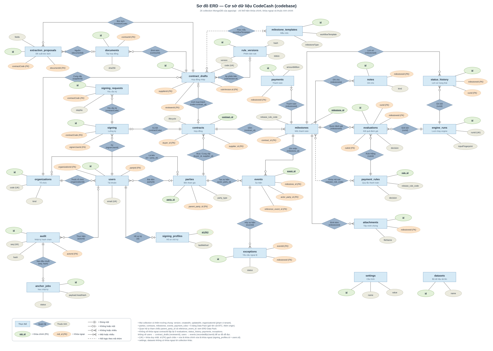

# ERD — Cơ sở dữ liệu của CodeCash (codebase)

ERD cho **26 collection** mà API lưu trữ, lấy từ [repository.ts](../../apps/api/src/common/repository.ts) (danh sách collection + unique index), [records.ts](../../apps/api/src/domain/records.ts), [types.ts](../../apps/api/src/domain/types.ts), [trust/types.ts](../../apps/api/src/trust/types.ts) và [resources.json](../../packages/contracts/resources.json).

[Mở SVG để phóng to](erd-codebase.svg) · [Chỉnh sửa bằng draw.io](erd-codebase.drawio) · [Ảnh PNG](erd-codebase.png) · [Script sinh sơ đồ](src/)

Ký hiệu Chen: hình chữ nhật = thực thể, hình thoi = quan hệ (ghi khóa nối), ellipse = thuộc tính. Ellipse xanh gạch chân = khóa chính (PK), ellipse cam viền đứt = khóa ngoại (FK); đầu đường kiểu crow's foot thể hiện bội số; đường đứt = nối logic theo mã nhóm.

- Lưu trữ: MongoDB (`STORAGE_DRIVER=mongo`) hoặc file `.data/records.json` khi dev. Không có FK vật lý; mọi quan hệ là tham chiếu theo giá trị, được kiểm trong handler của API.
- Tên entity dùng `_` thay cho `-` của tên collection (`payment_rules` = `payment-rules`, `contract_drafts` = `contract-drafts`, …).
- **Mọi** bản ghi có các trường chung `RecordEntity`: `id` (unique index), `version` (optimistic lock), `createdAt`, `updatedAt`, `organizationId?` (phạm vi tenant). Sơ đồ chỉ ghi lại `id` và các trường nghiệp vụ chính.
- 5 bảng Data Pack giữ nguyên tên cột của BTC (xem [erd-datapack-01_data.md](erd-datapack-01_data.md)), thêm `origin` = `DATA_PACK | SEED | APP`; dòng `DATA_PACK` được niêm phong hash khi import.

## Ghi chú

- **Liên kết với Data Pack:** `parties`, `contracts`, `milestones`, `events`, `payment_rules` là 5 bảng của BTC, import nguyên cột rồi bổ sung bản ghi `SEED`/`APP`. Tổ chức BUYER/SUPPLIER trong `organizations` dùng chung mã với `party_id`; tài khoản approver gắn với party qua `users.partyId`.
- **Engine:** mỗi lần chạy sinh một `engine_runs`; mỗi mốc có `evaluations` (quyết định + bằng chứng) và một dòng `status_history` khi trạng thái đổi. `evaluations.ruleId` trỏ về `payment_rules.rule_id`, `evaluations.evidence` là danh sách `event_id`.
- **Bất biến:** `audit` chỉ ghi thêm (append-only), được niêm phong hash chain trong `Repository.transact`; `audit.recordId` + `resource` trỏ tới bản ghi của bất kỳ collection nào. `anchor_jobs` neo đầu chuỗi (`seq`, `hash`) ra ngoài.
- **JSON nhúng:** `signing.steps`, `contract_drafts.signers`, `rule_versions.rules/templates` là mảng nhúng, không phải collection riêng.
- `datasets` là bộ Data Pack do người dùng tải lên để chạy engine độc lập, không nối với các bảng workflow.
