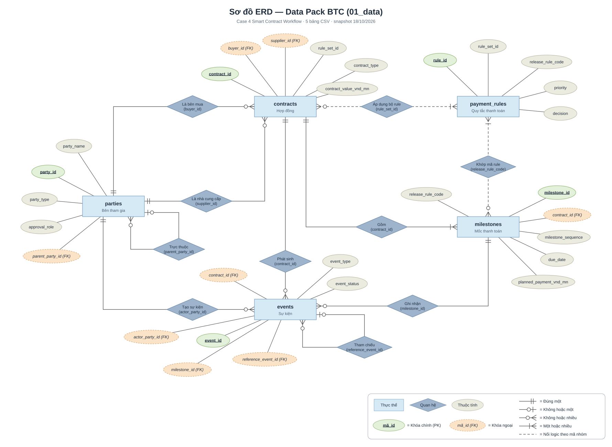

# ERD — Data Pack BTC (`01_data`)

ERD cho **5 bảng dữ liệu gốc** trong [01_data](../../BangD-Case4/DataPack-CASE4_SmartContractWorkflow/01_data/) (Data Pack v1.0-final, snapshot 18/10/2026). Kiểu, nullable và khóa lấy từ [data_dictionary.csv](../../BangD-Case4/DataPack-CASE4_SmartContractWorkflow/02_metadata/data_dictionary.csv). Sơ đồ đầy đủ cả metadata/sample/template xem [datapack-class-diagram.md](datapack-class-diagram.md).

[Mở SVG để phóng to](erd-datapack-01_data.svg) · [Chỉnh sửa bằng draw.io](erd-datapack-01_data.drawio) · [Ảnh PNG](erd-datapack-01_data.png) · [Script sinh sơ đồ](src/)

Ký hiệu Chen: hình chữ nhật = thực thể, hình thoi = quan hệ (ghi khóa nối), ellipse = thuộc tính. Ellipse xanh gạch chân = khóa chính (PK), ellipse cam viền đứt = khóa ngoại (FK); đầu đường kiểu crow's foot thể hiện bội số; đường đứt = nối logic theo mã nhóm.

| Bảng | Dòng | Cột | PK |
|---|---:|---:|---|
| `parties` | 65 | 15 | `party_id` |
| `contracts` | 100 | 20 | `contract_id` |
| `milestones` | 405 | 23 | `milestone_id` |
| `events` | 1134 | 16 | `event_id` |
| `payment_rules` | 128 | 20 | `rule_id` |

## Ghi chú

- Đây là các file CSV, không có FK tự thực thi; quan hệ là tham chiếu logic theo README §5 và data dictionary.
- Đường liền: FK tới khóa dòng. Đường đứt: JOIN theo mã nhóm (`rule_set_id`, `release_rule_code`) — một mốc khớp với nhiều rule, rule thắng chọn theo `priority` tăng dần.
- `events.contract_id` phải trùng `contract_id` của milestone tương ứng (dữ liệu dư thừa có chủ đích).
- `events.actor_party_type` / `actor_role` chỉ là bản chép; kiểm quyền phải tra `parties` theo `actor_party_id`.
- Các cột `*_vnd_mn` là triệu VND; các cột `*_pct*` là giá trị phần trăm (0.10 = 0,10%).
